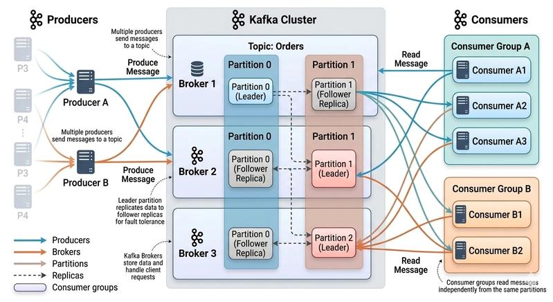

### When we needed the Kafka

Lets say we have app of the uber eats, so when delivery partner starts riding, then we need to show its position to the customer and store the location in the DB, every second delivery partner emits its location which we have to store in the DB, lets say we have million delivery partner riding at same time, means 1 million db updated needed to be done every second. we know that DB are low throughput, so there will be kafka comes as saviour. it just store the 1 million request at the second and make sigle query updation in the DB so there is no crash of DB.

Apache Kafka is a distributed event streaming platform used to transfer, store, and process data between multiple applications or services in real time.

**In simple words:**Kafka acts as a middleman between different applications so they can communicate without depending directly on each other.

Kafka is designed for distributed high throughput systems.

DB like Postgresql has low throughput, while kafka has high throughput

Since throughput of kafa is very high then why don't we use it as DB, the issue is that storage of kafka is low

In kafka, we have the `topic` inside it we have created the partition. We have the `producer` and the `consumer`.

Kafka is both the pub/sub and queue. We can use the consumer group to act like both

We run the server of kafka in local, we pull the image of kafka and run it

In node js, using the kafka we use the library kafka js

**Why is Kafka so fast?**
A. Sequential disk writes
B. Partitions (Parallel Processing)

