### What is node js
- Node is neither a language nor a framework
- It is a runtime environment for executing JS code on the server side
- JS is high level language while express is its framework
- Node.js is a JavaScript runtime environment built on Chrome's **V8 engine**.
- It allows JavaScript to run outside the browser, making it a powerful tool for various applications beyond web development.


### Architecture Diagram
```
┌──────────────────────────────┐
│           NODE.JS            │
│                              │
│    ┌────────────────────┐    │
│    │     V8 Engine      │    │
│    └────────────────────┘    │
│                              │
│    ┌────────────────────┐    │
│    │ Node APIs & Modules│    │
│    └────────────────────┘    │
│                              │
└──────────────────────────────┘
```

### How Node.js is a runtime environment on the server side, what is V8

- Browsers execute the JS on the clinet and similarly node js executes on the server side
- V8 is the JS engine

- **Runtime Environment:** Primarily focuses on providing the necessary infrastructure for **code execution**, including services like memory management and I/O operations. eg Node js

- **Framework:** Primarily focuses on **simplifying the development process** by offering a structured set of tools, libraries, and best practices. eg express js

## What are the 7 Main Features of Node.js?

1. **Single Threaded**
2. **Asynchronous**
3. **Event-Driven**
4. **V8 JavaScript Engine**
5. **Cross-Platform**
6. **NPM (Node Package Manager)**
7. **Real-Time Capabilities**

###  Node.js Code Conversion: High-Level code to Machine Code

### Module Export & Requirements.
We all know that keeping all the Node.js code in a single file is not good practice, right? We need multiple files to create a large project , so in this chapter, we will explore how we can create those file and import concepts like modules and export requirements. lets start

These two files, **app.js and xyz.js**, have different code that is not related to each other, so in NodeJS we call them separate modules.

**Q: How do you make two modules work together?**
-using a require function

**Q: What is the required function?**
In Node.js, the require() function is a built-in function that allows you to include or require other modules into your main modules.

Since in node js we can only provide the single entry file, so we need to use second file in first file then we use the require function, 

```js
// in xyz.js
console.log("Reached at the sum module")

function calculateSum(a, b) {
    const sum = a + b;
    console.log(sum);
}

```

```js
// in app.js
require('./xyz');
console.log('Hello World');
var a = 10;
var b = 20;
calculateSum(a, b);
```

In console we see

```
Reached at the sum module
Hello World

and error which calculateSum is not defined
```

### Big question is how we console "Reached at the sum module" but the function error why ?

- Modules protects their variables and fucntion to leak
- so when we used the require then it runs the file but prevent the variable and function from leak, to use it then we need to export it

```js
// in xyz.js
console.log("Reached at the sum module")

function calculateSum(a, b) {
    const sum = a + b;
    console.log(sum);
}

module.export = calculateSum
```

```js
// in app.js
const calculateSum = require('./xyz');
console.log('Hello World');
var a = 10;
var b = 20;
calculateSum(a, b);
```

- module is the built-in
- The importing module is of two type `CommonJS modules (CJS) and ES modules (ESM)`.

###  CommonJS Modules (CJS) vs ES Modules (ESM)
```
| CommonJS Modules (CJS) | ES Modules (ESM) |
|------------------------|------------------|
| `module.exports`, `require()` | `import`, `export` |
| By default used in Node.js (traditionally) | Commonly used in frameworks like React and Angular |
| Older module system | Modern module system |
| Synchronous loading | Supports asynchronous module loading |
| Non-strict mode by default | Strict mode by default |
| File extension: `.cjs` | File extension: `.mjs` |
```

Note: Modern Node.js supports both CommonJS and ES Modules. ESM is not always asynchronous—static imports are resolved and evaluated through the module loading process, while `import()` supports dynamic asynchronous loading.

In node, CJS is default, if we want to use the ESM then we need to pas `type: module` in package.json


# `require` Mechanism in Node.js

The `require()` function in Node.js is used to import **CommonJS modules**.

Here's a detailed five-step mechanism of how `require()` works:

### 1. Resolve
Node.js determines the full path of the module.

- First, it checks whether the module is a built-in module (like `fs` or `path`).
- If not, it checks relative or absolute file paths when specified.
- For package imports, it searches `node_modules` directories.

### 2. Load
Node.js loads the module based on its resolved filename and format.

- JavaScript files are loaded as CommonJS modules when applicable.
- JSON files are parsed into JavaScript objects.
- Native addons (`.node`) are loaded through the native module loader.

### 3. Wrap
Node.js wraps CommonJS module code inside a function to provide **module-level scope**.

The wrapper function looks like this:

~~~javascript
(function (exports, require, module, __filename, __dirname) {
    // Module code
});
~~~

This prevents variables declared inside a module from becoming global variables.

### 4. Compile
Node.js uses the **V8 engine** to compile JavaScript code for execution.

- V8 parses and compiles JavaScript.
- V8 uses Just-In-Time (JIT) compilation to optimize execution.

### 5. Execute
The module code is executed inside the wrapper function.

- The module's code runs.
- `module.exports` contains the exported values.
- Node.js caches the module after loading, so subsequent `require()` calls normally reuse the cached exports.

---

## Example

**myModule.js**

~~~javascript
function publicFunction() {
    console.log("This is a public function");
}

module.exports = {
    publicFunction
};
~~~

**index.js**

~~~javascript
const myModule = require('./myModule');

myModule.publicFunction();

// Output: This is a public function
~~~

In this example, `require('./myModule')` goes through the five-step mechanism to load and execute `myModule.js`.

---

## Important Interview Points

- `require()` is part of the **CommonJS module system**.
- CommonJS `require()` normally loads modules **synchronously**.
- Every CommonJS module has its own scope because of the module wrapper.
- Modules are **cached** after their first successful load.
- Requiring the same resolved module again usually returns the cached `module.exports` without executing the module again.
- `module.exports` defines what is returned by `require()`.

### Interview Question: What happens when we require the same module multiple times?

~~~javascript
// counter.js
console.log("Module loaded");

module.exports = {
    count: 10
};
~~~

~~~javascript
// index.js
const first = require('./counter');
const second = require('./counter');

console.log(first === second);

// Output:
// Module loaded
// true
~~~

**Explanation:**

Node.js executes `counter.js` only once because the module is cached after the first successful `require()`.

The second `require()` returns the cached exported object rather than executing the module again.


### LIBUV

Wikipedia page - Node.js has an event-driven architecture capable of asynchronous I/O.

JavaScript itself is synchronous, but with the power of Node.js, it can handle asynchronous operations, allowing JavaScript to perform multiple tasks concurrently.


Since JS is sync in nature, if any long or blocking task comes which can cause the performance issue. So the longer time consuming task is operated in async mode. Below is the diagram, basically all the async task were handled by the LIBUV library which is written in c, then we can say node is async in nature.


Line form node official website - A Node.js app runs in a single process, without creating a new thread for every request. Node.js provides a set of asynchronous I/O primitives in its standard library that prevent JavaScript code from blocking. In addition, libraries in Node.js are generally written using non-blocking paradigms. Accordingly, blocking behavior is the exception rather than the norm in Node.js.

Node is async I/O due to libuv

### V8 engine

# V8 JavaScript Engine: Code Execution Phases

## 1. Parsing Stage
- **Lexical Analysis:** V8 reads the JavaScript code and breaks it down into tokens, which are small chunks like keywords, operators, and identifiers.
- **Syntax Analysis:** The tokens are then arranged into a structure called an Abstract Syntax Tree (AST), which represents the code's structure and logic.

## 2. Ignition (Interpreter)
- **Bytecode Generation:** V8 converts the AST into bytecode, a simpler, intermediate form of the code that’s easier to run.
- **Execution:** The Ignition interpreter runs this bytecode directly, allowing the code to start executing quickly, but not yet fully optimized.

## 3. Profiling
- **Hotspot Detection:** As the code runs, V8 watches for parts of the code that are used a lot, called "hot" functions. It gathers data on these parts to decide if they should be optimized.

## 4. TurboFan (Optimizing Compiler)
- **Optimization:** For the frequently used "hot" code, V8 uses the TurboFan compiler to turn the bytecode into highly optimized machine code, making it run much faster.
- **Deoptimization:** If the assumptions used to optimize the code turn out to be wrong (like a variable type changing), V8 can revert the code back to a slower, but safer, execution mode.

## 5. Garbage Collection
- **Memory Management:** V8 regularly cleans up memory by removing data that the program no longer needs, making sure that memory usage stays efficient.

## 6. Final Execution
- **Execution:** The optimized code continues to run efficiently until the program finishes or until changes in the code require adjustments.

This step-by-step process ensures that JavaScript code is executed as quickly and efficiently as possible.
"""


### Below is more detailed structiure of node


### Below is the event loop diagram


**Note: Event loop lies inside the libuv libraray**


**Note: when there is nothing in callstack and event queue, then event loop wait at polls**

**nextTick and promises cycles runs before each time ie timers,poll,check,close**


1  **Timers Phase:** In this phase, all callbacks that were set using  `setTimeout` or `setInterval` are executed. These timers are checked, and if their time has expired, their corresponding callbacks are added to the callback queue for execution.

2  **Poll Phase:** After timers, the event loop enters the Poll phase, which is crucial because it handles I/O callbacks. For instance, when you perform a file read operation using `fs.readFile` , the callback associated with this I/O operation will be executed in this phase. The Poll phase is responsible for handling all I/Orelated tasks, making it one of the most important phases in the event loop.

3  **Check Phase:** Next is the Check phase, where callbacks scheduled by the `setImmediate` function are executed. This utility API allows you to execute callbacks immediately after the Poll phase, giving you more control over the order of operations.

4  **Close Callbacks Phase:** Finally, in the Close Callbacks phase, any callbacks associated with closing operations, such as socket closures, are handled. This phase is typically used for cleanup tasks, ensuring that resources are properly released.


- *Event Loop Cycle with `process.nextTick()` and `Promises`*

### One More Important Note
*When the event loop is empty and there are no more tasks to execute, it enters the `poll phase` and essentially waits for incoming events*

# Thread pool in libuv

Whenever there's an asynchronous task, V8 offloads it to libuv. For example, when reading a file, libuv uses one of the threads in its thread pool. The file system (fs) call is assigned to a thread in the pool, and that thread makes a request to the OS. While the file is being read, the thread in the pool is fully occupied and cannot perform any other tasks. Once the file reading is complete, the engaged thread is freed up and becomes available for other operations. For instance, if you're performing a cryptographic operation like hashing, it will be assigned to another thread. There are certain functions for which libuv uses the thread pool.

` In Node.js, the default size of the thread pool is 4 threads:`
```
    UV_THREADPOOL_SIZE=4
```


### Q - Is node js single thread or multi thread
- So answer is if the operation is sync in nature then it is single thread, if it is async in nature then it is multi thread beacuse async task is handled by libuv, and in libuv has thread pool ie 4 in count, so each task gets occupied by single thread in libuv which performs the task like fs. and keeps separate the main thread from blocking.

Below is the examle that thread pool size is 4 in libuv

```js
const fs = require("fs");
const crypto = require("crypto")

process.env.UV_THREADPOOL_SIZE = 5;

// fs.readFile("./file.txt", "utf-8", (err, data) => {
//     console.log(data);
// })
//The 4 keys will generate first and after that remaining one will be generated after some time because nodejs has only 4 threads at a time 
crypto.pbkdf2("Akshad", "salt", 500000, 10, "sha512", (err, key) => {
    console.log("1st key generated below:")
    console.log(key);
})
crypto.pbkdf2("Akshad", "salt", 500000, 10, "sha512", (err, key) => {
    console.log("2 nd key generated below:")
    console.log(key);
})
crypto.pbkdf2("Akshad", "salt", 500000, 10, "sha512", (err, key) => {
    console.log("3 nd key generated below:")
    console.log(key);
})
crypto.pbkdf2("Akshad", "salt", 500000, 10, "sha512", (err, key) => {
    console.log("4 nd key generated below:")
    console.log(key);
})
crypto.pbkdf2("Akshad", "salt", 500000, 10, "sha512", (err, key) => {
    console.log("5 nd key generated below:")
    console.log(key);
})
```

If you run above code then you see that 4 logs at a single time and 5th logs after some time. This is because 4 thread block by 4 task. then anyone task which completes then it unblocks the thraed and 5th task handed to that thread.

## Q: Suppose you have a server with many incoming requests, and users are hitting APIs. Do these APIs use the thread pool?
 A : No.

 In the libuv library, when it interacts with the OS for networking tasks, it uses sockets. Networking operations occur through these sockets. Each socket has a socket descriptor, also known as a file descriptor (although this has nothing to do with the file system). 
 
 When an incoming request arrives on a socket, and you want to write data to this connection, it involves blocking operations. To handle this, a thread is created for each request. However, creating a separate thread for each connection is not practical, especially when dealing with thousands of requests.
 
  Instead, the system uses efficient mechanisms provided by the OS, such as `epoll` (on Linux) or `kqueue` on macOS. These mechanisms handle multiple file descriptors (sockets) without needing a thread per connection:

  Here How it works:
  - `epoll` (**Linux**) and `kqueue` (**macOS**) are notification mechanisms used to manage many connections efficiently.
  -  When you create an `epoll` or `kqueue` descriptor, it monitors multiple file descriptors (sockets) for activity.
  -  The OS kernel manages these mechanisms and notifies libuv of any changes or activity on the sockets.
  -  This approach allows the server to handle a large number of connections efficiently without creating a thread for each one.

  The kernel-level mechanisms, like epoll and kqueue , provide a scalable way to manage multiple connections, significantly improving performance and resource utilization in a high-concurrency environment.

## Important points to follow:

 1 **DON'T BLOCK THE MAIN THREAD**
 - Don't use `sync` methods
 - Don't do operations on `heavy JSON Object` it will make load on main thread.
 - Avoid complex `Regular Expression`.
 - Avoid `Complex calculations` and big or `infine loops`.


### route exception case

```js
app.get("/ab?c", ()=>{})
```

Here means route will work for /abc, /ac also ie b is optional


```js
app.get("/ab+c", ()=>{})
```

Here measn route will work for /abc,/abbbc also. b can be of any count

```js
app.get("/ab*cd", ()=>{})
```

Here measn it will work for abcd, also what ever you will write between ab and cd.

### Instaed of making functions in the utils, We can also make function in the model or schema file. So the function related to that schema to be available in the file.


### How does Node.js handle child threads? or simply worker threads

visit video - https://www.youtube.com/watch?v=JTl6tQ4bqYA

While Node.js operates off a `single main thread`, it can harness the full power of multi-core systems by launching child threads for specific tasks, such as file compression or image processing

**Thread Pool and Worker Threads**
To manage these child threads, Node.js uses a combination of:

- A `thread pool`, powered by the libuv library.
- `Worker threads` for dedicated, offloaded computation.

```js
// index.js

const express = require("express");
const { Worker } = require("worker_threads");

const app = express();
const port = process.env.PORT || 3000;

app.get("/non-blocking", (req, res) => {
    res.status(200).send("This page is non-blocking.");
});

app.get("/blocking", (req, res) => {
    const worker = new Worker("./worker.js");

    worker.on("message", (data) => {
        res.status(200).send(`Result is ${data}`);
    });

    worker.on("error", (err) => {
        res.status(400).send(`An Error occured : ${err}`);
    });
});

app.listen(port, () => {
    console.log(`App listening on port ${port}`);
});
```

```js
// worker.js

const { parentPort } = require("worker_threads");

let result = 0;
for (let i = 0; i < 10000000000; i++) {
    result++;
}

parentPort.postMessage(result);
```

### Describe the event-driven programming in Node.js.

`Event-driven programming`, a hallmark of Node.js, uses an `event, listener, and emitter` architecture to handle asynchronous tasks. This design centers around events and how they trigger actions in the attached listeners.

Core Components
- **Event Emitter**: Acts as the event registry and dispatcher, letting objects register interest in particular events and emit these events when they occur.

- **Event Handler (Listener)**: Associates with a particular event through registration. These callback functions will be asynchronously carried out when a matching event is emitted.

**Code Example: Event Emitter and Handlers**

Here is the Node.js code:

```js
const { EventEmitter } = require('events');
const emitter = new EventEmitter();

emitter.on('event-name', (eventArgs) => {
    console.log(`Event-name was emitted with arguments: ${eventArgs}`);
});

emitter.emit('event-name', 'Some Payload');
```

In this code, when `emit` is called, the `on` method’s callback is executed asynchronously.

**Event Loop Mechanism in Node.js**
- **Call Stack**: Maintains the call order of the functions and methods being executed.
- **Node APIs and Callbacks Queue**: Handle I/O tasks and timers.
- **Event Loop**: Constantly watches the execution stack and checks whether it’s clear to execute pending tasks from the Callback Queue.

Practical Applications in Node.js
- **HTTP Server**: Listens for and serves requests.
- **File System Operations**: Execute I/O tasks.
- **Database Operations**: Such as data retrieval.

### Core Modules in node .js

- os: Provides system-related utility functions. Example: os.freemem(), os.totalmem().
- util: General utility functions primarily used for debugging. Example: util.inspect().
- fs: Offers extensive file system capabilities. Commonly used methods include fs.readFile() and fs.writeFile().
- http/https: Implements web server and client. Example: http.createServer().
- net: Facilitates low-level networking tasks. Example: net.createServer().
- dgram: Delivers UDP Datagram Socket support for messaging.
- crypto: Encompasses cryptographic operations. Common methods include crypto.createHash() and crypto.createHmac().
- **zlib**: Offers data compression capabilities integrated with various modules like http.
- stream: Facilitates event-based data stream processing.
- path: Aids in file path string manipulation.
- url: Parses and formats URL strings, especially beneficial in web applications and server operations.

### What are streams in Node.js and what types are available? 

video - https://www.youtube.com/watch?v=64LJJhT6Ybo

`Node.js` utilizes `streams` for efficient handling of input/output data, offering two main varieties: readable and writable.

Categories of Streams
- `Standard Streams`: Represent standard input, output, and error. These are instances of Readable or Writable streams.
- `Duplex Streams`: Facilitate both reading and writing. They can be connected to processes or handling pipelines.
- `Transform Streams`: A special type that acts as an intermediary, modifying the data as it passes through.

Practical Implementations
- `HTTP Transactions`: HTTP clients use readable and writable streams for sending requests and receiving responses. HTTP servers also apply these streams for similar actions in the opposite direction.
- `File System`: Reading and writing files in Node.js utilizes these streams. For instance, the fs.createReadStream() method generates a readable stream whereas fs.createWriteStream() creates a writable one.


### How do you read and write files in Node.js?

```js
import { readFile, writeFile, appendFile } from 'node:fs/promises';

try {
  // Write a file (creates it or overwrites existing contents).
  await writeFile('example.txt', 'Hello, Node.js!\n', 'utf8');

  // Read the file as text.
  const contents = await readFile('example.txt', 'utf8');
  console.log(contents);

  // Add text without overwriting.
  await appendFile('example.txt', 'Another line.\n', 'utf8');
} catch (error) {
  console.error('File operation failed:', error.message);
}
```

### How do you use the EventEmitter in Node.js?

Node.js’s built-in `EventEmitter` lets you register listeners for named events and trigger them with data.

```js
import { EventEmitter } from 'node:events';

const emitter = new EventEmitter();

// Listen for an event.
function greet(name) {
  console.log(`Hello, ${name}!`);
}

emitter.on('greet', greet);

// Trigger the event and pass data to listeners.
emitter.emit('greet', 'Alice'); // Hello, Alice!

// Listen only once.
emitter.once('connected', () => {
  console.log('Connected!');
});

emitter.emit('connected'); // Connected!
emitter.emit('connected'); // No output.

// Remove a specific listener.
emitter.off('greet', greet);
```

Key points:

- **`.on(event, listener)`** registers a listener.
- **`.emit(event, ...args)`** calls listeners synchronously, in registration order.
- **`.once(event, listener)`** automatically removes the listener after its first call.
- **`.off(event, listener)`** removes a listener using the same function reference.

Handle the special `'error'` event: emitting it without a registered listener throws an error.

```js
emitter.on('error', (error) => {
  console.error('Something failed:', error.message);
});

emitter.emit('error', new Error('Connection lost'));
```

For CommonJS, use:

```js
const { EventEmitter } = require('node:events');
```

### How do you manage path operations in Node.js?

Use Node.js’s built-in **`path` module** to construct and inspect file paths.

```js
const path = require('node:path');

// Join path segments using the operating system’s separator.
const filePath = path.join('users', 'alice', 'notes.txt');

// Resolve a path into an absolute path.
console.log(path.resolve('notes.txt'));

// Extract parts of a path.
console.log(path.basename(filePath)); // 'notes.txt'
console.log(path.dirname(filePath));  // 'users/alice' on macOS/Linux
console.log(path.extname(filePath));  // '.txt'

// Simplify redundant separators and "." or ".." segments.
console.log(path.normalize('users/alice/../bob/notes.txt'));

// Check whether a path is absolute.
console.log(path.isAbsolute(filePath)); // false
```

Common methods:

| Method | Purpose |
|---|---|
| `join()` | Combine path segments and normalize the result |
| `resolve()` | Produce an absolute path, using the current working directory when needed |
| `basename()` | Get the final filename or directory name |
| `dirname()` | Get the parent directory |
| `extname()` | Get the file extension |
| `parse()` | Split a path into `root`, `dir`, `base`, `name`, and `ext` |
| `relative()` | Calculate a relative path between two locations |

Path operations manipulate strings; they don’t check whether files exist. Use `path.win32` or `path.posix` when you need a specific platform’s path rules.


### Explain process.nextTick().

**`process.nextTick(callback)` schedules a callback to run after the current synchronous code finishes, before Node.js continues processing the event loop**, including timers and I/O callbacks. [Node.js documentation](https://nodejs.org/api/process.html#processnexttickcallback-args)

```js
console.log('Start');

setTimeout(() => {
  console.log('Timer');
}, 0);

process.nextTick(() => {
  console.log('Next tick');
});

console.log('End');
```

Output:

```text
Start
End
Next tick
Timer
```

The synchronous statements run first. Node.js then processes the next-tick queue before handling the timer.

It’s useful for deferring a callback so callers can finish setup—for example, registering event listeners before an object emits an event.

Avoid repeatedly scheduling `nextTick()` callbacks recursively: Node.js drains this queue before continuing, so an endless chain can prevent timers and I/O from running.

For most new code that simply needs to defer work, Node.js recommends **`queueMicrotask()`** and marks `process.nextTick()` as Legacy. To yield to the event loop between chunks of work, use `setImmediate()`. [Scheduling guidance](https://nodejs.org/api/process.html#when-to-use-queuemicrotask-vs-processnexttick)


### What is the global object in Node.js?

The **global object** in Node.js provides values and functions accessible throughout your application without importing them.

You can access it through **`globalThis`** (standard JavaScript) or **`global`** (Node.js-specific):

```js
console.log(globalThis === global); // true

// Examples of globally available APIs:
console.log(process.version);
setTimeout(() => console.log('Hello!'), 1000);
```

Common globals include:

| Global | Purpose |
|---|---|
| `console` | Log messages and errors |
| `process` | Access process information and environment variables |
| `Buffer` | Work with binary data |
| `setTimeout()` | Schedule a callback after a delay |
| `setInterval()` | Schedule repeated callbacks |

You can also attach your own properties:

```js
globalThis.appName = 'My App';

console.log(globalThis.appName); // 'My App'
```

However, shared global state can make code harder to maintain; module exports and imports usually provide clearer dependencies.

**Top-level variables in Node.js modules are not global:**

```js
var message = 'Hello'; // Scoped to this module.
console.log(globalThis.message); // undefined
```

Also, `require`, `module`, `__filename`, and `__dirname` are supplied to individual CommonJS modules; they aren’t properties of the global object.

### How do you connect a MySQL database with Node.js?

Use the **`mysql2` package**, which supports promises, connection pools, and prepared statements. [MySQL2 documentation](https://sidorares.github.io/node-mysql2/docs)

1. **Install the driver:**

   ```bash
   npm install mysql2
   ```

2. **Create a `.env` file** with credentials for an existing MySQL database and user:

   ```dotenv
   DB_HOST=localhost
   DB_PORT=3306
   DB_USER=app_user
   DB_PASSWORD=your_password
   DB_NAME=my_database
   ```

   Keep this file out of version control.

3. **Create `database.cjs`:**

   ```js
   const mysql = require('mysql2/promise');

   const pool = mysql.createPool({
     host: process.env.DB_HOST,
     port: Number(process.env.DB_PORT || 3306),
     user: process.env.DB_USER,
     password: process.env.DB_PASSWORD,
     database: process.env.DB_NAME,
     connectionLimit: 10
   });

   async function main() {
     try {
       // Executes a query to verify the connection.
       const [rows] = await pool.execute(
         'SELECT ? AS message',
         ['Connected to MySQL!']
       );

       console.log(rows[0].message);
     } catch (error) {
       console.error('Database operation failed:', error.message);
       process.exitCode = 1;
     } finally {
       await pool.end();
     }
   }

   main().catch(console.error);
   ```

4. **Run with a current Node.js version:**

   ```bash
   node --env-file=.env database.cjs
   ```

The pool opens connections as needed and reuses them. Calling `pool.execute()` automatically acquires and releases a connection. Use `?` placeholders for data values instead of inserting user input into SQL strings. [Queries and pools](https://sidorares.github.io/node-mysql2/docs)

For a web server, keep one shared pool and call `pool.end()` during shutdown, rather than after each request.

### What’s the role of ORM in Node.js?

An **ORM (Object-Relational Mapper)** connects your Node.js application’s objects and models to relational database tables. It translates operations such as creating, finding, and updating records into SQL.

For example, with a Sequelize model named `User`:

```js
const users = await User.findAll({
  where: { active: true }
});
```

This produces a query conceptually like:

```sql
SELECT * FROM users WHERE active = true;
```

An ORM commonly helps with:

- **Models:** Define how application data maps to tables and columns.
- **CRUD operations:** Create, read, update, and delete records.
- **Relationships:** Represent associations, such as users having many posts.
- **Migrations:** Manage database schema changes.
- **Transactions:** Group operations so they succeed or fail together.

Examples used with Node.js include **Sequelize, TypeORM, and Prisma**.

Compared with using a driver such as `mysql2` directly, an ORM adds a higher-level interface and reduces repetitive database code. You still need to understand SQL, indexes, and query performance; complex operations may benefit from raw SQL.

ORMs can help parameterize queries, but unsafe raw SQL can still introduce SQL injection vulnerabilities.


### How can you monitor the performance of a Node.js app?

“I’d monitor three layers: **request performance, the Node.js process, and its dependencies**.

- **Requests:** Throughput, error rate, and p95/p99 response times, broken down by route. Average latency alone can hide slow requests.
- **Runtime:** CPU, RSS and heap usage, garbage-collection pauses, event-loop delay, and event-loop utilization. Node provides `process.memoryUsage()` and `perf_hooks` for these.
- **Dependencies:** Database query duration, connection-pool wait time, and external API latency and failures.

I’d use **OpenTelemetry** to instrument requests and dependencies, export telemetry to a monitoring backend, and correlate traces with structured logs using request or trace IDs.” [OpenTelemetry Node.js guide](https://opentelemetry.io/docs/languages/js/getting-started/nodejs/)

“For example, if p99 latency increases alongside CPU and event-loop delay, I’d investigate blocking or CPU-heavy JavaScript with a CPU profile. If request latency rises while event-loop delay stays low, I’d inspect database and external-service traces.

For memory growth, I’d look at the trend across garbage collections before concluding there’s a leak, then investigate retained objects with heap snapshots.

Finally, I’d configure alerts around service targets and sustained resource pressure, compare performance before and after deployments, and validate capacity under realistic load.”

### What is clustering in Node.js and how does it work?

video - https://www.youtube.com/watch?v=JoPZ9gEvpz8

**Clustering lets a Node.js application use multiple CPU cores by running multiple worker processes that share a server port.** Each worker has its own JavaScript event loop, V8 instance, and memory.

It works like this:

1. A **primary process** creates workers using `cluster.fork()`.
2. Each worker runs the application and calls `server.listen()` on the same port.
3. Incoming **connections** are distributed among workers—round-robin by default on most platforms; Windows defaults to OS-managed distribution.
4. Workers communicate with the primary through IPC. If a worker crashes, other workers continue serving, but replacement requires application or supervisor logic. [Node.js cluster documentation](https://nodejs.org/api/cluster.html#how-it-works)

For a production system, I’d pay attention to:

- **Shared state:** Sessions and caches stored in one worker aren’t visible to others. Use an external store when consistency is required.
- **Resource limits:** Every worker creates its own database pool. Four workers with ten connections each can consume forty database connections.
- **Lifecycle:** Drain connections during shutdown and prevent uncontrolled restart loops.

Clustering increases service capacity; it **doesn’t make an individual CPU-heavy request faster**. Worker threads suit parallel computation within a process. If deployment infrastructure already manages multiple application instances, I’d assess whether adding clustering provides a benefit.

### How can you prevent memory leaks in a Node.js application?

**Preventing memory leaks comes down to controlling object lifetimes.** V8 garbage collection reclaims unreachable objects; it cannot reclaim data your application still references, even if that data is no longer useful.

In production, I’d focus on these common causes:

- **Unbounded caches and collections:** Set size limits and eviction policies. Ensure expired entries are actually removed.
- **Event listeners:** Remove listeners when their owner finishes. Use `.once()` where appropriate, but clean up if the event never occurs. Investigate `MaxListenersExceededWarning` before increasing the limit. [EventEmitter documentation](https://nodejs.org/api/events.html#eventsdefaultmaxlisteners)
- **Timers and closures:** Clear timers during cleanup and avoid long-lived callbacks retaining entire request objects or large buffers.
- **Unfinished operations:** Apply timeouts and cancellation, bound concurrency, and release resources in `finally`.
- **Excessive buffering:** Stream large payloads and respect backpressure. Growing queues can exhaust memory even without a traditional leak. [Node.js backpressure guide](https://nodejs.org/learn/modules/backpressuring-in-streams)

A typical issue is attaching a listener to a shared emitter on every request without removing it. The emitter keeps the callbacks—and anything those callbacks reference—alive.

**To verify a fix**, I’d run a sustained, repeatable workload and check whether the heap baseline stabilizes across garbage collections. I’d compare heap snapshots and inspect retaining paths to identify what keeps growing. [Heap snapshot guide](https://nodejs.org/learn/diagnostics/memory/using-heap-snapshot)

I’d also track RSS and external memory: stable JavaScript heap usage doesn’t rule out growing buffers or native allocations.

### How does Node.js handle concurrency?

**Node.js handles concurrency through an event loop and non-blocking I/O.** By default, application JavaScript runs on one main thread, while multiple I/O operations can remain in progress simultaneously.

For example, when an HTTP handler queries a database:

1. Node.js initiates the operation through a network socket.
2. The handler yields while waiting, allowing other requests to run.
3. When data becomes available, the event loop processes the relevant callbacks. **Keep in mind yha libvu process krta h async I/O operations ko, complete k badd callback function ko main thread me execute krta h**
4. The promise resolves, and execution after `await` can continue.

The underlying mechanism depends on the operation:

- **Network I/O:** Generally uses operating-system facilities for non-blocking sockets.
- **Some filesystem, crypto, compression, and DNS operations:** Use libuv’s worker pool.
- **CPU-heavy JavaScript:** Runs on the main thread unless explicitly moved to worker threads or another process.

The key distinction is **concurrency versus parallelism**: Node.js can manage many overlapping requests without executing their JavaScript simultaneously on the main thread.

Also, **`async`/`await` doesn’t move computation to another thread**:

```js
async function calculate() {
  expensiveSynchronousCalculation(); // Still blocks the event loop.
}
```

For a production application, I’d keep request handlers short, bound concurrent work to protect dependencies, and use worker threads for CPU-intensive tasks. Multiple processes or application instances can distribute requests across CPU cores.


### What is the difference between process and child_process modules?

video - https://www.youtube.com/watch?v=C1v4MXGhpcM

**`process` represents the current Node.js process; `child_process` lets it start and communicate with other processes.**

| Aspect | `process` | `child_process` |
|---|---|---|
| Purpose | Inspect and control the current process | Create and manage child processes |
| Access | Globally available as `process` | Import from `node:child_process` |
| Typical uses | Read environment variables, arguments, memory usage; handle signals | Run commands, scripts, or separate Node.js applications |
| Examples | `process.pid`, `process.env`, `process.argv` | `spawn()`, `exec()`, `execFile()`, `fork()` |

```js
const { spawn } = require('node:child_process');

console.log('Parent PID:', process.pid);

const child = spawn(process.execPath, ['worker.js'], {
  stdio: 'inherit'
});

child.on('error', console.error);
child.on('exit', (code) => {
  console.log('Child exited:', code);
});
```

Here, `process.execPath` is the current Node.js executable. `worker.js` runs in a **separate process with its own memory and event loop**.

The important interview follow-up is choosing the child-process API:

- **`spawn()`** streams output; useful for long-running commands or large output.
- **`exec()`** runs through a shell and buffers output. Avoid interpolating untrusted input into its command string.
- **`execFile()`** runs an executable directly without a shell by default.
- **`fork()`** starts another Node.js process with an IPC channel; it doesn’t copy the parent’s JavaScript heap.

The asynchronous APIs let the parent continue working. Their synchronous counterparts, such as `execSync()`, block the parent’s event loop until completion.


### What are some common security best practices for Node.js applications?

For a production Node.js application, **I’d prioritize access control, safe input handling, resource limits, and keeping the runtime and dependencies patched.**

1. **Validate input and prevent injection.** Validate request bodies, parameters, and headers against schemas. Use parameterized SQL, escape rendered output appropriately, and avoid passing user input into shell commands.

2. **Enforce authorization on every operation.** Authentication identifies the caller; authorization determines which records and actions they can access. For `/orders/:id`, verify ownership or permissions—not just whether the user has a valid token. [OWASP Node.js guidance](https://cheatsheetseries.owasp.org/cheatsheets/Nodejs_Security_Cheat_Sheet.html)

3. **Protect credentials and sessions.** Hash passwords with Argon2id using appropriate parameters. Use `Secure`, `HttpOnly`, and suitable `SameSite` cookie settings, plus CSRF protection where required. [Password storage guidance](https://cheatsheetseries.owasp.org/cheatsheets/Password_Storage_Cheat_Sheet.html), [session guidance](https://cheatsheetseries.owasp.org/cheatsheets/Nodejs_Security_Cheat_Sheet.html)

4. **Limit resource consumption.** Set request-body limits, header/request timeouts, rate limits, and concurrency bounds. Watch for expensive regexes, large JSON parsing, and synchronous work that can block the event loop. [Node.js security guidance](https://nodejs.org/learn/getting-started/security-best-practices)

5. **Manage dependencies deliberately.** Use a supported Node.js release, commit lockfiles, scan dependencies in CI, and review vulnerabilities for actual exposure before applying fixes.

6. **Protect secrets and minimize privileges.** Use a secrets manager, rotate credentials, restrict database permissions, and run the application without unnecessary OS privileges.

7. **Secure HTTP and browser interactions.** Use HTTPS, configure security headers through Helmet, and restrict CORS to required origins. CORS does not replace authorization.

8. **Log and test security failures.** Redact credentials and tokens, avoid exposing stack traces, audit sensitive actions, and test unauthorized access and abuse cases. [OWASP application security guidance](https://cheatsheetseries.owasp.org/cheatsheets/Nodejs_Security_Cheat_Sheet.html)


### What are WebSockets and how do they work with Node.js?

**WebSockets provide a persistent, bidirectional connection between a client and server.** Either side can send messages at any time, making them useful for chat, multiplayer games, and live dashboards.

The usual HTTP/1.1 connection flow is:

1. The client sends an HTTP request asking to upgrade to WebSocket.
2. The server accepts with **`101 Switching Protocols`**.
3. Both sides exchange text or binary messages over the established connection.
4. The connection remains open until closed or interrupted.

Node.js handles socket activity through its event loop, allowing many connections without assigning a dedicated thread to each one. For a WebSocket server, a library such as **`ws`** handles the protocol and exposes connection and message events. [Node.js WebSocket guide](https://nodejs.org/learn/getting-started/websocket), [`ws` documentation](https://github.com/websockets/ws)

In production, I’d address:

- **Security:** Use `wss://`, authenticate connections, validate browser origins, and authorize individual operations.
- **Connection health:** Use ping/pong heartbeats to detect broken connections.
- **Resource control:** Limit message sizes, rates, and outgoing buffers for slow clients.
- **Recovery:** Implement reconnect behavior and application-level replay where messages must survive disconnects.
- **Scaling:** Each connection belongs to one instance; coordinate broadcasts across instances through a shared messaging layer.

A common interview distinction: **Socket.IO adds its own protocol and features**, including reconnection, rooms, and acknowledgments. A plain WebSocket client cannot communicate directly with a Socket.IO server. [Socket.IO documentation](https://socket.io/docs/v4/)


### How do you set up a WebSocket server in Node.js?

Use **`ws`** to handle the WebSocket handshake, connections, and messages. Here’s a minimal echo server.

1. **Install the package:**

   ```bash
   npm install ws
   ```

2. **Create `server.cjs`:**

   ```js
   const { WebSocketServer } = require('ws');

   const wss = new WebSocketServer({
     port: 8080,
     maxPayload: 64 * 1024 // Maximum message size: 64 KiB.
   });

   wss.on('error', console.error);

   wss.on('connection', (socket) => {
     console.log('Client connected');

     socket.on('error', console.error);

     socket.on('message', (data, isBinary) => {
       // Echo the message, preserving its text/binary type.
       socket.send(data, { binary: isBinary });
     });

     socket.on('close', () => {
       console.log('Client disconnected');
     });
   });

   wss.on('listening', () => {
     console.log('Listening on ws://localhost:8080');
   });
   ```

3. **Start it:**

   ```bash
   node server.cjs
   ```

4. **Connect from a browser frontend served over local HTTP:**

   ```js
   const socket = new WebSocket('ws://localhost:8080');

   socket.addEventListener('open', () => {
     socket.send('Hello from the client!');
   });

   socket.addEventListener('message', (event) => {
     console.log('Received:', event.data);
   });

   socket.addEventListener('error', console.error);
   ```

The server accepts the upgrade automatically, creates a socket for each client, and handles incoming messages through events. You can also attach `ws` to an existing HTTP server. [`ws` documentation](https://github.com/websockets/ws)

**For production**, I’d authenticate and validate browser origins before accepting the upgrade, authorize message operations, use `wss://`, add ping/pong heartbeats, bound outgoing buffers, and drain connections during deployment. Those controls turn the basic server into something suitable for sustained traffic.

### What are semantic versioning (semver) and its importance in Node.js development?

Semantic versioning communicates how a release changes a package’s public API. It uses MAJOR.MINOR.PATCH, such as 2.4.1.

### How can you create a simple TCP server in Node.js?

Use Node.js’s built-in **`net` module**. It creates TCP servers without HTTP routing or headers.

Save this as `server.cjs`:

```js
const net = require('node:net');

const server = net.createServer((socket) => {
  console.log('Client connected');

  socket.on('error', (error) => {
    console.error('Socket error:', error.message);
  });

  // Echo incoming bytes back to the client.
  // pipe() handles stream backpressure.
  socket.pipe(socket);
});

server.on('error', (error) => {
  console.error('Server error:', error.message);
});

server.listen(4000, '127.0.0.1', () => {
  console.log('TCP server listening on port 4000');
});
```

Run it:

```bash
node server.cjs
```

To test it, save this as `client.cjs` and run it in another terminal:

```js
const net = require('node:net');

const client = net.createConnection({
  host: '127.0.0.1',
  port: 4000
}, () => {
  client.end('Hello TCP!\n');
});

client.on('data', (chunk) => process.stdout.write(chunk));
client.on('error', console.error);
```

```bash
node client.cjs
```

The client prints `Hello TCP!`.

**The important interview detail:** TCP is an ordered byte stream, with **no message boundaries**. One write can arrive across multiple `data` events, and multiple writes can arrive together. For a real application protocol, define framing—for example, newline-delimited messages or length-prefixed payloads—and enforce buffer limits.

For production, also handle idle timeouts, connection limits, graceful shutdown, and TLS through `node:tls` when encryption is required.

### What is REPL in Node.js?

**REPL stands for Read–Eval–Print Loop.** It’s Node.js’s interactive JavaScript environment:

- **Read:** Accept an expression or statement.
- **Eval:** Execute it.
- **Print:** Display the result.
- **Loop:** Wait for the next input.

Start it by running `node` without a filename:

```bash
node
```

Then enter JavaScript:

```js
> const price = 100;
undefined

> price * 1.18
118

> await Promise.resolve('Hello')
'Hello'
```

### Explain the role of a reverse proxy with Node.js applications.

**A reverse proxy sits between clients and your Node.js application.** It receives requests, forwards them to an application instance, and returns the response.

```text
Client → HTTPS :443 → Reverse proxy → Node.js instances :3000
```

Its main responsibilities are:

- **TLS termination:** Manage HTTPS certificates and encryption at the public entry point. Upstream connections can also use TLS.
- **Load balancing:** Distribute traffic across Node.js instances and support deployment traffic shifts.
- **Routing:** Send requests to different services based on hostname or path.
- **Traffic protection:** Apply request-size limits, timeouts, and rate limits.
- **Offloading:** Serve static files, compress responses, and cache suitable content to reduce application work. [NGINX documentation](https://docs.nginx.com/nginx/admin-guide/web-server/reverse-proxy/), [Express production guidance](https://expressjs.com/en/advanced/best-practice-performance/)

**The key Node.js configuration detail is trusting forwarded headers correctly.** Behind a proxy, the socket’s remote address is usually the proxy’s address. Headers such as `X-Forwarded-For` and `X-Forwarded-Proto` convey the original client IP and protocol.

In Express, I’d configure `trust proxy` to match the actual trusted proxy addresses or topology. Incorrect configuration can let clients spoof information used for rate limiting, logging, redirects, or secure-cookie behavior. The trusted proxy must handle forwarded headers consistently. [Express proxy guidance](https://expressjs.com/en/guide/behind-proxies/)

I’d also verify WebSocket upgrade handling and streaming behavior: response buffering that helps ordinary HTTP traffic may delay server-sent events. The application instances should be reachable only through the intended ingress path.

### How do Node.js streams enhance performance?

video - https://www.youtube.com/watch?v=64LJJhT6Ybo

**Streams improve performance by processing data incrementally, instead of loading the entire payload into memory.** This is useful for large files, uploads, downloads, and database exports.

Their main benefits are:

- **Lower memory usage:** Process chunks rather than retaining the whole payload.
- **Earlier output:** Start sending or transforming data before the entire input arrives.
- **Overlapping work:** Reading, transformation, and writing can progress as data becomes available.
- **Backpressure:** A slow consumer causes the producer to slow down, preventing uncontrolled buffering. This reduces memory pressure and garbage-collection overhead. [Node.js backpressure guide](https://nodejs.org/learn/modules/backpressuring-in-streams)

For example, compress a large file:

```js
const { createReadStream, createWriteStream } = require('node:fs');
const { createGzip } = require('node:zlib');
const { pipeline } = require('node:stream/promises');

pipeline(
  createReadStream('large.log'),
  createGzip(),
  createWriteStream('large.log.gz')
).catch((error) => {
  console.error('Compression failed:', error);
  process.exitCode = 1;
});
```

Here, `pipeline()` coordinates backpressure and propagates errors across the streams.

**The important interview distinction:** Streams primarily improve resource efficiency and responsiveness; they don’t guarantee faster execution. A CPU-heavy synchronous transform can still block the event loop.

Also, `highWaterMark` is a buffering threshold, not a hard memory limit. I’d check that application code respects backpressure and doesn’t accumulate chunks in arrays, which would defeat the benefit.


### How would you integrate a Node.js app with a third-party API?

**I’d put the integration behind a dedicated client or adapter**, keeping authentication, timeouts, response validation, and error handling separate from business logic.

First, I’d review the provider’s authentication, rate limits, pagination, error responses, and retry guarantees. For straightforward HTTP calls, Node.js’s built-in `fetch` is sufficient. [Node.js fetch guide](https://nodejs.org/learn/getting-started/fetch)

A minimal request could look like:

```js
async function getCustomer(customerId) {
  const url = new URL(
    `/customers/${encodeURIComponent(customerId)}`,
    process.env.PROVIDER_BASE_URL
  );

  const response = await fetch(url, {
    headers: {
      Authorization: `Bearer ${process.env.PROVIDER_API_KEY}`,
      Accept: 'application/json'
    },
    signal: AbortSignal.timeout(3000)
  });

  if (!response.ok) {
    await response.body?.cancel();
    throw new Error(`Provider returned HTTP ${response.status}`);
  }

  return response.json();
}
```

`fetch` requires explicit HTTP-status checks; a `404` or `500` isn’t automatically a rejected promise. The abort signal bounds how long the request can wait. [Fetch guide](https://nodejs.org/learn/getting-started/fetch), [AbortSignal documentation](https://nodejs.org/api/globals.html#static-method-abortsignaltimeoutdelay)

For production, I’d add:

- **Validation:** Check the response against a runtime schema and map provider data into application-owned models.
- **Resilience:** Retry eligible transient failures with bounded exponential backoff and jitter, respecting `Retry-After`. Bound concurrency to avoid exhausting provider quotas. [Retry-After](https://developer.mozilla.org/en-US/docs/Web/HTTP/Reference/Headers/Retry-After)
- **Security:** Keep credentials in a secrets manager and redact sensitive headers and payloads.
- **Observability and tests:** Record latency, status, and trace IDs; test timeouts, malformed responses, rate limits, and provider failures.

**A critical distinction:** A timeout doesn’t prove the provider failed to execute the operation. For payments or other writes, I’d use provider-supported idempotency keys and reconciliation before retrying.


### What is Socket.IO and how does it work with Node.js?

**Socket.IO is a library for real-time, bidirectional, event-based communication between clients and a Node.js server.** It’s commonly used for chat, live notifications, collaborative editing, and dashboards.

It works through two layers:

1. **Engine.IO manages the connection:** Transport selection, upgrades, and heartbeat-based disconnection detection. Supported transports include WebSocket, HTTP long-polling, and WebTransport.
2. **Socket.IO provides application features:** Named events, acknowledgments, rooms, namespaces, and broadcasting. The client also supports automatic reconnection. [Connection architecture](https://socket.io/docs/v4/how-it-works/), [features](https://socket.io/docs/v4/)

On Node.js, you attach a Socket.IO server to an HTTP server—or start it standalone—and register event handlers:

```js
const { Server } = require('socket.io');
const io = new Server(3000);

io.on('connection', (socket) => {
  socket.on('chat:message', (message) => {
    // Production code should validate and authorize the message.
    io.emit('chat:message', message); // Broadcast to connected clients.
  });
});
```

Clients connect using the compatible Socket.IO client library. [Server initialization](https://socket.io/docs/v4/server-initialization/)

Two important interview distinctions:

- **Socket.IO has its own protocol.** A native WebSocket client cannot communicate directly with a Socket.IO server. [Protocol distinction](https://socket.io/docs/v4/#what-socketio-is-not)
- **Reconnection does not guarantee message delivery.** Socket.IO preserves event ordering, but delivery is **at most once by default**. Important events need application-level persistence, acknowledgments, retries, replay, and idempotency according to the required guarantees. [Delivery guarantees](https://socket.io/docs/v4/delivery-guarantees/)

For production, I’d also enforce authentication, room-level authorization, payload limits, and coordination between instances for broadcasts.


### Explain how GraphQL can be used with Node.js.

**GraphQL provides a typed API where clients specify the fields they need.** In Node.js, a server library such as Apollo Server executes those requests through resolver functions. Resolvers can fetch data from databases, REST APIs, or other services. [Apollo Server documentation](https://www.apollographql.com/docs/apollo-server)

The main pieces are:

- **Schema:** Defines available types and operations.
- **Resolvers:** Connect schema fields to application logic.
- **Request context:** Carries the authenticated user, services, and request-scoped dependencies.

For example, a schema could expose:

```graphql
type User {
  id: ID!
  name: String!
  email: String!
}

type Query {
  user(id: ID!): User
}
```

A client requests:

```graphql
query {
  user(id: "42") {
    name
  }
}
```

The Node.js server parses and validates the operation, invokes the relevant resolvers, and returns the requested response shape. **Queries** retrieve data, **mutations** perform changes, and **subscriptions** support ongoing updates. [GraphQL fundamentals](https://graphql.org/learn/)

For production, I’d focus on:

- **N+1 queries:** Nested resolvers can trigger many database calls. Use request-scoped DataLoader instances to batch and cache appropriate lookups. [DataLoader](https://github.com/graphql/dataloader)
- **Authorization:** Enforce access to individual resources and sensitive fields through the business layer.
- **Query cost:** Bound pagination, depth, breadth, and complexity. A small HTTP request can request expensive computation. [GraphQL security guidance](https://graphql.org/learn/security/)
- **Observability:** Track operation latency, resolver failures, and downstream calls.

I’d consider GraphQL when multiple clients need different data shapes or a unified interface across several sources. The tradeoff is additional schema governance, authorization, caching, and query-cost management. Requesting fewer fields doesn’t automatically mean the database performs less work.


### How do you ensure your Node.js application adheres to the twelve-factor app principles?

**I’d translate the twelve factors into application design, deployment configuration, and checks in CI.** The goal is an application that can be reproduced, configured, scaled, and replaced predictably. [Original methodology](https://12factor.net/)

| Factor | Practical Node.js implementation |
|---|---|
| **1. Codebase** | Track application code in Git and deploy the same codebase across environments. |
| **2. Dependencies** | Declare dependencies explicitly, commit the lockfile, and use `npm ci`. Avoid relying on globally installed packages. |
| **3. Config** | Read deployment-specific configuration from environment variables, validate it at startup, and inject secrets securely. |
| **4. Backing services** | Access databases, caches, and brokers through configurable connection details so resources can change without code changes. |
| **5. Build, release, run** | Build an immutable artifact; combine it with configuration to create a versioned release; run that release without editing it. |
| **6. Processes** | Keep durable data and sessions outside application memory and local disk. Instances should be replaceable. |
| **7. Port binding** | Start the application’s HTTP server on a configured port, such as `process.env.PORT`. |
| **8. Concurrency** | Scale web processes and background workers independently according to their workloads. |
| **9. Disposability** | Start quickly and handle `SIGTERM`: stop accepting work, drain requests, and release resources within a deadline. |
| **10. Dev/prod parity** | Keep runtime versions and backing-service types consistent; minimize differences between development, staging, and production. |
| **11. Logs** | Emit structured logs to standard output streams; let the platform handle collection, storage, and retention. |
| **12. Admin processes** | Run migrations and maintenance as controlled one-off jobs using the same release, dependencies, and configuration. |

The key deployment distinctions come from the original guidance on [releases](https://12factor.net/build-release-run), [stateless processes](https://12factor.net/processes), [shutdown](https://12factor.net/disposability), and [administrative jobs](https://12factor.net/admin-processes).

**To verify adherence**, I’d test clean-environment startup, missing-config failures, multiple replicas, graceful termination, and recovery after abrupt process loss. I’d also verify that deploying the same artifact with different configuration requires no source changes, and that migrations run once through the release workflow.


### What are some strategies for scaling Node.js applications?

**I’d scale based on the measured bottleneck: CPU, memory, database capacity, or dependency latency.** Adding Node.js instances helps only if the downstream systems can support them.

The main strategies are:

1. **Optimize each instance.** Remove blocking operations, improve database queries and indexes, cache appropriate results, and stream large payloads. This establishes a useful baseline before adding capacity.

2. **Scale horizontally.** Run multiple instances behind a load balancer. Keep durable state and sessions external so requests can reach any healthy instance.

3. **Use CPU cores appropriately.** Worker threads suit CPU-intensive JavaScript. Multiple processes—through clustering or deployment replicas—distribute request handling across cores. Increasing CPU allocation alone won’t parallelize the main JavaScript thread. [Node.js cluster guidance](https://nodejs.org/api/cluster.html)

4. **Move suitable work to queues.** Process emails, reports, and other deferred tasks through independently scaled workers. Bound concurrency and make retryable jobs idempotent.

5. **Protect shared dependencies.** Budget database connections across replicas, use backpressure, and cap concurrent downstream requests. Ten replicas with twenty connections each can consume two hundred database connections.

6. **Autoscale using relevant signals.** Consider CPU, event-loop delay, request latency, and queue backlog or oldest-job age. Vertical scaling can help memory pressure or workloads that already use multiple threads.

**For example:** If latency rises while CPU stays low and database-pool wait time increases, I’d investigate database capacity and query behavior before adding application replicas.

Finally, I’d load-test realistic traffic, confirm graceful scale-down, and watch error rates and tail latency during rollout. New instances should receive traffic only when ready. [Health checks and shutdown](https://expressjs.com/en/advanced/healthcheck-graceful-shutdown/)


### How do you handle session management in a scaled Node.js application?

**I’d keep session state in a shared external store, typically Redis, so any Node.js replica can handle the next request.** The browser holds an opaque session ID in a cookie; the application retrieves the session data from the shared store.

```text
Browser cookie → Load balancer → Any Node.js replica → Shared session store
```

In Express, a common implementation is **`express-session` with `connect-redis`**. The default `MemoryStore` is unsuitable for production and doesn’t scale across processes. [Express session documentation](https://expressjs.com/en/resources/middleware/session/), [Redis store](https://github.com/tj/connect-redis)

The important details are:

- **Consistent configuration:** All replicas use compatible session settings, the same signing secrets, and coordinated secret rotation.
- **Secure cookies:** Use HTTPS, `Secure`, `HttpOnly`, an appropriate `SameSite` setting, and CSRF protection where required. Configure trusted proxies correctly.
- **Session lifecycle:** Regenerate the session ID after login or privilege changes. Destroy the server-side session on logout and clear its cookie.
- **Expiration:** Enforce idle and absolute timeouts server-side. Coordinate cookie expiration with store TTL; sliding expiration alone shouldn’t allow indefinite sessions. [OWASP session guidance](https://cheatsheetseries.owasp.org/cheatsheets/Session_Management_Cheat_Sheet.html)
- **Minimal mutable state:** Store identifiers and necessary session metadata. Concurrent requests can overwrite session changes, so business transactions belong in the database.
- **Store availability:** Monitor latency, connection failures, capacity, and eviction. If session verification is unavailable, fail closed and return a controlled service error rather than trusting an unverified session.

For ordinary HTTP sessions, this removes the need for sticky routing. I’d verify login across different replicas, restart an instance, test logout and expiration, and simulate store failures before production.


### How does the use of microservices affect the scalability of a Node.js application?

**Microservices allow parts of a Node.js application to scale independently.** Instead of replicating the entire application, you add capacity to the services experiencing demand.

For example, if product-search traffic increases while checkout traffic stays stable, you can scale the search service independently. A CPU-heavy reporting service can also have separate resources, protecting request-serving services from its workload.

The main scalability benefits are:

- **Targeted resource allocation:** Give different services the CPU, memory, and replica counts their workloads require.
- **Independent worker scaling:** Scale background consumers according to queue backlog.
- **Smaller failure boundaries:** Resource exhaustion in one service can be contained when dependencies and limits are designed properly.
- **Independent deployment:** Increase capacity or change implementation without redeploying every component.

However, distribution introduces costs:

- **Network overhead:** A request passing through several services accumulates latency and failure opportunities.
- **Cascading overload:** Unbounded retries or synchronous dependency chains can overwhelm otherwise healthy services.
- **Shared bottlenecks:** A common database or broker can limit the whole system. More replicas also mean more connection pools.
- **Operational complexity:** Autoscaling, tracing, service discovery, deployment, and data consistency need coordinated management.

**Node.js’s event-loop constraints still apply inside each service.** CPU-heavy JavaScript can block that instance even when the application uses microservices.

I’d measure service latency, saturation, dependency capacity, and queue backlog before scaling. Microservices provide finer control over capacity; the actual improvement depends on well-chosen boundaries and sufficient downstream capacity.


### What are message queues and how are they used in Node.js?

**A message queue buffers work between a producer and consumers, allowing them to operate independently.** In Node.js, queues commonly handle background jobs, traffic spikes, and communication between services.

```text
Node.js API → Queue → Worker processes
```

For example, a report-generation API can:

1. Publish a job containing a report ID and parameters.
2. Return `202 Accepted` once the work has been reliably accepted.
3. Let a worker generate the report.
4. Store the result and notify the client or expose job status.

Multiple workers can consume from a work queue to distribute processing. [RabbitMQ work-queue tutorial](https://www.rabbitmq.com/tutorials/tutorial-two-javascript)

Common Node.js options include **RabbitMQ with `amqplib`** for broker-based messaging and **BullMQ** for background-job processing, retries, and scheduling. [RabbitMQ client example](https://www.rabbitmq.com/tutorials/tutorial-two-javascript), [BullMQ documentation](https://docs.bullmq.io/)

The important production considerations are:

- **Acknowledgments:** Mark work complete after its required effects are durably committed.
- **Idempotency:** A worker can finish processing and crash before acknowledging, causing redelivery. Repeating the job must not duplicate business effects. [Idempotent jobs](https://docs.bullmq.io/patterns/idempotent-jobs)
- **Retries:** Use bounded retries with backoff; isolate permanently failing messages for investigation.
- **Capacity:** Bound worker concurrency and monitor backlog, oldest-message age, and failure rate.
- **Durability:** Configure persistence and publisher confirmations according to the broker and required guarantees.
- **Consistency:** Use an outbox when a database update and message publication must stay coordinated.

**Queues move work out of the request path; they don’t remove its processing cost.** Parallel consumers and retries can also change completion order, so ordering requirements need explicit design.


### How do you implement RabbitMQ with Node.js?

Use **`amqplib`** to connect Node.js to RabbitMQ. The usual flow is **connect → create a channel → declare a queue → publish or consume messages**.

Assume RabbitMQ is running locally on port `5672`.

```bash
npm install amqplib
```

Create a producer, `producer.mjs`:

```js
import amqp from 'amqplib';
import { randomUUID } from 'node:crypto';

const connection = await amqp.connect(
  process.env.RABBITMQ_URL || 'amqp://localhost'
);
connection.on('error', console.error);

try {
  const channel = await connection.createConfirmChannel();
  channel.on('error', console.error);

  await channel.assertQueue('report_jobs', { durable: true });

  const job = { id: randomUUID(), reportId: 'report-42' };

  channel.sendToQueue(
    'report_jobs',
    Buffer.from(JSON.stringify(job)),
    { persistent: true, contentType: 'application/json' }
  );

  await channel.waitForConfirms();
  console.log('Broker confirmed publication:', job.id);
} finally {
  await connection.close();
}
```

Create a consumer, `worker.mjs`:

```js
import amqp from 'amqplib';

const connection = await amqp.connect(
  process.env.RABBITMQ_URL || 'amqp://localhost'
);
connection.on('error', console.error);

const channel = await connection.createChannel();
channel.on('error', console.error);

await channel.assertQueue('report_jobs', { durable: true });
await channel.prefetch(5);

await channel.consume('report_jobs', async (message) => {
  if (!message) return; // Consumer was cancelled.

  try {
    const job = JSON.parse(message.content.toString());

    // Replace this log with validated, awaited business processing.
    console.log('Processing:', job);

    channel.ack(message);
  } catch (error) {
    console.error('Processing failed:', error.message);

    // Dead-letters if configured; otherwise discards the message.
    channel.nack(message, false, false);
  }
}, { noAck: false });

console.log('Waiting for jobs...');
```

Run them in separate terminals:

```bash
node worker.mjs
```

```bash
node producer.mjs
```

The important interview details are:

- **Publisher confirms** indicate broker acceptance; they don’t mean a consumer completed the job.
- **Manual acknowledgments** happen after successful processing. Unacknowledged messages can be redelivered when a worker disconnects.
- **`prefetch(5)`** limits outstanding unacknowledged deliveries to this consumer.
- **`sendToQueue()` returns a backpressure boolean**, not a promise. A high-volume publisher must also respect `'drain'`. [amqplib API](https://amqp-node.github.io/amqplib/channel_api.html)

For production, I’d add idempotent processing, bounded retries and a configured dead-letter queue, connection recovery, graceful worker shutdown, TLS, and restricted credentials. Durable queues and persistent messages also need an appropriate broker replication and durability configuration. [RabbitMQ work-queue guidance](https://www.rabbitmq.com/tutorials/tutorial-two-javascript)


### What is serverless architecture, and how does it relate to Node.js?

**Serverless architecture delegates infrastructure provisioning and scaling to a cloud platform.** You deploy application code and configure its resources, permissions, and triggers; the provider manages the underlying servers. Billing is commonly usage-based. [Serverless overview](https://aws.amazon.com/serverless/)

Node.js fits naturally into **function-based serverless platforms**, such as AWS Lambda. You export a handler that processes an event instead of managing a continuously running HTTP server yourself.

A typical flow is:

```text
HTTP request / Queue message / Scheduled event
                    ↓
             Node.js handler
                    ↓
          Database or external service
```

The platform starts or reuses an execution environment, invokes the handler, and manages capacity. Node.js’s asynchronous I/O works well for handlers that call databases, APIs, or storage services. [Node.js Lambda handlers](https://docs.aws.amazon.com/lambda/latest/dg/nodejs-handler.html)

The important production considerations are:

- **Cold starts:** Initializing a new environment adds latency.
- **State:** Keep durable state external. An environment may be reused, but reuse is not guaranteed.
- **Connection reuse:** Initialize reusable clients outside the handler, while avoiding request-specific data in shared state.
- **Completion:** Await required asynchronous work before returning; background work may not finish after the invocation ends.
- **Retries:** Handle duplicate events through idempotency.
- **Downstream capacity:** Control concurrency so automatic scaling doesn’t overwhelm databases or APIs. [Lambda best practices](https://docs.aws.amazon.com/lambda/latest/dg/best-practices.html)

I’d consider it for event-driven workloads, webhooks, scheduled tasks, and APIs with variable demand. I’d evaluate cold-start requirements, execution limits, provider coupling, and cost under sustained traffic before choosing it for a workload.


### How can you manage multiple Node.js versions on the same machine?
We can use nvm


### Describe the usage of the config module in Node.js.

The **`config` npm package**, commonly called **node-config**, manages application configuration through defaults, environment-specific overrides, and environment-variable mappings. It’s a third-party package, not a built-in Node.js module.

Install it:

```bash
npm install config
```

Create `config/default.json`:

```json
{
  "server": { "port": 3000 },
  "database": { "host": "localhost" }
}
```

Add `config/production.json` containing only production overrides:

```json
{
  "database": { "host": "db.internal" }
}
```

When `NODE_ENV=production`, the production values override the defaults; `server.port` remains `3000`. Additional supported configuration layers have their own precedence. [Configuration loading rules](https://github.com/node-config/node-config/wiki/Configuration-Files)

Access values in `app.cjs`:

```js
const config = require('config');

const port = config.get('server.port');
const databaseHost = config.get('database.host');

console.log({ port, databaseHost });

if (config.has('database.password')) {
  // A password has been configured.
}
```

`config.get()` throws if a property is missing; `config.has()` checks for its existence.

For deployment settings and secrets, create `config/custom-environment-variables.json`:

```json
{
  "database": {
    "host": "DB_HOST",
    "password": "DB_PASSWORD"
  }
}
```

The package reads these environment variables and overrides the corresponding configuration values. **Arbitrary environment variables aren’t automatically mapped**; define the mapping explicitly. Numeric values can use its `__format: "number"` support. [Environment-variable documentation](https://github.com/node-config/node-config/wiki/Environment-Variables)

On PowerShell, select production configuration before starting:

```powershell
$env:NODE_ENV = 'production'
node app.cjs
```

**In production**, I’d commit non-secret defaults and mappings, inject credentials through the deployment platform, and validate the complete configuration at startup. Missing-key checks alone don’t validate types, allowed values, or ranges.


### What is continuous integration/deployment and how is it implemented for Node.js apps?

**CI/CD automates validating and releasing application changes.** The terms have distinct meanings:

- **Continuous integration:** Developers integrate changes frequently; automated builds and tests detect problems early.
- **Continuous delivery:** Passing changes remain deployable, with production release potentially requiring approval.
- **Continuous deployment:** Every change that passes the pipeline is automatically deployed to production.

For Node.js, the pipeline typically looks like:

```text
Commit → Install → Lint/type-check → Test → Build
       → Package → Staging → Verify → Production → Monitor
```

For example, this GitHub Actions workflow runs CI. It assumes the repository contains a lockfile, `.node-version`, and the referenced npm scripts:

```yaml
# .github/workflows/ci.yml
name: Node CI

on:
  pull_request:
  push:
    branches: [main]

permissions:
  contents: read

jobs:
  validate:
    runs-on: ubuntu-latest
    steps:
      - uses: actions/checkout@v7
      - uses: actions/setup-node@v7
        with:
          node-version-file: .node-version
          cache: npm

      - run: npm ci
      - run: npm run lint
      - run: npm test
      - run: npm run build
```

Add a type-check step for TypeScript projects and integration tests against suitable database or broker services. [`setup-node` documentation](https://github.com/actions/setup-node), [Node.js CI guide](https://docs.github.com/en/actions/tutorials/build-and-test-code/nodejs)

**For deployment**, I’d extend this with:

1. **Versioned artifacts:** Publish a container image or deployment bundle identified by commit SHA. Promote the same artifact through environments.
2. **Controlled access:** Restrict deployment jobs to trusted branches, use scoped credentials, and keep secrets outside the repository. Environment protection rules can gate production access. [Deployment environments](https://docs.github.com/en/actions/concepts/workflows-and-actions/deployment-environments)
3. **Safe rollout:** Run backward-compatible migrations, deploy gradually, and verify readiness and smoke tests.
4. **Release verification:** Watch error rates and latency, and retain a tested rollback path.

A successful deployment means the new version serves traffic correctly—not merely that the deployment command exited successfully.


### How would you troubleshoot a slow running Node.js application?

**I’d first identify where time is being spent, then investigate the constrained resource.** “Slow” could mean one endpoint, intermittent tail latency, or throughput collapsing under load.

1. **Establish the scope.** Check p50/p95/p99 latency, throughput, errors, affected routes, and recent deployments or configuration changes. Compare against a known baseline.

2. **Trace a slow request.** Break its duration into application processing, database queries, connection-pool waits, and external calls. Look for repeated queries, sequential independent calls, retries, and oversized responses.

3. **Correlate with runtime signals:**

   | Signal | What I’d investigate |
   |---|---|
   | High CPU and event-loop delay | Expensive JavaScript, large JSON processing, regexes, or garbage collection |
   | Low CPU but slow requests | Database/API latency, pool exhaustion, locks, or other waiting |
   | Increasing heap and GC activity | Retained objects, unbounded caches, or excessive allocation |
   | Growing queues | Consumers or dependencies unable to sustain incoming traffic |

   These are investigation leads, not definitive diagnoses. Node’s `perf_hooks` provides event-loop measurements. [Performance APIs](https://nodejs.org/api/perf_hooks.html)

4. **Collect targeted evidence.** Use a CPU profile for computation hotspots, query plans for slow SQL, and heap snapshots for suspected retention. For filesystem or crypto-heavy workloads, investigate libuv worker-pool contention.

5. **Fix and verify.** Depending on the evidence, optimize queries, remove blocking work, introduce bounded concurrency, improve caching, or move CPU-heavy processing to workers. Repeat representative load tests and compare latency, throughput, errors, and resource usage.

For example, if latency increases while CPU remains low and database-pool wait time rises, I’d investigate query duration and connection usage. Adding application replicas could increase database pressure.

During an incident, I’d also consider rollback, load shedding, or temporarily reducing expensive work while investigating.


### Describe how to handle file uploads in a Node.js application.

**I’d handle uploads as a bounded pipeline: authenticate, receive, validate, store, and clean up.** The key concerns are security, memory usage, and incomplete uploads.

In Express, **Multer** handles `multipart/form-data` and exposes uploaded files through `req.file` or `req.files`. For lower-level streaming control, **Busboy** is another option. `express.json()` doesn’t parse multipart uploads. [Multer documentation](https://expressjs.com/en/resources/middleware/multer/), [Busboy](https://github.com/mscdex/busboy)

My implementation would follow these steps:

1. **Authorize before processing.** Confirm who can upload and enforce per-user quotas. Configure file-size, file-count, field-count, and request-duration limits.

2. **Receive without excessive buffering.** Apply upload middleware only to relevant routes. Stream large files to temporary storage or object storage; buffering complete uploads in memory multiplies memory consumption under concurrency.

3. **Validate the actual content.** Allowlist supported formats and inspect file signatures and content. The filename extension and client-supplied MIME type are insufficient. Apply malware scanning or document/image processing where required.

4. **Store safely.** Generate server-controlled filenames or object keys. Keep untrusted files outside the public web root, enforce download authorization, and store ownership and metadata in the database.

5. **Handle failures.** Remove partial or rejected uploads after errors, validation failures, or disconnects. Add cleanup for abandoned temporary files. [OWASP upload guidance](https://cheatsheetseries.owasp.org/cheatsheets/File_Upload_Cheat_Sheet.html)

For expensive scanning, resizing, or transcoding, I’d quarantine the upload and enqueue processing, exposing a pending status until validation succeeds.

**In a scaled deployment**, durable files belong in shared storage. Instance-local disk can serve as temporary workspace, but another replica must be able to retrieve the completed upload.


### How would you handle heavy computation tasks in a Node.js application?

**I’d move CPU-intensive work off the main event loop**, after profiling confirms that computation is the bottleneck. Making a function `async` or wrapping it in a promise doesn’t move its JavaScript to another thread.

The execution model depends on the workload:

| Approach | When I’d use it |
|---|---|
| **Worker threads** | CPU-heavy JavaScript that needs parallel execution within the application process |
| **Child processes** | External executables or computation requiring process isolation |
| **Queue with separate workers** | Long-running jobs that can complete asynchronously and scale independently |

For example, a report-generation API could enqueue work, return `202 Accepted` with a job ID, and expose progress or completion separately.

With **worker threads**, I’d use a reusable pool rather than creating a thread for every request; worker startup can outweigh the benefit for small tasks. I’d also account for message serialization and use transferable buffers where appropriate. [Node.js worker-thread guidance](https://nodejs.org/api/worker_threads.html)

Production controls matter as much as offloading:

- Bound worker count and queue length to protect CPU and memory.
- Apply execution deadlines and cancellation or termination policies.
- Handle worker crashes and propagate failures to callers.
- Make queued jobs idempotent when retries are possible.
- Measure execution time, queue wait, throughput, and event-loop delay.

For smaller computations, dividing work into chunks and yielding with `setImmediate()` can improve responsiveness, although it doesn’t provide parallel execution. [Event-loop guidance](https://nodejs.org/learn/asynchronous-work/dont-block-the-event-loop)

**Clustering distributes requests across processes, but CPU-heavy code still blocks the event loop of the worker executing it.** The aim is to keep request handling responsive while allocating computation its own bounded capacity.


# Deployment

- Signup on AWS 
- Launch instance
- chmod 400 <secret>.pem
- ssh -i "devTinder-secret.pem" ubuntu@ec2-43-204-96-49.ap-south-1.compute.amazonaws.com
- Install Node version 16.17.0
- Git clone
- Frontend    
    - npm install  -> dependencies install
    - npm run build
    - sudo apt update
    - sudo apt install nginx
    - sudo systemctl start nginx
    - sudo systemctl enable nginx
    - Copy code from dist(build files) to /var/www/html/
    - sudo scp -r dist/* /var/www/html/
    - Enable port :80 of your instance
- Backend
    - updated DB password
    - allowed ec2 instance public IP on mongodb server
    - npm intsall pm2 -g
    - pm2 start npm --name "devTinder-backend" -- start
    - pm2 logs
    - pm2 list, pm2 flush <name> , pm2 stop <name>, pm2 delete <name>
    - config nginx - /etc/nginx/sites-available/default
    - restart nginx - sudo systemctl restart nginx
    - Modify the BASEURL in frontend project to "/api"


# Ngxinx config: 

        Frontend = http://43.204.96.49/
        Backend = http://43.204.96.49:7777/
    
        Domain name = devtinder.com => 43.204.96.49

        Frontend = devtinder.com
        Backend = devtinder.com:7777 => devtinder.com/api

        nginx config : 

        server_name 43.204.96.49;

        location /api/ {
            proxy_pass http://localhost:7777/;  # Pass the request to the Node.js app
            proxy_http_version 1.1;
            proxy_set_header Upgrade $http_upgrade;
            proxy_set_header Connection 'upgrade';
            proxy_set_header Host $host;
            proxy_cache_bypass $http_upgrade;
        }


# Addding a custom Domain name

    - purchased domain name from godaddy
    - signup on cloudflare & add a new domain name
    - change the nameservers on godaddy and point it to cloudflare
    - wait for sometime till your nameservers are updated ~15 minutes
    - DNS record: A devtinder.in 43.204.96.49
    - Enable SSL for website 


# Sending Emails via SES

    - Create a IAM user
    - Give Access to AmazonSESFullAccess
    - Amazon SES: Create an Identity
    - Verify your domain name
    - Verify an email address identity
    - Install AWS SDK - v3 
    - Code Example https://github.com/awsdocs/aws-doc-sdk-examples/tree/main/javascriptv3/example_code/ses#code-examples
    - Setup SesClient
    - Access Credentials should be created in IAm under SecurityCredentials Tab
    - Add the credentials to the env file
    - Write code for SESClient
    - Write code for Sending email address
    - Make the email dynamic by passing more params to the run function

        ```js
        const sendEmail = require("../utils/sendEmail");

        requestRouter.post(
            "/request/send/:status/:toUserId",
            userAuth,
            async (req, res) => {
                try {
                const fromUserId = req.user._id;
                const toUserId = req.params.toUserId;
                const status = req.params.status;

                // below code for send email sns
                const emailRes = await sendEmail.run(
                  "A new friend request from " + req.user.firstName,
                  req.user.firstName + " is " + status + " in " + toUser.firstName
                );
                console.log(emailRes);

                res.json({
                    message:
                    req.user.firstName + " is " + status + " in " + toUser.firstName,
                    data,
                });
                } catch (err) {
                res.status(400).send("ERROR: " + err.message);
                }
            }
            );
        ```
        ```js
        // sendEmail.js
        const { SendEmailCommand } = require("@aws-sdk/client-ses");
        const { sesClient } = require("./sesClient.js");

        const createSendEmailCommand = (toAddress, fromAddress, subject, body) => {
        return new SendEmailCommand({
            Destination: {
            CcAddresses: [],
            ToAddresses: [toAddress],
            },
            Message: {
            Body: {
                Html: {
                Charset: "UTF-8",
                Data: `<h1>${body}</h1>`,
                },
                Text: {
                Charset: "UTF-8",
                Data: "This is the text format email",
                },
            },
            Subject: {
                Charset: "UTF-8",
                Data: subject,
            },
            },
            Source: fromAddress,
            ReplyToAddresses: [
            /* more items */
            ],
        });
        };

        const run = async (subject, body, toEmailId) => {
        const sendEmailCommand = createSendEmailCommand(
            "akshaysaini.in@gmail.com",
            "akshay@devtinder.in",
            subject,
            body
        );

        try {
            return await sesClient.send(sendEmailCommand);
        } catch (caught) {
            if (caught instanceof Error && caught.name === "MessageRejected") {
            const messageRejectedError = caught;
            return messageRejectedError;
            }
            throw caught;
        }
        };

        // snippet-end:[ses.JavaScript.email.sendEmailV3]
        module.exports = { run };
        ```


# Scheduling cron jobs in NodeJS
    - Installing node-cron package
    - Learning about cron expressions syntax - crontab.guru
    - Schedule a job
    - date-fns
    - Find all the unique  email Id who have got connection Request in previous day
    - Send Email
    - Explore queue mechanim to send bulk emails
    - Amazon SES Bulk Emails
    - Make sendEmail function dynamic
    - bee-queue & bull npm packages

    ```js
    const cron = require("node-cron");
    const { subDays, startOfDay, endOfDay } = require("date-fns");
    const sendEmail = require("./sendEmail");
    const ConnectionRequestModel = require("../models/connectionRequest");

    // This job will run at 8 AM in the morning everyday
    cron.schedule("0 8 * * *", async () => {
    // Send emails to all people who got requests the previous day
    try {
        const yesterday = subDays(new Date(), 1);

        const yesterdayStart = startOfDay(yesterday);
        const yesterdayEnd = endOfDay(yesterday);

        const pendingRequests = await ConnectionRequestModel.find({
        status: "interested",
        createdAt: {
            $gte: yesterdayStart,
            $lt: yesterdayEnd,
        },
        }).populate("fromUserId toUserId");

        const listOfEmails = [
        ...new Set(pendingRequests.map((req) => req.toUserId.emailId)),
        ];

        console.log(listOfEmails);

        for (const email of listOfEmails) {
        // Send Emails
        try {
            const res = await sendEmail.run(
            "New Friend Requests pending for " + email,
            "Ther eare so many frined reuests pending, please login to DevTinder.in and accept or reject the reqyests."
            );
            console.log(res);
        } catch (err) {
            console.log(err);
        }
        }
    } catch (err) {
        console.error(err);
    }
    });
    ```


# Razorpay Payment Gateway Inegration
    - Sign up on Razorpay & complete KYC 
    - Cerated a UI for premium page
    - Creating an API for create order in backend
    - added my key and secret in env file
    - Intialized Razorpay in utils
    - creating order on Razorpay
    - create Schema and model
    - saved the order in payments collection
    - make the API dynamic
    - Setup RRazorpay webhook on your live APi
    - Ref - https://github.com/razorpay/razorpay-node/tree/master/documents
    - Ref - https://razorpay.com/docs/payments/server-integration/nodejs/integration-steps/#integrate-with-razorpay-payment-gateway
    - Ref - https://razorpay.com/docs/webhooks/validate-test/
    - Ref - https://razorpay.com/docs/webhooks/payloads/payments/


# Real Time Chat using Websocket(Socket.io)
    - Build the UI for a chat window on /chat/:targetUserId
    - Setup socket.io in backend
    - npm i socket.io
    - Setup frontend socket.io-client
    - Initialise the chat
    - createSocketConnection
    - Listen to events
    - Homework:  improve the UI
    - Homework: Fix Security Bug - auth in web ockets
    - Homework: Fix bug - If I'm not fried, then I should not be able to send message
    - Homework: feat: Show Green Symbol when online???? - [last Seen 2 hours ago]
    - Homework: Limit messages when fetching from DB
    - Project Ideas: Tic tac toe game
    - Project Idea 2 : Chess


## What is Asynchronous Programming?

- In Node.js, asynchronous flow can be achieved by its **single-threaded, non-blocking, and event-driven architecture**.
- In Node.js, if there are 4 tasks (Task1, Task2, Task3, Task4) to be completed for an event, then the following steps will be executed:

1. First, **Thread T1** will be created.
2. Thread T1 initiates Task1, but it won't wait for Task1 to complete. Instead, T1 proceeds to initiate Task2, then Task3 and Task4. This asynchronous execution allows T1 to efficiently handle multiple tasks concurrently.
3. Whenever Task1 completes, an event is emitted.
4. Thread T1, being event-driven, promptly responds to this event, interrupting its current task and delivering the result of Task1.

### Asynchronous Execution

| Task | Time |
|---|---|
| Task 1 | 10 sec |
| Task 2 | 8 sec |
| Task 3 | 4 sec |
| Task 4 | 5 sec |

**Time taken (as shown):** 10 sec to 27 sec.

## What are Events, Event Emitter, Event Queue, Event Loop & Event Driven?

- **Event:** Signals that something has happened in a program.
- **Event Emitter:** Creates or emits events.
- **Event Queue:** Events emitted are queued (stored) in the event queue.
- **Event Handler (Event Listener):** A function that responds to specific events.
- **Event Loop:** Picks up events from the event queue and executes them in the order they were added.
- **Event Driven Architecture:** Operations in Node.js are driven by or based on events.

### Diagram

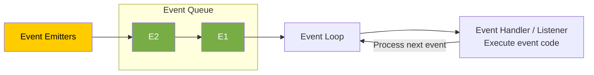

## What are the Main Features & Advantages of Node.js?

| Feature | Advantage |
|---|---|
| **1. Asynchronous** | Enables handling **multiple concurrent requests** and **non-blocking execution** of the thread. |
| **2. V8 JS Engine** | Built on the V8 JS engine from Google Chrome, Node.js **executes code fast**. |
| **3. Event-Driven Architecture** | **Efficient handling of events.** Great for real-time applications like chat applications and gaming applications (using WebSockets), where bidirectional communication is required. |
| **4. Cross-Platform** | Supports deployment on various operating systems, **enhancing flexibility**. |
| **5. JavaScript** | Coding in JavaScript means there is no need to learn a new language. |


## What are the Disadvantages of Node.js? When to Use and When Not to Use Node.js?

### When to Use Node.js

- Ideal for **real-time applications** like chat applications, online gaming, and collaborative tools due to its event-driven architecture.
- Excellent for building **lightweight and scalable RESTful APIs** that handle a large number of concurrent connections.
- Well-suited for building **microservices-based architectures**, enabling modular and scalable systems.

### When Not to Use Node.js (Disadvantages)

- **CPU-Intensive Tasks:** Avoid for applications that involve heavy CPU processing, such as image/video processing and data encryption/decryption. Node.js may not provide optimal performance in such scenarios because it is single-threaded, and for heavy computation, multithreading is better.

## What are Modules in Node.js? What is the Difference Between a Function & a Module?

- A module contains **specific functionality** that can be easily **reused** within a Node.js application.
- Ideally, in Node.js, a JavaScript file can be treated as a module.

module is like order module, and function is inside that modeule work like add or remove order function

```javascript
// myModule1.js
function sayHello(name) {
  console.log("Hello, " + name);
}

module.exports = sayHello;
```

### Function vs. Module

- A **module** is a broader concept that encapsulates functionality, while a **function** is a specific set of instructions within that module.
- Modules can contain **multiple functions and variables**.

### Diagram

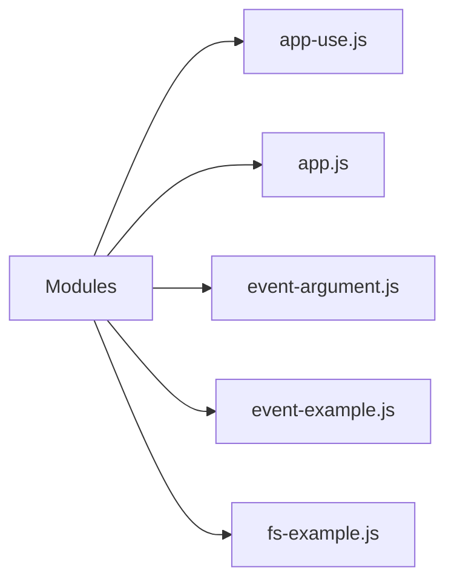


## How Many Ways Are There to Export a Module?

### 1. Using `module.exports`

The `module.exports` object can be used to export the module.

```javascript
// Exporting a function
function sayHello(name) {
  console.log("Hello, " + name);
}

// Exporting a variable
const pi = 3.14159;

// Exporting an object
const myObject = {
  key: "value",
};

// Using module.exports
module.exports.sayHello = sayHello;
module.exports.pi = pi;
module.exports.myObject = myObject;
```

### 2. Using `exports`

The `exports` object can also be used directly to export the module.

```javascript
// Exporting a function
exports.sayHello = function (name) {
  console.log("Hello, " + name);
};

// Exporting a variable
exports.pi = 3.14159;

// Exporting an object
exports.myObject = {
  key: "value",
};
```

## What is a Module Wrapper Function?

In Node.js, each module is wrapped in a function called the **module wrapper function** before it is executed.

### Original Module

```javascript
// app.js
const message = 'Interview Happy';

console.log(message);

// Output: Interview Happy
```

### Converted/Wrapped by Node.js

```javascript
// Wrapper function generated by Node
(function (exports, require, module, __filename, __dirname) {
  const message = "Interview Happy";

  console.log(message);

  // Output: Interview Happy
});
```

## What are the Types of Modules in Node.js?

### 1. Built-in Modules (Core Modules)

These are **already present modules** in Node.js that provide essential functionalities.

Examples:

- `fs` — File system
- `http` — HTTP server
- `path` — Path manipulation
- `util` — Utilities

### 2. Local Modules

These are **user-defined modules (JavaScript files)** created by developers for specific functionalities.

### 3. Third-Party Modules

These are **external packages or libraries created by the community** that provide additional functionalities for Node.js projects.

You install third-party modules using the `npm install` command.

For example:

```bash
npm install lodash
```

## Explain the Role of the `fs` Module. Name Some of Its Functions.

### 7 Main Functions of the `fs` Module

| Function | Description |
|---|---|
| `fs.readFile()` | Reads the content of the specified file. |
| `fs.writeFile()` | Writes data to the specified file, creating the file if it does not exist. |
| `fs.appendFile()` | Appends data to a file. If the file does not exist, it is created. |
| `fs.unlink()` | Deletes the specified file. |
| `fs.readdir()` | Reads the contents of a directory. |
| `fs.mkdir()` | Creates a new directory. |
| `fs.rmdir()` | Removes the specified directory. |

## Explain the Role of the `path` Module. Name Some of Its Functions.

The `path` module provides utilities for **joining, resolving, parsing, formatting, normalizing, and manipulating paths**.

```javascript
// path-example.js

const path = require('path');

// Joining Path Segments
const fullPath = path.join('/docs', 'file.txt');
console.log(fullPath);
// Output: /docs/file.txt

// Parsing Path
const parsedPath = path.parse('/docs/file.txt');
console.log(parsedPath);
/*
Output: {
  root: '/',
  dir: '/docs',
  base: 'file.txt',
  ext: '.txt',
  name: 'file'
}
*/
```

### 5 Main Functions of the `path` Module

```javascript
const path = require('path');

// Joining path segments together
const fullPath = path.join(__dirname, 'folder', 'file.txt');

// Resolving the absolute path
const absolutePath = path.resolve('folder', 'file.txt');

// Getting the directory name of a path
const directoryName = path.dirname('/folder/file.txt');

// Getting the file extension of a path
const fileExtension = path.extname('/folder/file.txt');

// Parsing a path into an object with its components
const pathObject = path.parse('/folder/file.txt');
```

## Explain the Role of the OS Module. Name Some of Its Functions.

- The `os` module in Node.js provides a set of methods for **interacting with the operating system**.
- Developers can use it for building **cross-platform applications** or performing system-related tasks in Node.js applications.

```javascript
const os = require('os');

// 1. Get Platform Information
console.log(os.type());
// Output: 'Windows_NT' or 'Linux'...

// 2. Get Current User Information
console.log(os.userInfo());
// Output: { uid: -1, gid: -1, username: 'anaya', ... }

// 3. Get Memory Information in bytes
console.log(os.totalmem()); // Output: 14877265920
console.log(os.freemem());  // Output: 4961570816
```

The Node.js **`events` module is useful when one action should trigger several independent reactions**.

Think of an online store: when a customer places an order, your application may need to send a confirmation email, generate an invoice, and notify the warehouse.

Your order code can announce **“an order was placed”**, and separate functions can react to that announcement.

```text
Customer places an order
          │
          ▼
   "orderPlaced" event
          │
          ├── Send confirmation email
          ├── Generate invoice
          └── Notify warehouse
```

Here’s a runnable example. Save it as `shop.cjs`. The email, invoice, and warehouse actions are simulated using console messages.

```javascript
const EventEmitter = require("node:events");

// Create an object that can announce events.
const shop = new EventEmitter();

// Register listeners BEFORE emitting the event.

// Listener 1: confirmation email
shop.on("orderPlaced", (order) => {
  console.log(`Sending confirmation email to ${order.email}`);
});

// Listener 2: invoice
shop.on("orderPlaced", (order) => {
  console.log(`Generating invoice for order #${order.id}`);
});

// Listener 3: warehouse notification
shop.on("orderPlaced", (order) => {
  console.log(`Warehouse: pack ${order.quantity} × ${order.product}`);
});

function placeOrder(order) {
  // A real application would validate and save the order first.
  console.log(`Order #${order.id} placed successfully`);

  // Announce what happened and pass the order to every listener.
  shop.emit("orderPlaced", order);

  console.log("Finished notifying listeners");
}

placeOrder({
  id: 101,
  email: "customer@example.com",
  product: "Keyboard",
  quantity: 1,
});
```

Run it with Node.js—no package installation is needed:

```bash
node shop.cjs
```

Output:

```text
Order #101 placed successfully
Sending confirmation email to customer@example.com
Generating invoice for order #101
Warehouse: pack 1 × Keyboard
Finished notifying listeners
```

The two key methods are:

| Method | Meaning |
|---|---|
| `shop.on("orderPlaced", handler)` | “Whenever this event happens, run this function.” |
| `shop.emit("orderPlaced", order)` | “This event happened; here is its data.” |

Node calls the registered listeners when you emit the event. See the [official Node.js events documentation](https://nodejs.org/api/events.html).

**Why use this instead of calling three functions directly?**

Both approaches work. Events help when the reactions may grow or change. For example, you could add an analytics listener without changing `placeOrder()`:

```javascript
shop.on("orderPlaced", (order) => {
  console.log(`Analytics: recorded sale of ${order.product}`);
});
```

**How does this relate to real-time applications?**

An `EventEmitter` communicates inside your running Node.js process. To show an order update immediately in a customer’s browser, you would also use a connection such as WebSockets or Server-Sent Events:

```text
Order status changes
    → Node event listener
    → WebSocket message
    → Customer’s page updates
```

One detail to remember: **listeners run synchronously, in registration order**. Using events does not automatically make work asynchronous or run it in parallel. An asynchronous listener can start an email request, but `emit()` does not wait for its promise to finish. [Node.js documentation](https://nodejs.org/api/events.html#asynchronous-vs-synchronous)


## What are the Advantages of Using Express.js with Node.js?

| Advantage | Description |
|---|---|
| **1. Simplified Web Development** | Express.js provides a lightweight framework that simplifies the process of building web applications in Node.js. |
| **2. Middleware Support** | Easy integration of middleware functions into an application's request-response cycle. |
| **3. Flexible Routing System** | Defining routes for handling different HTTP methods (`GET`, `POST`, `PUT`, `DELETE`, etc.) and URL patterns is easy. |
| **4. Template Engine Integration** | Express.js supports various template engines, making it easy to generate dynamic HTML content on the server side. |

**Template engine:** HTML + Data.

## What is Middleware in Express.js and When to Use It?

A middleware in Express.js is a **function** that handles **HTTP requests**, performs **operations**, and passes control to the **next middleware**.

### Diagram

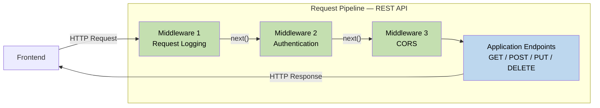

## How Do You Implement Middleware in Express.js?

### 4 Steps to Use Middleware

1. Initialize an Express application.
2. Define a middleware function, `myMiddleware`.
3. Use `app.use()` to mount `myMiddleware` globally, meaning it will be executed for every incoming request to the application.
4. Start the server by listening on a specified port (defaulting to port `3000`) using `app.listen()`.

```javascript
// Create and execute middleware
const express = require("express");
const app = express();

// Define middleware function
const myMiddleware = (req, res, next) => {
  // Middleware logic goes here
  res.send("Interview Happy!");
  next(); // Call the next middleware function
};

// Use middleware globally for all routes
app.use(myMiddleware);

// Start the server
const PORT = 3000;
app.listen(PORT, () => {
  console.log(`Server is running ${PORT}`);
});
```

### Browser Output

At `localhost:3000`:

```text
Interview Happy!
```

## What is the Purpose of the `app.use()` Function in Express.js?

The `app.use()` method is used to **execute (mount) middleware functions globally**.

```javascript
// Create and execute middleware
const express = require("express");
const app = express();

// Define middleware function
const myMiddleware = (req, res, next) => {
  // Middleware logic goes here
  res.send("Interview Happy!");
  next(); // Call the next middleware function
};

// Use middleware globally for all routes
app.use(myMiddleware);

// Start the server
const PORT = 3000;
app.listen(PORT, () => {
  console.log(`Server is running ${PORT}`);
});
```

## What is the Purpose of the `next` Parameter in Express.js?

The `next` parameter is a **callback function** used to **pass control to the next middleware function** in the stack.

## How to Use Middleware Globally for a Specific Route?

```javascript
const express = require('express');
const app = express();

const middleware = (req, res, next) => {
  res.send('Middleware for specific route');
  next();
};

// Use middleware globally for specific routes
app.use('/example', middleware);

const PORT = 3000;
app.listen(PORT, () => {
  console.log(`Server is running ${PORT}`);
});
```

### Browser Output

At `localhost:3000/example`:

```text
Middleware for specific route
```

## What is a Request Pipeline in Express?

The request pipeline in Express.js is a **series of middleware functions** that handle incoming HTTP requests and pass control to the next function.

### Diagram


## What are the Types of Middleware in Express.js?

1. **Application-level middleware**
2. **Router-level middleware**
3. **Error-handling middleware**
4. **Built-in middleware**
5. **Third-party middleware**

### Diagram

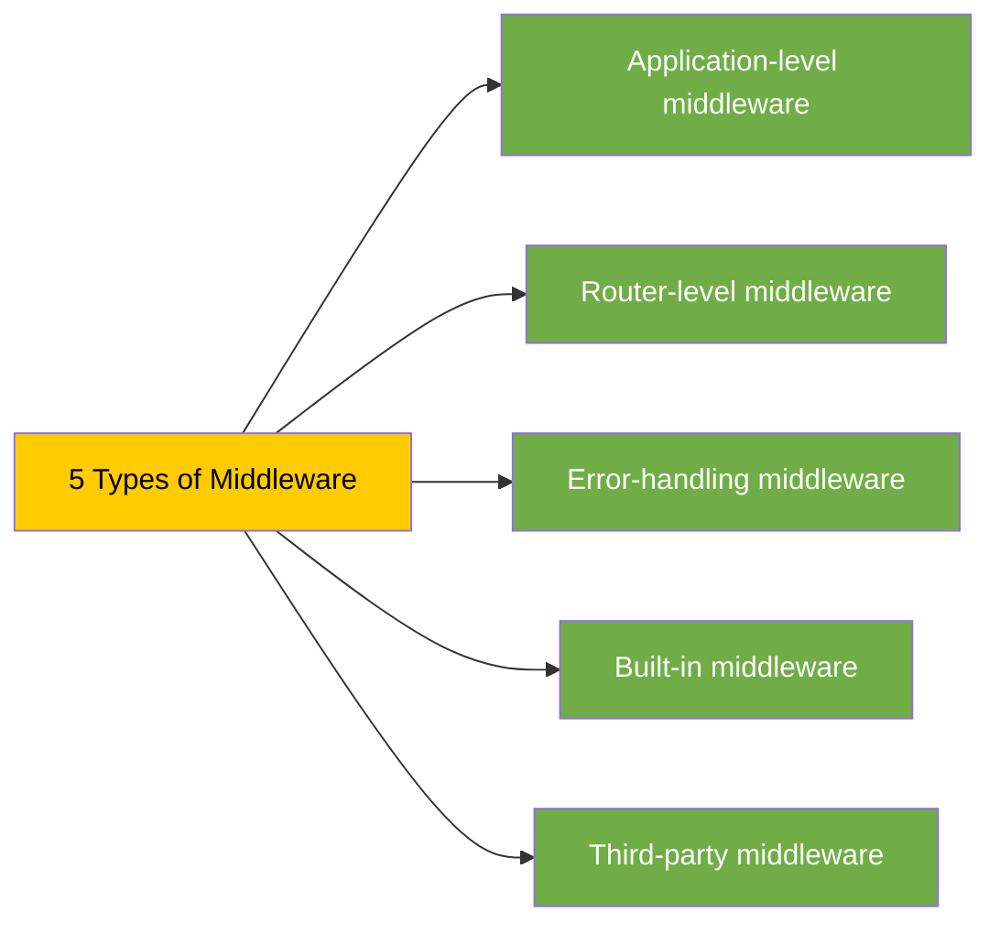

## What is the Difference Between Application-Level & Route-Level Middleware?

| Application-Level Middleware | Route-Level Middleware |
|---|---|
| Applies globally to all incoming requests in the entire Express.js application. | Applies only to specific routes, not to all incoming requests. |


## What is Error-Handling Middleware and How to Implement It?

- Error-handling middleware in Express is a special kind of middleware used to **manage errors** that occur while handling incoming requests.
- To implement error handling in Express, define middleware with four parameters: **`err`, `req`, `res`, `next`**. The additional **error object parameter (`err`)** is used for error handling.

```javascript
const express = require("express");
const app = express();

// Middleware generating error
app.use((req, res, next) => {
  // Simulate an error
  next(new Error("An error occurred"));
});

// Error-handling middleware
app.use((err, req, res, next) => {
  console.error(err.stack);
  res.status(500).send("Something went wrong!");
});

// Start the server
const PORT = 3000;
app.listen(PORT, () => {
  console.log(`Server is running on ${PORT}`);
});
```

### Browser Output

At `localhost:3000`:

```text
Something went wrong!
```

### Console Output

```text
Error: An error occurred
```

## If You Have 5 Middlewares, in Which Middleware Will You Handle Errors?

Error-handling middleware should be **defined last**, after all other middleware.

When an error occurs, Express.js searches for the next error-handling middleware, **skipping regular middleware and route handlers**.

```javascript
// Multiple middlewares
app.use(middleware1);
app.use(middleware2); // Error occurred
app.use(middleware3);
app.use(middleware4);

// Error-handling middleware
app.use((err, req, res, next) => {
  console.error(err.stack);
  res.status(500).send("Something went wrong!");
});
```

### Diagram

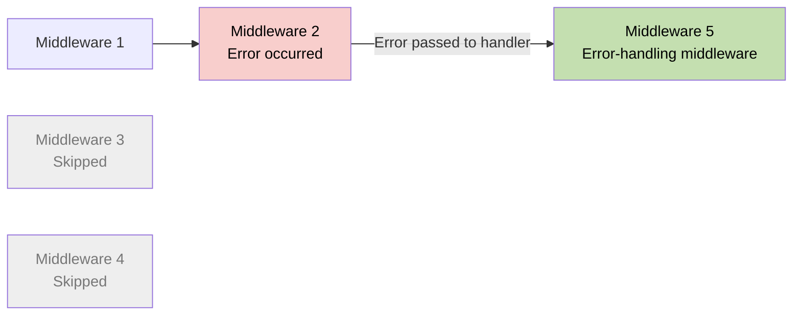

## What is Built-in Middleware? How to Serve Static Files from Express.js?

- **Built-in middleware** consists of functions built into the Express framework that provide common functionalities.
- **`express.static()`** middleware is used for serving static files.

```javascript
const express = require("express");
const app = express();

// Serve static files from the 'public' directory
app.use(express.static("public"));

// Other routes and middleware can be defined here

// Start the server
const PORT = 3000;
app.listen(PORT, () => {
  console.log(`Server is running on :${PORT}`);
});
```

### Browser Output

At `localhost:3000/1.jpg`, the browser displays the image served from `public/1.jpg`.

## What are the Advantages of Using Middleware in Express.js?

| Advantage | Description |
|---|---|
| **1. Modularity** | Middleware allows you to modularize your application's functionality into **smaller, self-contained units**. Each middleware function can handle a specific task or concern, such as logging, authentication, or error handling. |
| **2. Reusability** | Middleware can be reused at **multiple places**, making application code easier to maintain. |
| **3. Improved Request Handling** | Middleware functions have access to both the request (`req`) and response (`res`) objects, enabling you to perform **validations on requests** or modify the response before sending it back to the client. |
| **4. Flexible Control Flow** | Middleware functions can be applied globally to all routes or selectively to specific routes, allowing you to control the flow of request processing in your application. |
| **5. Third-Party Middleware** | Express.js offers a wide range of third-party middleware packages that provide additional functionality, such as `body-parser` and `cors`. |


## What are Route Handlers?

- A **route handler** is the second argument passed to `app.get()` or `app.post()`.
- A route handler function is used to **process the request and generate a response**.

```javascript
const express = require("express");
const app = express();

// Define a route for handling GET requests
app.get("/", (req, res) => {
  res.send("Interview Happy!");
});

// Define a route for handling POST requests
app.post("/login", (req, res) => {
  // Handle login logic
});

// Start the server
const PORT = 3000;
app.listen(PORT, () => {
  console.log(`Server is running on ${PORT}`);
});
```

## What are the Router Object & Router Methods, and How Do You Implement Them?

- The **Router object** is a mini version of an Express application used for **handling routes**.
- **Router methods** are functions provided by the Router object to define routes for different HTTP methods (`GET`, `POST`, `DELETE`, etc.).

### Implement Router Method

```javascript
// router.js
const express = require("express");

// Create a router object
const router = express.Router();

// Define a route for the root URL ('/')
router.get("/", (req, res) => {
  res.send("Interview Happy");
});

// Export the router object
module.exports = router;
```

### Use Router Method

```javascript
// app.js
const express = require("express");
const router = require("./router");
const app = express();

// Mount the router object on a path
app.use("/api", router);

// Start the server
app.listen(3000, () => {
  console.log("Server is running");
});
```

## What is the Difference Between `app.get()` and `router.get()`?

| `app.get()` | `router.get()` |
|---|---|
| Defines routes **directly on the application object**. | Defines routes on a **Router object**. |
| Routes are automatically mounted on the root path (`/`). | Routes are not automatically mounted; they must be explicitly mounted using `app.use()`. |
| Routes are not modular and cannot be reused in other applications. | Routes are modular and can be **reused in other applications** by exporting the Router object. |

### `app.get()` Example

```javascript
// app-get.js
const express = require("express");
const app = express();

app.get("/", (req, res) => {
  res.send("Interview Happy");
});

app.listen(3000, () => {
  console.log("Server is running");
});
```

### `router.get()` Example

```javascript
// router.js
const express = require("express");
const router = express.Router();

// Define a route for the root URL ('/')
router.get("/", (req, res) => {
  res.send("Interview Happy");
});

// Export the router object
module.exports = router;
```

## What are the Top 5 REST Guidelines and Their Advantages?

| Guideline | Description | Advantage |
|---|---|---|
| **1. Separation of Client & Server** | The implementation of the client and the server must be done independently. | Independence allows **easier maintenance, scalability, and evolution**. |
| **2. Stateless** | The server will not store anything about the latest HTTP request the client made. | Treats every request as a new request. It **simplifies server implementation** by avoiding the burden of state management. |
| **3. Uniform Interface** | Identify resources by URL, e.g., `www.abc.com/api/questions`. | Standardized URLs make it **easy to understand and use the API**. |
| **4. Cacheable** | The API response should be cacheable to improve performance. | Caching API responses **improves performance** by reducing repeated requests to the server. |
| **5. Layered System** | The system should follow a layered pattern. | A layered system, such as the Model-View-Controller (MVC) pattern, promotes **modular design** and separation of concerns. |


## Explain the Concept of Idempotence in RESTful APIs

**Idempotence** means performing an operation **multiple times** should have the same outcome as performing it once.

For example, sending multiple identical `GET` requests will always return the same response.

### Methods

| Idempotent Methods | Non-Idempotent Methods |
|---|---|
| `GET` | `POST` |
| `PUT` | |
| `DELETE` | |

## What are Serialization & Deserialization?

- **Serialization** is the process of **converting an object** into a format that can be stored, transmitted, or reconstructed later.
- **Deserialization** is the process of converting serialized data, such as binary, XML, or JSON data, back into an object.

### Diagram

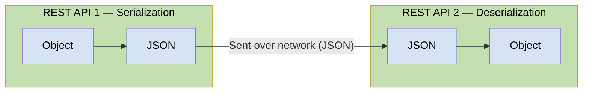

## What are the Types of Serialization?

1. **Binary Serialization**
2. **XML Serialization**
3. **JSON Serialization**

## How to Serialize & Deserialize in Node.js?

### Serialization

Serialize a JavaScript object into JSON format using **`JSON.stringify()`**.

```javascript
// Serialization (to JSON)
const obj = { name: "Happy", age: 39 };

const jsonStr = JSON.stringify(obj);

console.log("Serialized JSON:", jsonStr);
// Output: Serialized JSON: {"name":"Happy","age":39}
```

### Deserialization

Deserialize a JSON string into a JavaScript object using **`JSON.parse()`**.

```javascript
// Deserialization (from JSON)
const jsonStr2 = '{"name":"Happy","age":39}';

const obj2 = JSON.parse(jsonStr2);

console.log("Deserialized JSON:", obj2);
// Output: Deserialized JSON: { name: 'Happy', age: 39 }
```

## Explain the Concept of Versioning in RESTful APIs

Versioning in RESTful APIs refers to the practice of **maintaining multiple versions of an API** to support backward compatibility.

### Diagram

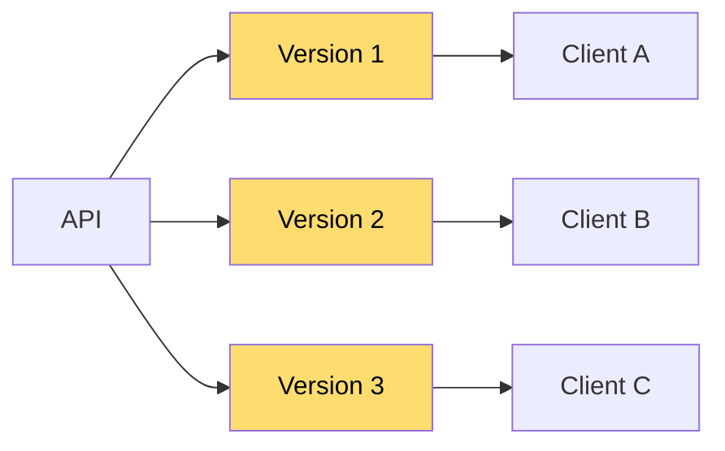

### Example URLs

```text
https://api.example.com/v1/resource
https://api.example.com/v2/resource
https://api.example.com/v3/resource
```


## What is the Typical Structure of a REST API Project in Node.js?

```text
ecommerce-project-root/
├── node_modules/
├── src/
│   ├── controllers/
│   │   ├── productController.js
│   │   └── userController.js
│   ├── models/
│   │   ├── productModel.js
│   │   └── userModel.js
│   ├── routes/
│   │   ├── productRoutes.js
│   │   └── userRoutes.js
│   ├── utils/
│   │   ├── errorHandlers.js
│   │   └── validators.js
│   └── app.js
├── .gitignore
└── package.json
```

| File / Directory | Purpose |
|---|---|
| **`node_modules/`** | Directory where npm packages are installed. |
| **`src/`** | Source code directory. |
| **`controllers/`** | Contains files responsible for handling business logic. |
| **`models/`** | Defines data models. |
| **`routes/`** | Defines API routes. |
| **`utils/`** | Contains reusable functions used across the project. |
| **`app.js`** | Initializes and configures the Express application. Connects routes, middleware, and other configurations. |
| **`.gitignore`** | Specifies files and directories to be ignored by version control, e.g., `node_modules` and `*.log`. |
| **`package.json`** | Contains metadata about the project and its dependencies. |


## What are Authentication and Authorization?

- **Authentication** is the process of **verifying the identity** of a user by validating their credentials, such as a username and password.
- **Authorization** is the process of allowing an authenticated user **access to resources**.
- Authentication always precedes authorization.

### Example

A student signs in to `www.school.com` using a username and password. After authentication, their permissions determine what they can access.

| Resource | Student Access |
|---|---|
| View Result | ✅ Allowed |
| Edit Result | ❌ Only teachers have rights |
| Fees | ✅ Allowed |
| Salary | ❌ Only teachers have rights |

### Diagram

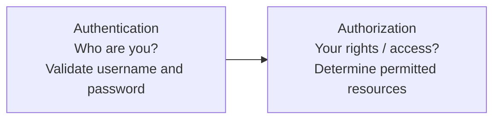


## What are the Types of Authentication in Node.js?

1. **Basic (Username and Password) Authentication**
2. **API Key Authentication**
3. **Token-based Authentication (JWT)**
4. **Multi-factor Authentication (MFA)**
5. **Certificate-based Authentication**

## What is Basic Authentication?

- In Basic Authentication, the user passes their credentials in a **POST request**. At the Node REST API end, credentials are verified, and a response is sent back.
- **Disadvantage:** Basic Authentication sends credentials in plain text over the network, so it is not considered a secure method of authentication.

## What is the Role of Hashing and Salt in Securing Passwords?

- **Hashing:** The process of converting a password into a fixed-size string of characters using a **mathematical algorithm**.
- **Salt:** A random string of data combined with a password before hashing.
  - Salting ensures security even if the hacker **knows the hashing algorithm**.
  - Even if two users **have the same password**, their hashed passwords will differ due to the unique salt.
  - Typically, each user has a unique salt.

### Diagram

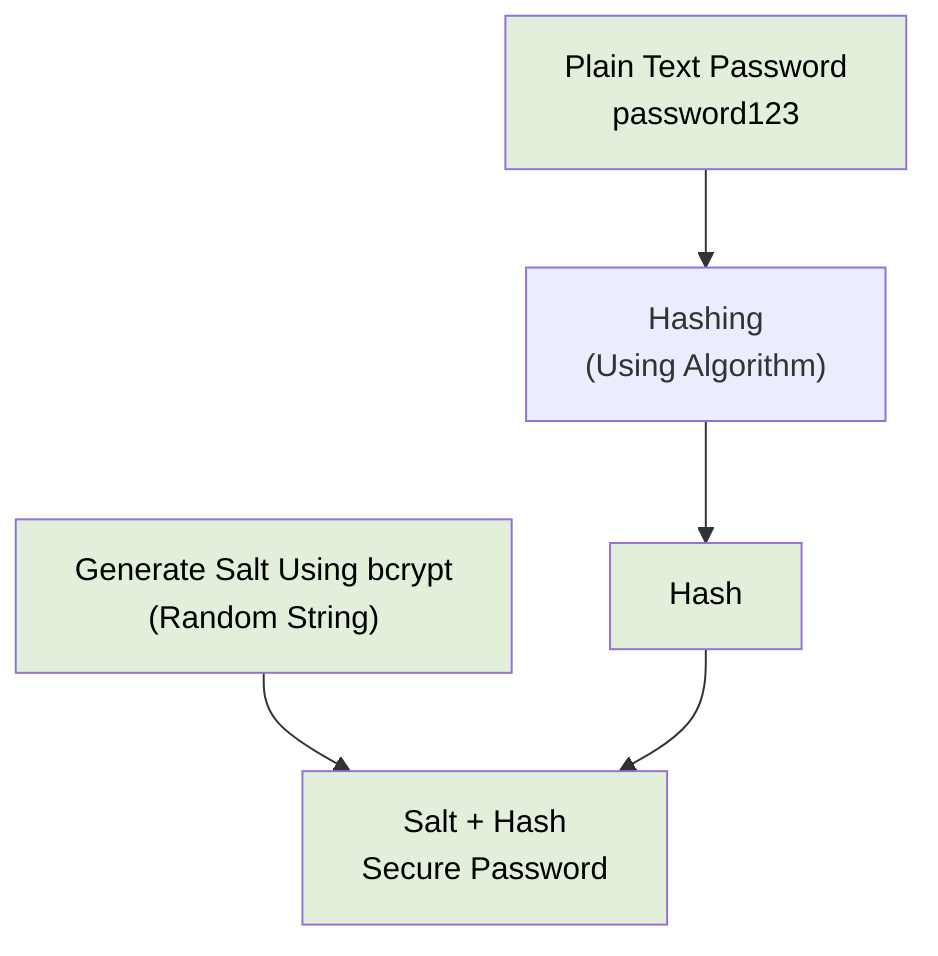

## How Can We Create Hashed Passwords in Node.js?

1. Generate a random salt.
2. Create a hash object using SHA-256.
3. Update the hash object with the salt and password.
4. Get the hashed data as a hexadecimal string.
5. Return the salt and hashed password as a string.

```javascript
const crypto = require("crypto");

// Define a function to hash and salt a password
function hashAndSaltPassword(password) {
  // 1. Generate a random salt
  const salt = crypto.randomBytes(16).toString("hex");

  // 2. Create a hash object using SHA-256
  const hash = crypto.createHash("sha256");

  // 3. Update the hash object with the salt and password
  hash.update(salt + password);

  // 4. Get the hashed data in a hexadecimal string
  const hexHash = hash.digest("hex");

  // 5. Return the salt and hashed password as a string
  return salt + ":" + hexHash;
}
```

## What is API Key Authentication?

- **API Key Authentication:** The API owner shares an API key with users. This key is used to authenticate users of that API.
- **Disadvantage:** API keys can be shared or stolen, so they may not be suitable for all scenarios.

### Example Request Header

```http
ApiKey: <your-api-key>
```

## Where Does the JWT Token Reside in the Request?

In the **request header**.

## What are the Parts of a JWT Token?

A JWT token has **3 parts**:

1. **Header**
2. **Payload**
3. **Signature**

## How to Handle Errors in Synchronous Operations Using `try-catch-finally`?

## What are Error-First Callbacks?

- **Error-first callbacks** are a convention in Node.js for handling asynchronous operations.
- They are called error-first callbacks because the **first argument of a callback function is reserved for an error object**.

```javascript
// Define the error-first callback function
const errorFirstCallback = (error, result) => {
  if (error) {
    console.error("Error:", error.message);
    return;
  }

  console.log("Result:", result);
};

// Call the asynchronous operation and pass the
// error-first callback function as an argument
asyncOperation(errorFirstCallback);

// Function simulating an asynchronous operation
function asyncOperation(callback) {
  // Simulate an asynchronous operation
  setTimeout(() => {
    const error = new Error("Async operation error");

    // Pass error as the first argument of the callback
    callback(error, null);
  }, 0);
}

// Output: Error: Async operation error
```

## What is NoSQL?

**NoSQL (Not Only SQL)** databases are designed to handle **structured, semi-structured, and unstructured data**.

### Diagram

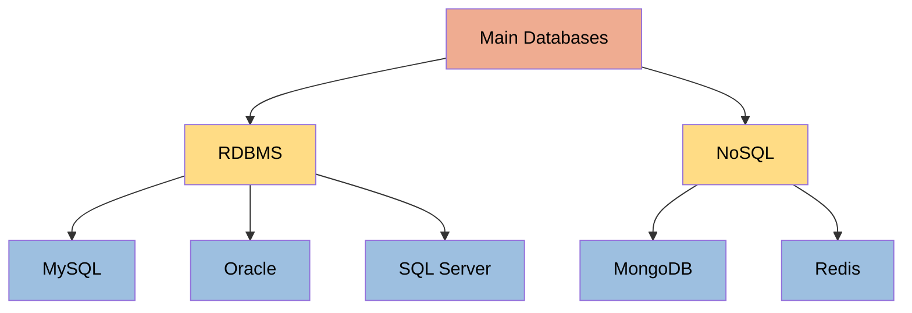


## What is the Difference Between NoSQL & RDBMS?

## When to Use RDBMS and When to Use a NoSQL Database in Your Applications?

## What is Mongoose? What are the Advantages of Using It?

- **Mongoose** is an **Object Data Modeling (ODM)** library for MongoDB and Node.js.
- Mongoose provides a **schema-based solution** to model application data.

### Advantages of Mongoose over Directly Using MongoDB

1. **Data validation**
2. **Middleware support**
3. **Defining relationships between collections**

### Diagram

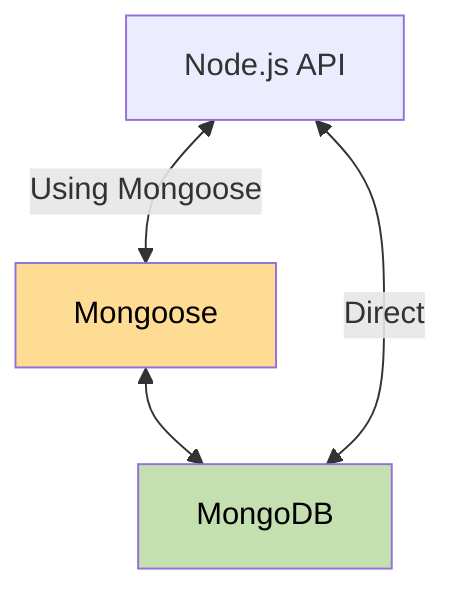


### Q. What is XSS (Cross-Site Scripting) attack?
**XSS (Cross-Site Scripting)** is a security vulnerability where an attacker injects malicious JavaScript into a trusted website. 

For example, consider a Node.js/Express endpoint:
```js
app.get('/search', (req, res) => {
  res.send(`<h1>Search results for: ${req.query.q}</h1>`);
});
```

If an attacker supplies this as `q`:

```html
<script>alert('XSS')</script>
```


**How I prevent it:**

- Use templates with automatic escaping and **context-aware output encoding**. HTML, JavaScript, and URL contexts need different handling.
- Use `textContent` instead of `innerHTML` when displaying plain text.
- If users can submit HTML, sanitize it with a maintained HTML sanitizer.
- Apply a restrictive **Content Security Policy (CSP)** as an additional defense.
- Use `HttpOnly` cookies to prevent JavaScript from reading session cookies. This limits cookie theft but does **not** prevent XSS or authenticated actions.

Input validation helps, but it does not replace safe output handling.

### Q. What is SQL Injection attack?

**SQL Injection (SQLi)** is a vulnerability where an attacker manipulates a database query by supplying malicious input. It happens when an application combines untrusted data with SQL code, allowing the database to interpret that input as part of the query.

An attacker may read sensitive data, bypass authentication, or modify and delete records, depending on the database permissions.

For example, this Node.js code is vulnerable:

```js
const query = `
  SELECT id, email
  FROM users
  WHERE email = '${req.body.email}'
`;

const result = await pool.query(query);
```

If the attacker submits this email:

```text
' OR 1=1 --
```

The query becomes:

```sql
SELECT id, email
FROM users
WHERE email = '' OR 1=1 --'
```

Because `1=1` is always true, the query returns all users instead of matching one email. `--` comments out the remaining quote.

**How to prevent it**

The primary defense is **parameterized queries**, which keep SQL instructions separate from input values.

Using PostgreSQL’s `pg` package:

```js
const result = await pool.query(
  'SELECT id, email FROM users WHERE email = $1',
  [req.body.email]
);
```

Here, the database treats the supplied email as a value, even if it contains SQL syntax.

Additional practices:

- Validate input types, lengths, and business rules.
- Allowlist dynamic table names, column names, and sort directions; ordinary value parameters cannot represent SQL identifiers.
- Give the application database account only the permissions it needs.
- Use ORM parameter binding correctly; concatenated raw SQL can still be vulnerable.
- Avoid exposing database errors to clients.

**The key principle is to parameterize values instead of building SQL through string concatenation.**

### Q. How can you improve the performance of a Node.js application?

**I improve Node.js performance by measuring the bottleneck first, applying a targeted fix, and validating it under realistic load.** I look at response latency—especially p95/p99—throughput, error rate, CPU, memory, and dependency timings.

My main areas of focus are:

1. **Profile the application**
   
   Use CPU profiles, heap snapshots, and request tracing to identify expensive code or slow dependencies. Node’s `perf_hooks` can measure event-loop delay and utilization. [Node.js performance APIs](https://nodejs.org/api/perf_hooks.html)

2. **Keep the event loop responsive**
   
   Avoid synchronous filesystem or crypto operations in request handlers, expensive loops, pathological regular expressions, and processing huge JSON payloads. Simply marking a function `async` does not move its computation off the main thread. [Node.js event-loop guidance](https://nodejs.org/en/learn/asynchronous-work/dont-block-the-event-loop)

3. **Offload CPU-intensive work**
   
   Use a reusable `worker_threads` pool for heavy JavaScript computation. Move long-running work, such as report generation, to background job workers when the API can return before completion. Worker threads usually offer little benefit for ordinary asynchronous I/O. [Worker threads documentation](https://nodejs.org/api/worker_threads.html)

4. **Optimize database access**
   
   Inspect slow queries and execution plans, add appropriate indexes, eliminate N+1 queries, fetch only required fields, and paginate results. Size connection pools against database capacity across **all application instances**.

5. **Handle I/O concurrency carefully**
   
   Run independent operations concurrently instead of awaiting each sequentially. Use bounded concurrency for large batches; an unlimited `Promise.all()` can exhaust connections or overwhelm downstream services. Configure timeouts and reuse connections.

6. **Cache repeated work**
   
   Cache frequently accessed data or expensive results where freshness requirements allow it. Define TTLs, invalidation rules, size limits, and protection against many requests rebuilding the same expired entry.

7. **Control memory and data transfer**
   
   Fix retained objects, unbounded caches, and listener leaks. Stream large files with backpressure instead of buffering everything in memory. Reduce response payloads and use compression where beneficial. [Node.js streams guidance](https://nodejs.org/learn/modules/backpressuring-in-streams)

8. **Scale with dependency limits in mind**
   
   Run multiple processes or container replicas behind a load balancer to use available cores and machines. Keep shared session state external, and ensure additional instances do not overload the database. [Express production guidance](https://expressjs.com/en/advanced/best-practice-performance/)

For example, if tracing shows an endpoint spends 90% of its time waiting for a database query, I would investigate that query and its indexes before changing JavaScript code or adding application instances.


### Q. How can you Deploy a Node.js application?

**A Node.js application can be deployed on a virtual machine, a managed application platform, containers, or serverless infrastructure.** The choice depends on traffic, operational requirements, and the team’s infrastructure.

For a production backend, I would follow this process:

1. **Prepare the application**
   
   Use a supported Node.js LTS release, define a production start command, and read configuration such as `PORT` and database URLs from the environment. Keep secrets outside the repository. [Node.js release guidance](https://nodejs.org/en/about/previous-releases)

   ```json
   {
     "scripts": {
       "start": "node server.js"
     }
   }
   ```

   In containers, the server should usually listen on `0.0.0.0` so it is reachable through the container’s network.

2. **Test and build in CI**
   
   A pipeline typically runs:

   ```bash
   npm ci
   npm run lint
   npm test
   npm run build
   ```

   These assume the project defines those scripts; plain JavaScript may need no build step. `npm ci` installs dependencies from the committed lockfile without updating it. Build dependencies must be available during compilation; the runtime artifact can contain only production dependencies. [npm documentation](https://docs.npmjs.com/cli/commands/npm-ci/)

3. **Package and release**
   
   Produce a versioned deployment artifact, often a Docker image, and deploy the same artifact through staging and production. Inject environment-specific configuration at runtime.

4. **Configure networking and process management**
   
   Place the application behind a reverse proxy or load balancer, configure DNS and HTTPS, and restrict direct access to internal services. On a VM, use a supervisor such as systemd or PM2. With containers, let the platform supervise and restart the application.

5. **Handle database changes**
   
   Run migrations as a controlled release step. Prefer backward-compatible changes so old and new application versions can coexist during deployment and application rollback remains possible.

6. **Deploy with health checks and graceful shutdown**
   
   Use readiness checks before routing traffic to a new instance. On `SIGTERM`, stop accepting requests, drain ongoing work, close database connections, and exit within a defined timeout. Use rolling, blue-green, or canary deployment when availability requires it. [Express deployment guidance](https://expressjs.com/en/advanced/healthcheck-graceful-shutdown/)

7. **Verify and monitor**
   
   Run smoke tests and monitor errors, latency, memory, CPU, and dependency health. Keep the previous artifact available for rollback.

A typical deployment path is:

```text
Git push → CI checks → Build artifact → Staging
         → Production rollout → Health checks → Monitoring
```

###  How to create unit tests using Jest framework?

**Jest is a JavaScript testing framework that provides a test runner, assertions, mocks, and code coverage.** For backend unit tests, I test a function or service in isolation and mock external dependencies such as databases and APIs.

Here is a practical example using **CommonJS**.

**1. Install and configure Jest**

```bash
npm install --save-dev jest
```

Add these scripts to `package.json`:

```json
{
  "scripts": {
    "test": "jest",
    "test:watch": "jest --watch",
    "test:coverage": "jest --coverage"
  }
}
```

Jest discovers files such as `userService.test.js` automatically. [Getting started](https://jestjs.io/docs/getting-started)

**2. Create the service**

```js
// userService.js
async function getUserName(userId, userRepository) {
  if (!Number.isInteger(userId) || userId <= 0) {
    throw new Error('Invalid user ID');
  }

  const user = await userRepository.findById(userId);

  if (!user) {
    throw new Error('User not found');
  }

  return user.name;
}

module.exports = { getUserName };
```

The repository is passed as a dependency, allowing tests to substitute it without connecting to a database.

**3. Write unit tests**

```js
// userService.test.js
const { getUserName } = require('./userService');

describe('getUserName', () => {
  let userRepository;

  beforeEach(() => {
    userRepository = {
      findById: jest.fn(),
    };
  });

  test('returns the name of an existing user', async () => {
    // Arrange
    userRepository.findById.mockResolvedValue({
      id: 1,
      name: 'Asha',
    });

    // Act
    const name = await getUserName(1, userRepository);

    // Assert
    expect(name).toBe('Asha');
    expect(userRepository.findById).toHaveBeenCalledWith(1);
  });

  test('rejects an invalid ID without querying the repository', async () => {
    await expect(
      getUserName(0, userRepository)
    ).rejects.toThrow('Invalid user ID');

    expect(userRepository.findById).not.toHaveBeenCalled();
  });

  test('throws when the user does not exist', async () => {
    userRepository.findById.mockResolvedValue(null);

    await expect(
      getUserName(1, userRepository)
    ).rejects.toThrow('User not found');
  });

  test('propagates repository errors', async () => {
    userRepository.findById.mockRejectedValue(
      new Error('Database unavailable')
    );

    await expect(
      getUserName(1, userRepository)
    ).rejects.toThrow('Database unavailable');
  });
});
```

`jest.fn()` creates a mock that records calls. `mockResolvedValue()` and `mockRejectedValue()` simulate asynchronous success and failure. [Mock documentation](https://jestjs.io/docs/30.0/mock-functions)

**4. Run the tests**

```bash
npm test
npm run test:coverage
```

The main concepts are:

- `describe()` groups related tests.
- `test()` or `it()` defines a test case.
- `expect()` asserts the expected behavior.
- `beforeEach()` prepares fresh state for every test.
- `toBe()` compares primitive values or object identity; `toEqual()` compares object structure.

**Always await or return asynchronous assertions**, otherwise the test may finish before the assertion runs. [Asynchronous testing](https://jestjs.io/docs/asynchronous)

In production projects, I cover success cases, boundary conditions, and failures. I use coverage to find gaps, while keeping assertions focused on observable behavior.

### Explain AAA?

**AAA stands for Arrange, Act, Assert.** It is a pattern for structuring unit tests so each test is easy to understand.

1. **Arrange:** Prepare the inputs, dependencies, mocks, and expected conditions.
2. **Act:** Execute the behavior being tested.
3. **Assert:** Verify the result or expected side effects.

For example, using Jest:

```js
test('returns the name of an existing user', async () => {
  // Arrange
  const userRepository = {
    findById: jest.fn().mockResolvedValue({
      id: 1,
      name: 'Asha',
    }),
  };

  // Act
  const name = await getUserName(1, userRepository);

  // Assert
  expect(name).toBe('Asha');
  expect(userRepository.findById).toHaveBeenCalledWith(1);
});
```

Here, we prepare a mocked repository, call the real service function, and verify both the returned name and the ID passed to the repository.

A good practice is to keep **one clear behavior per test**. Multiple assertions are fine when they verify that same behavior.

### Q. What are Query Operators in MongoDB?

**Query operators in MongoDB define conditions used to select matching documents.** They usually start with `$` and appear in filters for operations such as `find()`, `findOne()`, `updateOne()`, and `deleteMany()`.

For example:

```js
// Find users aged 18 or older.
db.users.find({ age: { $gte: 18 } });
```

The main groups are:

| Group | Common operators | Purpose |
|---|---|---|
| Comparison | `$eq`, `$ne`, `$gt`, `$gte`, `$lt`, `$lte`, `$in`, `$nin` | Compare field values |
| Logical | `$and`, `$or`, `$not`, `$nor` | Combine or negate conditions |
| Element / data type | `$exists`, `$type` | Check field presence or type |
| Array | `$all`, `$elemMatch`, `$size` | Match array contents or length |
| Evaluation / expressions | `$regex`, `$expr`, `$mod` | Match patterns or evaluate expressions |
| Geospatial | `$near`, `$geoWithin`, `$geoIntersects` | Query geographic data |

MongoDB also provides bitwise query operators. [Query operator reference](https://www.mongodb.com/docs/manual/reference/mql/query-predicates/)

**1. Comparison operators**

```js
// Age between 18 and 30, inclusive.
db.users.find({ age: { $gte: 18, $lte: 30 } });

// Role matches either value.
db.users.find({ role: { $in: ['admin', 'editor'] } });
```

`$gt` means greater than; `$gte` includes equality. `$in` matches any listed value, while `$nin` excludes listed values and can also match missing fields. [Comparison operators](https://www.mongodb.com/docs/manual/reference/mql/query-predicates/comparison/)

**2. Logical operators**

```js
// Active users who are either admins or editors.
db.users.find({
  active: true,
  $or: [
    { role: 'admin' },
    { role: 'editor' },
  ],
});
```

Conditions on different fields are implicitly combined with AND. `$not` negates a field condition; `$nor` matches documents satisfying none of its clauses.

**3. Field existence**

```js
db.users.find({ phone: { $exists: true } });
```

This includes documents where `phone` exists but is `null`. `$exists` checks presence, not whether the value is meaningful. [Existence operator](https://www.mongodb.com/docs/manual/reference/operator/query/exists/)

**4. Array operators**

```js
// Contains both skills.
db.users.find({
  skills: { $all: ['Node.js', 'MongoDB'] },
});

// Contains exactly three elements.
db.users.find({ skills: { $size: 3 } });

// One order must satisfy both conditions.
db.users.find({
  orders: {
    $elemMatch: {
      status: 'paid',
      total: { $gt: 1000 },
    },
  },
});
```

**`$elemMatch` ensures the same array element satisfies every condition.** Separate dotted-field conditions can be satisfied by different array elements. [Array matching documentation](https://www.mongodb.com/docs/manual/reference/operator/query/elemmatch/)

**5. Expressions**

```js
// Compare two fields in the same document.
db.products.find({
  $expr: { $gt: ['$salePrice', '$costPrice'] },
});
```

`$expr` allows aggregation expressions inside a query filter. [Expression documentation](https://www.mongodb.com/docs/manual/reference/operator/query/expr/)

In the Node.js driver, the same filter is passed to the collection:

```js
const users = await db.collection('users')
  .find({ active: true, age: { $gte: 18 } })
  .toArray();
```

Query operators determine **which documents match**. Update operators such as `$set` and `$inc` determine **how matching documents change**.

### Q. Compare Query Operators in SQL & MongoDB?

**SQL uses expressions in a `WHERE` clause; MongoDB uses a filter document with operators such as `$gt`, `$in`, and `$or`.** Most common conditions have similar counterparts, but their handling of nulls, missing fields, and arrays differs.

For scalar fields, the common mappings are:

| Condition | SQL `WHERE` expression | MongoDB filter |
|---|---|---|
| Equal | `age = 25` | `{ age: { $eq: 25 } }` or `{ age: 25 }` |
| Not equal | `age <> 25` | `{ age: { $ne: 25 } }` |
| Greater than | `age > 25` | `{ age: { $gt: 25 } }` |
| Greater than or equal | `age >= 25` | `{ age: { $gte: 25 } }` |
| Less than | `age < 25` | `{ age: { $lt: 25 } }` |
| Less than or equal | `age <= 25` | `{ age: { $lte: 25 } }` |
| In a list | `age IN (20, 25, 30)` | `{ age: { $in: [20, 25, 30] } }` |
| Not in a list | `age NOT IN (20, 25)` | `{ age: { $nin: [20, 25] } }` |
| Inclusive range | `age BETWEEN 18 AND 30` | `{ age: { $gte: 18, $lte: 30 } }` |
| AND | `age >= 18 AND active = TRUE` | `{ age: { $gte: 18 }, active: true }` |
| OR | `age < 18 OR active = FALSE` | `{ $or: [{ age: { $lt: 18 } }, { active: false }] }` |
| NOT | `NOT (age >= 18)` | `{ age: { $not: { $gte: 18 } } }` |
| Starts with | `name LIKE 'A%'` | `{ name: { $regex: '^A' } }` |

The pattern example assumes compatible case sensitivity; SQL `LIKE` and MongoDB regular expressions use different pattern syntax. [MongoDB SQL mapping](https://www.mongodb.com/docs/manual/reference/sql-comparison/), [comparison operators](https://www.mongodb.com/docs/manual/reference/mql/query-predicates/comparison/)

For example, these queries express the same condition when the fields have the expected scalar types:

```sql
SELECT *
FROM users
WHERE age >= 18
  AND role IN ('admin', 'editor');
```

```js
db.users.find({
  age: { $gte: 18 },
  role: { $in: ['admin', 'editor'] },
});
```

**The important differences are:**

- **NULL and missing fields:** SQL distinguishes null values using `IS NULL`. MongoDB distinguishes both null and absent fields:

  ```js
  { email: null }                  // Null OR missing
  { email: { $type: 'null' } }     // Explicit null, assuming a scalar field
  { email: { $exists: false } }    // Missing
  { email: { $ne: null } }         // Present and non-null
  ```

  [MongoDB null handling](https://www.mongodb.com/docs/manual/tutorial/query-for-null-fields/)

- **Negation behaves differently:** SQL comparisons involving NULL produce UNKNOWN, which `WHERE` excludes. MongoDB `$ne: 25`, `$nin: [20, 25]`, and `$not` can match documents with missing fields. These are therefore conceptual mappings rather than exact equivalents for every document. [SQL NULL semantics](https://www.postgresql.org/docs/current/functions-comparison.html)

- **Arrays have dedicated operators:** MongoDB provides `$all`, `$size`, and `$elemMatch`. In SQL, similar queries depend on whether the data uses related tables, arrays, or JSON. `$elemMatch` requires one array element to satisfy all specified conditions. [Array matching](https://www.mongodb.com/docs/manual/reference/operator/query/elemmatch/)

### Q. What is projection in MongoDB? How to implement it?

**Projection in MongoDB controls which fields are returned by a query.** The filter selects **which documents** match; the projection selects **which fields** appear in those documents. It does not modify the stored data.

It is similar to selecting specific columns in SQL:

```sql
SELECT name, email FROM users WHERE active = TRUE;
```

**1. Include specific fields**

In the MongoDB shell, pass the projection as the second argument to `find()`:

```js
db.users.find(
  { active: true },               // Filter
  { name: 1, email: 1, _id: 0 }   // Projection
);
```

Example result:

```js
[
  { name: 'Asha', email: 'asha@example.com' }
]
```

For basic field selection:

- `1` includes a field.
- `0` excludes a field.
- `_id` is included by default unless explicitly excluded.
- An inclusion projection excludes unspecified fields.
- An exclusion projection includes unspecified fields. [Projection documentation](https://www.mongodb.com/docs/v8.0/tutorial/project-fields-from-query-results/)

**2. Exclude specific fields**

```js
// Return every field except passwordHash and refreshToken.
db.users.find(
  {},
  { passwordHash: 0, refreshToken: 0 }
);
```

You cannot mix inclusion and exclusion for ordinary fields. Excluding `_id` from an inclusion projection is allowed:

```js
// Valid
{ name: 1, email: 1, _id: 0 }

// Invalid
{ name: 1, passwordHash: 0 }
```

**3. Implement it using the Node.js driver**

Assuming `db` is an established database connection:

```js
const users = await db.collection('users')
  .find(
    { active: true },
    { projection: { name: 1, email: 1, _id: 0 } }
  )
  .toArray();
```

Alternatively, chain `.project()`:

```js
const users = await db.collection('users')
  .find({ active: true })
  .project({ name: 1, email: 1, _id: 0 })
  .toArray();
```

**Notice the syntax difference:** the Node.js driver takes an options object containing `projection`; the shell accepts the projection document directly. [Node.js driver documentation](https://www.mongodb.com/docs/drivers/node/current/crud/query/project/)

**4. Project nested fields**

Use dot notation:

```js
db.users.find(
  {},
  { name: 1, 'address.city': 1, _id: 0 }
);
```

This preserves the nested structure:

```js
{ name: 'Asha', address: { city: 'Pune' } }
```

Projection reduces response size and unnecessary data transfer. For public API responses, I generally prefer explicitly including permitted fields so newly added internal fields are not returned accidentally.

### Q. How to remove _id field from result in MongoDB?

Set **`_id: 0` in the projection** to exclude it from query results.

**MongoDB shell:**

```js
// Return all fields except _id.
db.users.find({}, { _id: 0 });

// Return only name and email.
db.users.find({}, { name: 1, email: 1, _id: 0 });
```

**Node.js MongoDB driver:**

```js
const users = await db.collection('users')
  .find({}, {
    projection: { name: 1, email: 1, _id: 0 },
  })
  .toArray();
```

This removes `_id` **only from the returned results**; it remains in the stored documents. Excluding `_id` is allowed alongside included fields. [MongoDB documentation](https://www.mongodb.com/docs/drivers/node/current/crud/query/project/)

### Q. How do you perform sorting in ascending & descending order in MongoDB?

Use MongoDB’s **`.sort()`** method with:

- **`1`** for ascending order.
- **`-1`** for descending order.

**MongoDB shell:**

```js
// Sort by age: youngest first.
db.users.find().sort({ age: 1 });

// Sort by age: oldest first.
db.users.find().sort({ age: -1 });
```

**Sorting by multiple fields:**

```js
// Age ascending, then name descending for users with the same age.
db.users.find().sort({ age: 1, name: -1 });
```

Fields are prioritized in the order specified.

**Node.js MongoDB driver:**

```js
const users = await db.collection('users')
  .find({ active: true })
  .sort({ age: -1, _id: 1 })
  .limit(10)
  .toArray();
```

This returns the 10 oldest active users. Adding the unique `_id` field breaks ties when ages are equal, producing a consistent order.

Apply `.sort()` to the cursor **before** retrieving results with `.toArray()`. [MongoDB sorting examples](https://www.mongodb.com/docs/manual/reference/sql-comparison/)

### Q. What are Indexes in MongoDB? How indexing make data retrieval faster?

**An index in MongoDB is a separate data structure that stores selected field values in an ordered form, with references to the corresponding documents.** Standard MongoDB indexes use a **B-tree**, allowing efficient lookups, range searches, and supported sorts. Think of a book’s index: it helps locate relevant pages without reading the whole book. [MongoDB indexing documentation](https://www.mongodb.com/docs/manual/indexes/)

**How does it make retrieval faster?**

Suppose a `users` collection contains one million documents:

```js
db.users.find({ email: 'asha@example.com' });
```

Without a suitable index, MongoDB may perform a **collection scan**, checking every document to find matches.

Create an index:

```js
db.users.createIndex({ email: 1 });
```

MongoDB can now:

1. Traverse the index to locate the matching email.
2. Read the relevant index entries.
3. Fetch the matching documents.

This can greatly reduce the number of documents examined, especially when the condition matches only a small portion of the collection.

**Indexes can also support filtering and sorting together**

```js
db.orders.createIndex({ customerId: 1, createdAt: -1 });

db.orders.find({ customerId: 101 })
  .sort({ createdAt: -1 })
  .limit(10);
```

This compound index groups entries by customer, then orders each customer’s entries by creation time. MongoDB can use it to retrieve that customer’s latest orders without separately sorting all their orders.

**Field order matters:** `{ customerId: 1, createdAt: -1 }` and `{ createdAt: -1, customerId: 1 }` support different access patterns. [Index types](https://www.mongodb.com/docs/manual/core/indexes/index-types/)

**How do I verify the improvement?**

Use `explain()` before and after creating the index:

```js
db.users.find({ email: 'asha@example.com' })
  .explain('executionStats');
```

Check:

| Metric or stage | Meaning |
|---|---|
| `COLLSCAN` | Scans collection documents |
| `IXSCAN` | Scans index entries |
| `totalKeysExamined` | Number of index entries examined |
| `totalDocsExamined` | Number of documents examined |
| `nReturned` | Number of documents returned |

I compare the work performed with the number of results returned. **Seeing `IXSCAN` alone does not prove the query is efficient**—it could still scan many index entries. [Explain documentation](https://www.mongodb.com/docs/v8.0/reference/explain-results/)

There are trade-offs: indexes consume storage and memory, and inserts, deletes, and relevant updates must maintain them. Queries matching most documents may gain little benefit. A **covered query** can go further: if the index contains everything needed for filtering and output, MongoDB can answer without fetching documents. [Query optimization](https://www.mongodb.com/docs/manual/core/query-optimization/)

In production, I design indexes around actual query patterns and validate them with execution plans rather than indexing every field.

### Q. What are Indexes in MongoDB? How indexing make data retrieval faster?

**An index in MongoDB is a separate data structure that stores selected field values in an ordered form, with references to the corresponding documents.** Standard MongoDB indexes use a **B-tree**, allowing efficient lookups, range searches, and supported sorts. Think of a book’s index: it helps locate relevant pages without reading the whole book. [MongoDB indexing documentation](https://www.mongodb.com/docs/manual/indexes/)

**How does it make retrieval faster?**

Suppose a `users` collection contains one million documents:

```js
db.users.find({ email: 'asha@example.com' });
```

Without a suitable index, MongoDB may perform a **collection scan**, checking every document to find matches.

Create an index:

```js
db.users.createIndex({ email: 1 });
```

MongoDB can now:

1. Traverse the index to locate the matching email.
2. Read the relevant index entries.
3. Fetch the matching documents.

This can greatly reduce the number of documents examined, especially when the condition matches only a small portion of the collection.

**Indexes can also support filtering and sorting together**

```js
db.orders.createIndex({ customerId: 1, createdAt: -1 });

db.orders.find({ customerId: 101 })
  .sort({ createdAt: -1 })
  .limit(10);
```

This compound index groups entries by customer, then orders each customer’s entries by creation time. MongoDB can use it to retrieve that customer’s latest orders without separately sorting all their orders.

**Field order matters:** `{ customerId: 1, createdAt: -1 }` and `{ createdAt: -1, customerId: 1 }` support different access patterns. [Index types](https://www.mongodb.com/docs/manual/core/indexes/index-types/)

**How do I verify the improvement?**

Use `explain()` before and after creating the index:

```js
db.users.find({ email: 'asha@example.com' })
  .explain('executionStats');
```

Check:

| Metric or stage | Meaning |
|---|---|
| `COLLSCAN` | Scans collection documents |
| `IXSCAN` | Scans index entries |
| `totalKeysExamined` | Number of index entries examined |
| `totalDocsExamined` | Number of documents examined |
| `nReturned` | Number of documents returned |

I compare the work performed with the number of results returned. **Seeing `IXSCAN` alone does not prove the query is efficient**—it could still scan many index entries. [Explain documentation](https://www.mongodb.com/docs/v8.0/reference/explain-results/)

There are trade-offs: indexes consume storage and memory, and inserts, deletes, and relevant updates must maintain them. Queries matching most documents may gain little benefit. A **covered query** can go further: if the index contains everything needed for filtering and output, MongoDB can answer without fetching documents. [Query optimization](https://www.mongodb.com/docs/manual/core/query-optimization/)

In production, I design indexes around actual query patterns and validate them with execution plans rather than indexing every field.

### Q. On which filed you will create an index - projection field or filter field?

**I usually index the filter fields first. I add projection fields when a covered query provides a worthwhile performance benefit.** I also consider sorting when designing the index.

For example:

```js
db.users.find(
  { email: 'asha@example.com' },       // Filter
  { name: 1, email: 1, _id: 0 }       // Projection
);
```

**Indexing the filter field:**

```js
db.users.createIndex({ email: 1 });
```

MongoDB can locate matching index entries efficiently, then fetch the documents to retrieve `name`.

Creating an index only on `name`, the projection field, would generally not help locate the requested email.

**Indexing both filter and projection fields:**

```js
db.users.createIndex({ email: 1, name: 1 });
```

For this query, MongoDB can find the email and return both requested fields directly from the index. This is a **covered query**, which avoids fetching the documents.

We exclude `_id` because it is returned by default and is not part of this compound index. [MongoDB covered queries](https://www.mongodb.com/docs/manual/core/query-optimization/)

My decision process is:

- **Filter fields:** Support efficient document selection.
- **Sort fields:** Include them where needed to support the query’s ordering.
- **Projection fields:** Add them when covering a frequent query justifies a larger index and additional write overhead.

I verify the result using:

```js
db.users.find(
  { email: 'asha@example.com' },
  { name: 1, email: 1, _id: 0 }
).explain('executionStats');
```

For a covered query using this index, `totalDocsExamined` should be **0**. Index design follows the complete query pattern, rather than every field appearing in its output.

### Q. On which filed you will create an index - projection field or filter field?

**I usually index the filter fields first. I add projection fields when a covered query provides a worthwhile performance benefit.** I also consider sorting when designing the index.

For example:

```js
db.users.find(
  { email: 'asha@example.com' },       // Filter
  { name: 1, email: 1, _id: 0 }       // Projection
);
```

**Indexing the filter field:**

```js
db.users.createIndex({ email: 1 });
```

MongoDB can locate matching index entries efficiently, then fetch the documents to retrieve `name`.

Creating an index only on `name`, the projection field, would generally not help locate the requested email.

**Indexing both filter and projection fields:**

```js
db.users.createIndex({ email: 1, name: 1 });
```

For this query, MongoDB can find the email and return both requested fields directly from the index. This is a **covered query**, which avoids fetching the documents.

We exclude `_id` because it is returned by default and is not part of this compound index. [MongoDB covered queries](https://www.mongodb.com/docs/manual/core/query-optimization/)

My decision process is:

- **Filter fields:** Support efficient document selection.
- **Sort fields:** Include them where needed to support the query’s ordering.
- **Projection fields:** Add them when covering a frequent query justifies a larger index and additional write overhead.

I verify the result using:

```js
db.users.find(
  { email: 'asha@example.com' },
  { name: 1, email: 1, _id: 0 }
).explain('executionStats');
```

For a covered query using this index, `totalDocsExamined` should be **0**. Index design follows the complete query pattern, rather than every field appearing in its output.


### Q. What happens if I create an index on all fields of the collection?

**Indexing every field may speed up some reads, but it increases storage, memory pressure, and write overhead. It does not guarantee that every query becomes faster.**

If you create a separate index on every field:

```js
db.users.createIndex({ name: 1 });
db.users.createIndex({ email: 1 });
db.users.createIndex({ age: 1 });
db.users.createIndex({ city: 1 });
```

The main consequences are:

- **More expensive writes:** Inserts and deletes must maintain applicable indexes. Updates must maintain indexes whose keys change. An index may still help locate documents for an update or delete, but maintaining it adds work. [Write performance](https://www.mongodb.com/docs/manual/core/write-performance/)
- **More disk usage and cache pressure:** Indexes occupy storage. Frequently accessed index pages compete for memory, potentially increasing disk reads.
- **Unused indexes:** A field that is rarely queried may add maintenance cost without meaningful read benefits.
- **Queries may still be inefficient:** Separate indexes do not automatically provide the filtering and sorting benefits of a suitable compound index. Low-selectivity queries may gain little from indexing. [Query optimization](https://www.mongodb.com/docs/manual/core/query-optimization/)

For example:

```js
db.users.find({ city: 'Pune' }).sort({ age: 1 });
```

A targeted compound index can support both operations:

```js
db.users.createIndex({ city: 1, age: 1 });
```

**There are also different meanings of “index all fields”:**

| Approach | Important distinction |
|---|---|
| Separate index per field | Each index has its own maintenance cost |
| One compound index containing every field | Field order and prefixes determine which queries it supports efficiently |
| Wildcard index: `{ "$**": 1 }` | Supports queries on unknown or changing field names; it does not replace workload-based index design |

[Compound indexes](https://www.mongodb.com/docs/manual/core/indexes/index-types/), [wildcard indexing guidance](https://www.mongodb.com/docs/manual/core/indexes/index-types/index-wildcard/index-wildcard-compound/)

In production, I create the smallest useful set of indexes for actual filter, sort, and projection patterns, then verify their benefit with `explain('executionStats')` and workload measurements.

### Q. What is the difference between Single Field Indexes & Compound Indexes?

**A single field index indexes one field. A compound index indexes multiple fields in a defined order.**

| Feature | Single field index | Compound index |
|---|---|---|
| Fields indexed | One | Two or more |
| Example | `{ age: 1 }` | `{ city: 1, age: -1 }` |
| Ordering | By one field | By the first field, then subsequent fields |
| Typical use | Queries or sorts on one field | Queries combining filtering and sorting across fields |
| Field order | No field-order decision | Order affects which queries are efficient |

**Single field index:**

```js
db.users.createIndex({ age: 1 });

// Supports filtering by age.
db.users.find({ age: { $gte: 18 } });

// Supports sorting by age.
db.users.find().sort({ age: -1 });
```

MongoDB can traverse an ordinary single field index in either direction, so an ascending index can also support descending sorting.

**Compound index:**

```js
db.users.createIndex({ city: 1, age: -1 });

// Supports filtering by city and sorting by age.
db.users.find({ city: 'Pune' }).sort({ age: -1 });
```

The index first groups entries by `city`, then orders ages descending within each city. [MongoDB index types](https://www.mongodb.com/docs/manual/core/indexes/index-types/)

**The key interview concept is the index prefix.**

For this index:

```js
{ city: 1, age: -1 }
```

- Queries on **`city`** can efficiently use the leading field.
- Queries on **`city` and `age`** can use both fields.
- Queries on **`age` alone** generally cannot perform the same efficient lookup because `city` comes first.

A compound index is therefore **not equivalent to creating separate indexes on each field**. I choose its field order based on the application’s filter and sort patterns. [MongoDB indexing guidance](https://www.mongodb.com/docs/manual/core/query-optimization/)

### Q. What is Mongoose? What are the advantages of using it?

**Mongoose is an Object Data Modeling (ODM) library for MongoDB and Node.js.** It builds on the MongoDB driver and provides schemas, models, validation, type casting, and middleware to simplify working with application data. [Mongoose documentation](https://mongoosejs.com/)

Three core concepts are:

- **Schema:** Defines document fields, types, defaults, and validation rules.
- **Model:** A class compiled from a schema, used to query and modify a collection.
- **Document:** An instance of a model representing an individual record.

For example:

```js
const mongoose = require('mongoose');

const userSchema = new mongoose.Schema(
  {
    name: {
      type: String,
      required: true,
      trim: true,
    },
    email: {
      type: String,
      required: true,
      lowercase: true,
      trim: true,
    },
    age: {
      type: Number,
      min: 0,
    },
  },
  { timestamps: true }
);

const User = mongoose.model('User', userSchema);
```

After establishing a connection:

```js
await mongoose.connect(process.env.MONGODB_URI);

await User.create({
  name: 'Asha',
  email: 'asha@example.com',
  age: 28,
});

const users = await User.find({ age: { $gte: 18 } })
  .select('name email -_id')
  .sort({ name: 1 });
```

**Its main advantages are:**

1. **Consistent data modeling:** Centralizes field definitions, defaults, nested structures, and indexes.
2. **Validation and casting:** Supports required fields, ranges, enums, custom validators, and conversion to declared types.
3. **Convenient queries:** Provides methods such as `findById()`, `create()`, and chainable query helpers.
4. **Middleware:** Runs hooks around supported operations to centralize lifecycle behavior.
5. **Reusable model logic:** Supports document methods, model statics, virtual fields, and plugins. [Schema guide](https://mongoosejs.com/docs/guide.html)
6. **References through `populate()`:** Retrieves referenced documents from other collections, reducing manual application code. [Population guide](https://mongoosejs.com/docs/populate.html)

There are practical caveats:

- Mongoose validation runs in the application; it does not automatically enforce rules on writes from other database clients.
- `unique: true` declares a MongoDB unique index—it is **not a Mongoose validator**.
- Update validators generally require `{ runValidators: true }` and have operation-specific limitations. [Validation documentation](https://mongoosejs.com/docs/validation.html)
- Mongoose documents add memory and processing overhead. For reads that only need plain objects, `.lean()` skips document hydration, but also removes document features such as `.save()`. [Lean documentation](https://mongoosejs.com/docs/tutorials/lean.html)

I would choose Mongoose when shared schemas and model behavior improve maintainability; the native driver is also a valid choice when those abstractions are unnecessary.

**In Mongoose, relationships between collections are usually defined using document IDs and the `ref` option.** You retrieve the referenced documents using **`populate()`**.

The main relationship patterns are:

| Relationship | Example | Typical implementation |
|---|---|---|
| One-to-one | User → Profile | A reference with a unique index |
| One-to-many | User → Posts | Store the user reference in each post |
| Many-to-many | Students ↔ Courses | Arrays of references or a separate enrollment collection |

**1. Define a one-to-many relationship**

One user can write many posts:

```js
const mongoose = require('mongoose');
const { Schema } = mongoose;

const userSchema = new Schema({
  name: { type: String, required: true },
});

const postSchema = new Schema({
  title: { type: String, required: true },
  author: {
    type: Schema.Types.ObjectId,
    ref: 'User',
    required: true,
    index: true,
  },
});

const User = mongoose.model('User', userSchema);
const Post = mongoose.model('Post', postSchema);
```

`ref: 'User'` refers to the **registered model name**, not the collection name.

After connecting to MongoDB, save the referenced user’s ID:

```js
const user = await User.create({ name: 'Asha' });

await Post.create({
  title: 'Understanding Node.js',
  author: user._id,
});
```

Retrieve posts with author details:

```js
const posts = await Post.find({ author: user._id })
  .populate('author', 'name');
```

`populate()` replaces the returned `author` ID with the referenced user document. It generally performs additional queries; it does not rewrite the stored reference. [Mongoose population](https://mongoosejs.com/docs/populate.html)

**2. Define a one-to-one relationship**

Store a user reference in a profile, with a unique index:

```js
const profileSchema = new Schema({
  user: {
    type: Schema.Types.ObjectId,
    ref: 'User',
    required: true,
    unique: true,
  },
  bio: String,
});

const Profile = mongoose.model('Profile', profileSchema);
```

Once the unique index exists, a user can have **at most one profile**. This does not require every user to have a profile. `unique` declares an index rather than a Mongoose validator. [Validation documentation](https://mongoosejs.com/docs/validation.html)

**3. Define a many-to-many relationship**

For students and courses, a separate enrollment collection supports growing relationships and extra information:

```js
const enrollmentSchema = new Schema({
  student: { type: Schema.Types.ObjectId, ref: 'Student' },
  course: { type: Schema.Types.ObjectId, ref: 'Course' },
  enrolledAt: { type: Date, default: Date.now },
});

enrollmentSchema.index(
  { student: 1, course: 1 },
  { unique: true }
);
```

Register the `Student`, `Course`, and enrollment models before using population.

**When should you embed instead?**

Embed small, bounded data that belongs to its parent and is commonly read together, such as a user’s address. Embedded subdocuments live inside the parent document; references point to separate documents. [Mongoose subdocuments](https://mongoosejs.com/docs/subdocs.html)

**A crucial distinction:** `ref` does not enforce foreign-key integrity or cascade deletes. Your application must handle missing references, authorization, and deletion rules.

### Q. How to define relationships between collections using Mongoose?

**In Mongoose, relationships between collections are usually defined using document IDs and the `ref` option.** You retrieve the referenced documents using **`populate()`**.

The main relationship patterns are:

| Relationship | Example | Typical implementation |
|---|---|---|
| One-to-one | User → Profile | A reference with a unique index |
| One-to-many | User → Posts | Store the user reference in each post |
| Many-to-many | Students ↔ Courses | Arrays of references or a separate enrollment collection |

**1. Define a one-to-many relationship**

One user can write many posts:

```js
const mongoose = require('mongoose');
const { Schema } = mongoose;

const userSchema = new Schema({
  name: { type: String, required: true },
});

const postSchema = new Schema({
  title: { type: String, required: true },
  author: {
    type: Schema.Types.ObjectId,
    ref: 'User',
    required: true,
    index: true,
  },
});

const User = mongoose.model('User', userSchema);
const Post = mongoose.model('Post', postSchema);
```

`ref: 'User'` refers to the **registered model name**, not the collection name.

After connecting to MongoDB, save the referenced user’s ID:

```js
const user = await User.create({ name: 'Asha' });

await Post.create({
  title: 'Understanding Node.js',
  author: user._id,
});
```

Retrieve posts with author details:

```js
const posts = await Post.find({ author: user._id })
  .populate('author', 'name');
```

`populate()` replaces the returned `author` ID with the referenced user document. It generally performs additional queries; it does not rewrite the stored reference. [Mongoose population](https://mongoosejs.com/docs/populate.html)

**2. Define a one-to-one relationship**

Store a user reference in a profile, with a unique index:

```js
const profileSchema = new Schema({
  user: {
    type: Schema.Types.ObjectId,
    ref: 'User',
    required: true,
    unique: true,
  },
  bio: String,
});

const Profile = mongoose.model('Profile', profileSchema);
```

Once the unique index exists, a user can have **at most one profile**. This does not require every user to have a profile. `unique` declares an index rather than a Mongoose validator. [Validation documentation](https://mongoosejs.com/docs/validation.html)

**3. Define a many-to-many relationship**

For students and courses, a separate enrollment collection supports growing relationships and extra information:

```js
const enrollmentSchema = new Schema({
  student: { type: Schema.Types.ObjectId, ref: 'Student' },
  course: { type: Schema.Types.ObjectId, ref: 'Course' },
  enrolledAt: { type: Date, default: Date.now },
});

enrollmentSchema.index(
  { student: 1, course: 1 },
  { unique: true }
);
```

Register the `Student`, `Course`, and enrollment models before using population.

**When should you embed instead?**

Embed small, bounded data that belongs to its parent and is commonly read together, such as a user’s address. Embedded subdocuments live inside the parent document; references point to separate documents. [Mongoose subdocuments](https://mongoosejs.com/docs/subdocs.html)

**A crucial distinction:** `ref` does not enforce foreign-key integrity or cascade deletes. Your application must handle missing references, authorization, and deletion rules.

### Q. How Mongoose provide middleware support? What are Pre & Post Hooks?

**Mongoose provides middleware through schema-level functions called hooks.** They run before or after supported document, query, model, or aggregation operations.

| Hook | When it runs | Common uses |
|---|---|---|
| **Pre hook** | Before the operation | Transform data, perform checks, prepare values |
| **Post hook** | After successful completion | Logging, metrics, follow-up processing |

Register them using `schema.pre()` and `schema.post()`:

```js
const mongoose = require('mongoose');

const userSchema = new mongoose.Schema({
  name: String,
  lastSavedAt: Date,
});

// Document middleware: `this` is the document.
userSchema.pre('save', function () {
  this.lastSavedAt = new Date();
});

userSchema.post('save', function (doc) {
  console.log('User saved:', doc._id);
});

// Register hooks before compiling the model.
const User = mongoose.model('User', userSchema);

// After connecting to MongoDB:
await User.create({ name: 'Asha' });
```

The sequence is: **pre-save hook → database save → post-save hook**.

Mongoose supports four middleware types:

- **Document:** `this` is the document, such as in `save` hooks.
- **Query:** `this` is the query, such as in `findOneAndUpdate` hooks.
- **Model:** `this` is the model, such as in `insertMany` hooks.
- **Aggregate:** `this` is the aggregation object.

**Important details:**

- Use regular functions when accessing `this`.
- Hooks can be `async`; Mongoose awaits their promises.
- Throwing in a pre hook prevents the operation.
- `create()` triggers save hooks; `updateOne()` and `findOneAndUpdate()` do **not**.
- Validation normally runs before custom pre-save hooks.
- A post-hook failure does not automatically undo a completed database write.

[Mongoose middleware documentation](https://mongoosejs.com/docs/middleware.html)


video 135 for forgot password and reset password

keep in mind when we are using the middleware protect, there we are adding the useer to res then the user details is available on all the routes below that

security of cookie ----------- video 142 full dekhna -------------. res k cookies me humne apna jwt store kia and httponly mark kia h means no 3rd party can store it.

video 145 bhi theek h

** Special note: Many functions, checks, validators do not work on updationg one or many. So we should keep it in mind

video 102-107 phir se dekhna h

we need to form like "import-dev-data.js" of jonas to have the backup or default file to upload in database if anthing bad happen

Browser has document and window
Node has process and global

REST API
The api's which are made on REST architecture. The rest architecture is below
1. Separate API into logical resources
    -- What is resorce. It is an object or a representation of something which has some data associated to it. Any information can be named as resource. 
2. Expose structured resource-based URL's
3. Use HTTP methods
    -- Not to use end points like test.com/getTor => test.com/tour  (get method)
4. Send data as JSON
5. Be Stateless - like not storing the page on which user is

To read/write the file which is available in local folder we use the fs module ie fs.readFilesync and fs.writeFilesync. Path used be in form of __dirname /file/te.json

app.use(express.json({ limit : '10kb' })) It works as middleware and helps to get the data from the request body, also limits the data on body allowable

To get the dynamic params => api/v1/products/:id and use through req.params.id
req.query me hamesa object aata h
find, findbyid, findone etc ye sab "query promise" k form me return karte h. isi query pe hum sort, paginate etc lagate h then promise resolve karte h
for query - http://localhost:3000/api/v1/tours?duration[gte]=5&difficulty=easy

Please read about the process.argv in detail

Mongodb is schemaless while mysql is opposite. mongodb me hum kuch bhi ghused dete h

//--------------------Schema and Model-------------
We make schema(condition ) fist and then we make the model form it. Model is function used to connect to schema(blueprint) with a name. Layered form of schema is the model. schema => model => model instance
Generally the collection name is plural
First argument of the model of mongoose is the collection or table name
eg const data = mongoose.model('collection_name', dataSchema)

    image: {
        type: [String],   // Here how we define the type is important
        required: [true, "Please share the images"]
    },


In Schema, we have 
- unique
- default
- required
- min and max
- validate or validator
- trim (only for string)
- select - if it is false means it will not be visible in response api
- get
- set
- alias
- immutable
- transform

String
- lowercase
- uppercase
- trim
- match
- enum
- minLength
- maxLength
- populate

Number
- min
- max
- enum
- populate

Date
- min
- max
- expires

-----------------------------
console.log(__dirname)
console.log(__filename)
const path = require('path')
console.log(path.join(__dirname,"../../public"))

express.static defines the folder which serves directly means if it has the about.html filr, you can access directly like localhost:3000/about.html.  Jab ye folder define kar denge phir iske ander file dhyan se rakhni padegai

aur agr code me ye path use krna ho to src='/images/self.png'

app.use(express.static(path.join(__dirname,'public')));

-----------------------------
https://expressjs.com/en/4x/api.html#app
explore left section of above url


// ---------------- MVC Architecture---------------
Model Layer - It is concerned with everything about application data and business logic
Controller Layer - It's function is to handle the application's request, interect with models, and send back responses to the client
View Layer - used for the graphical interface, ssr website, template to generate the view. Basically presenation logic

FAT Model/THIN Controllers - Offload as much logic as possible into the models and keep the cotrollers as simple and lean as possible.


// ----------------------- Aggregation---------------
We basically define a pipeline that all documents from a certain collection go through where they are processed step by step in order to transform them into aggregated results.
eg we use aggregation pipeline in order to calculate averages, min, max values 
self note - basically data k uper calcution kr k kuch naya data dena.

aggreation is use to calculate the statics of the collection data in various steps or stages
eg we use aggregation pipeline in order to calculate averages, min, max values 
It occurs in stages, 
eg  Stage 1 - match
    Stage 2 - group it has _id means on which basis you want to group. if null is provided means no group or one single group. 
    Stage 3 - sort
    Stage 4 - match
https://www.mongodb.com/docs/manual/aggregation/   site for defination and example
self note - basically data k uper calcution kr k kuch naya data dena.

We have the virtual properties which do not save the data but return in response of api. These data can not be used for query


----------- https://mongoosejs.com/docs/middleware.html
We have the pre and post save middleware ie Document middleware which work before and after saving the document. "This" points towards the schema

We have the pre and post find middleware ie query middleware. "This" points towards the quey. Isme bas quey chalti h jo data filter karti h. We can use the regex in find to use various type of find query

We have the pre and post aggregation middleware. "This" points towards the aggregation.


------------ validation
enum


// ------------------------ Error Handling --------------------
video 112 concept is good, not the code
video 114 logic is must. 115 code and logic
video 116 kafi deep logical h, catchasync h
video 123 is also good

we always have 4, (err, req, res, next) => {}

We need to understand separately
- errorObject
- unhandled route
- catch and async or catchasync - iske error kaise flow kar rahe h

isOperational why it is added


----------------------- Auth ---------------
video 128 gives how JWT works
point to note that password hashing is one side, means we can encrypt it but can't decrypt it. It is for safety purpose that no one can use that password on another platform
Generally hume jwt me pas id pass karni chaiye coz, jwt debugger se data nikala ja sakta h. iska main use ye rehta h ki information koi bhi dekh le but koi ishe modify na kar paye

we can create a method on the instance of schema

video 132 part 2 is the good one


------------------- POSTMAN -----------------
video 133 for advanced postman setup

---------------------
we have the routes protected to certain user and login also like admin and subadmin


----------------------- MODELLING DATA -------------------
Relation
1:1
1: Many - further subdivide are few, many, ton
Many : Many

                                        data modelling
                                embedding           referencing
                                                child  parent  two-way

how to decide which type of data referencing we should use like embedding or referencing. see video 148,151,152 is must
ek hoto h child referencing and ek hoti h parent referencng
ek hota h virtual, ek hota h populate, phir ek hota h virtual populate

=> Ja child me parent ki id mark ki ho(parent referencing) and then child ko call kr k parent ki detail nikalni ho to populate use hoga. same case me agr parent ko call kr k child ki detail nikalni ho to virtual populate hoga
=> virtual me as ek additional node add krna api me jo kuch calculate kr k de, without storing/adding/using the database


video - 153 - child referencing
video - 154,156,157 - parent referencing and virtual populate - we mostly use it
159 kam samjh aaya

factory function banna padega pr wo project k last me banaunga

indexes - video 167 very much important - Indexes created the performance very much----------- we need to create at the end

populate or virtual populate me hum kabhi query nhi kr sakte like sum, avg. just we can show the data


methods vs static in mongoose, the differece is that one is called after making the instance and other one is called directly

video 168,169 aache content h

we can use the index for preventing the duplicate values like 2 reviews by single user

we have the set function in the schema.

video 200 for multer, imp
204 for multiple images imp h - multiple case me single and multiple dono cover ho jata h, we have the single and array

if needed, frontend pe 203 dekhna

we have the resize the photo function

we are using the sharp package to image resize

jab koi function kafi controller me use karna ho to bas uska ek factorycontroller bna lo design ek middleware(req,res,next) jaisa hone chaiye na ki koi function file bna k usko import karo controller file me

Jab calculation karni ho to aggregation agar data dikhana ho to populate
