### What is node js
- Node is neither a language nor a framework
- It is a runtime environment for executing JS code on the server side
- JS is high level language while express is its framework


### How Node.js is a runtime environment on the server side, what is V8

- Browsers execute the JS on the clinet and similarly node js executes on the server side
- V8 is the JS engine

- **Runtime Environment:** Primarily focuses on providing the necessary infrastructure for **code execution**, including services like memory management and I/O operations. eg Node js

- **Framework:** Primarily focuses on **simplifying the development process** by offering a structured set of tools, libraries, and best practices. eg express js

## What are the 7 Main Features of Node.js?

1. **Single Threaded**
2. **Asynchronous**
3. **Event-Driven**
4. **V8 JavaScript Engine**
5. **Cross-Platform**
6. **NPM (Node Package Manager)**
7. **Real-Time Capabilities**

## What is Asynchronous Programming?

- In Node.js, asynchronous flow can be achieved by its **single-threaded, non-blocking, and event-driven architecture**.
- In Node.js, if there are 4 tasks (Task1, Task2, Task3, Task4) to be completed for an event, then the following steps will be executed:

1. First, **Thread T1** will be created.
2. Thread T1 initiates Task1, but it won't wait for Task1 to complete. Instead, T1 proceeds to initiate Task2, then Task3 and Task4. This asynchronous execution allows T1 to efficiently handle multiple tasks concurrently.
3. Whenever Task1 completes, an event is emitted.
4. Thread T1, being event-driven, promptly responds to this event, interrupting its current task and delivering the result of Task1.

### Asynchronous Execution

| Task | Time |
|---|---|
| Task 1 | 10 sec |
| Task 2 | 8 sec |
| Task 3 | 4 sec |
| Task 4 | 5 sec |

**Time taken (as shown):** 10 sec to 27 sec.

## What are Events, Event Emitter, Event Queue, Event Loop & Event Driven?

- **Event:** Signals that something has happened in a program.
- **Event Emitter:** Creates or emits events.
- **Event Queue:** Events emitted are queued (stored) in the event queue.
- **Event Handler (Event Listener):** A function that responds to specific events.
- **Event Loop:** Picks up events from the event queue and executes them in the order they were added.
- **Event Driven Architecture:** Operations in Node.js are driven by or based on events.

### Diagram

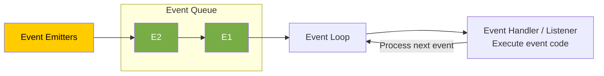

## What are the Main Features & Advantages of Node.js?

| Feature | Advantage |
|---|---|
| **1. Asynchronous** | Enables handling **multiple concurrent requests** and **non-blocking execution** of the thread. |
| **2. V8 JS Engine** | Built on the V8 JS engine from Google Chrome, Node.js **executes code fast**. |
| **3. Event-Driven Architecture** | **Efficient handling of events.** Great for real-time applications like chat applications and gaming applications (using WebSockets), where bidirectional communication is required. |
| **4. Cross-Platform** | Supports deployment on various operating systems, **enhancing flexibility**. |
| **5. JavaScript** | Coding in JavaScript means there is no need to learn a new language. |


## What are the Disadvantages of Node.js? When to Use and When Not to Use Node.js?

### When to Use Node.js

- Ideal for **real-time applications** like chat applications, online gaming, and collaborative tools due to its event-driven architecture.
- Excellent for building **lightweight and scalable RESTful APIs** that handle a large number of concurrent connections.
- Well-suited for building **microservices-based architectures**, enabling modular and scalable systems.

### When Not to Use Node.js (Disadvantages)

- **CPU-Intensive Tasks:** Avoid for applications that involve heavy CPU processing, such as image/video processing and data encryption/decryption. Node.js may not provide optimal performance in such scenarios because it is single-threaded, and for heavy computation, multithreading is better.

## What are Modules in Node.js? What is the Difference Between a Function & a Module?

- A module contains **specific functionality** that can be easily **reused** within a Node.js application.
- Ideally, in Node.js, a JavaScript file can be treated as a module.

module is like order module, and function is inside that modeule work like add or remove order function

```javascript
// myModule1.js
function sayHello(name) {
  console.log("Hello, " + name);
}

module.exports = sayHello;
```

### Function vs. Module

- A **module** is a broader concept that encapsulates functionality, while a **function** is a specific set of instructions within that module.
- Modules can contain **multiple functions and variables**.

### Diagram

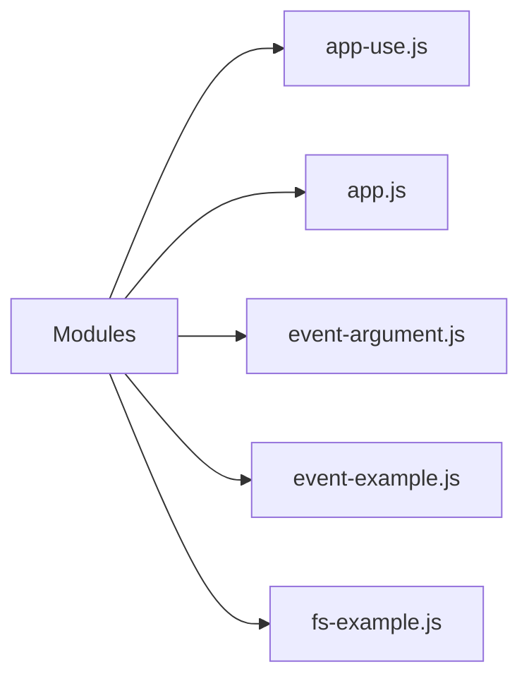


## How Many Ways Are There to Export a Module?

### 1. Using `module.exports`

The `module.exports` object can be used to export the module.

```javascript
// Exporting a function
function sayHello(name) {
  console.log("Hello, " + name);
}

// Exporting a variable
const pi = 3.14159;

// Exporting an object
const myObject = {
  key: "value",
};

// Using module.exports
module.exports.sayHello = sayHello;
module.exports.pi = pi;
module.exports.myObject = myObject;
```

### 2. Using `exports`

The `exports` object can also be used directly to export the module.

```javascript
// Exporting a function
exports.sayHello = function (name) {
  console.log("Hello, " + name);
};

// Exporting a variable
exports.pi = 3.14159;

// Exporting an object
exports.myObject = {
  key: "value",
};
```

## What is a Module Wrapper Function?

In Node.js, each module is wrapped in a function called the **module wrapper function** before it is executed.

### Original Module

```javascript
// app.js
const message = 'Interview Happy';

console.log(message);

// Output: Interview Happy
```

### Converted/Wrapped by Node.js

```javascript
// Wrapper function generated by Node
(function (exports, require, module, __filename, __dirname) {
  const message = "Interview Happy";

  console.log(message);

  // Output: Interview Happy
});
```

## What are the Types of Modules in Node.js?

### 1. Built-in Modules (Core Modules)

These are **already present modules** in Node.js that provide essential functionalities.

Examples:

- `fs` — File system
- `http` — HTTP server
- `path` — Path manipulation
- `util` — Utilities

### 2. Local Modules

These are **user-defined modules (JavaScript files)** created by developers for specific functionalities.

### 3. Third-Party Modules

These are **external packages or libraries created by the community** that provide additional functionalities for Node.js projects.

You install third-party modules using the `npm install` command.

For example:

```bash
npm install lodash
```

## Explain the Role of the `fs` Module. Name Some of Its Functions.

### 7 Main Functions of the `fs` Module

| Function | Description |
|---|---|
| `fs.readFile()` | Reads the content of the specified file. |
| `fs.writeFile()` | Writes data to the specified file, creating the file if it does not exist. |
| `fs.appendFile()` | Appends data to a file. If the file does not exist, it is created. |
| `fs.unlink()` | Deletes the specified file. |
| `fs.readdir()` | Reads the contents of a directory. |
| `fs.mkdir()` | Creates a new directory. |
| `fs.rmdir()` | Removes the specified directory. |

## Explain the Role of the `path` Module. Name Some of Its Functions.

The `path` module provides utilities for **joining, resolving, parsing, formatting, normalizing, and manipulating paths**.

```javascript
// path-example.js

const path = require('path');

// Joining Path Segments
const fullPath = path.join('/docs', 'file.txt');
console.log(fullPath);
// Output: /docs/file.txt

// Parsing Path
const parsedPath = path.parse('/docs/file.txt');
console.log(parsedPath);
/*
Output: {
  root: '/',
  dir: '/docs',
  base: 'file.txt',
  ext: '.txt',
  name: 'file'
}
*/
```

### 5 Main Functions of the `path` Module

```javascript
const path = require('path');

// Joining path segments together
const fullPath = path.join(__dirname, 'folder', 'file.txt');

// Resolving the absolute path
const absolutePath = path.resolve('folder', 'file.txt');

// Getting the directory name of a path
const directoryName = path.dirname('/folder/file.txt');

// Getting the file extension of a path
const fileExtension = path.extname('/folder/file.txt');

// Parsing a path into an object with its components
const pathObject = path.parse('/folder/file.txt');
```

## Explain the Role of the OS Module. Name Some of Its Functions.

- The `os` module in Node.js provides a set of methods for **interacting with the operating system**.
- Developers can use it for building **cross-platform applications** or performing system-related tasks in Node.js applications.

```javascript
const os = require('os');

// 1. Get Platform Information
console.log(os.type());
// Output: 'Windows_NT' or 'Linux'...

// 2. Get Current User Information
console.log(os.userInfo());
// Output: { uid: -1, gid: -1, username: 'anaya', ... }

// 3. Get Memory Information in bytes
console.log(os.totalmem()); // Output: 14877265920
console.log(os.freemem());  // Output: 4961570816
```

The Node.js **`events` module is useful when one action should trigger several independent reactions**.

Think of an online store: when a customer places an order, your application may need to send a confirmation email, generate an invoice, and notify the warehouse.

Your order code can announce **“an order was placed”**, and separate functions can react to that announcement.

```text
Customer places an order
          │
          ▼
   "orderPlaced" event
          │
          ├── Send confirmation email
          ├── Generate invoice
          └── Notify warehouse
```

Here’s a runnable example. Save it as `shop.cjs`. The email, invoice, and warehouse actions are simulated using console messages.

```javascript
const EventEmitter = require("node:events");

// Create an object that can announce events.
const shop = new EventEmitter();

// Register listeners BEFORE emitting the event.

// Listener 1: confirmation email
shop.on("orderPlaced", (order) => {
  console.log(`Sending confirmation email to ${order.email}`);
});

// Listener 2: invoice
shop.on("orderPlaced", (order) => {
  console.log(`Generating invoice for order #${order.id}`);
});

// Listener 3: warehouse notification
shop.on("orderPlaced", (order) => {
  console.log(`Warehouse: pack ${order.quantity} × ${order.product}`);
});

function placeOrder(order) {
  // A real application would validate and save the order first.
  console.log(`Order #${order.id} placed successfully`);

  // Announce what happened and pass the order to every listener.
  shop.emit("orderPlaced", order);

  console.log("Finished notifying listeners");
}

placeOrder({
  id: 101,
  email: "customer@example.com",
  product: "Keyboard",
  quantity: 1,
});
```

Run it with Node.js—no package installation is needed:

```bash
node shop.cjs
```

Output:

```text
Order #101 placed successfully
Sending confirmation email to customer@example.com
Generating invoice for order #101
Warehouse: pack 1 × Keyboard
Finished notifying listeners
```

The two key methods are:

| Method | Meaning |
|---|---|
| `shop.on("orderPlaced", handler)` | “Whenever this event happens, run this function.” |
| `shop.emit("orderPlaced", order)` | “This event happened; here is its data.” |

Node calls the registered listeners when you emit the event. See the [official Node.js events documentation](https://nodejs.org/api/events.html).

**Why use this instead of calling three functions directly?**

Both approaches work. Events help when the reactions may grow or change. For example, you could add an analytics listener without changing `placeOrder()`:

```javascript
shop.on("orderPlaced", (order) => {
  console.log(`Analytics: recorded sale of ${order.product}`);
});
```

**How does this relate to real-time applications?**

An `EventEmitter` communicates inside your running Node.js process. To show an order update immediately in a customer’s browser, you would also use a connection such as WebSockets or Server-Sent Events:

```text
Order status changes
    → Node event listener
    → WebSocket message
    → Customer’s page updates
```

One detail to remember: **listeners run synchronously, in registration order**. Using events does not automatically make work asynchronous or run it in parallel. An asynchronous listener can start an email request, but `emit()` does not wait for its promise to finish. [Node.js documentation](https://nodejs.org/api/events.html#asynchronous-vs-synchronous)


## What are the Advantages of Using Express.js with Node.js?

| Advantage | Description |
|---|---|
| **1. Simplified Web Development** | Express.js provides a lightweight framework that simplifies the process of building web applications in Node.js. |
| **2. Middleware Support** | Easy integration of middleware functions into an application's request-response cycle. |
| **3. Flexible Routing System** | Defining routes for handling different HTTP methods (`GET`, `POST`, `PUT`, `DELETE`, etc.) and URL patterns is easy. |
| **4. Template Engine Integration** | Express.js supports various template engines, making it easy to generate dynamic HTML content on the server side. |

**Template engine:** HTML + Data.

## What is Middleware in Express.js and When to Use It?

A middleware in Express.js is a **function** that handles **HTTP requests**, performs **operations**, and passes control to the **next middleware**.

### Diagram

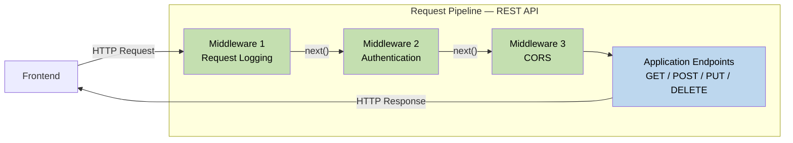

## How Do You Implement Middleware in Express.js?

### 4 Steps to Use Middleware

1. Initialize an Express application.
2. Define a middleware function, `myMiddleware`.
3. Use `app.use()` to mount `myMiddleware` globally, meaning it will be executed for every incoming request to the application.
4. Start the server by listening on a specified port (defaulting to port `3000`) using `app.listen()`.

```javascript
// Create and execute middleware
const express = require("express");
const app = express();

// Define middleware function
const myMiddleware = (req, res, next) => {
  // Middleware logic goes here
  res.send("Interview Happy!");
  next(); // Call the next middleware function
};

// Use middleware globally for all routes
app.use(myMiddleware);

// Start the server
const PORT = 3000;
app.listen(PORT, () => {
  console.log(`Server is running ${PORT}`);
});
```

### Browser Output

At `localhost:3000`:

```text
Interview Happy!
```

## What is the Purpose of the `app.use()` Function in Express.js?

The `app.use()` method is used to **execute (mount) middleware functions globally**.

```javascript
// Create and execute middleware
const express = require("express");
const app = express();

// Define middleware function
const myMiddleware = (req, res, next) => {
  // Middleware logic goes here
  res.send("Interview Happy!");
  next(); // Call the next middleware function
};

// Use middleware globally for all routes
app.use(myMiddleware);

// Start the server
const PORT = 3000;
app.listen(PORT, () => {
  console.log(`Server is running ${PORT}`);
});
```

## What is the Purpose of the `next` Parameter in Express.js?

The `next` parameter is a **callback function** used to **pass control to the next middleware function** in the stack.

## How to Use Middleware Globally for a Specific Route?

```javascript
const express = require('express');
const app = express();

const middleware = (req, res, next) => {
  res.send('Middleware for specific route');
  next();
};

// Use middleware globally for specific routes
app.use('/example', middleware);

const PORT = 3000;
app.listen(PORT, () => {
  console.log(`Server is running ${PORT}`);
});
```

### Browser Output

At `localhost:3000/example`:

```text
Middleware for specific route
```

## What is a Request Pipeline in Express?

The request pipeline in Express.js is a **series of middleware functions** that handle incoming HTTP requests and pass control to the next function.

### Diagram


## What are the Types of Middleware in Express.js?

1. **Application-level middleware**
2. **Router-level middleware**
3. **Error-handling middleware**
4. **Built-in middleware**
5. **Third-party middleware**

### Diagram

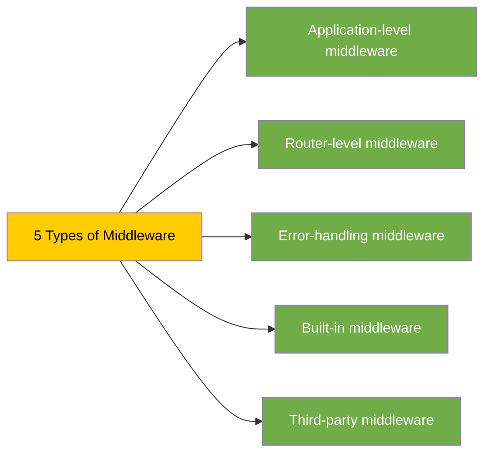

## What is the Difference Between Application-Level & Route-Level Middleware?

| Application-Level Middleware | Route-Level Middleware |
|---|---|
| Applies globally to all incoming requests in the entire Express.js application. | Applies only to specific routes, not to all incoming requests. |


## What is Error-Handling Middleware and How to Implement It?

- Error-handling middleware in Express is a special kind of middleware used to **manage errors** that occur while handling incoming requests.
- To implement error handling in Express, define middleware with four parameters: **`err`, `req`, `res`, `next`**. The additional **error object parameter (`err`)** is used for error handling.

```javascript
const express = require("express");
const app = express();

// Middleware generating error
app.use((req, res, next) => {
  // Simulate an error
  next(new Error("An error occurred"));
});

// Error-handling middleware
app.use((err, req, res, next) => {
  console.error(err.stack);
  res.status(500).send("Something went wrong!");
});

// Start the server
const PORT = 3000;
app.listen(PORT, () => {
  console.log(`Server is running on ${PORT}`);
});
```

### Browser Output

At `localhost:3000`:

```text
Something went wrong!
```

### Console Output

```text
Error: An error occurred
```

## If You Have 5 Middlewares, in Which Middleware Will You Handle Errors?

Error-handling middleware should be **defined last**, after all other middleware.

When an error occurs, Express.js searches for the next error-handling middleware, **skipping regular middleware and route handlers**.

```javascript
// Multiple middlewares
app.use(middleware1);
app.use(middleware2); // Error occurred
app.use(middleware3);
app.use(middleware4);

// Error-handling middleware
app.use((err, req, res, next) => {
  console.error(err.stack);
  res.status(500).send("Something went wrong!");
});
```

### Diagram

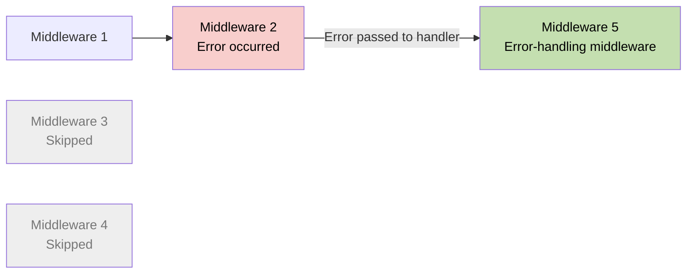

## What is Built-in Middleware? How to Serve Static Files from Express.js?

- **Built-in middleware** consists of functions built into the Express framework that provide common functionalities.
- **`express.static()`** middleware is used for serving static files.

```javascript
const express = require("express");
const app = express();

// Serve static files from the 'public' directory
app.use(express.static("public"));

// Other routes and middleware can be defined here

// Start the server
const PORT = 3000;
app.listen(PORT, () => {
  console.log(`Server is running on :${PORT}`);
});
```

### Browser Output

At `localhost:3000/1.jpg`, the browser displays the image served from `public/1.jpg`.

## What are the Advantages of Using Middleware in Express.js?

| Advantage | Description |
|---|---|
| **1. Modularity** | Middleware allows you to modularize your application's functionality into **smaller, self-contained units**. Each middleware function can handle a specific task or concern, such as logging, authentication, or error handling. |
| **2. Reusability** | Middleware can be reused at **multiple places**, making application code easier to maintain. |
| **3. Improved Request Handling** | Middleware functions have access to both the request (`req`) and response (`res`) objects, enabling you to perform **validations on requests** or modify the response before sending it back to the client. |
| **4. Flexible Control Flow** | Middleware functions can be applied globally to all routes or selectively to specific routes, allowing you to control the flow of request processing in your application. |
| **5. Third-Party Middleware** | Express.js offers a wide range of third-party middleware packages that provide additional functionality, such as `body-parser` and `cors`. |


## What are Route Handlers?

- A **route handler** is the second argument passed to `app.get()` or `app.post()`.
- A route handler function is used to **process the request and generate a response**.

```javascript
const express = require("express");
const app = express();

// Define a route for handling GET requests
app.get("/", (req, res) => {
  res.send("Interview Happy!");
});

// Define a route for handling POST requests
app.post("/login", (req, res) => {
  // Handle login logic
});

// Start the server
const PORT = 3000;
app.listen(PORT, () => {
  console.log(`Server is running on ${PORT}`);
});
```

## What are the Router Object & Router Methods, and How Do You Implement Them?

- The **Router object** is a mini version of an Express application used for **handling routes**.
- **Router methods** are functions provided by the Router object to define routes for different HTTP methods (`GET`, `POST`, `DELETE`, etc.).

### Implement Router Method

```javascript
// router.js
const express = require("express");

// Create a router object
const router = express.Router();

// Define a route for the root URL ('/')
router.get("/", (req, res) => {
  res.send("Interview Happy");
});

// Export the router object
module.exports = router;
```

### Use Router Method

```javascript
// app.js
const express = require("express");
const router = require("./router");
const app = express();

// Mount the router object on a path
app.use("/api", router);

// Start the server
app.listen(3000, () => {
  console.log("Server is running");
});
```

## What is the Difference Between `app.get()` and `router.get()`?

| `app.get()` | `router.get()` |
|---|---|
| Defines routes **directly on the application object**. | Defines routes on a **Router object**. |
| Routes are automatically mounted on the root path (`/`). | Routes are not automatically mounted; they must be explicitly mounted using `app.use()`. |
| Routes are not modular and cannot be reused in other applications. | Routes are modular and can be **reused in other applications** by exporting the Router object. |

### `app.get()` Example

```javascript
// app-get.js
const express = require("express");
const app = express();

app.get("/", (req, res) => {
  res.send("Interview Happy");
});

app.listen(3000, () => {
  console.log("Server is running");
});
```

### `router.get()` Example

```javascript
// router.js
const express = require("express");
const router = express.Router();

// Define a route for the root URL ('/')
router.get("/", (req, res) => {
  res.send("Interview Happy");
});

// Export the router object
module.exports = router;
```

## What are the Top 5 REST Guidelines and Their Advantages?

| Guideline | Description | Advantage |
|---|---|---|
| **1. Separation of Client & Server** | The implementation of the client and the server must be done independently. | Independence allows **easier maintenance, scalability, and evolution**. |
| **2. Stateless** | The server will not store anything about the latest HTTP request the client made. | Treats every request as a new request. It **simplifies server implementation** by avoiding the burden of state management. |
| **3. Uniform Interface** | Identify resources by URL, e.g., `www.abc.com/api/questions`. | Standardized URLs make it **easy to understand and use the API**. |
| **4. Cacheable** | The API response should be cacheable to improve performance. | Caching API responses **improves performance** by reducing repeated requests to the server. |
| **5. Layered System** | The system should follow a layered pattern. | A layered system, such as the Model-View-Controller (MVC) pattern, promotes **modular design** and separation of concerns. |


## Explain the Concept of Idempotence in RESTful APIs

**Idempotence** means performing an operation **multiple times** should have the same outcome as performing it once.

For example, sending multiple identical `GET` requests will always return the same response.

### Methods

| Idempotent Methods | Non-Idempotent Methods |
|---|---|
| `GET` | `POST` |
| `PUT` | |
| `DELETE` | |

## What are Serialization & Deserialization?

- **Serialization** is the process of **converting an object** into a format that can be stored, transmitted, or reconstructed later.
- **Deserialization** is the process of converting serialized data, such as binary, XML, or JSON data, back into an object.

### Diagram

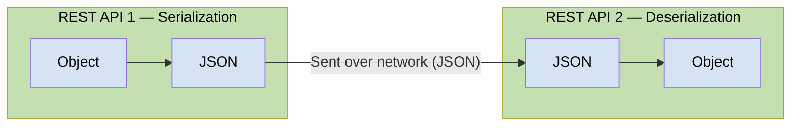

## What are the Types of Serialization?

1. **Binary Serialization**
2. **XML Serialization**
3. **JSON Serialization**

## How to Serialize & Deserialize in Node.js?

### Serialization

Serialize a JavaScript object into JSON format using **`JSON.stringify()`**.

```javascript
// Serialization (to JSON)
const obj = { name: "Happy", age: 39 };

const jsonStr = JSON.stringify(obj);

console.log("Serialized JSON:", jsonStr);
// Output: Serialized JSON: {"name":"Happy","age":39}
```

### Deserialization

Deserialize a JSON string into a JavaScript object using **`JSON.parse()`**.

```javascript
// Deserialization (from JSON)
const jsonStr2 = '{"name":"Happy","age":39}';

const obj2 = JSON.parse(jsonStr2);

console.log("Deserialized JSON:", obj2);
// Output: Deserialized JSON: { name: 'Happy', age: 39 }
```

## Explain the Concept of Versioning in RESTful APIs

Versioning in RESTful APIs refers to the practice of **maintaining multiple versions of an API** to support backward compatibility.

### Diagram

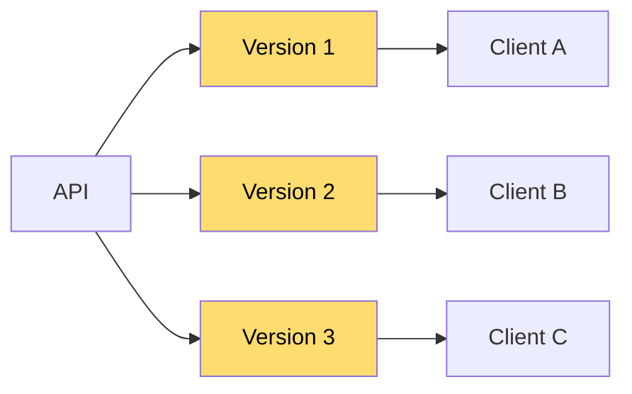

### Example URLs

```text
https://api.example.com/v1/resource
https://api.example.com/v2/resource
https://api.example.com/v3/resource
```


## What is the Typical Structure of a REST API Project in Node.js?

```text
ecommerce-project-root/
├── node_modules/
├── src/
│   ├── controllers/
│   │   ├── productController.js
│   │   └── userController.js
│   ├── models/
│   │   ├── productModel.js
│   │   └── userModel.js
│   ├── routes/
│   │   ├── productRoutes.js
│   │   └── userRoutes.js
│   ├── utils/
│   │   ├── errorHandlers.js
│   │   └── validators.js
│   └── app.js
├── .gitignore
└── package.json
```

| File / Directory | Purpose |
|---|---|
| **`node_modules/`** | Directory where npm packages are installed. |
| **`src/`** | Source code directory. |
| **`controllers/`** | Contains files responsible for handling business logic. |
| **`models/`** | Defines data models. |
| **`routes/`** | Defines API routes. |
| **`utils/`** | Contains reusable functions used across the project. |
| **`app.js`** | Initializes and configures the Express application. Connects routes, middleware, and other configurations. |
| **`.gitignore`** | Specifies files and directories to be ignored by version control, e.g., `node_modules` and `*.log`. |
| **`package.json`** | Contains metadata about the project and its dependencies. |


## What are Authentication and Authorization?

- **Authentication** is the process of **verifying the identity** of a user by validating their credentials, such as a username and password.
- **Authorization** is the process of allowing an authenticated user **access to resources**.
- Authentication always precedes authorization.

### Example

A student signs in to `www.school.com` using a username and password. After authentication, their permissions determine what they can access.

| Resource | Student Access |
|---|---|
| View Result | ✅ Allowed |
| Edit Result | ❌ Only teachers have rights |
| Fees | ✅ Allowed |
| Salary | ❌ Only teachers have rights |

### Diagram

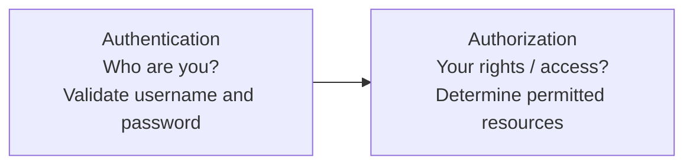


## What are the Types of Authentication in Node.js?

1. **Basic (Username and Password) Authentication**
2. **API Key Authentication**
3. **Token-based Authentication (JWT)**
4. **Multi-factor Authentication (MFA)**
5. **Certificate-based Authentication**

## What is Basic Authentication?

- In Basic Authentication, the user passes their credentials in a **POST request**. At the Node REST API end, credentials are verified, and a response is sent back.
- **Disadvantage:** Basic Authentication sends credentials in plain text over the network, so it is not considered a secure method of authentication.

## What is the Role of Hashing and Salt in Securing Passwords?

- **Hashing:** The process of converting a password into a fixed-size string of characters using a **mathematical algorithm**.
- **Salt:** A random string of data combined with a password before hashing.
  - Salting ensures security even if the hacker **knows the hashing algorithm**.
  - Even if two users **have the same password**, their hashed passwords will differ due to the unique salt.
  - Typically, each user has a unique salt.

### Diagram

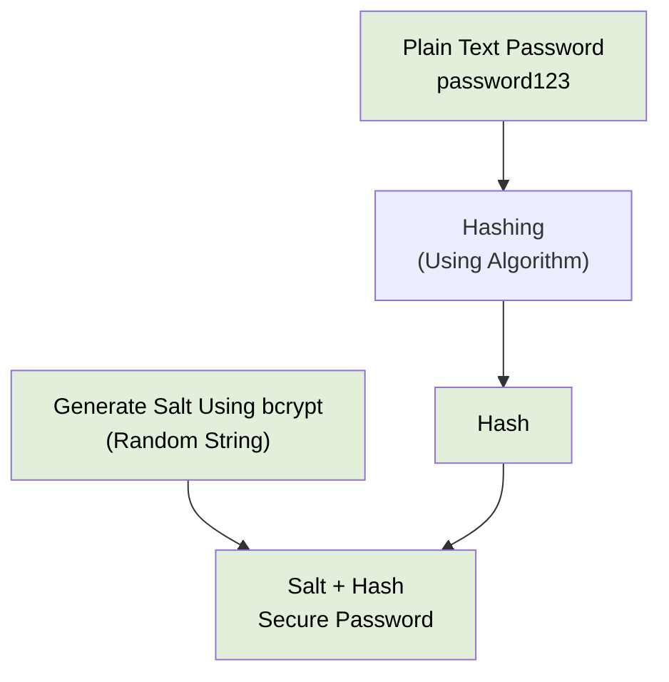

## How Can We Create Hashed Passwords in Node.js?

1. Generate a random salt.
2. Create a hash object using SHA-256.
3. Update the hash object with the salt and password.
4. Get the hashed data as a hexadecimal string.
5. Return the salt and hashed password as a string.

```javascript
const crypto = require("crypto");

// Define a function to hash and salt a password
function hashAndSaltPassword(password) {
  // 1. Generate a random salt
  const salt = crypto.randomBytes(16).toString("hex");

  // 2. Create a hash object using SHA-256
  const hash = crypto.createHash("sha256");

  // 3. Update the hash object with the salt and password
  hash.update(salt + password);

  // 4. Get the hashed data in a hexadecimal string
  const hexHash = hash.digest("hex");

  // 5. Return the salt and hashed password as a string
  return salt + ":" + hexHash;
}
```

## What is API Key Authentication?

- **API Key Authentication:** The API owner shares an API key with users. This key is used to authenticate users of that API.
- **Disadvantage:** API keys can be shared or stolen, so they may not be suitable for all scenarios.

### Example Request Header

```http
ApiKey: <your-api-key>
```

## Where Does the JWT Token Reside in the Request?

In the **request header**.

## What are the Parts of a JWT Token?

A JWT token has **3 parts**:

1. **Header**
2. **Payload**
3. **Signature**

## How to Handle Errors in Synchronous Operations Using `try-catch-finally`?

## What are Error-First Callbacks?

- **Error-first callbacks** are a convention in Node.js for handling asynchronous operations.
- They are called error-first callbacks because the **first argument of a callback function is reserved for an error object**.

```javascript
// Define the error-first callback function
const errorFirstCallback = (error, result) => {
  if (error) {
    console.error("Error:", error.message);
    return;
  }

  console.log("Result:", result);
};

// Call the asynchronous operation and pass the
// error-first callback function as an argument
asyncOperation(errorFirstCallback);

// Function simulating an asynchronous operation
function asyncOperation(callback) {
  // Simulate an asynchronous operation
  setTimeout(() => {
    const error = new Error("Async operation error");

    // Pass error as the first argument of the callback
    callback(error, null);
  }, 0);
}

// Output: Error: Async operation error
```

## What is NoSQL?

**NoSQL (Not Only SQL)** databases are designed to handle **structured, semi-structured, and unstructured data**.

### Diagram

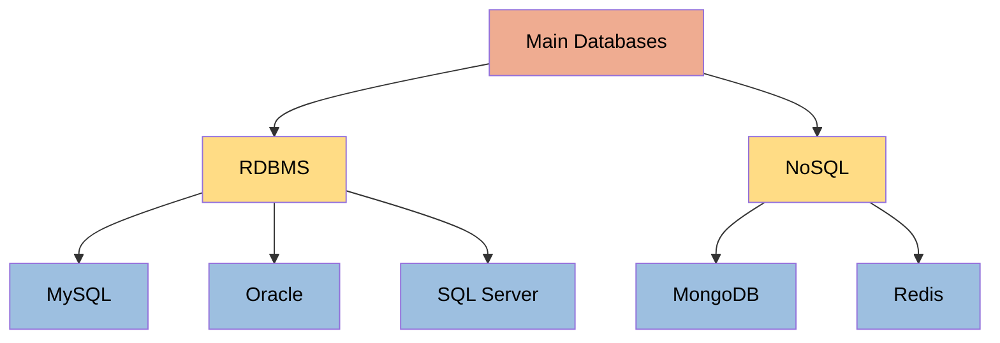


## What is the Difference Between NoSQL & RDBMS?

## When to Use RDBMS and When to Use a NoSQL Database in Your Applications?

## What is Mongoose? What are the Advantages of Using It?

- **Mongoose** is an **Object Data Modeling (ODM)** library for MongoDB and Node.js.
- Mongoose provides a **schema-based solution** to model application data.

### Advantages of Mongoose over Directly Using MongoDB

1. **Data validation**
2. **Middleware support**
3. **Defining relationships between collections**

### Diagram

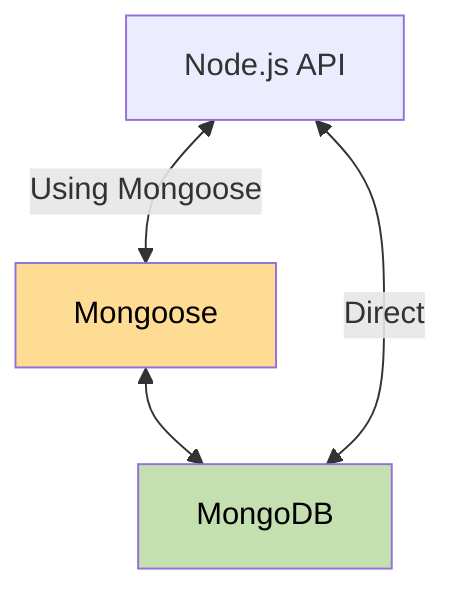


### Q. What is XSS (Cross-Site Scripting) attack?
**XSS (Cross-Site Scripting)** is a security vulnerability where an attacker injects malicious JavaScript into a trusted website. 

For example, consider a Node.js/Express endpoint:
```js
app.get('/search', (req, res) => {
  res.send(`<h1>Search results for: ${req.query.q}</h1>`);
});
```

If an attacker supplies this as `q`:

```html
<script>alert('XSS')</script>
```


**How I prevent it:**

- Use templates with automatic escaping and **context-aware output encoding**. HTML, JavaScript, and URL contexts need different handling.
- Use `textContent` instead of `innerHTML` when displaying plain text.
- If users can submit HTML, sanitize it with a maintained HTML sanitizer.
- Apply a restrictive **Content Security Policy (CSP)** as an additional defense.
- Use `HttpOnly` cookies to prevent JavaScript from reading session cookies. This limits cookie theft but does **not** prevent XSS or authenticated actions.

Input validation helps, but it does not replace safe output handling.

### Q. What is SQL Injection attack?

**SQL Injection (SQLi)** is a vulnerability where an attacker manipulates a database query by supplying malicious input. It happens when an application combines untrusted data with SQL code, allowing the database to interpret that input as part of the query.

An attacker may read sensitive data, bypass authentication, or modify and delete records, depending on the database permissions.

For example, this Node.js code is vulnerable:

```js
const query = `
  SELECT id, email
  FROM users
  WHERE email = '${req.body.email}'
`;

const result = await pool.query(query);
```

If the attacker submits this email:

```text
' OR 1=1 --
```

The query becomes:

```sql
SELECT id, email
FROM users
WHERE email = '' OR 1=1 --'
```

Because `1=1` is always true, the query returns all users instead of matching one email. `--` comments out the remaining quote.

**How to prevent it**

The primary defense is **parameterized queries**, which keep SQL instructions separate from input values.

Using PostgreSQL’s `pg` package:

```js
const result = await pool.query(
  'SELECT id, email FROM users WHERE email = $1',
  [req.body.email]
);
```

Here, the database treats the supplied email as a value, even if it contains SQL syntax.

Additional practices:

- Validate input types, lengths, and business rules.
- Allowlist dynamic table names, column names, and sort directions; ordinary value parameters cannot represent SQL identifiers.
- Give the application database account only the permissions it needs.
- Use ORM parameter binding correctly; concatenated raw SQL can still be vulnerable.
- Avoid exposing database errors to clients.

**The key principle is to parameterize values instead of building SQL through string concatenation.**

### Q. How can you improve the performance of a Node.js application?

**I improve Node.js performance by measuring the bottleneck first, applying a targeted fix, and validating it under realistic load.** I look at response latency—especially p95/p99—throughput, error rate, CPU, memory, and dependency timings.

My main areas of focus are:

1. **Profile the application**
   
   Use CPU profiles, heap snapshots, and request tracing to identify expensive code or slow dependencies. Node’s `perf_hooks` can measure event-loop delay and utilization. [Node.js performance APIs](https://nodejs.org/api/perf_hooks.html)

2. **Keep the event loop responsive**
   
   Avoid synchronous filesystem or crypto operations in request handlers, expensive loops, pathological regular expressions, and processing huge JSON payloads. Simply marking a function `async` does not move its computation off the main thread. [Node.js event-loop guidance](https://nodejs.org/en/learn/asynchronous-work/dont-block-the-event-loop)

3. **Offload CPU-intensive work**
   
   Use a reusable `worker_threads` pool for heavy JavaScript computation. Move long-running work, such as report generation, to background job workers when the API can return before completion. Worker threads usually offer little benefit for ordinary asynchronous I/O. [Worker threads documentation](https://nodejs.org/api/worker_threads.html)

4. **Optimize database access**
   
   Inspect slow queries and execution plans, add appropriate indexes, eliminate N+1 queries, fetch only required fields, and paginate results. Size connection pools against database capacity across **all application instances**.

5. **Handle I/O concurrency carefully**
   
   Run independent operations concurrently instead of awaiting each sequentially. Use bounded concurrency for large batches; an unlimited `Promise.all()` can exhaust connections or overwhelm downstream services. Configure timeouts and reuse connections.

6. **Cache repeated work**
   
   Cache frequently accessed data or expensive results where freshness requirements allow it. Define TTLs, invalidation rules, size limits, and protection against many requests rebuilding the same expired entry.

7. **Control memory and data transfer**
   
   Fix retained objects, unbounded caches, and listener leaks. Stream large files with backpressure instead of buffering everything in memory. Reduce response payloads and use compression where beneficial. [Node.js streams guidance](https://nodejs.org/learn/modules/backpressuring-in-streams)

8. **Scale with dependency limits in mind**
   
   Run multiple processes or container replicas behind a load balancer to use available cores and machines. Keep shared session state external, and ensure additional instances do not overload the database. [Express production guidance](https://expressjs.com/en/advanced/best-practice-performance/)

For example, if tracing shows an endpoint spends 90% of its time waiting for a database query, I would investigate that query and its indexes before changing JavaScript code or adding application instances.


### Q. How can you Deploy a Node.js application?

**A Node.js application can be deployed on a virtual machine, a managed application platform, containers, or serverless infrastructure.** The choice depends on traffic, operational requirements, and the team’s infrastructure.

For a production backend, I would follow this process:

1. **Prepare the application**
   
   Use a supported Node.js LTS release, define a production start command, and read configuration such as `PORT` and database URLs from the environment. Keep secrets outside the repository. [Node.js release guidance](https://nodejs.org/en/about/previous-releases)

   ```json
   {
     "scripts": {
       "start": "node server.js"
     }
   }
   ```

   In containers, the server should usually listen on `0.0.0.0` so it is reachable through the container’s network.

2. **Test and build in CI**
   
   A pipeline typically runs:

   ```bash
   npm ci
   npm run lint
   npm test
   npm run build
   ```

   These assume the project defines those scripts; plain JavaScript may need no build step. `npm ci` installs dependencies from the committed lockfile without updating it. Build dependencies must be available during compilation; the runtime artifact can contain only production dependencies. [npm documentation](https://docs.npmjs.com/cli/commands/npm-ci/)

3. **Package and release**
   
   Produce a versioned deployment artifact, often a Docker image, and deploy the same artifact through staging and production. Inject environment-specific configuration at runtime.

4. **Configure networking and process management**
   
   Place the application behind a reverse proxy or load balancer, configure DNS and HTTPS, and restrict direct access to internal services. On a VM, use a supervisor such as systemd or PM2. With containers, let the platform supervise and restart the application.

5. **Handle database changes**
   
   Run migrations as a controlled release step. Prefer backward-compatible changes so old and new application versions can coexist during deployment and application rollback remains possible.

6. **Deploy with health checks and graceful shutdown**
   
   Use readiness checks before routing traffic to a new instance. On `SIGTERM`, stop accepting requests, drain ongoing work, close database connections, and exit within a defined timeout. Use rolling, blue-green, or canary deployment when availability requires it. [Express deployment guidance](https://expressjs.com/en/advanced/healthcheck-graceful-shutdown/)

7. **Verify and monitor**
   
   Run smoke tests and monitor errors, latency, memory, CPU, and dependency health. Keep the previous artifact available for rollback.

A typical deployment path is:

```text
Git push → CI checks → Build artifact → Staging
         → Production rollout → Health checks → Monitoring
```

###  How to create unit tests using Jest framework?

**Jest is a JavaScript testing framework that provides a test runner, assertions, mocks, and code coverage.** For backend unit tests, I test a function or service in isolation and mock external dependencies such as databases and APIs.

Here is a practical example using **CommonJS**.

**1. Install and configure Jest**

```bash
npm install --save-dev jest
```

Add these scripts to `package.json`:

```json
{
  "scripts": {
    "test": "jest",
    "test:watch": "jest --watch",
    "test:coverage": "jest --coverage"
  }
}
```

Jest discovers files such as `userService.test.js` automatically. [Getting started](https://jestjs.io/docs/getting-started)

**2. Create the service**

```js
// userService.js
async function getUserName(userId, userRepository) {
  if (!Number.isInteger(userId) || userId <= 0) {
    throw new Error('Invalid user ID');
  }

  const user = await userRepository.findById(userId);

  if (!user) {
    throw new Error('User not found');
  }

  return user.name;
}

module.exports = { getUserName };
```

The repository is passed as a dependency, allowing tests to substitute it without connecting to a database.

**3. Write unit tests**

```js
// userService.test.js
const { getUserName } = require('./userService');

describe('getUserName', () => {
  let userRepository;

  beforeEach(() => {
    userRepository = {
      findById: jest.fn(),
    };
  });

  test('returns the name of an existing user', async () => {
    // Arrange
    userRepository.findById.mockResolvedValue({
      id: 1,
      name: 'Asha',
    });

    // Act
    const name = await getUserName(1, userRepository);

    // Assert
    expect(name).toBe('Asha');
    expect(userRepository.findById).toHaveBeenCalledWith(1);
  });

  test('rejects an invalid ID without querying the repository', async () => {
    await expect(
      getUserName(0, userRepository)
    ).rejects.toThrow('Invalid user ID');

    expect(userRepository.findById).not.toHaveBeenCalled();
  });

  test('throws when the user does not exist', async () => {
    userRepository.findById.mockResolvedValue(null);

    await expect(
      getUserName(1, userRepository)
    ).rejects.toThrow('User not found');
  });

  test('propagates repository errors', async () => {
    userRepository.findById.mockRejectedValue(
      new Error('Database unavailable')
    );

    await expect(
      getUserName(1, userRepository)
    ).rejects.toThrow('Database unavailable');
  });
});
```

`jest.fn()` creates a mock that records calls. `mockResolvedValue()` and `mockRejectedValue()` simulate asynchronous success and failure. [Mock documentation](https://jestjs.io/docs/30.0/mock-functions)

**4. Run the tests**

```bash
npm test
npm run test:coverage
```

The main concepts are:

- `describe()` groups related tests.
- `test()` or `it()` defines a test case.
- `expect()` asserts the expected behavior.
- `beforeEach()` prepares fresh state for every test.
- `toBe()` compares primitive values or object identity; `toEqual()` compares object structure.

**Always await or return asynchronous assertions**, otherwise the test may finish before the assertion runs. [Asynchronous testing](https://jestjs.io/docs/asynchronous)

In production projects, I cover success cases, boundary conditions, and failures. I use coverage to find gaps, while keeping assertions focused on observable behavior.

### Explain AAA?

**AAA stands for Arrange, Act, Assert.** It is a pattern for structuring unit tests so each test is easy to understand.

1. **Arrange:** Prepare the inputs, dependencies, mocks, and expected conditions.
2. **Act:** Execute the behavior being tested.
3. **Assert:** Verify the result or expected side effects.

For example, using Jest:

```js
test('returns the name of an existing user', async () => {
  // Arrange
  const userRepository = {
    findById: jest.fn().mockResolvedValue({
      id: 1,
      name: 'Asha',
    }),
  };

  // Act
  const name = await getUserName(1, userRepository);

  // Assert
  expect(name).toBe('Asha');
  expect(userRepository.findById).toHaveBeenCalledWith(1);
});
```

Here, we prepare a mocked repository, call the real service function, and verify both the returned name and the ID passed to the repository.

A good practice is to keep **one clear behavior per test**. Multiple assertions are fine when they verify that same behavior.

### Q. What are Query Operators in MongoDB?

**Query operators in MongoDB define conditions used to select matching documents.** They usually start with `$` and appear in filters for operations such as `find()`, `findOne()`, `updateOne()`, and `deleteMany()`.

For example:

```js
// Find users aged 18 or older.
db.users.find({ age: { $gte: 18 } });
```

The main groups are:

| Group | Common operators | Purpose |
|---|---|---|
| Comparison | `$eq`, `$ne`, `$gt`, `$gte`, `$lt`, `$lte`, `$in`, `$nin` | Compare field values |
| Logical | `$and`, `$or`, `$not`, `$nor` | Combine or negate conditions |
| Element / data type | `$exists`, `$type` | Check field presence or type |
| Array | `$all`, `$elemMatch`, `$size` | Match array contents or length |
| Evaluation / expressions | `$regex`, `$expr`, `$mod` | Match patterns or evaluate expressions |
| Geospatial | `$near`, `$geoWithin`, `$geoIntersects` | Query geographic data |

MongoDB also provides bitwise query operators. [Query operator reference](https://www.mongodb.com/docs/manual/reference/mql/query-predicates/)

**1. Comparison operators**

```js
// Age between 18 and 30, inclusive.
db.users.find({ age: { $gte: 18, $lte: 30 } });

// Role matches either value.
db.users.find({ role: { $in: ['admin', 'editor'] } });
```

`$gt` means greater than; `$gte` includes equality. `$in` matches any listed value, while `$nin` excludes listed values and can also match missing fields. [Comparison operators](https://www.mongodb.com/docs/manual/reference/mql/query-predicates/comparison/)

**2. Logical operators**

```js
// Active users who are either admins or editors.
db.users.find({
  active: true,
  $or: [
    { role: 'admin' },
    { role: 'editor' },
  ],
});
```

Conditions on different fields are implicitly combined with AND. `$not` negates a field condition; `$nor` matches documents satisfying none of its clauses.

**3. Field existence**

```js
db.users.find({ phone: { $exists: true } });
```

This includes documents where `phone` exists but is `null`. `$exists` checks presence, not whether the value is meaningful. [Existence operator](https://www.mongodb.com/docs/manual/reference/operator/query/exists/)

**4. Array operators**

```js
// Contains both skills.
db.users.find({
  skills: { $all: ['Node.js', 'MongoDB'] },
});

// Contains exactly three elements.
db.users.find({ skills: { $size: 3 } });

// One order must satisfy both conditions.
db.users.find({
  orders: {
    $elemMatch: {
      status: 'paid',
      total: { $gt: 1000 },
    },
  },
});
```

**`$elemMatch` ensures the same array element satisfies every condition.** Separate dotted-field conditions can be satisfied by different array elements. [Array matching documentation](https://www.mongodb.com/docs/manual/reference/operator/query/elemmatch/)

**5. Expressions**

```js
// Compare two fields in the same document.
db.products.find({
  $expr: { $gt: ['$salePrice', '$costPrice'] },
});
```

`$expr` allows aggregation expressions inside a query filter. [Expression documentation](https://www.mongodb.com/docs/manual/reference/operator/query/expr/)

In the Node.js driver, the same filter is passed to the collection:

```js
const users = await db.collection('users')
  .find({ active: true, age: { $gte: 18 } })
  .toArray();
```

Query operators determine **which documents match**. Update operators such as `$set` and `$inc` determine **how matching documents change**.

### Q. Compare Query Operators in SQL & MongoDB?

**SQL uses expressions in a `WHERE` clause; MongoDB uses a filter document with operators such as `$gt`, `$in`, and `$or`.** Most common conditions have similar counterparts, but their handling of nulls, missing fields, and arrays differs.

For scalar fields, the common mappings are:

| Condition | SQL `WHERE` expression | MongoDB filter |
|---|---|---|
| Equal | `age = 25` | `{ age: { $eq: 25 } }` or `{ age: 25 }` |
| Not equal | `age <> 25` | `{ age: { $ne: 25 } }` |
| Greater than | `age > 25` | `{ age: { $gt: 25 } }` |
| Greater than or equal | `age >= 25` | `{ age: { $gte: 25 } }` |
| Less than | `age < 25` | `{ age: { $lt: 25 } }` |
| Less than or equal | `age <= 25` | `{ age: { $lte: 25 } }` |
| In a list | `age IN (20, 25, 30)` | `{ age: { $in: [20, 25, 30] } }` |
| Not in a list | `age NOT IN (20, 25)` | `{ age: { $nin: [20, 25] } }` |
| Inclusive range | `age BETWEEN 18 AND 30` | `{ age: { $gte: 18, $lte: 30 } }` |
| AND | `age >= 18 AND active = TRUE` | `{ age: { $gte: 18 }, active: true }` |
| OR | `age < 18 OR active = FALSE` | `{ $or: [{ age: { $lt: 18 } }, { active: false }] }` |
| NOT | `NOT (age >= 18)` | `{ age: { $not: { $gte: 18 } } }` |
| Starts with | `name LIKE 'A%'` | `{ name: { $regex: '^A' } }` |

The pattern example assumes compatible case sensitivity; SQL `LIKE` and MongoDB regular expressions use different pattern syntax. [MongoDB SQL mapping](https://www.mongodb.com/docs/manual/reference/sql-comparison/), [comparison operators](https://www.mongodb.com/docs/manual/reference/mql/query-predicates/comparison/)

For example, these queries express the same condition when the fields have the expected scalar types:

```sql
SELECT *
FROM users
WHERE age >= 18
  AND role IN ('admin', 'editor');
```

```js
db.users.find({
  age: { $gte: 18 },
  role: { $in: ['admin', 'editor'] },
});
```

**The important differences are:**

- **NULL and missing fields:** SQL distinguishes null values using `IS NULL`. MongoDB distinguishes both null and absent fields:

  ```js
  { email: null }                  // Null OR missing
  { email: { $type: 'null' } }     // Explicit null, assuming a scalar field
  { email: { $exists: false } }    // Missing
  { email: { $ne: null } }         // Present and non-null
  ```

  [MongoDB null handling](https://www.mongodb.com/docs/manual/tutorial/query-for-null-fields/)

- **Negation behaves differently:** SQL comparisons involving NULL produce UNKNOWN, which `WHERE` excludes. MongoDB `$ne: 25`, `$nin: [20, 25]`, and `$not` can match documents with missing fields. These are therefore conceptual mappings rather than exact equivalents for every document. [SQL NULL semantics](https://www.postgresql.org/docs/current/functions-comparison.html)

- **Arrays have dedicated operators:** MongoDB provides `$all`, `$size`, and `$elemMatch`. In SQL, similar queries depend on whether the data uses related tables, arrays, or JSON. `$elemMatch` requires one array element to satisfy all specified conditions. [Array matching](https://www.mongodb.com/docs/manual/reference/operator/query/elemmatch/)

### Q. What is projection in MongoDB? How to implement it?

**Projection in MongoDB controls which fields are returned by a query.** The filter selects **which documents** match; the projection selects **which fields** appear in those documents. It does not modify the stored data.

It is similar to selecting specific columns in SQL:

```sql
SELECT name, email FROM users WHERE active = TRUE;
```

**1. Include specific fields**

In the MongoDB shell, pass the projection as the second argument to `find()`:

```js
db.users.find(
  { active: true },               // Filter
  { name: 1, email: 1, _id: 0 }   // Projection
);
```

Example result:

```js
[
  { name: 'Asha', email: 'asha@example.com' }
]
```

For basic field selection:

- `1` includes a field.
- `0` excludes a field.
- `_id` is included by default unless explicitly excluded.
- An inclusion projection excludes unspecified fields.
- An exclusion projection includes unspecified fields. [Projection documentation](https://www.mongodb.com/docs/v8.0/tutorial/project-fields-from-query-results/)

**2. Exclude specific fields**

```js
// Return every field except passwordHash and refreshToken.
db.users.find(
  {},
  { passwordHash: 0, refreshToken: 0 }
);
```

You cannot mix inclusion and exclusion for ordinary fields. Excluding `_id` from an inclusion projection is allowed:

```js
// Valid
{ name: 1, email: 1, _id: 0 }

// Invalid
{ name: 1, passwordHash: 0 }
```

**3. Implement it using the Node.js driver**

Assuming `db` is an established database connection:

```js
const users = await db.collection('users')
  .find(
    { active: true },
    { projection: { name: 1, email: 1, _id: 0 } }
  )
  .toArray();
```

Alternatively, chain `.project()`:

```js
const users = await db.collection('users')
  .find({ active: true })
  .project({ name: 1, email: 1, _id: 0 })
  .toArray();
```

**Notice the syntax difference:** the Node.js driver takes an options object containing `projection`; the shell accepts the projection document directly. [Node.js driver documentation](https://www.mongodb.com/docs/drivers/node/current/crud/query/project/)

**4. Project nested fields**

Use dot notation:

```js
db.users.find(
  {},
  { name: 1, 'address.city': 1, _id: 0 }
);
```

This preserves the nested structure:

```js
{ name: 'Asha', address: { city: 'Pune' } }
```

Projection reduces response size and unnecessary data transfer. For public API responses, I generally prefer explicitly including permitted fields so newly added internal fields are not returned accidentally.

### Q. How to remove _id field from result in MongoDB?

Set **`_id: 0` in the projection** to exclude it from query results.

**MongoDB shell:**

```js
// Return all fields except _id.
db.users.find({}, { _id: 0 });

// Return only name and email.
db.users.find({}, { name: 1, email: 1, _id: 0 });
```

**Node.js MongoDB driver:**

```js
const users = await db.collection('users')
  .find({}, {
    projection: { name: 1, email: 1, _id: 0 },
  })
  .toArray();
```

This removes `_id` **only from the returned results**; it remains in the stored documents. Excluding `_id` is allowed alongside included fields. [MongoDB documentation](https://www.mongodb.com/docs/drivers/node/current/crud/query/project/)

### Q. How do you perform sorting in ascending & descending order in MongoDB?

Use MongoDB’s **`.sort()`** method with:

- **`1`** for ascending order.
- **`-1`** for descending order.

**MongoDB shell:**

```js
// Sort by age: youngest first.
db.users.find().sort({ age: 1 });

// Sort by age: oldest first.
db.users.find().sort({ age: -1 });
```

**Sorting by multiple fields:**

```js
// Age ascending, then name descending for users with the same age.
db.users.find().sort({ age: 1, name: -1 });
```

Fields are prioritized in the order specified.

**Node.js MongoDB driver:**

```js
const users = await db.collection('users')
  .find({ active: true })
  .sort({ age: -1, _id: 1 })
  .limit(10)
  .toArray();
```

This returns the 10 oldest active users. Adding the unique `_id` field breaks ties when ages are equal, producing a consistent order.

Apply `.sort()` to the cursor **before** retrieving results with `.toArray()`. [MongoDB sorting examples](https://www.mongodb.com/docs/manual/reference/sql-comparison/)

### Q. What are Indexes in MongoDB? How indexing make data retrieval faster?

**An index in MongoDB is a separate data structure that stores selected field values in an ordered form, with references to the corresponding documents.** Standard MongoDB indexes use a **B-tree**, allowing efficient lookups, range searches, and supported sorts. Think of a book’s index: it helps locate relevant pages without reading the whole book. [MongoDB indexing documentation](https://www.mongodb.com/docs/manual/indexes/)

**How does it make retrieval faster?**

Suppose a `users` collection contains one million documents:

```js
db.users.find({ email: 'asha@example.com' });
```

Without a suitable index, MongoDB may perform a **collection scan**, checking every document to find matches.

Create an index:

```js
db.users.createIndex({ email: 1 });
```

MongoDB can now:

1. Traverse the index to locate the matching email.
2. Read the relevant index entries.
3. Fetch the matching documents.

This can greatly reduce the number of documents examined, especially when the condition matches only a small portion of the collection.

**Indexes can also support filtering and sorting together**

```js
db.orders.createIndex({ customerId: 1, createdAt: -1 });

db.orders.find({ customerId: 101 })
  .sort({ createdAt: -1 })
  .limit(10);
```

This compound index groups entries by customer, then orders each customer’s entries by creation time. MongoDB can use it to retrieve that customer’s latest orders without separately sorting all their orders.

**Field order matters:** `{ customerId: 1, createdAt: -1 }` and `{ createdAt: -1, customerId: 1 }` support different access patterns. [Index types](https://www.mongodb.com/docs/manual/core/indexes/index-types/)

**How do I verify the improvement?**

Use `explain()` before and after creating the index:

```js
db.users.find({ email: 'asha@example.com' })
  .explain('executionStats');
```

Check:

| Metric or stage | Meaning |
|---|---|
| `COLLSCAN` | Scans collection documents |
| `IXSCAN` | Scans index entries |
| `totalKeysExamined` | Number of index entries examined |
| `totalDocsExamined` | Number of documents examined |
| `nReturned` | Number of documents returned |

I compare the work performed with the number of results returned. **Seeing `IXSCAN` alone does not prove the query is efficient**—it could still scan many index entries. [Explain documentation](https://www.mongodb.com/docs/v8.0/reference/explain-results/)

There are trade-offs: indexes consume storage and memory, and inserts, deletes, and relevant updates must maintain them. Queries matching most documents may gain little benefit. A **covered query** can go further: if the index contains everything needed for filtering and output, MongoDB can answer without fetching documents. [Query optimization](https://www.mongodb.com/docs/manual/core/query-optimization/)

In production, I design indexes around actual query patterns and validate them with execution plans rather than indexing every field.

### Q. What are Indexes in MongoDB? How indexing make data retrieval faster?

**An index in MongoDB is a separate data structure that stores selected field values in an ordered form, with references to the corresponding documents.** Standard MongoDB indexes use a **B-tree**, allowing efficient lookups, range searches, and supported sorts. Think of a book’s index: it helps locate relevant pages without reading the whole book. [MongoDB indexing documentation](https://www.mongodb.com/docs/manual/indexes/)

**How does it make retrieval faster?**

Suppose a `users` collection contains one million documents:

```js
db.users.find({ email: 'asha@example.com' });
```

Without a suitable index, MongoDB may perform a **collection scan**, checking every document to find matches.

Create an index:

```js
db.users.createIndex({ email: 1 });
```

MongoDB can now:

1. Traverse the index to locate the matching email.
2. Read the relevant index entries.
3. Fetch the matching documents.

This can greatly reduce the number of documents examined, especially when the condition matches only a small portion of the collection.

**Indexes can also support filtering and sorting together**

```js
db.orders.createIndex({ customerId: 1, createdAt: -1 });

db.orders.find({ customerId: 101 })
  .sort({ createdAt: -1 })
  .limit(10);
```

This compound index groups entries by customer, then orders each customer’s entries by creation time. MongoDB can use it to retrieve that customer’s latest orders without separately sorting all their orders.

**Field order matters:** `{ customerId: 1, createdAt: -1 }` and `{ createdAt: -1, customerId: 1 }` support different access patterns. [Index types](https://www.mongodb.com/docs/manual/core/indexes/index-types/)

**How do I verify the improvement?**

Use `explain()` before and after creating the index:

```js
db.users.find({ email: 'asha@example.com' })
  .explain('executionStats');
```

Check:

| Metric or stage | Meaning |
|---|---|
| `COLLSCAN` | Scans collection documents |
| `IXSCAN` | Scans index entries |
| `totalKeysExamined` | Number of index entries examined |
| `totalDocsExamined` | Number of documents examined |
| `nReturned` | Number of documents returned |

I compare the work performed with the number of results returned. **Seeing `IXSCAN` alone does not prove the query is efficient**—it could still scan many index entries. [Explain documentation](https://www.mongodb.com/docs/v8.0/reference/explain-results/)

There are trade-offs: indexes consume storage and memory, and inserts, deletes, and relevant updates must maintain them. Queries matching most documents may gain little benefit. A **covered query** can go further: if the index contains everything needed for filtering and output, MongoDB can answer without fetching documents. [Query optimization](https://www.mongodb.com/docs/manual/core/query-optimization/)

In production, I design indexes around actual query patterns and validate them with execution plans rather than indexing every field.

### Q. On which filed you will create an index - projection field or filter field?

**I usually index the filter fields first. I add projection fields when a covered query provides a worthwhile performance benefit.** I also consider sorting when designing the index.

For example:

```js
db.users.find(
  { email: 'asha@example.com' },       // Filter
  { name: 1, email: 1, _id: 0 }       // Projection
);
```

**Indexing the filter field:**

```js
db.users.createIndex({ email: 1 });
```

MongoDB can locate matching index entries efficiently, then fetch the documents to retrieve `name`.

Creating an index only on `name`, the projection field, would generally not help locate the requested email.

**Indexing both filter and projection fields:**

```js
db.users.createIndex({ email: 1, name: 1 });
```

For this query, MongoDB can find the email and return both requested fields directly from the index. This is a **covered query**, which avoids fetching the documents.

We exclude `_id` because it is returned by default and is not part of this compound index. [MongoDB covered queries](https://www.mongodb.com/docs/manual/core/query-optimization/)

My decision process is:

- **Filter fields:** Support efficient document selection.
- **Sort fields:** Include them where needed to support the query’s ordering.
- **Projection fields:** Add them when covering a frequent query justifies a larger index and additional write overhead.

I verify the result using:

```js
db.users.find(
  { email: 'asha@example.com' },
  { name: 1, email: 1, _id: 0 }
).explain('executionStats');
```

For a covered query using this index, `totalDocsExamined` should be **0**. Index design follows the complete query pattern, rather than every field appearing in its output.

### Q. On which filed you will create an index - projection field or filter field?

**I usually index the filter fields first. I add projection fields when a covered query provides a worthwhile performance benefit.** I also consider sorting when designing the index.

For example:

```js
db.users.find(
  { email: 'asha@example.com' },       // Filter
  { name: 1, email: 1, _id: 0 }       // Projection
);
```

**Indexing the filter field:**

```js
db.users.createIndex({ email: 1 });
```

MongoDB can locate matching index entries efficiently, then fetch the documents to retrieve `name`.

Creating an index only on `name`, the projection field, would generally not help locate the requested email.

**Indexing both filter and projection fields:**

```js
db.users.createIndex({ email: 1, name: 1 });
```

For this query, MongoDB can find the email and return both requested fields directly from the index. This is a **covered query**, which avoids fetching the documents.

We exclude `_id` because it is returned by default and is not part of this compound index. [MongoDB covered queries](https://www.mongodb.com/docs/manual/core/query-optimization/)

My decision process is:

- **Filter fields:** Support efficient document selection.
- **Sort fields:** Include them where needed to support the query’s ordering.
- **Projection fields:** Add them when covering a frequent query justifies a larger index and additional write overhead.

I verify the result using:

```js
db.users.find(
  { email: 'asha@example.com' },
  { name: 1, email: 1, _id: 0 }
).explain('executionStats');
```

For a covered query using this index, `totalDocsExamined` should be **0**. Index design follows the complete query pattern, rather than every field appearing in its output.


### Q. What happens if I create an index on all fields of the collection?

**Indexing every field may speed up some reads, but it increases storage, memory pressure, and write overhead. It does not guarantee that every query becomes faster.**

If you create a separate index on every field:

```js
db.users.createIndex({ name: 1 });
db.users.createIndex({ email: 1 });
db.users.createIndex({ age: 1 });
db.users.createIndex({ city: 1 });
```

The main consequences are:

- **More expensive writes:** Inserts and deletes must maintain applicable indexes. Updates must maintain indexes whose keys change. An index may still help locate documents for an update or delete, but maintaining it adds work. [Write performance](https://www.mongodb.com/docs/manual/core/write-performance/)
- **More disk usage and cache pressure:** Indexes occupy storage. Frequently accessed index pages compete for memory, potentially increasing disk reads.
- **Unused indexes:** A field that is rarely queried may add maintenance cost without meaningful read benefits.
- **Queries may still be inefficient:** Separate indexes do not automatically provide the filtering and sorting benefits of a suitable compound index. Low-selectivity queries may gain little from indexing. [Query optimization](https://www.mongodb.com/docs/manual/core/query-optimization/)

For example:

```js
db.users.find({ city: 'Pune' }).sort({ age: 1 });
```

A targeted compound index can support both operations:

```js
db.users.createIndex({ city: 1, age: 1 });
```

**There are also different meanings of “index all fields”:**

| Approach | Important distinction |
|---|---|
| Separate index per field | Each index has its own maintenance cost |
| One compound index containing every field | Field order and prefixes determine which queries it supports efficiently |
| Wildcard index: `{ "$**": 1 }` | Supports queries on unknown or changing field names; it does not replace workload-based index design |

[Compound indexes](https://www.mongodb.com/docs/manual/core/indexes/index-types/), [wildcard indexing guidance](https://www.mongodb.com/docs/manual/core/indexes/index-types/index-wildcard/index-wildcard-compound/)

In production, I create the smallest useful set of indexes for actual filter, sort, and projection patterns, then verify their benefit with `explain('executionStats')` and workload measurements.

### Q. What is the difference between Single Field Indexes & Compound Indexes?

**A single field index indexes one field. A compound index indexes multiple fields in a defined order.**

| Feature | Single field index | Compound index |
|---|---|---|
| Fields indexed | One | Two or more |
| Example | `{ age: 1 }` | `{ city: 1, age: -1 }` |
| Ordering | By one field | By the first field, then subsequent fields |
| Typical use | Queries or sorts on one field | Queries combining filtering and sorting across fields |
| Field order | No field-order decision | Order affects which queries are efficient |

**Single field index:**

```js
db.users.createIndex({ age: 1 });

// Supports filtering by age.
db.users.find({ age: { $gte: 18 } });

// Supports sorting by age.
db.users.find().sort({ age: -1 });
```

MongoDB can traverse an ordinary single field index in either direction, so an ascending index can also support descending sorting.

**Compound index:**

```js
db.users.createIndex({ city: 1, age: -1 });

// Supports filtering by city and sorting by age.
db.users.find({ city: 'Pune' }).sort({ age: -1 });
```

The index first groups entries by `city`, then orders ages descending within each city. [MongoDB index types](https://www.mongodb.com/docs/manual/core/indexes/index-types/)

**The key interview concept is the index prefix.**

For this index:

```js
{ city: 1, age: -1 }
```

- Queries on **`city`** can efficiently use the leading field.
- Queries on **`city` and `age`** can use both fields.
- Queries on **`age` alone** generally cannot perform the same efficient lookup because `city` comes first.

A compound index is therefore **not equivalent to creating separate indexes on each field**. I choose its field order based on the application’s filter and sort patterns. [MongoDB indexing guidance](https://www.mongodb.com/docs/manual/core/query-optimization/)

### Q. What is Mongoose? What are the advantages of using it?

**Mongoose is an Object Data Modeling (ODM) library for MongoDB and Node.js.** It builds on the MongoDB driver and provides schemas, models, validation, type casting, and middleware to simplify working with application data. [Mongoose documentation](https://mongoosejs.com/)

Three core concepts are:

- **Schema:** Defines document fields, types, defaults, and validation rules.
- **Model:** A class compiled from a schema, used to query and modify a collection.
- **Document:** An instance of a model representing an individual record.

For example:

```js
const mongoose = require('mongoose');

const userSchema = new mongoose.Schema(
  {
    name: {
      type: String,
      required: true,
      trim: true,
    },
    email: {
      type: String,
      required: true,
      lowercase: true,
      trim: true,
    },
    age: {
      type: Number,
      min: 0,
    },
  },
  { timestamps: true }
);

const User = mongoose.model('User', userSchema);
```

After establishing a connection:

```js
await mongoose.connect(process.env.MONGODB_URI);

await User.create({
  name: 'Asha',
  email: 'asha@example.com',
  age: 28,
});

const users = await User.find({ age: { $gte: 18 } })
  .select('name email -_id')
  .sort({ name: 1 });
```

**Its main advantages are:**

1. **Consistent data modeling:** Centralizes field definitions, defaults, nested structures, and indexes.
2. **Validation and casting:** Supports required fields, ranges, enums, custom validators, and conversion to declared types.
3. **Convenient queries:** Provides methods such as `findById()`, `create()`, and chainable query helpers.
4. **Middleware:** Runs hooks around supported operations to centralize lifecycle behavior.
5. **Reusable model logic:** Supports document methods, model statics, virtual fields, and plugins. [Schema guide](https://mongoosejs.com/docs/guide.html)
6. **References through `populate()`:** Retrieves referenced documents from other collections, reducing manual application code. [Population guide](https://mongoosejs.com/docs/populate.html)

There are practical caveats:

- Mongoose validation runs in the application; it does not automatically enforce rules on writes from other database clients.
- `unique: true` declares a MongoDB unique index—it is **not a Mongoose validator**.
- Update validators generally require `{ runValidators: true }` and have operation-specific limitations. [Validation documentation](https://mongoosejs.com/docs/validation.html)
- Mongoose documents add memory and processing overhead. For reads that only need plain objects, `.lean()` skips document hydration, but also removes document features such as `.save()`. [Lean documentation](https://mongoosejs.com/docs/tutorials/lean.html)

I would choose Mongoose when shared schemas and model behavior improve maintainability; the native driver is also a valid choice when those abstractions are unnecessary.

**In Mongoose, relationships between collections are usually defined using document IDs and the `ref` option.** You retrieve the referenced documents using **`populate()`**.

The main relationship patterns are:

| Relationship | Example | Typical implementation |
|---|---|---|
| One-to-one | User → Profile | A reference with a unique index |
| One-to-many | User → Posts | Store the user reference in each post |
| Many-to-many | Students ↔ Courses | Arrays of references or a separate enrollment collection |

**1. Define a one-to-many relationship**

One user can write many posts:

```js
const mongoose = require('mongoose');
const { Schema } = mongoose;

const userSchema = new Schema({
  name: { type: String, required: true },
});

const postSchema = new Schema({
  title: { type: String, required: true },
  author: {
    type: Schema.Types.ObjectId,
    ref: 'User',
    required: true,
    index: true,
  },
});

const User = mongoose.model('User', userSchema);
const Post = mongoose.model('Post', postSchema);
```

`ref: 'User'` refers to the **registered model name**, not the collection name.

After connecting to MongoDB, save the referenced user’s ID:

```js
const user = await User.create({ name: 'Asha' });

await Post.create({
  title: 'Understanding Node.js',
  author: user._id,
});
```

Retrieve posts with author details:

```js
const posts = await Post.find({ author: user._id })
  .populate('author', 'name');
```

`populate()` replaces the returned `author` ID with the referenced user document. It generally performs additional queries; it does not rewrite the stored reference. [Mongoose population](https://mongoosejs.com/docs/populate.html)

**2. Define a one-to-one relationship**

Store a user reference in a profile, with a unique index:

```js
const profileSchema = new Schema({
  user: {
    type: Schema.Types.ObjectId,
    ref: 'User',
    required: true,
    unique: true,
  },
  bio: String,
});

const Profile = mongoose.model('Profile', profileSchema);
```

Once the unique index exists, a user can have **at most one profile**. This does not require every user to have a profile. `unique` declares an index rather than a Mongoose validator. [Validation documentation](https://mongoosejs.com/docs/validation.html)

**3. Define a many-to-many relationship**

For students and courses, a separate enrollment collection supports growing relationships and extra information:

```js
const enrollmentSchema = new Schema({
  student: { type: Schema.Types.ObjectId, ref: 'Student' },
  course: { type: Schema.Types.ObjectId, ref: 'Course' },
  enrolledAt: { type: Date, default: Date.now },
});

enrollmentSchema.index(
  { student: 1, course: 1 },
  { unique: true }
);
```

Register the `Student`, `Course`, and enrollment models before using population.

**When should you embed instead?**

Embed small, bounded data that belongs to its parent and is commonly read together, such as a user’s address. Embedded subdocuments live inside the parent document; references point to separate documents. [Mongoose subdocuments](https://mongoosejs.com/docs/subdocs.html)

**A crucial distinction:** `ref` does not enforce foreign-key integrity or cascade deletes. Your application must handle missing references, authorization, and deletion rules.

### Q. How to define relationships between collections using Mongoose?

**In Mongoose, relationships between collections are usually defined using document IDs and the `ref` option.** You retrieve the referenced documents using **`populate()`**.

The main relationship patterns are:

| Relationship | Example | Typical implementation |
|---|---|---|
| One-to-one | User → Profile | A reference with a unique index |
| One-to-many | User → Posts | Store the user reference in each post |
| Many-to-many | Students ↔ Courses | Arrays of references or a separate enrollment collection |

**1. Define a one-to-many relationship**

One user can write many posts:

```js
const mongoose = require('mongoose');
const { Schema } = mongoose;

const userSchema = new Schema({
  name: { type: String, required: true },
});

const postSchema = new Schema({
  title: { type: String, required: true },
  author: {
    type: Schema.Types.ObjectId,
    ref: 'User',
    required: true,
    index: true,
  },
});

const User = mongoose.model('User', userSchema);
const Post = mongoose.model('Post', postSchema);
```

`ref: 'User'` refers to the **registered model name**, not the collection name.

After connecting to MongoDB, save the referenced user’s ID:

```js
const user = await User.create({ name: 'Asha' });

await Post.create({
  title: 'Understanding Node.js',
  author: user._id,
});
```

Retrieve posts with author details:

```js
const posts = await Post.find({ author: user._id })
  .populate('author', 'name');
```

`populate()` replaces the returned `author` ID with the referenced user document. It generally performs additional queries; it does not rewrite the stored reference. [Mongoose population](https://mongoosejs.com/docs/populate.html)

**2. Define a one-to-one relationship**

Store a user reference in a profile, with a unique index:

```js
const profileSchema = new Schema({
  user: {
    type: Schema.Types.ObjectId,
    ref: 'User',
    required: true,
    unique: true,
  },
  bio: String,
});

const Profile = mongoose.model('Profile', profileSchema);
```

Once the unique index exists, a user can have **at most one profile**. This does not require every user to have a profile. `unique` declares an index rather than a Mongoose validator. [Validation documentation](https://mongoosejs.com/docs/validation.html)

**3. Define a many-to-many relationship**

For students and courses, a separate enrollment collection supports growing relationships and extra information:

```js
const enrollmentSchema = new Schema({
  student: { type: Schema.Types.ObjectId, ref: 'Student' },
  course: { type: Schema.Types.ObjectId, ref: 'Course' },
  enrolledAt: { type: Date, default: Date.now },
});

enrollmentSchema.index(
  { student: 1, course: 1 },
  { unique: true }
);
```

Register the `Student`, `Course`, and enrollment models before using population.

**When should you embed instead?**

Embed small, bounded data that belongs to its parent and is commonly read together, such as a user’s address. Embedded subdocuments live inside the parent document; references point to separate documents. [Mongoose subdocuments](https://mongoosejs.com/docs/subdocs.html)

**A crucial distinction:** `ref` does not enforce foreign-key integrity or cascade deletes. Your application must handle missing references, authorization, and deletion rules.

### Q. How Mongoose provide middleware support? What are Pre & Post Hooks?

**Mongoose provides middleware through schema-level functions called hooks.** They run before or after supported document, query, model, or aggregation operations.

| Hook | When it runs | Common uses |
|---|---|---|
| **Pre hook** | Before the operation | Transform data, perform checks, prepare values |
| **Post hook** | After successful completion | Logging, metrics, follow-up processing |

Register them using `schema.pre()` and `schema.post()`:

```js
const mongoose = require('mongoose');

const userSchema = new mongoose.Schema({
  name: String,
  lastSavedAt: Date,
});

// Document middleware: `this` is the document.
userSchema.pre('save', function () {
  this.lastSavedAt = new Date();
});

userSchema.post('save', function (doc) {
  console.log('User saved:', doc._id);
});

// Register hooks before compiling the model.
const User = mongoose.model('User', userSchema);

// After connecting to MongoDB:
await User.create({ name: 'Asha' });
```

The sequence is: **pre-save hook → database save → post-save hook**.

Mongoose supports four middleware types:

- **Document:** `this` is the document, such as in `save` hooks.
- **Query:** `this` is the query, such as in `findOneAndUpdate` hooks.
- **Model:** `this` is the model, such as in `insertMany` hooks.
- **Aggregate:** `this` is the aggregation object.

**Important details:**

- Use regular functions when accessing `this`.
- Hooks can be `async`; Mongoose awaits their promises.
- Throwing in a pre hook prevents the operation.
- `create()` triggers save hooks; `updateOne()` and `findOneAndUpdate()` do **not**.
- Validation normally runs before custom pre-save hooks.
- A post-hook failure does not automatically undo a completed database write.

[Mongoose middleware documentation](https://mongoosejs.com/docs/middleware.html)


video 135 for forgot password and reset password

keep in mind when we are using the middleware protect, there we are adding the useer to res then the user details is available on all the routes below that

security of cookie ----------- video 142 full dekhna -------------. res k cookies me humne apna jwt store kia and httponly mark kia h means no 3rd party can store it.

video 145 bhi theek h

** Special note: Many functions, checks, validators do not work on updationg one or many. So we should keep it in mind

video 102-107 phir se dekhna h

we need to form like "import-dev-data.js" of jonas to have the backup or default file to upload in database if anthing bad happen

Browser has document and window
Node has process and global

REST API
The api's which are made on REST architecture. The rest architecture is below
1. Separate API into logical resources
    -- What is resorce. It is an object or a representation of something which has some data associated to it. Any information can be named as resource. 
2. Expose structured resource-based URL's
3. Use HTTP methods
    -- Not to use end points like test.com/getTor => test.com/tour  (get method)
4. Send data as JSON
5. Be Stateless - like not storing the page on which user is

To read/write the file which is available in local folder we use the fs module ie fs.readFilesync and fs.writeFilesync. Path used be in form of __dirname /file/te.json

app.use(express.json({ limit : '10kb' })) It works as middleware and helps to get the data from the request body, also limits the data on body allowable

To get the dynamic params => api/v1/products/:id and use through req.params.id
req.query me hamesa object aata h
find, findbyid, findone etc ye sab "query promise" k form me return karte h. isi query pe hum sort, paginate etc lagate h then promise resolve karte h
for query - http://localhost:3000/api/v1/tours?duration[gte]=5&difficulty=easy

Please read about the process.argv in detail

Mongodb is schemaless while mysql is opposite. mongodb me hum kuch bhi ghused dete h

//--------------------Schema and Model-------------
We make schema(condition ) fist and then we make the model form it. Model is function used to connect to schema(blueprint) with a name. Layered form of schema is the model. schema => model => model instance
Generally the collection name is plural
First argument of the model of mongoose is the collection or table name
eg const data = mongoose.model('collection_name', dataSchema)

    image: {
        type: [String],   // Here how we define the type is important
        required: [true, "Please share the images"]
    },


In Schema, we have 
- unique
- default
- required
- min and max
- validate or validator
- trim (only for string)
- select - if it is false means it will not be visible in response api
- get
- set
- alias
- immutable
- transform

String
- lowercase
- uppercase
- trim
- match
- enum
- minLength
- maxLength
- populate

Number
- min
- max
- enum
- populate

Date
- min
- max
- expires

-----------------------------
console.log(__dirname)
console.log(__filename)
const path = require('path')
console.log(path.join(__dirname,"../../public"))

express.static defines the folder which serves directly means if it has the about.html filr, you can access directly like localhost:3000/about.html.  Jab ye folder define kar denge phir iske ander file dhyan se rakhni padegai

aur agr code me ye path use krna ho to src='/images/self.png'

app.use(express.static(path.join(__dirname,'public')));

-----------------------------
https://expressjs.com/en/4x/api.html#app
explore left section of above url


// ---------------- MVC Architecture---------------
Model Layer - It is concerned with everything about application data and business logic
Controller Layer - It's function is to handle the application's request, interect with models, and send back responses to the client
View Layer - used for the graphical interface, ssr website, template to generate the view. Basically presenation logic

FAT Model/THIN Controllers - Offload as much logic as possible into the models and keep the cotrollers as simple and lean as possible.


// ----------------------- Aggregation---------------
We basically define a pipeline that all documents from a certain collection go through where they are processed step by step in order to transform them into aggregated results.
eg we use aggregation pipeline in order to calculate averages, min, max values 
self note - basically data k uper calcution kr k kuch naya data dena.

aggreation is use to calculate the statics of the collection data in various steps or stages
eg we use aggregation pipeline in order to calculate averages, min, max values 
It occurs in stages, 
eg  Stage 1 - match
    Stage 2 - group it has _id means on which basis you want to group. if null is provided means no group or one single group. 
    Stage 3 - sort
    Stage 4 - match
https://www.mongodb.com/docs/manual/aggregation/   site for defination and example
self note - basically data k uper calcution kr k kuch naya data dena.

We have the virtual properties which do not save the data but return in response of api. These data can not be used for query


----------- https://mongoosejs.com/docs/middleware.html
We have the pre and post save middleware ie Document middleware which work before and after saving the document. "This" points towards the schema

We have the pre and post find middleware ie query middleware. "This" points towards the quey. Isme bas quey chalti h jo data filter karti h. We can use the regex in find to use various type of find query

We have the pre and post aggregation middleware. "This" points towards the aggregation.


------------ validation
enum


// ------------------------ Error Handling --------------------
video 112 concept is good, not the code
video 114 logic is must. 115 code and logic
video 116 kafi deep logical h, catchasync h
video 123 is also good

we always have 4, (err, req, res, next) => {}

We need to understand separately
- errorObject
- unhandled route
- catch and async or catchasync - iske error kaise flow kar rahe h

isOperational why it is added


----------------------- Auth ---------------
video 128 gives how JWT works
point to note that password hashing is one side, means we can encrypt it but can't decrypt it. It is for safety purpose that no one can use that password on another platform
Generally hume jwt me pas id pass karni chaiye coz, jwt debugger se data nikala ja sakta h. iska main use ye rehta h ki information koi bhi dekh le but koi ishe modify na kar paye

we can create a method on the instance of schema

video 132 part 2 is the good one


------------------- POSTMAN -----------------
video 133 for advanced postman setup

---------------------
we have the routes protected to certain user and login also like admin and subadmin


----------------------- MODELLING DATA -------------------
Relation
1:1
1: Many - further subdivide are few, many, ton
Many : Many

                                        data modelling
                                embedding           referencing
                                                child  parent  two-way

how to decide which type of data referencing we should use like embedding or referencing. see video 148,151,152 is must
ek hoto h child referencing and ek hoti h parent referencng
ek hota h virtual, ek hota h populate, phir ek hota h virtual populate

=> Ja child me parent ki id mark ki ho(parent referencing) and then child ko call kr k parent ki detail nikalni ho to populate use hoga. same case me agr parent ko call kr k child ki detail nikalni ho to virtual populate hoga
=> virtual me as ek additional node add krna api me jo kuch calculate kr k de, without storing/adding/using the database


video - 153 - child referencing
video - 154,156,157 - parent referencing and virtual populate - we mostly use it
159 kam samjh aaya

factory function banna padega pr wo project k last me banaunga

indexes - video 167 very much important - Indexes created the performance very much----------- we need to create at the end

populate or virtual populate me hum kabhi query nhi kr sakte like sum, avg. just we can show the data


methods vs static in mongoose, the differece is that one is called after making the instance and other one is called directly

video 168,169 aache content h

we can use the index for preventing the duplicate values like 2 reviews by single user

we have the set function in the schema.

video 200 for multer, imp
204 for multiple images imp h - multiple case me single and multiple dono cover ho jata h, we have the single and array

if needed, frontend pe 203 dekhna

we have the resize the photo function

we are using the sharp package to image resize

jab koi function kafi controller me use karna ho to bas uska ek factorycontroller bna lo design ek middleware(req,res,next) jaisa hone chaiye na ki koi function file bna k usko import karo controller file me

Jab calculation karni ho to aggregation agar data dikhana ho to populate
