```
https://nodejs.org/learn/asynchronous-work/event-loop-timers-and-nexttick?utm_source=chatgpt.com
```

Visit above url

### concurrency versus parallelism - get answer of it

### We have the pre and post method in model schema of mongodb

###  Node.js Code Conversion: High-Level code to Machine Code

### We can use the zod validation of the payload. first we define the schema and then validate it

### What is the Difference Between NoSQL & RDBMS?

## When to Use RDBMS and When to Use a NoSQL Database in Your Applications?

### Check code structure of authorization

### Instaed of making functions in the utils, We can also make function in the model or schema file. So the function related to that schema to be available in the file.


<br>

### Configuration for uniform error and response, also async handler in node js

<details>

```js
// src/utils/ApiError.js

class ApiError extends Error {
    constructor(
        statusCode,
        message= "Something went wrong",
        errors = [],
        stack = ""
    ){
        super(message)
        this.statusCode = statusCode
        this.data = null
        this.message = message
        this.success = false;
        this.errors = errors

        if (stack) {
            this.stack = stack
        } else{
            Error.captureStackTrace(this, this.constructor)
        }

    }
}

export {ApiError}
```

```js
// src/utils/ApiResponse.js
class ApiResponse {
    constructor(statusCode, data, message = "Success"){
        this.statusCode = statusCode
        this.data = data
        this.message = message
        this.success = statusCode < 400
    }
}

export { ApiResponse }
```

```js
// src/utils/asyncHandler.js
const asyncHandler = (requestHandler) => {
    return (req, res, next) => {
        Promise.resolve(requestHandler(req, res, next)).catch((err) => next(err))
    }
}


export { asyncHandler }


// const asyncHandler = () => {}
// const asyncHandler = (func) => () => {}
// const asyncHandler = (func) => async () => {}


// const asyncHandler = (fn) => async (req, res, next) => {
//     try {
//         await fn(req, res, next)
//     } catch (error) {
//         res.status(err.code || 500).json({
//             success: false,
//             message: err.message
//         })
//     }
// }
```

usage

```js
// src/controllers/user.controller.js
import { asyncHandler } from "../utils/asyncHandler.js";
import {ApiError} from "../utils/ApiError.js"
import { User} from "../models/user.model.js"
import {uploadOnCloudinary} from "../utils/cloudinary.js"
import { ApiResponse } from "../utils/ApiResponse.js";
import jwt from "jsonwebtoken"
import mongoose from "mongoose";


const registerUser = asyncHandler( async (req, res) => {

    const {fullName, email, username, password } = req.body
    //console.log("email: ", email);

    if (
        [fullName, email, username, password].some((field) => field?.trim() === "")
    ) {
        throw new ApiError(400, "All fields are required")
    }

    const existedUser = await User.findOne({
        $or: [{ username }, { email }]
    })

    if (existedUser) {
        throw new ApiError(409, "User with email or username already exists")
    }
    //console.log(req.files);

    const avatarLocalPath = req.files?.avatar[0]?.path;
    //const coverImageLocalPath = req.files?.coverImage[0]?.path;

    let coverImageLocalPath;
    if (req.files && Array.isArray(req.files.coverImage) && req.files.coverImage.length > 0) {
        coverImageLocalPath = req.files.coverImage[0].path
    }
    

    if (!avatarLocalPath) {
        throw new ApiError(400, "Avatar file is required")
    }

    const avatar = await uploadOnCloudinary(avatarLocalPath)
    const coverImage = await uploadOnCloudinary(coverImageLocalPath)

    if (!avatar) {
        throw new ApiError(400, "Avatar file is required")
    }
   

    const user = await User.create({
        fullName,
        avatar: avatar.url,
        coverImage: coverImage?.url || "",
        email, 
        password,
        username: username.toLowerCase()
    })

    const createdUser = await User.findById(user._id).select(
        "-password -refreshToken"
    )

    if (!createdUser) {
        throw new ApiError(500, "Something went wrong while registering the user")
    }

    return res.status(201).json(
        new ApiResponse(200, createdUser, "User registered Successfully")
    )

} )

const loginUser = asyncHandler(async (req, res) =>{
    // req body -> data
    // username or email
    //find the user
    //password check
    //access and referesh token
    //send cookie

    const {email, username, password} = req.body
    console.log(email);

    if (!username && !email) {
        throw new ApiError(400, "username or email is required")
    }
    
    // Here is an alternative of above code based on logic discussed in video:
    // if (!(username || email)) {
    //     throw new ApiError(400, "username or email is required")
        
    // }

    const user = await User.findOne({
        $or: [{username}, {email}]
    })

    if (!user) {
        throw new ApiError(404, "User does not exist")
    }

   const isPasswordValid = await user.isPasswordCorrect(password)

   if (!isPasswordValid) {
    throw new ApiError(401, "Invalid user credentials")
    }

   const {accessToken, refreshToken} = await generateAccessAndRefereshTokens(user._id)

    const loggedInUser = await User.findById(user._id).select("-password -refreshToken")

    const options = {
        httpOnly: true,
        secure: true
    }

    return res
    .status(200)
    .cookie("accessToken", accessToken, options)
    .cookie("refreshToken", refreshToken, options)
    .json(
        new ApiResponse(
            200, 
            {
                user: loggedInUser, accessToken, refreshToken
            },
            "User logged In Successfully"
        )
    )

})

const logoutUser = asyncHandler(async(req, res) => {
    await User.findByIdAndUpdate(
        req.user._id,
        {
            $unset: {
                refreshToken: 1 // this removes the field from document
            }
        },
        {
            new: true
        }
    )

    const options = {
        httpOnly: true,
        secure: true
    }

    return res
    .status(200)
    .clearCookie("accessToken", options)
    .clearCookie("refreshToken", options)
    .json(new ApiResponse(200, {}, "User logged Out"))
})

const updateUserAvatar = asyncHandler(async(req, res) => {
    const avatarLocalPath = req.file?.path

    if (!avatarLocalPath) {
        throw new ApiError(400, "Avatar file is missing")
    }

    //TODO: delete old image - assignment

    const avatar = await uploadOnCloudinary(avatarLocalPath)

    if (!avatar.url) {
        throw new ApiError(400, "Error while uploading on avatar")
        
    }

    const user = await User.findByIdAndUpdate(
        req.user?._id,
        {
            $set:{
                avatar: avatar.url
            }
        },
        {new: true}
    ).select("-password")

    return res
    .status(200)
    .json(
        new ApiResponse(200, user, "Avatar image updated successfully")
    )
})

export {
    registerUser,
    loginUser,
    logoutUser,
    refreshAccessToken,
    changeCurrentPassword,
    getCurrentUser,
    updateAccountDetails,
    updateUserAvatar,
    updateUserCoverImage,
    getUserChannelProfile,
    getWatchHistory
}
```
</details>

<br>

### Using middleware

Middleware functions are functions that have access to:

- The request object (req)
- The response object (res)
- The next middleware function in the application’s request-response cycle, commonly named next


Middleware functions can perform the following tasks:

- Execute any code.
- Modify the request and response objects.
- End the request-response cycle.
- Pass control to the next middleware function.


If a middleware function does not end the request-response cycle, it must call next() to pass control to the next middleware function. Otherwise, the request will be left hanging.

<br>

### What is node js
- Node is neither a language nor a framework
- It is a runtime environment for executing JS code on the server side
- JS is high level language while express is its framework
- Node.js is a JavaScript runtime environment built on Chrome's **V8 engine**.
- It allows JavaScript to run outside the browser, making it a powerful tool for various applications beyond web development.


#### Architecture Diagram
```
┌──────────────────────────────┐
│           NODE.JS            │
│                              │
│    ┌────────────────────┐    │
│    │     V8 Engine      │    │
│    └────────────────────┘    │
│                              │
│    ┌────────────────────┐    │
│    │ Node APIs & Modules│    │
│    └────────────────────┘    │
│                              │
└──────────────────────────────┘
```
<br>

### How Node.js is a runtime environment on the server side, what is V8

- Browsers execute the JS on the clinet and similarly node js executes on the server side
- V8 is the JS engine

- **Runtime Environment:** Primarily focuses on providing the necessary infrastructure for **code execution**, including services like memory management and I/O operations. eg Node js

- **Framework:** Primarily focuses on **simplifying the development process** by offering a structured set of tools, libraries, and best practices. eg express js

<br>

### What are the 7 Main Features of Node.js?

1. **Single Threaded**
2. **Asynchronous**
3. **Event-Driven**
4. **V8 JavaScript Engine**
5. **Cross-Platform**
6. **NPM (Node Package Manager)**
7. **Real-Time Capabilities**

<br>

### Module Export & Requirements in nodejs.
We all know that keeping all the Node.js code in a single file is not good practice, right? We need multiple files to create a large project , so in this chapter, we will explore how we can create those file and import concepts like modules and export requirements.

These two files, **app.js and xyz.js**, have different code that is not related to each other, so in NodeJS we call them separate modules.

**Q: How do you make two modules work together?**
- using a require function

**Q: What is the require function?**

In Node.js, the require() function is a built-in function that allows you to include or require other modules into your main modules.

Since in node js we can only provide the single entry file, so we need to use second file in first file then we use the require function, 

```js
// in xyz.js
console.log("Reached at the sum module")

function calculateSum(a, b) {
    const sum = a + b;
    console.log(sum);
}

```

```js
// in app.js
require('./xyz');
console.log('Hello World');
var a = 10;
var b = 20;
calculateSum(a, b);
```

**In console we see**
```
Reached at the sum module
Hello World

and error which calculateSum is not defined
```

<br>

### Big question is how we console "Reached at the sum module" but the function error why ?

- Modules `protects` their `variables and function to leak`.
- so when we used the require then it runs the file but prevent the variable and function from leak, to use it then we need to export it

```js
// in xyz.js
console.log("Reached at the sum module")

function calculateSum(a, b) {
    const sum = a + b;
    console.log(sum);
}

module.export = calculateSum
```

```js
// in app.js
const calculateSum = require('./xyz');
console.log('Hello World');
var a = 10;
var b = 20;
calculateSum(a, b);
```

- module is the built-in
- The importing module is of two type `CommonJS modules (CJS) and ES modules (ESM)`.

<br>

###  CommonJS Modules (CJS) vs ES Modules (ESM)

| CommonJS Modules (CJS) | ES Modules (ESM) |
|------------------------|------------------|
| `module.exports`, `require()` | `import`, `export` |
| By default used in Node.js (traditionally) | Commonly used in frameworks like React and Angular |
| Older module system | Modern module system |
| Synchronous loading | Supports asynchronous module loading |
| Non-strict mode by default | Strict mode by default |
| File extension: `.cjs` | File extension: `.mjs` |


**Note:** 
- Modern Node.js supports both CommonJS and ES Modules.
- ESM is not always asynchronous—static imports are resolved and evaluated through the module loading process, while `import()` supports dynamic asynchronous loading.
- In node, `CJS is default`, if we want to use the `ESM` then we need to pas `type: module` in package.json

<br>

### `require` Mechanism in Node.js

Here's a detailed five-step mechanism of how `require()` works:

#### 1. Resolve
Node.js determines the full path of the module.

- First, it checks whether the module is a built-in module (like `fs` or `path`).
- If not, it checks relative or absolute file paths when specified.
- For package imports, it searches `node_modules` directories.

#### 2. Load
Node.js loads the module based on its resolved filename and format.

- JavaScript files are loaded as CommonJS modules when applicable.
- JSON files are parsed into JavaScript objects.
- Native addons (`.node`) are loaded through the native module loader.

#### 3. Wrap
Node.js wraps CommonJS module code inside a function to provide **module-level scope**.

The wrapper function looks like this:

```js
(function (exports, require, module, __filename, __dirname) {
    // Module code
});
```

This prevents variables declared inside a module from becoming global variables.

#### 4. Compile
Node.js uses the **V8 engine** to compile JavaScript code for execution.

- V8 parses and compiles JavaScript.
- V8 uses Just-In-Time (JIT) compilation to optimize execution.

#### 5. Execute
The module code is executed inside the wrapper function.

- The module's code runs.
- `module.exports` contains the exported values.
- Node.js caches the module after loading, so subsequent `require()` calls normally reuse the cached exports.

<br>

### What happens when we require the same module multiple times?

~~~javascript
// counter.js
console.log("Module loaded");

module.exports = {
    count: 10
};
~~~

~~~javascript
// index.js
const first = require('./counter');
const second = require('./counter');

console.log(first === second);

// Output:
// Module loaded
// true
~~~

**Explanation:**

- Node.js executes `counter.js` only once because the module is `cached` after the first successful `require()`.
- The second `require()` returns the `cached exported object rather than executing the module again`.

<br>

### LIBUV

Wikipedia page - Node.js has an event-driven architecture capable of asynchronous I/O.

JavaScript itself is synchronous, but with the power of Node.js, it can handle asynchronous operations, allowing JavaScript to perform multiple tasks concurrently.

Since JS is sync in nature, if any long or blocking task comes which can cause the performance issue. So the longer time consuming task is operated in async mode. Below is the diagram, basically all the async task were handled by the LIBUV library which is written in c, then we can say node is async in nature.


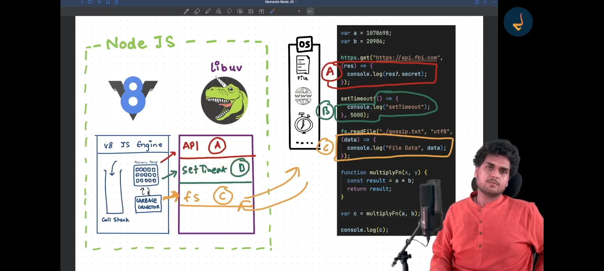

**Line form node official website** - A Node.js app runs in a single process, without creating a new thread for every request. Node.js provides a set of asynchronous I/O primitives in its standard library that prevent JavaScript code from blocking. In addition, libraries in Node.js are generally written using non-blocking paradigms. Accordingly, blocking behavior is the exception rather than the norm in Node.js.

**Node is async I/O due to libuv**

<br>

### V8 JavaScript Engine: Code Execution Phases

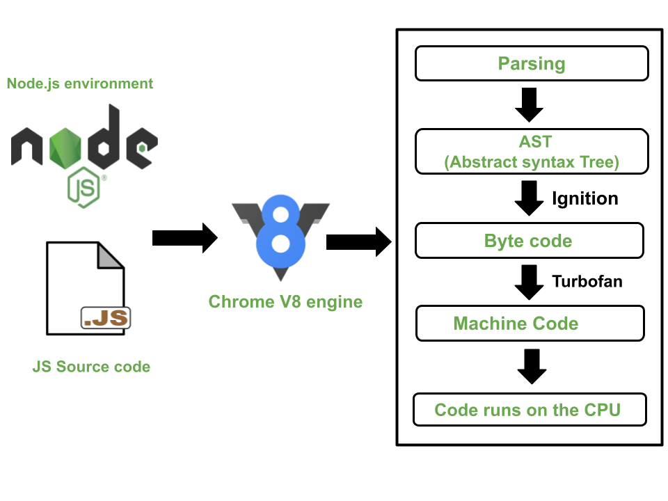

#### 1. Parsing Stage
- **Lexical Analysis:** V8 reads the JavaScript code and breaks it down into tokens, which are small chunks like keywords, operators, and identifiers.
- **Syntax Analysis:** The tokens are then arranged into a structure called an Abstract Syntax Tree (AST), which represents the code's structure and logic.

#### 2. Ignition (Interpreter)
- **Bytecode Generation:** V8 converts the AST into bytecode, a simpler, intermediate form of the code that’s easier to run.
- **Execution:** The Ignition interpreter runs this bytecode directly, allowing the code to start executing quickly, but not yet fully optimized.

#### 3. Profiling
- **Hotspot Detection:** As the code runs, V8 watches for parts of the code that are used a lot, called "hot" functions. It gathers data on these parts to decide if they should be optimized.

#### 4. TurboFan (Optimizing Compiler)
- **Optimization:** For the frequently used "hot" code, V8 uses the TurboFan compiler to turn the bytecode into highly optimized machine code, making it run much faster.
- **Deoptimization:** If the assumptions used to optimize the code turn out to be wrong (like a variable type changing), V8 can revert the code back to a slower, but safer, execution mode.

#### 5. Garbage Collection
- **Memory Management:** V8 regularly cleans up memory by removing data that the program no longer needs, making sure that memory usage stays efficient.

#### 6. Final Execution
- **Execution:** The optimized code continues to run efficiently until the program finishes or until changes in the code require adjustments.

<br>

This step-by-step process ensures that JavaScript code is executed as quickly and efficiently as possible.

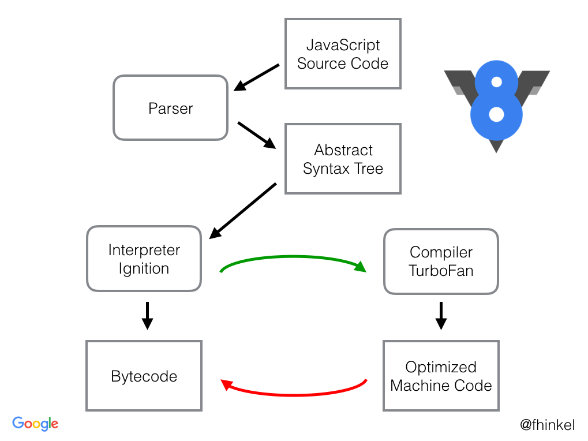

<br>

### Below is more detailed structiure of node
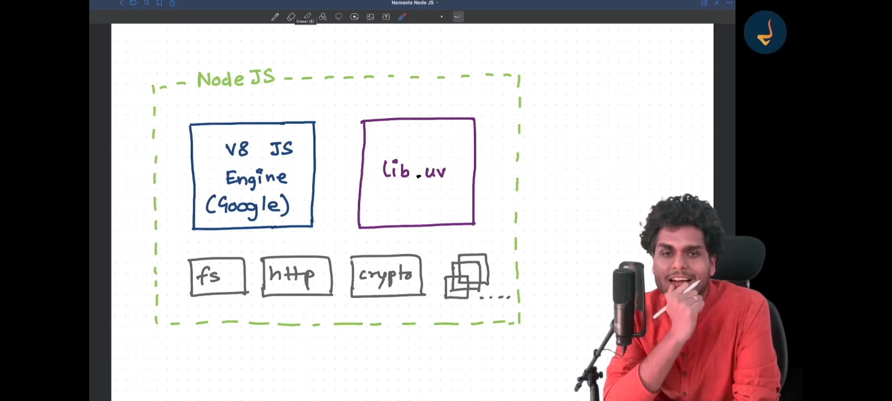

<br>

### Event loop diagram in node js

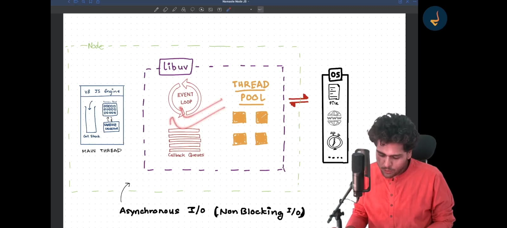

**Note: Event loop lies inside the libuv libraray**

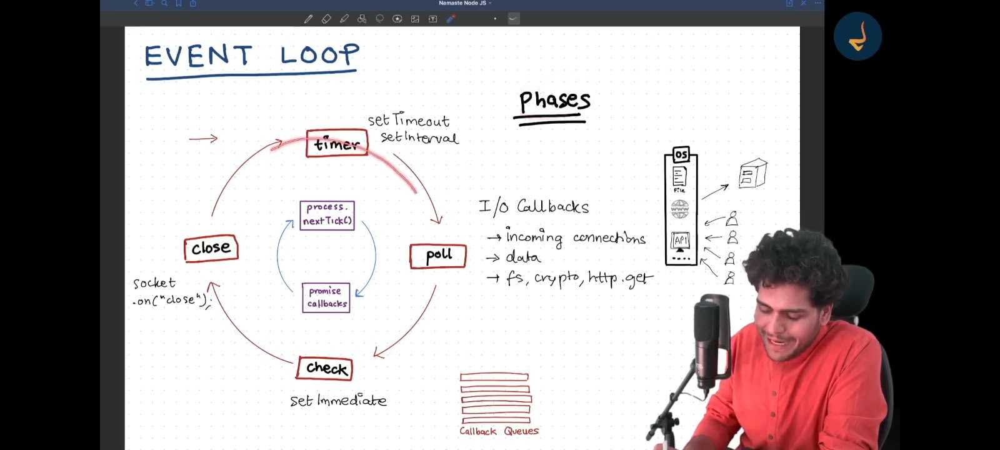

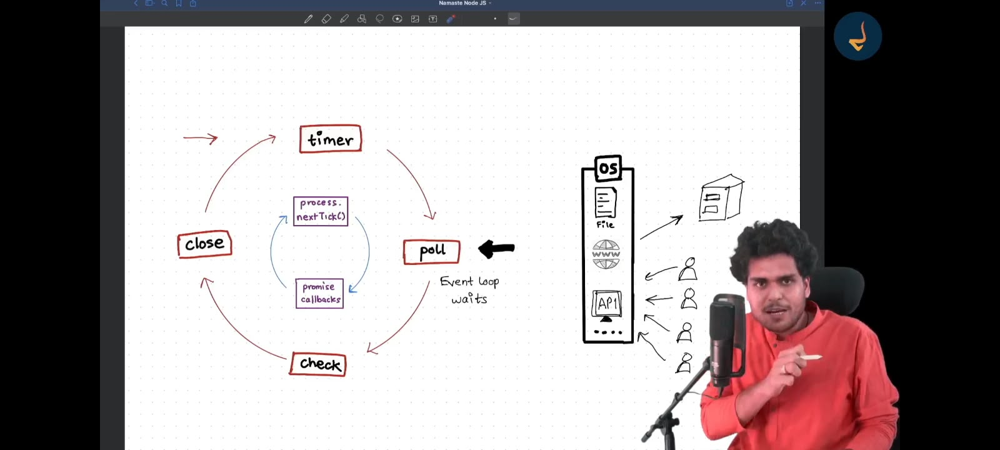

**Note:** 
- when there is nothing in callstack and event queue, then event loop wait at polls
- nextTick and promises cycles runs before each time ie timers,poll,check,close

<br>

### Explanation of each phase

**1. Timers Phase:** In this phase, all callbacks that were set using  `setTimeout` or `setInterval` are executed. These timers are checked, and if their time has expired, their corresponding callbacks are added to the callback queue for execution.

**2. Poll Phase:** After timers, the event loop enters the Poll phase, which is crucial because it handles I/O callbacks. For instance, when you perform a file read operation using `fs.readFile` , the callback associated with this I/O operation will be executed in this phase. The Poll phase is responsible for handling all I/Orelated tasks, making it one of the most important phases in the event loop.

**3. Check Phase:** Next is the Check phase, where callbacks scheduled by the `setImmediate` function are executed. This utility API allows you to execute callbacks immediately after the Poll phase, giving you more control over the order of operations.

**4. Close Callbacks Phase:** Finally, in the Close Callbacks phase, any callbacks associated with closing operations, such as socket closures, are handled. This phase is typically used for cleanup tasks, ensuring that resources are properly released.

- *Event Loop Cycle with `process.nextTick()` and `Promises`*
<br>

### One More Important Note
*When the event loop is empty and there are no more tasks to execute, it enters the `poll phase` and essentially waits for incoming events*

<br>

### Thread pool in libuv

Whenever there's an asynchronous task, V8 offloads it to libuv. For example, when reading a file, libuv uses one of the threads in its thread pool. The file system (fs) call is assigned to a thread in the pool, and that thread makes a request to the OS. While the file is being read, the thread in the pool is fully occupied and cannot perform any other tasks. Once the file reading is complete, the engaged thread is freed up and becomes available for other operations. For instance, if you're performing a cryptographic operation like hashing, it will be assigned to another thread. There are certain functions for which libuv uses the thread pool.

In Node.js, the default size of the `thread pool is 4 threads:`

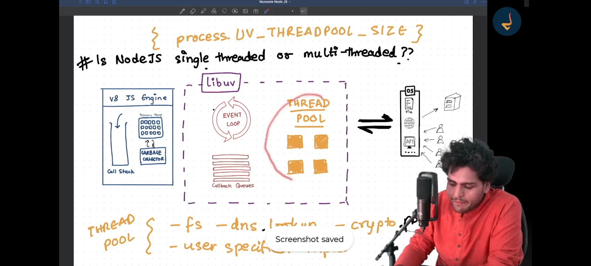

<br>

### Is node js single thread or multi thread

So answer is if the operation is sync in nature then it is single thread, if it is async in nature then it is multi thread beacuse async task is handled by libuv, and in libuv has thread pool ie 4 in count, so each task gets occupied by single thread in libuv which performs the task like fs. and keeps separate the main thread from blocking.

Below is the examle that thread pool size is 4 in libuv

```js
const fs = require("fs");
const crypto = require("crypto")

process.env.UV_THREADPOOL_SIZE = 5;

// fs.readFile("./file.txt", "utf-8", (err, data) => {
//     console.log(data);
// })
// The 4 keys will generate first and after that remaining one will be generated after some time because 
// nodejs has only 4 threads at a time 

crypto.pbkdf2("Akshad", "salt", 500000, 10, "sha512", (err, key) => {
    console.log("1st key generated below:")
    console.log(key);
})
crypto.pbkdf2("Akshad", "salt", 500000, 10, "sha512", (err, key) => {
    console.log("2 nd key generated below:")
    console.log(key);
})
crypto.pbkdf2("Akshad", "salt", 500000, 10, "sha512", (err, key) => {
    console.log("3 nd key generated below:")
    console.log(key);
})
crypto.pbkdf2("Akshad", "salt", 500000, 10, "sha512", (err, key) => {
    console.log("4 nd key generated below:")
    console.log(key);
})
crypto.pbkdf2("Akshad", "salt", 500000, 10, "sha512", (err, key) => {
    console.log("5 nd key generated below:")
    console.log(key);
})
```

If you run above code then you see that 4 logs at a single time and 5th logs after some time. This is because 4 thread block by 4 task. then anyone task which completes then it unblocks the thraed and 5th task handed to that thread.

<br>

### Suppose you have a server with many incoming requests, and users are hitting APIs. Do these APIs use the thread pool?

1. Node.js does **not create a separate thread for every incoming API request**.
2. It uses a single main JavaScript thread with an **Event Loop** to execute JavaScript callbacks.
3. When multiple requests arrive, Node.js can handle their asynchronous operations without blocking the main thread.
4. Network I/O operations, such as MongoDB, Redis and HTTP requests, generally use OS-level asynchronous I/O, not the libuv thread pool.
5. Node.js uses the **libuv Thread Pool** for specific operations like filesystem operations, crypto and `dns.lookup()`.
6. The libuv thread pool has **4 threads by default**, configurable using `UV_THREADPOOL_SIZE`.
7. While I/O operations are waiting, the Event Loop can process other requests and callbacks.
8. CPU-intensive JavaScript operations can block the Event Loop and slow down other requests.
9. To handle CPU-intensive tasks, Node.js provides **Worker Threads**, which execute JavaScript on separate threads.
10. **In short:** Event Loop handles JavaScript execution, OS handles many asynchronous I/O operations, and libuv Thread Pool handles specific background operations.

If 1000 request comes, and api has sync operation then it operates one by one 1000 request. If api has async request then api hands over the OS, and executes rest part and other api, when it gets completed then send this response

<br>

### Important points to follow:

1. **DON'T BLOCK THE MAIN THREAD**
 - Don't use `sync` methods
 - Don't do operations on `heavy JSON Object` it will make load on main thread.
 - Avoid complex `Regular Expression`.
 - Avoid `Complex calculations` and big or `infine loops`.

<br>

### Route exception case

```js
app.get("/ab?c", ()=>{})
```

Here means route will work for /abc, /ac also ie b is optional

```js
app.get("/ab+c", ()=>{})
```

Here means route will work for /abc,/abbbc also. b can be of any count

```js
app.get("/ab*cd", ()=>{})
```

Here means it will work for abcd, also what ever you will write between ab and cd.

<br>

### How does Node.js handle child threads? or simply worker threads

visit video - https://www.youtube.com/watch?v=JTl6tQ4bqYA

site link - https://nodejs.org/api/worker_threads.html?utm_source=chatgpt.com

While Node.js operates off a `single main thread`, it can harness the full power of multi-core systems by launching child threads for specific tasks, such as file compression or image processing

**Thread Pool and Worker Threads**
To manage these child threads, Node.js uses a combination of:

- A `thread pool`, powered by the libuv library.
- `Worker threads` for dedicated, offloaded computation.

```js
// index.js

const express = require("express");
const { Worker } = require("worker_threads");

const app = express();
const port = process.env.PORT || 3000;

app.get("/non-blocking", (req, res) => {
    res.status(200).send("This page is non-blocking.");
});

app.get("/blocking", (req, res) => {
    const worker = new Worker("./worker.js");

    worker.on("message", (data) => {
        res.status(200).send(`Result is ${data}`);
    });

    worker.on("error", (err) => {
        res.status(400).send(`An Error occured : ${err}`);
    });
});

app.listen(port, () => {
    console.log(`App listening on port ${port}`);
});
```

```js
// worker.js

const { parentPort } = require("worker_threads");

let result = 0;
for (let i = 0; i < 10000000000; i++) {
    result++;
}

parentPort.postMessage(result);
```

<br>

### Describe the event-driven programming in Node js.

**Event-driven programming** is a programming approach where the execution of code depends on events and their corresponding handlers (callbacks).

In Node.js, instead of continuously waiting for an operation to complete, we register event listeners or callbacks. When an event occurs, Node.js executes the associated handler.

#### **1. How does it work?**

1. An event occurs, such as an HTTP request, file completion or user action.
2. Node.js detects the event.
3. A callback or event handler is registered to handle it.
4. When the event is ready, its handler is scheduled for execution.
5. The Event Loop executes the callback when the JavaScript thread is available.

#### **2. Example using EventEmitter**

Node.js provides a built-in module called `events`.

```js
const EventEmitter = require("events");

const emitter = new EventEmitter();

// Register event listener
emitter.on("userCreated", (user) => {
  console.log("User created:", user.name);
});

// Trigger event
emitter.emit("userCreated", {
  name: "Amit"
});
```

**Output:**

```
User created: Amit
```

Here:

- `on()` registers an event listener.
- `emit()` triggers an event.
- The callback executes when the event is emitted.

#### **3. Real-world example**

Suppose a user registers on an application.

After registration, multiple operations might happen:

- Send a welcome email.
- Generate an audit log.
- Send a notification.
- Update analytics.

Instead of tightly coupling all these operations, you can publish a `userRegistered` event.

Different listeners can independently handle that event.

#### **4. Benefits**

- Loose coupling between modules.
- Better scalability.
- Efficient asynchronous processing.
- Non-blocking I/O.
- Easier integration with message queues like Kafka and RabbitMQ.

<br>

### Core Modules in node .js

- **os**: Provides system-related utility functions. Example: os.freemem(), os.totalmem().
- **util**: General utility functions primarily used for debugging. Example: util.inspect().
- **fs**: Offers extensive file system capabilities. Commonly used methods include fs.readFile() and fs.writeFile().
- **http/https**: Implements web server and client. Example: http.createServer().
- **net**: Facilitates low-level networking tasks. Example: net.createServer().
- **dgram**: Delivers UDP Datagram Socket support for messaging.
- **crypto**: Encompasses cryptographic operations. Common methods include crypto.createHash() and crypto.createHmac().
- **zlib**: Offers data compression capabilities integrated with various modules like http.
- **stream**: Facilitates event-based data stream processing.
- **path**: Aids in file path string manipulation.
- **url**: Parses and formats URL strings, especially beneficial in web applications and server operations.

<br>

### What are streams in Node.js and what types are available? 

video - https://www.youtube.com/watch?v=64LJJhT6Ybo

`Node.js` utilizes `streams` for efficient handling of input/output data, offering two main varieties: readable and writable.

Categories of Streams
- `Standard Streams`: Represent standard input, output, and error. These are instances of Readable or Writable streams.
- `Duplex Streams`: Facilitate both reading and writing. They can be connected to processes or handling pipelines.
- `Transform Streams`: A special type that acts as an intermediary, modifying the data as it passes through.

Practical Implementations
- `HTTP Transactions`: HTTP clients use readable and writable streams for sending requests and receiving responses. HTTP servers also apply these streams for similar actions in the opposite direction.
- `File System`: Reading and writing files in Node.js utilizes these streams. For instance, the fs.createReadStream() method generates a readable stream whereas fs.createWriteStream() creates a writable one.

<br>

### How do you read and write files in Node.js?

```js
import { readFile, writeFile, appendFile } from 'node:fs/promises';

try {
  // Write a file (creates it or overwrites existing contents).
  await writeFile('example.txt', 'Hello, Node.js!\n', 'utf8');

  // Read the file as text.
  const contents = await readFile('example.txt', 'utf8');
  console.log(contents);

  // Add text without overwriting.
  await appendFile('example.txt', 'Another line.\n', 'utf8');
} catch (error) {
  console.error('File operation failed:', error.message);
}
```

<br>

### How do you use the EventEmitter in Node.js?

Node.js’s built-in `EventEmitter` lets you register listeners for named events and trigger them with data.

```js
import { EventEmitter } from 'node:events';

const emitter = new EventEmitter();

// Listen for an event.
function greet(name) {
  console.log(`Hello, ${name}!`);
}

emitter.on('greet', greet);

// Trigger the event and pass data to listeners.
emitter.emit('greet', 'Alice'); // Hello, Alice!

// Listen only once.
emitter.once('connected', () => {
  console.log('Connected!');
});

emitter.emit('connected'); // Connected!
emitter.emit('connected'); // No output.

// Remove a specific listener.
emitter.off('greet', greet);
```

Key points:

- **`.on(event, listener)`** registers a listener.
- **`.emit(event, ...args)`** calls listeners synchronously, in registration order.
- **`.once(event, listener)`** automatically removes the listener after its first call.
- **`.off(event, listener)`** removes a listener using the same function reference.

Handle the special `'error'` event: emitting it without a registered listener throws an error.

```js
emitter.on('error', (error) => {
  console.error('Something failed:', error.message);
});

emitter.emit('error', new Error('Connection lost'));
```

For CommonJS, use:

```js
const { EventEmitter } = require('node:events');
```

<br>

### How do you manage path operations in Node.js?

Use Node.js’s built-in **`path` module** to construct and inspect file paths.

```js
const path = require('node:path');

// Join path segments using the operating system’s separator.
const filePath = path.join('users', 'alice', 'notes.txt');

// Resolve a path into an absolute path.
console.log(path.resolve('notes.txt'));

// Extract parts of a path.
console.log(path.basename(filePath)); // 'notes.txt'
console.log(path.dirname(filePath));  // 'users/alice' on macOS/Linux
console.log(path.extname(filePath));  // '.txt'

// Simplify redundant separators and "." or ".." segments.
console.log(path.normalize('users/alice/../bob/notes.txt'));

// Check whether a path is absolute.
console.log(path.isAbsolute(filePath)); // false
```

Common methods:

| Method | Purpose |
|---|---|
| `join()` | Combine path segments and normalize the result |
| `resolve()` | Produce an absolute path, using the current working directory when needed |
| `basename()` | Get the final filename or directory name |
| `dirname()` | Get the parent directory |
| `extname()` | Get the file extension |
| `parse()` | Split a path into `root`, `dir`, `base`, `name`, and `ext` |
| `relative()` | Calculate a relative path between two locations |

Path operations manipulate strings; they don’t check whether files exist. Use `path.win32` or `path.posix` when you need a specific platform’s path rules.

<br>

### Explain process.nextTick().

**`process.nextTick(callback)` schedules a callback to run after the current synchronous code finishes, before Node.js continues processing the event loop**, including timers and I/O callbacks. [Node.js documentation](https://nodejs.org/api/process.html#processnexttickcallback-args)

```js
console.log('Start');

setTimeout(() => {
  console.log('Timer');
}, 0);

process.nextTick(() => {
  console.log('Next tick');
});

console.log('End');
```

Output:

```text
Start
End
Next tick
Timer
```

The synchronous statements run first. Node.js then processes the next-tick queue before handling the timer.

It’s useful for deferring a callback so callers can finish setup—for example, registering event listeners before an object emits an event.

Avoid repeatedly scheduling `nextTick()` callbacks recursively: Node.js drains this queue before continuing, so an endless chain can prevent timers and I/O from running.

For most new code that simply needs to defer work, Node.js recommends **`queueMicrotask()`** and marks `process.nextTick()` as Legacy. To yield to the event loop between chunks of work, use `setImmediate()`. [Scheduling guidance](https://nodejs.org/api/process.html#when-to-use-queuemicrotask-vs-processnexttick)

<br>

### What is the global object in Node.js?

The **global object** in Node.js provides values and functions accessible throughout your application without importing them.

You can access it through **`globalThis`** (standard JavaScript) or **`global`** (Node.js-specific):

```js
console.log(globalThis === global); // true

// Examples of globally available APIs:
console.log(process.version);
setTimeout(() => console.log('Hello!'), 1000);
```

Common globals include:

| Global | Purpose |
|---|---|
| `console` | Log messages and errors |
| `process` | Access process information and environment variables |
| `Buffer` | Work with binary data |
| `setTimeout()` | Schedule a callback after a delay |
| `setInterval()` | Schedule repeated callbacks |


**Top-level variables in Node.js modules are not global:**

```js
var message = 'Hello'; // Scoped to this module.
console.log(globalThis.message); // undefined
```

Also, `require`, `module`, `__filename`, and `__dirname` are supplied to individual CommonJS modules; they aren’t properties of the global object.

<br>

### How do you connect a MySQL database with Node.js?

Use the **`mysql2` package**, which supports promises, connection pools, and prepared statements. [MySQL2 documentation](https://sidorares.github.io/node-mysql2/docs)

1. **Install the driver:**

   ```bash
   npm install mysql2
   ```

2. **Create a `.env` file** with credentials for an existing MySQL database and user:

   ```dotenv
   DB_HOST=localhost
   DB_PORT=3306
   DB_USER=app_user
   DB_PASSWORD=your_password
   DB_NAME=my_database
   ```

   Keep this file out of version control.

3. **Create `database.cjs`:**

   ```js
   const mysql = require('mysql2/promise');

   const pool = mysql.createPool({
     host: process.env.DB_HOST,
     port: Number(process.env.DB_PORT || 3306),
     user: process.env.DB_USER,
     password: process.env.DB_PASSWORD,
     database: process.env.DB_NAME,
     connectionLimit: 10
   });

   async function main() {
     try {
       // Executes a query to verify the connection.
       const [rows] = await pool.execute(
         'SELECT ? AS message',
         ['Connected to MySQL!']
       );

       console.log(rows[0].message);
     } catch (error) {
       console.error('Database operation failed:', error.message);
       process.exitCode = 1;
     } finally {
       await pool.end();
     }
   }

   main().catch(console.error);
   ```

4. **Run with a current Node.js version:**

   ```bash
   node --env-file=.env database.cjs
   ```

The pool opens connections as needed and reuses them. Calling `pool.execute()` automatically acquires and releases a connection. Use `?` placeholders for data values instead of inserting user input into SQL strings. [Queries and pools](https://sidorares.github.io/node-mysql2/docs)

For a web server, keep one shared pool and call `pool.end()` during shutdown, rather than after each request.

<br>

### What’s the role of ORM in Node.js?

An **ORM (Object-Relational Mapper)** connects your Node.js application’s objects and models to relational database tables. It translates operations such as creating, finding, and updating records into SQL.

For example, with a `Sequelize` model named `User`:

```js
const users = await User.findAll({
  where: { active: true }
});
```

This produces a query conceptually like:

```sql
SELECT * FROM users WHERE active = true;
```

An ORM commonly helps with:

- **Models:** Define how application data maps to tables and columns.
- **CRUD operations:** Create, read, update, and delete records.
- **Relationships:** Represent associations, such as users having many posts.
- **Migrations:** Manage database schema changes.
- **Transactions:** Group operations so they succeed or fail together.

Examples used with Node.js include **Sequelize, TypeORM, and Prisma**.

Compared with using a driver such as `mysql2` directly, an ORM adds a higher-level interface and reduces repetitive database code. You still need to understand SQL, indexes, and query performance; complex operations may benefit from raw SQL.

ORMs can help parameterize queries, but unsafe raw SQL can still introduce SQL injection vulnerabilities.

<br>

### How can you monitor the performance of a Node.js app?

- **Requests:** Throughput, error rate, and p95/p99 response times, broken down by route. Average latency alone can hide slow requests.
- **Runtime:** CPU, RSS and heap usage, garbage-collection pauses, event-loop delay, and event-loop utilization. Node provides `process.memoryUsage()` and `perf_hooks` for these.
- **Dependencies:** Database query duration, connection-pool wait time, and external API latency and failures.

I’d use **OpenTelemetry** to instrument requests and dependencies, export telemetry to a monitoring backend, and correlate traces with structured logs using request or trace IDs.” [OpenTelemetry Node.js guide](https://opentelemetry.io/docs/languages/js/getting-started/nodejs/)

“For example, if p99 latency increases alongside CPU and event-loop delay, I’d investigate blocking or CPU-heavy JavaScript with a CPU profile. If request latency rises while event-loop delay stays low, I’d inspect database and external-service traces.

For memory growth, I’d look at the trend across garbage collections before concluding there’s a leak, then investigate retained objects with heap snapshots.

<br>

### What is clustering in Node.js and how does it work?

video - https://www.youtube.com/watch?v=JoPZ9gEvpz8

**Clustering lets a Node.js application use multiple CPU cores by running multiple worker processes that share a server port.** Each worker has its own JavaScript event loop, V8 instance, and memory.

It works like this:

1. A **primary process** creates workers using `cluster.fork()`.
2. Each worker runs the application and calls `server.listen()` on the same port.
3. Incoming **connections** are distributed among workers—round-robin by default on most platforms; Windows defaults to OS-managed distribution.
4. Workers communicate with the primary through IPC. If a worker crashes, other workers continue serving, but replacement requires application or supervisor logic. [Node.js cluster documentation](https://nodejs.org/api/cluster.html#how-it-works)

For a production system, I’d pay attention to:

- **Shared state:** Sessions and caches stored in one worker aren’t visible to others. Use an external store when consistency is required.
- **Resource limits:** Every worker creates its own database pool. Four workers with ten connections each can consume forty database connections.
- **Lifecycle:** Drain connections during shutdown and prevent uncontrolled restart loops.

Clustering increases service capacity; it **doesn’t make an individual CPU-heavy request faster**. Worker threads suit parallel computation within a process. If deployment infrastructure already manages multiple application instances, I’d assess whether adding clustering provides a benefit.

<br>

### How can you prevent memory leaks in a Node.js application?

- **Unbounded caches and collections:** Set size limits and eviction policies. Ensure expired entries are actually removed.
- **Event listeners:** Remove listeners when their owner finishes. Use `.once()` where appropriate, but clean up if the event never occurs. Investigate `MaxListenersExceededWarning` before increasing the limit. [EventEmitter documentation](https://nodejs.org/api/events.html#eventsdefaultmaxlisteners)
- **Timers and closures:** Clear timers during cleanup and avoid long-lived callbacks retaining entire request objects or large buffers.
- **Unfinished operations:** Apply timeouts and cancellation, bound concurrency, and release resources in `finally`.
- **Excessive buffering:** Stream large payloads and respect backpressure. Growing queues can exhaust memory even without a traditional leak. [Node.js backpressure guide](https://nodejs.org/learn/modules/backpressuring-in-streams)


**To verify a fix**, I’d run a sustained, repeatable workload and check whether the heap baseline stabilizes across garbage collections. I’d compare heap snapshots and inspect retaining paths to identify what keeps growing. [Heap snapshot guide](https://nodejs.org/learn/diagnostics/memory/using-heap-snapshot)


### How do you detect and prevent memory leaks?

Memory leaks occur when memory that is no longer needed is not released. Node.js provides several tools to detect and prevent them.

**Common Causes:**
- Global variables
- Forgotten timers/callbacks
- Event listeners not removed
- Closures holding references
- Large caches without limits

```javascript
// ❌ MEMORY LEAK EXAMPLES

// 1. Global variables
global.cache = {};
function addToCache(key, value) {
  global.cache[key] = value; // Never cleared
}

// 2. Forgotten timers
function startTimer() {
  setInterval(() => {
    console.log('Running...');
  }, 1000);
  // Timer never cleared
}

// 3. Event listeners
const EventEmitter = require('events');
const emitter = new EventEmitter();

function addListener() {
  emitter.on('event', () => {
    console.log('Event fired');
  });
  // Listener never removed
}

// 4. Closures
function createLeak() {
  const largeData = new Array(1000000).fill('data');
  return function() {
    console.log(largeData[0]); // Holds reference to largeData
  };
}

// ✅ PREVENTING MEMORY LEAKS

// 1. Clear timers
function startTimerSafe() {
  const timer = setInterval(() => {
    console.log('Running...');
  }, 1000);
  
  // Clear when done
  setTimeout(() => {
    clearInterval(timer);
  }, 10000);
  
  return timer;
}

// 2. Remove event listeners
function addListenerSafe() {
  const handler = () => console.log('Event fired');
  emitter.on('event', handler);
  
  // Remove when done
  return () => emitter.removeListener('event', handler);
}

// 3. Use WeakMap/WeakSet
const weakCache = new WeakMap();
function addToWeakCache(obj, value) {
  weakCache.set(obj, value);
  // Automatically garbage collected when obj is no longer referenced
}

// 4. Limit cache size
class LRUCache {
  constructor(maxSize) {
    this.maxSize = maxSize;
    this.cache = new Map();
  }
  
  set(key, value) {
    if (this.cache.size >= this.maxSize) {
      const firstKey = this.cache.keys().next().value;
      this.cache.delete(firstKey);
    }
    this.cache.set(key, value);
  }
  
  get(key) {
    return this.cache.get(key);
  }
}

// DETECTING MEMORY LEAKS

// 1. Using process.memoryUsage()
function monitorMemory() {
  const usage = process.memoryUsage();
  console.log({
    rss: `${Math.round(usage.rss / 1024 / 1024)} MB`,
    heapTotal: `${Math.round(usage.heapTotal / 1024 / 1024)} MB`,
    heapUsed: `${Math.round(usage.heapUsed / 1024 / 1024)} MB`,
    external: `${Math.round(usage.external / 1024 / 1024)} MB`
  });
}

setInterval(monitorMemory, 5000);

// 2. Using heap snapshots
const v8 = require('v8');
const fs = require('fs');

function takeHeapSnapshot() {
  const filename = `heap-${Date.now()}.heapsnapshot`;
  const snapshot = v8.writeHeapSnapshot(filename);
  console.log('Snapshot written to', snapshot);
}

// 3. Using Node.js --inspect flag
// Run: node --inspect app.js
// Open chrome://inspect in Chrome
// Take heap snapshots and compare

// 4. Using clinic.js
// npm install -g clinic
// clinic doctor -- node app.js
// clinic heapprofiler -- node app.js

// 5. Monitor with process events
process.on('warning', (warning) => {
  console.warn(warning.name);
  console.warn(warning.message);
  console.warn(warning.stack);
});

// 6. Set memory limits
// node --max-old-space-size=4096 app.js

// Best practices
// - Use 'use strict'
// - Avoid global variables
// - Clean up timers and listeners
// - Use WeakMap/WeakSet for caches
// - Implement cache size limits
// - Monitor memory in production
// - Use proper error handling
```

<br>

### How does Node.js handle concurrency?

**Node.js handles concurrency through an event loop and non-blocking I/O.** By default, application JavaScript runs on one main thread, while multiple I/O operations can remain in progress simultaneously.

For example, when an HTTP handler queries a database:

1. Node.js initiates the operation through a network socket.
2. The handler yields while waiting, allowing other requests to run.
3. When data becomes available, the event loop processes the relevant callbacks. **Keep in mind yha libvu process krta h async I/O operations ko, complete k badd callback function ko main thread me execute krta h**
4. The promise resolves, and execution after `await` can continue.

The underlying mechanism depends on the operation:

- **Network I/O:** Generally uses operating-system facilities for non-blocking sockets.
- **Some filesystem, crypto, compression, and DNS operations:** Use libuv’s worker pool.
- **CPU-heavy JavaScript:** Runs on the main thread unless explicitly moved to worker threads or another process.

The key distinction is **concurrency versus parallelism**: Node.js can manage many overlapping requests without executing their JavaScript simultaneously on the main thread.


For a production application, I’d keep request handlers short, bound concurrent work to protect dependencies, and use worker threads for CPU-intensive tasks. Multiple processes or application instances can distribute requests across CPU cores.

<br>

### What is the difference between process and child_process modules?

video - https://www.youtube.com/watch?v=C1v4MXGhpcM

**`process` represents the current Node.js process; `child_process` lets it start and communicate with other processes.**

| Aspect | `process` | `child_process` |
|---|---|---|
| Purpose | Inspect and control the current process | Create and manage child processes |
| Access | Globally available as `process` | Import from `node:child_process` |
| Typical uses | Read environment variables, arguments, memory usage; handle signals | Run commands, scripts, or separate Node.js applications |
| Examples | `process.pid`, `process.env`, `process.argv` | `spawn()`, `exec()`, `execFile()`, `fork()` |

```js
const { spawn } = require('node:child_process');

console.log('Parent PID:', process.pid);

const child = spawn(process.execPath, ['worker.js'], {
  stdio: 'inherit'
});

child.on('error', console.error);
child.on('exit', (code) => {
  console.log('Child exited:', code);
});
```

Here, `process.execPath` is the current Node.js executable. `worker.js` runs in a **separate process with its own memory and event loop**.

The important interview follow-up is choosing the child-process API:

- **`spawn()`** streams output; useful for long-running commands or large output.
- **`exec()`** runs through a shell and buffers output. Avoid interpolating untrusted input into its command string.
- **`execFile()`** runs an executable directly without a shell by default.
- **`fork()`** starts another Node.js process with an IPC channel; it doesn’t copy the parent’s JavaScript heap.

The asynchronous APIs let the parent continue working. Their synchronous counterparts, such as `execSync()`, block the parent’s event loop until completion.

<br>

### What are some common security best practices for Node.js applications?

1. **Validate input and prevent injection.** Validate request bodies, parameters, and headers against schemas. Use parameterized SQL, escape rendered output appropriately, and avoid passing user input into shell commands.

2. **Enforce authorization on every operation.** Authentication identifies the caller; authorization determines which records and actions they can access. For `/orders/:id`, verify ownership or permissions—not just whether the user has a valid token. [OWASP Node.js guidance](https://cheatsheetseries.owasp.org/cheatsheets/Nodejs_Security_Cheat_Sheet.html)

3. **Protect credentials and sessions.** Hash passwords with Argon2id using appropriate parameters. Use `Secure`, `HttpOnly`, and suitable `SameSite` cookie settings, plus CSRF protection where required. [Password storage guidance](https://cheatsheetseries.owasp.org/cheatsheets/Password_Storage_Cheat_Sheet.html), [session guidance](https://cheatsheetseries.owasp.org/cheatsheets/Nodejs_Security_Cheat_Sheet.html)

4. **Limit resource consumption.** Set request-body limits, header/request timeouts, rate limits, and concurrency bounds. Watch for expensive regexes, large JSON parsing, and synchronous work that can block the event loop. [Node.js security guidance](https://nodejs.org/learn/getting-started/security-best-practices)

5. **Manage dependencies deliberately.** Use a supported Node.js release, commit lockfiles, scan dependencies in CI, and review vulnerabilities for actual exposure before applying fixes.

6. **Protect secrets and minimize privileges.** Use a secrets manager, rotate credentials, restrict database permissions, and run the application without unnecessary OS privileges.

7. **Secure HTTP and browser interactions.** Use HTTPS, configure security headers through Helmet, and restrict CORS to required origins. CORS does not replace authorization.

8. **Log and test security failures.** Redact credentials and tokens, avoid exposing stack traces, audit sensitive actions, and test unauthorized access and abuse cases. [OWASP application security guidance](https://cheatsheetseries.owasp.org/cheatsheets/Nodejs_Security_Cheat_Sheet.html)

<br>

### What are WebSockets and how do they work with Node.js?

**WebSockets provide a persistent, bidirectional connection between a client and server.** Either side can send messages at any time, making them useful for chat, multiplayer games, and live dashboards.

The usual HTTP/1.1 connection flow is:

1. The client sends an HTTP request asking to upgrade to WebSocket.
2. The server accepts with **`101 Switching Protocols`**.
3. Both sides exchange text or binary messages over the established connection.
4. The connection remains open until closed or interrupted.

Node.js handles socket activity through its event loop, allowing many connections without assigning a dedicated thread to each one. For a WebSocket server, a library such as **`ws`** handles the protocol and exposes connection and message events. [Node.js WebSocket guide](https://nodejs.org/learn/getting-started/websocket), [`ws` documentation](https://github.com/websockets/ws)

In production, I’d address:

- **Security:** Use `wss://`, authenticate connections, validate browser origins, and authorize individual operations.
- **Connection health:** Use ping/pong heartbeats to detect broken connections.
- **Resource control:** Limit message sizes, rates, and outgoing buffers for slow clients.
- **Recovery:** Implement reconnect behavior and application-level replay where messages must survive disconnects.
- **Scaling:** Each connection belongs to one instance; coordinate broadcasts across instances through a shared messaging layer.

**Note:** A common interview distinction: **Socket.IO adds its own protocol and features**, including reconnection, rooms, and acknowledgments. A plain WebSocket client cannot communicate directly with a Socket.IO server. [Socket.IO documentation](https://socket.io/docs/v4/)

<br>

### How do you set up a WebSocket server in Node.js?

<details>

Use **`ws`** to handle the WebSocket handshake, connections, and messages. Here’s a minimal echo server.

1. **Install the package:**

   ```bash
   npm install ws
   ```

2. **Create `server.cjs`:**

   ```js
   const { WebSocketServer } = require('ws');

   const wss = new WebSocketServer({
     port: 8080,
     maxPayload: 64 * 1024 // Maximum message size: 64 KiB.
   });

   wss.on('error', console.error);

   wss.on('connection', (socket) => {
     console.log('Client connected');

     socket.on('error', console.error);

     socket.on('message', (data, isBinary) => {
       // Echo the message, preserving its text/binary type.
       socket.send(data, { binary: isBinary });
     });

     socket.on('close', () => {
       console.log('Client disconnected');
     });
   });

   wss.on('listening', () => {
     console.log('Listening on ws://localhost:8080');
   });
   ```

3. **Start it:**

   ```bash
   node server.cjs
   ```

4. **Connect from a browser frontend served over local HTTP:**

   ```js
   const socket = new WebSocket('ws://localhost:8080');

   socket.addEventListener('open', () => {
     socket.send('Hello from the client!');
   });

   socket.addEventListener('message', (event) => {
     console.log('Received:', event.data);
   });

   socket.addEventListener('error', console.error);
   ```

The server accepts the upgrade automatically, creates a socket for each client, and handles incoming messages through events. You can also attach `ws` to an existing HTTP server. [`ws` documentation](https://github.com/websockets/ws)

**For production**, I’d authenticate and validate browser origins before accepting the upgrade, authorize message operations, use `wss://`, add ping/pong heartbeats, bound outgoing buffers, and drain connections during deployment. Those controls turn the basic server into something suitable for sustained traffic.

</details>

<br>

### How can you create a simple TCP server in Node.js?

<details>

Use Node.js’s built-in **`net` module**. It creates TCP servers without HTTP routing or headers.

Save this as `server.cjs`:

```js
const net = require('node:net');

const server = net.createServer((socket) => {
  console.log('Client connected');

  socket.on('error', (error) => {
    console.error('Socket error:', error.message);
  });

  // Echo incoming bytes back to the client.
  // pipe() handles stream backpressure.
  socket.pipe(socket);
});

server.on('error', (error) => {
  console.error('Server error:', error.message);
});

server.listen(4000, '127.0.0.1', () => {
  console.log('TCP server listening on port 4000');
});
```

Run it:

```bash
node server.cjs
```

To test it, save this as `client.cjs` and run it in another terminal:

```js
const net = require('node:net');

const client = net.createConnection({
  host: '127.0.0.1',
  port: 4000
}, () => {
  client.end('Hello TCP!\n');
});

client.on('data', (chunk) => process.stdout.write(chunk));
client.on('error', console.error);
```

```bash
node client.cjs
```

The client prints `Hello TCP!`.

**The important interview detail:** TCP is an ordered byte stream, with **no message boundaries**. One write can arrive across multiple `data` events, and multiple writes can arrive together. For a real application protocol, define framing—for example, newline-delimited messages or length-prefixed payloads—and enforce buffer limits.

For production, also handle idle timeouts, connection limits, graceful shutdown, and TLS through `node:tls` when encryption is required.

</details>

<br>

### What is REPL in Node.js?

<details>

**REPL stands for Read–Eval–Print Loop.** It’s Node.js’s interactive JavaScript environment:

- **Read:** Accept an expression or statement.
- **Eval:** Execute it.
- **Print:** Display the result.
- **Loop:** Wait for the next input.

Start it by running `node` without a filename:

```bash
node
```

Then enter JavaScript:

```js
> const price = 100;
undefined

> price * 1.18
118

> await Promise.resolve('Hello')
'Hello'
```

</details>

<br>

### Explain the role of a reverse proxy with Node.js applications.

A **Reverse Proxy** is a server that sits between the client (browser) and the Node.js application server. It receives incoming client requests and forwards them to the appropriate backend server.

In production, we generally use reverse proxies like **Nginx, Apache, or HAProxy** in front of Node.js applications.

#### **How does it work?**

[Let’s Encrypt using CertBot. To start off, I run an NGINX web… | by Anmol Agrawal | Medium](https://images.openai.com/static-rsc-4/d_tSISpnMVwop_JXn1-WDMyKBbsG9-JUgzWf7kCa9cDIwkuFvFQH-jZD3cZpTSM-6RpbPGmiB5PEoVbyVUwnWuaZbXUi5wd0b1rOiYBg3oaXP-yk3KuHc9I3v3zn9oo20hX659ECyQzwYSBc02GWhh5eaSnTFxmzLIEbRdncFwo?purpose=inline)

[anmode.medium.com](https://anmode.medium.com/lets-encrypt-using-certbot-414708fc36a7?utm_source=chatgpt.com)

1. The client sends an HTTP request to the reverse proxy.
2. The reverse proxy receives the request.
3. It forwards the request to the appropriate Node.js server.
4. The Node.js application processes the request and sends the response back.
5. The reverse proxy forwards the response to the client.

#### **Why do we use a reverse proxy?**

1. **Load Balancing:** Distributes incoming requests across multiple Node.js instances to handle high traffic.
2. **SSL Termination:** Handles HTTPS encryption/decryption, so Node.js doesn't need to manage SSL certificates directly.
3. **Security:** Hides internal Node.js server details and can block suspicious requests.
4. **Caching:** Caches static files or frequently requested responses to reduce backend workload.
5. **Compression:** Compresses responses using Gzip or Brotli to reduce data transfer.
6. **Rate Limiting:** Limits the number of requests from a client to protect the application.
7. **Routing:** Routes requests to different services based on URL paths, domains, or other rules.
8. **High Availability:** Can distribute traffic across healthy instances if one Node.js server goes down.

#### **Example: Node.js with Nginx**

Suppose we have two Node.js instances:

- Instance 1: `localhost:3000`
- Instance 2: `localhost:3001`

Nginx can distribute incoming requests between these instances.

Example Nginx configuration:

```
upstream node_backend {
    server localhost:3000;
    server localhost:3001;
}

server {
    listen 80;

    location / {
        proxy_pass http://node_backend;
        proxy_set_header Host $host;
        proxy_set_header X-Real-IP $remote_addr;
        proxy_set_header X-Forwarded-For $proxy_add_x_forwarded_for;
    }
}
```

Here, Nginx receives requests on port 80 and forwards them to one of the available Node.js instances.


### How do Node.js streams enhance performance?

video - https://www.youtube.com/watch?v=64LJJhT6Ybo

**Streams in Node.js enhance performance by processing data in small chunks instead of loading the entire data into memory at once.** This makes streams memory-efficient, faster for large data processing, and suitable for handling files, videos, network requests, and other large datasets.

#### **How do streams work?**

Suppose we need to read a 1 GB file.

- **Without streams:** Node.js loads the entire 1 GB file into memory before processing it.
- **With streams:** Node.js reads the file in small chunks, processes each chunk, and continues reading the next chunk.

[“Streams & Buffers in Node.js: Handling Data the Smart Way” | by MD. JAOADUL ISLAM | Apr, 2026 | Medium](https://images.openai.com/static-rsc-4/ISAReTFQ53CpHMiB8QnO2hCAMAziZ0zIwoiJ95WTS1pMdOBbGOKVt-sRiv_-sbTxnW7outIL4zfxxn-YkLRJRafvOvhyqCPqy-HHbZZBEqAvkBjUuRH8Slkr62ZtlSdWS1SDW9Qnx5o08bNxZppaP0rUjYEALjRx-rFXW_1dLFk?purpose=inline)

[medium.com](https://medium.com/%40mdjaoadulislam/streams-buffers-in-node-js-handling-data-the-smart-way-ff4ed043389a?utm_source=chatgpt.com)

#### **How do streams improve performance?**

1. **Memory Efficiency:** Instead of loading the entire file into memory, streams process small chunks.
2. **Faster Processing:** Data processing can start before the entire file is loaded.
3. **Better Scalability:** Multiple requests involving large files can be handled without consuming excessive memory.
4. **Reduced Latency:** We can start sending data to the client while the remaining data is still being processed.
5. **Backpressure Handling:** Streams automatically manage the data flow when the destination is slower than the source, preventing excessive memory usage.

#### **Types of streams in Node.js**

| Stream    | Purpose                                              |
| --------- | ---------------------------------------------------- |
| Readable  | Reads data (e.g., reading a file)                    |
| Writable  | Writes data (e.g., writing a file)                   |
| Duplex    | Reads and writes data (e.g., TCP socket)             |
| Transform | Reads, modifies, and writes data (e.g., compression) |

#### **Example**

**Without streams:**

```js
const fs = require('fs');

const data = fs.readFileSync('large-file.txt');

console.log(data);
```

Here, the entire file is loaded into memory.

**With streams:**

```js
const fs = require('fs');

const readStream = fs.createReadStream('large-file.txt');

readStream.on('data', (chunk) => {
    console.log('Received chunk:', chunk.length);
});

readStream.on('end', () => {
    console.log('File reading completed');
});
```

Here, the file is read in chunks, reducing memory consumption.

### **Interview-ready answer**

Node.js streams improve performance by processing data in smaller chunks instead of loading the entire data into memory. This reduces memory consumption, improves response time, and makes applications more scalable when handling large files or network requests. Streams also support backpressure, which helps control data flow when the destination cannot process data as quickly as the source produces it.

**Important interview follow-up:** What is backpressure in Node.js streams, and how do you handle it using `pipe()`?

<br>

### What is backpressure in Node.js streams, and how do you handle it using pipe()

**Backpressure in Node.js streams occurs when a Writable stream cannot process data as fast as a Readable stream produces it.**

In simple words, the data producer is faster than the data consumer. If we don't handle this situation, data can accumulate in memory, increasing memory consumption and potentially causing performance issues.

#### **1. How does backpressure happen?**

Suppose we are transferring a large file:

- Readable stream produces data at 10 MB/sec.
- Writable stream can process data at only 2 MB/sec.
- The remaining data starts accumulating in memory.
- If this continues, memory consumption keeps increasing.

[Stream Foundations: Chunks, Buffers, and Backpressure](https://images.openai.com/static-rsc-4/KlzputQF4AQwyldN5y6UgJL5igyNiBB5-EOzkp0Hmk4ZIjboFxxQccB00m0_iCuC4ONTddPZbKI-zbKtqiOWDvMrorD1NQBRRxBC6MXaRiwMhDHqF0hl_DAHlk9PqdT43UHfvVs-u7WK8YcuGsn-c9579doGqLtSCHv0rLEMQ1Y?purpose=inline)

[thenodebook.com](https://www.thenodebook.com/streams/foundation-of-streams?utm_source=chatgpt.com)

#### **2. How do we handle backpressure using&#x20;**`pipe()`**?**

Node.js provides the `pipe()` method to automatically manage backpressure between Readable and Writable streams.

**Example:**

```js
const fs = require('fs');

const readable = fs.createReadStream('large-file.txt');

const writable = fs.createWriteStream('output.txt');

readable.pipe(writable);
```

**How does&#x20;**`pipe()`**&#x20;handle it?**

1. Readable stream starts producing data.
2. Writable stream receives and processes the chunks.
3. If the Writable stream's internal buffer becomes full, its `write()` method returns `false`.
4. The Readable stream pauses automatically.
5. Once the Writable stream processes enough buffered data and emits `drain`, the Readable stream resumes.
6. This process continues until all data is transferred.

#### **3. What happens internally?**

**Readable Stream**

Produces data chunks

write() returns false

**Backpressure**

Readable pauses temporarily

Writable buffer gets space and emits drain

**Writable Stream**

Processes data and Readable resumes

#### **4. What if we don't use&#x20;**`pipe()`**?**

If we manually read chunks and write them without checking the return value of `write()`, data can accumulate in the Writable stream's buffer.

We need to manually handle backpressure:

```js
readable.on('data', (chunk) => {
    const canContinue = writable.write(chunk);

    if (!canContinue) {
        readable.pause();
    }
});

writable.on('drain', () => {
    readable.resume();
});
```

#### **Interview-ready answer**

Backpressure occurs when a Writable stream consumes data slower than a Readable stream produces it. This can cause excessive memory consumption because data keeps accumulating in the buffer. Node.js handles this using `pipe()`, which automatically pauses the Readable stream when the Writable buffer is full and resumes it when the buffer has enough space. This ensures efficient memory management and stable application performance.

**Important interview point:** `highWaterMark` defines the buffer threshold at which a stream starts applying backpressure. It is a threshold, not a strict maximum memory limit.

<br>

### What is Buffer in Node.js?

**Buffer in Node.js is a built-in class used to handle binary data directly in memory.** It allows us to work with data such as images, videos, files, TCP packets, and other binary content.

JavaScript traditionally works with strings and objects, but Node.js needs to handle raw binary data efficiently. Buffer provides this capability.

#### **1. Why do we need Buffer?**

Suppose we are reading an image or video file.

- The file contains binary data (bytes), not normal readable text.
- Node.js uses Buffer to temporarily store and manipulate these bytes in memory.
- We can then process, modify, transfer, or write that binary data.

#### **2. How to create a Buffer?**

**Using&#x20;**`Buffer.from()`

```js
const buffer = Buffer.from('Hello');

console.log(buffer);
console.log(buffer.toString());
```

Output:

```
<Buffer 48 65 6c 6c 6f>
Hello
```

Here, each hexadecimal value represents a byte.

**Using&#x20;**`Buffer.alloc()`

```js
const buffer = Buffer.alloc(5);

console.log(buffer);
```

Output:

```
<Buffer 00 00 00 00 00>
```

It creates a buffer of 5 bytes initialized with zero.

**Using&#x20;**`Buffer.allocUnsafe()`

```
const buffer = Buffer.allocUnsafe(5);
```

It allocates 5 bytes without initializing them. It is faster in some cases, but the buffer may contain old memory data. Always overwrite it before using or exposing its contents.

#### **3. Where do we use Buffer in Node.js?**

1. **File Handling:** Reading and writing binary files such as images and PDFs.
2. **Streams:** Streams use Buffer chunks to transfer binary data.
3. **Network Communication:** Handling raw TCP data and network packets.
4. **File Uploads:** Processing uploaded images, videos, and documents.
5. **Encoding/Decoding:** Converting binary data into formats such as UTF-8, Base64, and hexadecimal.

#### **4. Buffer vs Stream**

| Buffer                                         | Stream                                   |
| ---------------------------------------------- | ---------------------------------------- |
| Stores binary data in memory                   | Processes data in chunks                 |
| Works with a complete or partial block of data | Handles continuous data flow             |
| Useful for manipulating binary data            | Useful for large files and data transfer |
| Can consume more memory for large files        | More memory-efficient for large files    |

<br>

### What is the difference between process.nextTick() and setImmediate()?

| process.nextTick() | setImmediate() |
|-------------------|----------------|
| Executes before I/O events | Executes after I/O events |
| Executes in current phase | Executes in check phase |
| Can cause I/O starvation | Better for I/O operations |
| Higher priority | Lower priority |

```javascript
console.log('Start');

setImmediate(() => {
  console.log('setImmediate');
});

process.nextTick(() => {
  console.log('nextTick');
});

console.log('End');

// Output:
// Start
// End
// nextTick
// setImmediate

// Multiple nextTick calls
process.nextTick(() => console.log('nextTick 1'));
process.nextTick(() => console.log('nextTick 2'));
setImmediate(() => console.log('setImmediate 1'));
setImmediate(() => console.log('setImmediate 2'));

// Output:
// nextTick 1
// nextTick 2
// setImmediate 1
// setImmediate 2
```

<br>

### What is the purpose of the cluster module?

The cluster module allows you to create child processes (workers) that share the same server port, enabling you to take advantage of multi-core systems.

```javascript
const cluster = require('cluster');
const http = require('http');
const os = require('os');

if (cluster.isMaster) {
  const numCPUs = os.cpus().length;
  console.log(`Master process ${process.pid} is running`);

  // Fork workers
  for (let i = 0; i < numCPUs; i++) {
    cluster.fork();
  }

  cluster.on('exit', (worker, code, signal) => {
    console.log(`Worker ${worker.process.pid} died`);
    cluster.fork(); // Restart worker
  });
} else {
  // Workers share the TCP connection
  http.createServer((req, res) => {
    res.writeHead(200);
    res.end(`Worker ${process.pid} handled request\n`);
  }).listen(8000);

  console.log(`Worker ${process.pid} started`);
}
```
<br>

### What is the purpose of the crypto module?

<details>

The crypto module provides cryptographic functionality including hashing, encryption, decryption, and generating random values.

```javascript
const crypto = require('crypto');

// Hash (MD5, SHA256, etc.)
const hash = crypto.createHash('sha256');
hash.update('password123');
console.log(hash.digest('hex'));

// HMAC (Hash-based Message Authentication Code)
const hmac = crypto.createHmac('sha256', 'secret-key');
hmac.update('data to authenticate');
console.log(hmac.digest('hex'));

// Encryption and Decryption
const algorithm = 'aes-256-cbc';
const key = crypto.randomBytes(32);
const iv = crypto.randomBytes(16);

function encrypt(text) {
  const cipher = crypto.createCipheriv(algorithm, key, iv);
  let encrypted = cipher.update(text, 'utf8', 'hex');
  encrypted += cipher.final('hex');
  return encrypted;
}

function decrypt(encrypted) {
  const decipher = crypto.createDecipheriv(algorithm, key, iv);
  let decrypted = decipher.update(encrypted, 'hex', 'utf8');
  decrypted += decipher.final('utf8');
  return decrypted;
}

// Random bytes
const randomBytes = crypto.randomBytes(16).toString('hex');
console.log(randomBytes);
```
</details>

<br>

### What is the difference between readFile and createReadStream?

<details>

| readFile | createReadStream |
|----------|------------------|
| Reads entire file into memory | Reads file in chunks |
| Not suitable for large files | Suitable for large files |
| Simple to use | More complex |
| Returns all data at once | Returns data in streams |
| Higher memory usage | Lower memory usage |

```javascript
const fs = require('fs');

// readFile - loads entire file
fs.readFile('large-file.txt', 'utf8', (err, data) => {
  if (err) throw err;
  console.log(data); // Entire file content
});

// createReadStream - reads in chunks
const readStream = fs.createReadStream('large-file.txt', {
  encoding: 'utf8',
  highWaterMark: 16 * 1024 // 16KB chunks
});

readStream.on('data', (chunk) => {
  console.log('Chunk:', chunk.length);
});

readStream.on('end', () => {
  console.log('Finished reading');
});

// Practical example: Copy large file
const readStream = fs.createReadStream('source.txt');
const writeStream = fs.createWriteStream('destination.txt');
readStream.pipe(writeStream);
```

</details>

<br>

### How do you handle errors in Node.js?

Error handling in Node.js can be done using:

1. **Try-Catch** (for synchronous code)
2. **Callbacks** (error-first callbacks)
3. **Promises** (.catch())
4. **Async/Await** (try-catch)
5. **Event Emitters** (error events)
6. **Error Middleware** (Express.js)

<br>

### What is global object in Node.js?

<details>

The global object in Node.js provides variables and functions that are available in all modules without requiring them.

**Common Global Objects:**
- `__dirname` - Current directory
- `__filename` - Current file
- `console` - Console functions
- `process` - Process information
- `Buffer` - Binary data
- `setTimeout`, `setInterval`, `setImmediate`
- `require()` - Import modules

```javascript
// Global variables
console.log(__dirname); // Current directory path
console.log(__filename); // Current file path
console.log(process.version); // Node.js version

// Custom global variables (not recommended)
global.myVariable = 'Hello';
console.log(myVariable); // Accessible anywhere

// Process object
console.log(process.env.NODE_ENV); // Environment variables
console.log(process.argv); // Command line arguments
console.log(process.pid); // Process ID

// Console
console.log('Log message');
console.error('Error message');
console.warn('Warning message');
console.time('label');
console.timeEnd('label');
```
</details>

<br>

### What is the purpose of __dirname and __filename?

- `__dirname`: Returns the absolute path of the directory containing the currently executing file
- `__filename`: Returns the absolute path of the currently executing file

```js
// current file: /home/user/project/app.js

console.log(__dirname);  // /home/user/project
console.log(__filename); // /home/user/project/app.js
```

<br>

### What is piping in Node.js?

Piping is a mechanism to connect the output of one stream to the input of another stream, enabling efficient data transfer without loading all data into memory.

```javascript
const fs = require('fs');
const zlib = require('zlib');

// Basic piping
const readStream = fs.createReadStream('input.txt');
const writeStream = fs.createWriteStream('output.txt');

readStream.pipe(writeStream);

// Multiple pipes (chaining)
fs.createReadStream('input.txt')
  .pipe(zlib.createGzip())
  .pipe(fs.createWriteStream('input.txt.gz'));

// HTTP response piping
const http = require('http');
http.createServer((req, res) => {
  const stream = fs.createReadStream('large-file.pdf');
  stream.pipe(res);
}).listen(3000);

// Error handling in pipes
const pipeline = require('stream').pipeline;

pipeline(
  fs.createReadStream('input.txt'),
  zlib.createGzip(),
  fs.createWriteStream('input.txt.gz'),
  (err) => {
    if (err) {
      console.error('Pipeline failed:', err);
    } else {
      console.log('Pipeline succeeded');
    }
  }
);

// Transform stream in pipe
const { Transform } = require('stream');

const upperCase = new Transform({
  transform(chunk, encoding, callback) {
    this.push(chunk.toString().toUpperCase());
    callback();
  }
});

fs.createReadStream('input.txt')
  .pipe(upperCase)
  .pipe(fs.createWriteStream('output.txt'));
```

<br>

### What is the purpose of the os module?

<details>

The os module provides operating system-related utility methods and properties.

```javascript
const os = require('os');

// Platform information
console.log(os.platform()); // 'win32', 'linux', 'darwin'
console.log(os.type()); // 'Windows_NT', 'Linux', 'Darwin'
console.log(os.arch()); // 'x64', 'arm', 'ia32'
console.log(os.release()); // OS release version

// CPU information
console.log(os.cpus()); // Array of CPU cores
console.log(os.cpus().length); // Number of cores

// Memory information
console.log(os.totalmem()); // Total memory in bytes
console.log(os.freemem()); // Free memory in bytes

// Convert to GB
const totalMemGB = (os.totalmem() / 1024 / 1024 / 1024).toFixed(2);
console.log(`Total Memory: ${totalMemGB} GB`);

// User information
console.log(os.userInfo());
// {
//   username: 'user',
//   homedir: '/home/user',
//   shell: '/bin/bash'
// }

// Network interfaces
console.log(os.networkInterfaces());

// System uptime
console.log(os.uptime()); // Seconds since system boot

// Temporary directory
console.log(os.tmpdir()); // /tmp or C:\Users\...\AppData\Local\Temp

// Hostname
console.log(os.hostname());

// End of line marker
console.log(os.EOL); // '\n' on POSIX, '\r\n' on Windows

// Constants
console.log(os.constants.signals); // Signal constants
console.log(os.constants.errno); // Error constants
```
</details>

<br>

### What is the purpose of the fs module?

<details>

The fs (File System) module provides an API for interacting with the file system, including reading, writing, and manipulating files and directories.

```javascript
const fs = require('fs');
const fsPromises = require('fs').promises;

// Read file (synchronous)
const data = fs.readFileSync('file.txt', 'utf8');
console.log(data);

// Read file (asynchronous - callback)
fs.readFile('file.txt', 'utf8', (err, data) => {
  if (err) throw err;
  console.log(data);
});

// Read file (Promise)
fsPromises.readFile('file.txt', 'utf8')
  .then(data => console.log(data))
  .catch(err => console.error(err));

// Write file
fs.writeFileSync('output.txt', 'Hello World');
fs.writeFile('output.txt', 'Hello World', (err) => {
  if (err) throw err;
});

// Append to file
fs.appendFileSync('log.txt', 'New log entry\n');

// Delete file
fs.unlinkSync('file.txt');
fs.unlink('file.txt', (err) => {
  if (err) throw err;
});

// Check if file exists
if (fs.existsSync('file.txt')) {
  console.log('File exists');
}

// Get file stats
const stats = fs.statSync('file.txt');
console.log(stats.isFile());
console.log(stats.isDirectory());
console.log(stats.size);

// Directory operations
fs.mkdirSync('newDir');
fs.rmdirSync('oldDir');
const files = fs.readdirSync('directory');

// Watch file changes
fs.watch('file.txt', (eventType, filename) => {
  console.log(`${filename} changed: ${eventType}`);
});

// Copy file
fs.copyFileSync('source.txt', 'destination.txt');

// Rename/Move file
fs.renameSync('old.txt', 'new.txt');
```
</details>

<br>

### What is backpressure in Node.js?

Backpressure occurs when the data producer writes data faster than the consumer can read it. This can lead to memory issues if not handled properly. Node.js streams have built-in backpressure handling.

**Why Backpressure Happens:**
- Fast data source (reading from disk)
- Slow data destination (writing to network)
- Buffer overflow
- Memory exhaustion

```javascript
const fs = require('fs');

// ❌ BAD - No backpressure handling
const readStream = fs.createReadStream('large-file.txt');
const writeStream = fs.createWriteStream('output.txt');

readStream.on('data', (chunk) => {
  writeStream.write(chunk); // May cause backpressure
});

// ✅ GOOD - Using pipe() handles backpressure automatically
readStream.pipe(writeStream);

// ✅ GOOD - Manual backpressure handling
readStream.on('data', (chunk) => {
  const canContinue = writeStream.write(chunk);
  
  if (!canContinue) {
    // Pause reading until drain event
    readStream.pause();
  }
});

writeStream.on('drain', () => {
  // Resume reading when buffer is drained
  readStream.resume();
});

// Using pipeline for better error handling
const { pipeline } = require('stream');

pipeline(
  fs.createReadStream('input.txt'),
  fs.createWriteStream('output.txt'),
  (err) => {
    if (err) {
      console.error('Pipeline failed:', err);
    } else {
      console.log('Pipeline succeeded');
    }
  }
);

// Transform stream with backpressure
const { Transform } = require('stream');

const slowTransform = new Transform({
  transform(chunk, encoding, callback) {
    // Simulate slow processing
    setTimeout(() => {
      this.push(chunk.toString().toUpperCase());
      callback();
    }, 100);
  }
});

fs.createReadStream('input.txt')
  .pipe(slowTransform)
  .pipe(fs.createWriteStream('output.txt'));
```

<br>

### Explain the Role of the `path` Module. Name Some of Its Functions.

The `path` module provides utilities for **joining, resolving, parsing, formatting, normalizing, and manipulating paths**.

```javascript
// path-example.js

const path = require('path');

// Joining Path Segments
const fullPath = path.join('/docs', 'file.txt');
console.log(fullPath);
// Output: /docs/file.txt

// Parsing Path
const parsedPath = path.parse('/docs/file.txt');
console.log(parsedPath);
/*
Output: {
  root: '/',
  dir: '/docs',
  base: 'file.txt',
  ext: '.txt',
  name: 'file'
}
*/
```

#### 5 Main Functions of the `path` Module

```javascript
const path = require('path');

// Joining path segments together
const fullPath = path.join(__dirname, 'folder', 'file.txt');

// Resolving the absolute path
const absolutePath = path.resolve('folder', 'file.txt');

// Getting the directory name of a path
const directoryName = path.dirname('/folder/file.txt');

// Getting the file extension of a path
const fileExtension = path.extname('/folder/file.txt');

// Parsing a path into an object with its components
const pathObject = path.parse('/folder/file.txt');
```

<br>

### What is the difference between cluster and worker threads?

Both allow parallel processing, but they serve different purposes and work differently.

| Cluster | Worker Threads |
|---------|---------------|
| Multiple processes | Multiple threads in one process |
| Share server ports | Share memory (SharedArrayBuffer) |
| Each has its own memory | Share same memory space |
| Better for I/O scaling | Better for CPU-intensive tasks |
| Higher overhead | Lower overhead |
| Communication via IPC | Communication via message passing |
| Each has own event loop | Share event loop resources |

```javascript
// CLUSTER - For I/O scaling
const cluster = require('cluster');
const http = require('http');
const os = require('os');

if (cluster.isMaster) {
  const numCPUs = os.cpus().length;
  
  // Fork workers (separate processes)
  for (let i = 0; i < numCPUs; i++) {
    cluster.fork();
  }
  
  cluster.on('exit', (worker) => {
    console.log(`Worker ${worker.process.pid} died`);
    cluster.fork(); // Restart
  });
} else {
  // Each worker is a separate process
  http.createServer((req, res) => {
    res.end(`Worker ${process.pid}`);
  }).listen(8000);
  
  console.log(`Worker ${process.pid} started`);
}

// WORKER THREADS - For CPU-intensive tasks
const { Worker, isMainThread, parentPort } = require('worker_threads');

if (isMainThread) {
  // Main thread
  const worker = new Worker(__filename);
  
  worker.on('message', (msg) => {
    console.log('From worker:', msg);
  });
  
  worker.postMessage('Hello from main thread');
} else {
  // Worker thread (same process, different thread)
  parentPort.on('message', (msg) => {
    console.log('From main:', msg);
    
    // CPU-intensive work
    const result = heavyComputation();
    parentPort.postMessage(result);
  });
}

// Combining both for optimal performance
if (cluster.isMaster) {
  // Master process forks workers
  for (let i = 0; i < os.cpus().length; i++) {
    cluster.fork();
  }
} else {
  // Each cluster worker can use worker threads
  const express = require('express');
  const app = express();
  
  app.get('/compute', async (req, res) => {
    // Offload CPU work to worker thread
    const worker = new Worker('./compute-worker.js', {
      workerData: req.query
    });
    
    worker.on('message', (result) => {
      res.json({ result });
    });
  });
  
  app.listen(3000);
}

// When to use what:
// 1. Cluster: Scale HTTP server across CPU cores
// 2. Worker Threads: CPU-intensive operations (crypto, image processing)
// 3. Child Process: Running external programs
// 4. Async I/O: Most I/O operations (already non-blocking)
```

<br>

### How do you optimize Node.js performance?

Performance optimization in Node.js involves multiple strategies at different levels.

1. USE CLUSTERING

```js
const cluster = require('cluster');
const os = require('os');

if (cluster.isMaster) {
  for (let i = 0; i < os.cpus().length; i++) {
    cluster.fork();
  }
} else {
  require('./app');
}
```

2. IMPLEMENT CACHING

```js
const NodeCache = require('node-cache');
const cache = new NodeCache({ stdTTL: 600 });

app.get('/api/data/:id', async (req, res) => {
  const cacheKey = `data_${req.params.id}`;
  
  // Check cache first
  const cached = cache.get(cacheKey);
  if (cached) {
    return res.json(cached);
  }
  
  // Fetch from database
  const data = await db.getData(req.params.id);
  
  // Store in cache
  cache.set(cacheKey, data);
  res.json(data);
});
```

3. USE COMPRESSION
```js
const compression = require('compression');
app.use(compression());
```

4. OPTIMIZE DATABASE QUERIES
```js
// ❌ BAD - N+1 query problem
async function getUsersWithPosts() {
  const users = await User.find();
  for (let user of users) {
    user.posts = await Post.find({ userId: user.id });
  }
  return users;
}

// ✅ GOOD - Single query with join
async function getUsersWithPostsOptimized() {
  return User.find().populate('posts');
}
```

5. USE STREAMS FOR LARGE DATA
```js
// ❌ BAD - Loads entire file into memory
app.get('/download', (req, res) => {
  const data = fs.readFileSync('large-file.zip');
  res.send(data);
});

// ✅ GOOD - Streams data
app.get('/download', (req, res) => {
  const stream = fs.createReadStream('large-file.zip');
  stream.pipe(res);
});
```

6. IMPLEMENT CONNECTION POOLING
```js
const { Pool } = require('pg');
const pool = new Pool({
  max: 20,
  idleTimeoutMillis: 30000,
  connectionTimeoutMillis: 2000,
});
```

7. USE ASYNC/AWAIT PROPERLY
```js
// ❌ BAD - Sequential execution
async function fetchDataSlow() {
  const user = await getUser();
  const posts = await getPosts();
  const comments = await getComments();
  return { user, posts, comments };
}

// ✅ GOOD - Parallel execution
async function fetchDataFast() {
  const [user, posts, comments] = await Promise.all([
    getUser(),
    getPosts(),
    getComments()
  ]);
  return { user, posts, comments };
}
```

8. OPTIMIZE REGULAR EXPRESSIONS
```js
// ❌ BAD - Catastrophic backtracking
const badRegex = /^(a+)+$/;

// ✅ GOOD - Optimized
const goodRegex = /^a+$/;
```

9. USE WORKER THREADS FOR CPU-INTENSIVE TASKS
```js
const { Worker } = require('worker_threads');

app.post('/process-image', (req, res) => {
  const worker = new Worker('./image-processor.js', {
    workerData: req.body.image
  });
  
  worker.on('message', (result) => {
    res.json(result);
  });
});
```

10. IMPLEMENT RATE LIMITING
```js
const rateLimit = require('express-rate-limit');

const limiter = rateLimit({
  windowMs: 15 * 60 * 1000, // 15 minutes
  max: 100 // limit each IP to 100 requests per windowMs
});

app.use('/api/', limiter);
```

11. OPTIMIZE JSON PARSING
```js
// Use fast-json-stringify for serialization
const fastJson = require('fast-json-stringify');
const stringify = fastJson({
  type: 'object',
  properties: {
    name: { type: 'string' },
    age: { type: 'number' }
  }
});

app.get('/user', (req, res) => {
  const user = { name: 'John', age: 30 };
  res.send(stringify(user));
});
```

12. USE PROFILING TOOLS
```js
// Run with profiling: node --prof app.js
// Process profiling data: node --prof-process isolate-*.log
```

13. MONITOR PERFORMANCE
```js
const monitoring = {
  requestCount: 0,
  responseTime: [],
  
  middleware(req, res, next) {
    const start = Date.now();
    this.requestCount++;
    
    res.on('finish', () => {
      const duration = Date.now() - start;
      this.responseTime.push(duration);
      
      if (this.responseTime.length > 1000) {
        this.responseTime.shift();
      }
    });
    
    next();
  },
  
  getStats() {
    const avg = this.responseTime.reduce((a, b) => a + b, 0) / this.responseTime.length;
    return {
      totalRequests: this.requestCount,
      avgResponseTime: avg.toFixed(2),
      memoryUsage: process.memoryUsage()
    };
  }
};

app.use(monitoring.middleware.bind(monitoring));
```


14. ENABLE HTTP/2
```js
const http2 = require('http2');
const server = http2.createSecureServer({
  key: fs.readFileSync('server-key.pem'),
  cert: fs.readFileSync('server-cert.pem')
}, app);
```


15. LAZY LOAD MODULES
```js
// ❌ BAD - Load all modules upfront
const heavy1 = require('./heavy-module-1');
const heavy2 = require('./heavy-module-2');

// ✅ GOOD - Load only when needed
app.get('/feature1', (req, res) => {
  const heavy1 = require('./heavy-module-1');
  heavy1.process();
});
```

<br>

### How do you version an API

API versioning is a technique used to manage changes in an API without breaking existing clients.

For example, suppose you have a REST API:

```
GET /api/v1/users/123
```

It returns:

```
{
  "id": 123,
  "name": "Pradeep Kumar"
}
```

Now your business requirement changes. You want to return `firstName` and `lastName` separately.

```
GET /api/v2/users/123
```

Response:

```
{
  "id": 123,
  "firstName": "Pradeep",
  "lastName": "Kumar"
}
```

If you modify the existing API response, older frontend or mobile applications expecting `name` may break.

**Solution:** Maintain both API versions until consumers migrate to the newer version.

<br>

#### 2. Different ways to version an API

| Strategy              | Example                                 | When to use                                     |
| --------------------- | --------------------------------------- | ----------------------------------------------- |
| URL versioning        | `/api/v1/users`                         | Public REST APIs                                |
| Header versioning     | `API-Version: 2`                        | Internal or enterprise APIs                     |
| Media type versioning | `Accept: application/vnd.myapp.v2+json` | APIs using media-type negotiation               |
| Query parameter       | `/api/users?version=2`                  | Simple APIs, less preferred for major contracts |

<br>

#### Which approach would I choose?

For most REST APIs built with Node.js and Express, I prefer URL-based major versioning.

Why?

- Easy for frontend and backend developers to understand.
- Simple to test through Postman or curl.
- Easy to configure in API gateways and reverse proxies.
- Allows multiple versions to run simultaneously.
- Makes deprecation and migration easier to manage.

However, versioning strategy should be consistent across the organization.

<br>

#### 3. How I would implement API versioning in Node.js

One `mistake` developers make is `duplicating the entire backend for each API version`.

For example:

```
❌ Bad architecture

v1/
  userController.js
  userService.js
  userRepository.js

v2/
  userController.js
  userService.js
  userRepository.js
```

This can lead to duplication of business logic, bugs, and maintenance overhead.

Instead, I would separate the API contract from the business logic.

<br>

#### Recommended modular architecture

Version-specific API layer with shared business logic and persistence

Folder structure:

```js
src/
├── app.js
├── modules/
│   └── users/
│       ├── v1/
│       │   ├── user.routes.js
│       │   └── user.controller.js
│       ├── v2/
│       │   ├── user.routes.js
│       │   └── user.controller.js
│       ├── user.service.js
│       └── user.repository.js
└── middleware/
    └── errorHandler.js
```

Here:

- Controllers handle version-specific HTTP contracts.
- Services contain reusable business logic.
- Repositories handle database queries.
- Routes expose version-specific endpoints.

This structure helps prevent business logic duplication while supporting backward compatibility.

<br>

#### Step 1: Shared service

```js
// user.service.js
const getUserById = async (id) => {
  // Fetch user from repository/database
  return {
    id,
    firstName: "Pradeep",
    lastName: "Kumar",
  };
};

module.exports = { getUserById };
```

#### Step 2: V1 controller

```js
// v1/user.controller.js
const userService = require("../user.service");

const getUser = async (req, res, next) => {
  try {
    const user = await userService.getUserById(req.params.id);

    res.json({
      id: user.id,
      name: `${user.firstName} ${user.lastName}`,
    });
  } catch (error) {
    next(error);
  }
};

module.exports = { getUser };
```

#### Step 3: V2 controller

```js
// v2/user.controller.js
const userService = require("../user.service");

const getUser = async (req, res, next) => {
  try {
    const user = await userService.getUserById(req.params.id);

    res.json({
      id: user.id,
      firstName: user.firstName,
      lastName: user.lastName,
    });
  } catch (error) {
    next(error);
  }
};

module.exports = { getUser };
```

#### Step 4: Register version-specific routes

```js
// app.js
const express = require("express");
const app = express();

const v1Controller = require("./modules/users/v1/user.controller");
const v2Controller = require("./modules/users/v2/user.controller");

app.get("/api/v1/users/:id", v1Controller.getUser);
app.get("/api/v2/users/:id", v2Controller.getUser);

app.listen(3000);
```

Both versions call the same service, but each controller returns its own response contract. In a larger application, I would put route definitions in their respective `user.routes.js` files and mount the routers centrally.

<br>

### 4. When should you create a new API version?

Not every change requires a new version. Versioning is primarily necessary when introducing breaking changes.&#x20;


| Change                                     | New major version? |
| ------------------------------------------ | ------------------ |
| Fix internal bug without changing contract | No                 |
| Improve database performance               | No                 |
| Add optional response field                | Usually no         |
| Rename or remove response field            | Yes                |
| Change response data type                  | Yes                |
| Remove an endpoint                         | Yes                |
| Make an optional request field mandatory   | Yes                |
| Change established endpoint behavior       | Potentially yes    |


#### 5. How do you manage old API versions in production?

In a large-scale application, I follow a defined API lifecycle:

V1 — Existing API

Supported

Existing clients continue functioning without changes.

V2 — New API

Preferred

Publish documentation, migration guide, and contract tests.

V1 — Deprecation

Scheduled

Notify consumers, track usage, and communicate the sunset date.

V1 — Retirement

Removed

Retire V1 after the migration window and agreed support period.

<br>

### Rate limting

Rate limiting is a technique used to control how many requests a client can make to an API within a specified period.

1. Prevent API abuse and brute-force attempts.
2. Protect backend services and databases from excessive traffic.
3. Prevent individual users from monopolizing resources.
4. Manage infrastructure costs.
5. Enforce different limits for free and premium users.

<br>

#### 2. How does rate limiting work?

Before a request reaches the business logic, the rate limiter checks how much quota the caller has consumed.

If the limit is exceeded, it returns:

```
HTTP/1.1 429 Too Many Requests
Retry-After: 30
```

The `Retry-After` header tells the client how long to wait before trying again.

<br>

#### 4. Implement rate limiting in Node.js and Express

**Approach A:** Single-server application

For a simple application, we can use `express-rate-limit`.

Installation:

```
npm install express express-rate-limit
```

Implementation:

```js
const express = require("express");
const { rateLimit } = require("express-rate-limit");

const app = express();

const apiLimiter = rateLimit({
  windowMs: 60 * 1000,
  limit: 100,
  standardHeaders: "draft-8",
  legacyHeaders: false,
  message: {
    error: "Too many requests. Please try again later.",
  },
});

app.use("/api", apiLimiter);

app.get("/api/users", (req, res) => {
  res.json({ users: [] });
});

app.listen(3000);
```

This allows 100 requests per minute for each client identity tracked by the middleware, typically its IP address by default.

But this setup has an important limitation: its default in-memory store isn't shared across multiple Node.js instances.

<br>

#### How would I design it for a scalable production application?

Imagine your backend runs across three Node.js servers behind a load balancer.

#### Why Redis?

Suppose we allow 100 requests per minute per user.

Without a shared store:

- Server 1 allows 100 requests.
- Server 2 allows another 100.
- Server 3 allows another 100.

A user could potentially send 300 requests instead of 100.


#### Production implementation using Redis

```
npm install express express-rate-limit rate-limit-redis redis
```

```js
const express = require("express");
const { rateLimit } = require("express-rate-limit");
const { RedisStore } = require("rate-limit-redis");
const { createClient } = require("redis");

async function startServer() {
  const app = express();

  const redis = createClient({
    url: process.env.REDIS_URL,
  });

  redis.on("error", (err) => {
    console.error("Redis error:", err);
  });

  await redis.connect();

  const limiter = rateLimit({
    windowMs: 60 * 1000,
    limit: 100,

    standardHeaders: "draft-8",
    legacyHeaders: false,

    store: new RedisStore({
      sendCommand: (...args) => redis.sendCommand(args),
      prefix: "rate-limit:api:",
    }),

    message: {
      error: "Rate limit exceeded",
    },
  });

  app.use("/api", limiter);

  app.get("/api/users", (req, res) => {
    res.json({ message: "Success" });
  });

  app.listen(3000);
}

startServer().catch(console.error);
```
<br>

#### Different endpoints should have different limits

I wouldn't apply one universal limit to every endpoint.

For example:

| API             | Illustrative limit  | Reason                           |
| --------------- | ------------------- | -------------------------------- |
| `POST /login`   | 5 attempts / minute | Brute-force protection           |
| `GET /products` | 100 / minute        | Normal browsing                  |
| `POST /orders`  | 10 / minute         | Prevent excessive order creation |
| `GET /reports`  | 5 / minute          | Resource-intensive operations    |

The exact values should be established using traffic metrics, business requirements, and load testing.

## 7. Important senior-level considerations

When designing rate limiting for production, I would also consider:

- API gateway: Enforce coarse-grained limits at the gateway or edge so abusive traffic is rejected before reaching application servers.
- Application layer: Apply additional user-specific or endpoint-specific limits.
- Redis failure: Decide whether to fail open or fail closed based on endpoint risk. For example, a public read API may prioritize availability, while an expensive sensitive operation may need stricter protection.
- Trusted client IP: Configure reverse-proxy trust carefully so clients cannot spoof rate-limit identities.
- Monitoring: Track rejected requests, Redis latency, error rates, and usage by endpoint.
- Multiple regions: A single-region Redis store does not automatically provide globally consistent limits across separate regional deployments.
- Layered protection: Rate limiting complements, but does not replace, authentication, authorization, WAF rules, and concurrency limits.

<br>
<br>

### What is OAuth?

OAuth (Open Authorization) is an authorization framework that allows an application to access protected resources on behalf of a user without sharing the user's password with that application.

OAuth 2.0 is widely used to secure APIs by granting applications limited, controlled access through access tokens.

<br>

#### Real-world example: Login with Google

Suppose you're building a React application and want users to connect their Google account.

Instead of asking users for their Google credentials, your application redirects them to Google, where they can approve the requested permissions.

Your application then receives authorization to access specific resources.

For example, a user might grant your application permission to read their Google Calendar events without giving it access to their Gmail messages.

Important distinction: OAuth is primarily about authorization, not authentication. For standardized user login and identity information, we typically use OpenID Connect (OIDC), which is built on top of OAuth 2.0.

<br>

#### How does OAuth 2.0 work?

OAuth involves four primary roles:

| Role                 | Responsibility                      | Example                     |
| -------------------- | ----------------------------------- | --------------------------- |
| Resource Owner       | Owns the protected resources        | User                        |
| Client               | Application requesting access       | React application           |
| Authorization Server | Authorizes access and issues tokens | Google authorization server |
| Resource Server      | Hosts protected APIs                | Google Calendar API         |

<br>

#### OAuth 2.0 Authorization Code Flow with PKCE

This is the preferred approach for modern browser-based and mobile applications.

Conceptual browser-based OAuth flow. Login and consent occur at the authorization server; token exchange and API requests use secure HTTPS connections.

### Step-by-step explanation

1. The React application redirects the user to the authorization server with a client ID, requested scopes, redirect URI, and PKCE code challenge.
2. The user authenticates with the authorization server and grants permission if required.
3. The authorization server redirects back with a short-lived authorization code.
4. The client exchanges the authorization code and PKCE code verifier for tokens.
5. The authorization server issues an access token, and optionally a refresh token.
6. The client sends the access token to the protected API.
7. The API validates the token and permissions before returning protected data.

PKCE helps protect against authorization-code interception. The `state` parameter is also commonly used to defend against authorization response CSRF, depending on the client's security design.

<br>

### API Backward Compatibility

API backward compatibility means ensuring that existing clients continue to work correctly even after the backend API is updated.

For example, suppose your React frontend or mobile application consumes this API:

```
GET /api/users/101
```

Response:

```
{
  "id": 101,
  "name": "Rahul",
  "email": "rahul@example.com"
}
```

Now the business requires storing the first and last names separately.

If the backend suddenly changes the response to:

```
{
  "id": 101,
  "firstName": "Rahul",
  "lastName": "Sharma"
}
```

The existing frontend may break because it expects `user.name`.

#### How would I handle this?

Instead of removing `name`, I would introduce additional fields while maintaining the existing contract.

```
{
  "id": 101,
  "name": "Rahul Sharma",
  "firstName": "Rahul",
  "lastName": "Sharma",
  "email": "rahul@example.com"
}
```

Now:

- Older clients can continue using `name`.
- New clients can use `firstName` and `lastName`.
- We can gradually migrate existing consumers.

This is called an additive or non-breaking API change, assuming clients tolerate additional response fields.

<br>

#### 2. Strategies to ensure backward compatibility

As a senior developer, I generally follow these strategies:

| Strategy                  | Purpose                                           |
| ------------------------- | ------------------------------------------------- |
| Additive API changes      | Add new fields without removing existing ones     |
| API versioning            | Isolate breaking changes using V1, V2, etc.       |
| Deprecation strategy      | Give consumers time to migrate                    |
| Consumer contract testing | Detect changes that break existing clients        |
| Expand-and-contract       | Safely evolve database and API contracts          |
| Default values            | Preserve behavior when optional fields are absent |
| Feature flags             | Gradually introduce new behavior                  |
| Monitoring and rollout    | Identify affected consumers before retirement     |


#### 4. Expand-and-contract pattern

This is particularly important in enterprise applications where multiple backend versions may run simultaneously during deployment.

Suppose the database currently has:

```
users
----------------
id
name
email
```

You want to replace `name` with `first_name` and `last_name`.

I wouldn't simply delete the old database column.

Instead, I would use the expand-and-contract pattern.

1. Expand

   Add `first_name` and `last_name` columns while keeping `name`.
2. Migrate

   Backfill historical data and temporarily synchronize old and new representations where needed.
3. Transition

   Deploy updated code, migrate consumers, and monitor usage of the old field.
4. Contract

   Remove `name` only when all dependent application versions and consumers have migrated.

This approach allows gradual deployments without unexpectedly breaking old clients or backend instances.

One important detail: splitting a full name into first and last names cannot always be done accurately, so a real migration needs a data-quality and fallback strategy.

<br>

#### 6. Deprecation and sunset strategy

Sometimes breaking changes are unavoidable.

Instead of immediately removing the old API, I would introduce a gradual migration process.

For example:

```
GET /api/v1/users/101
```

Response headers:

```
HTTP/1.1 200 OK
Deprecation: @1790812800
Sunset: Thu, 31 Dec 2026 23:59:59 GMT
Link: <https://api.example.com/docs/migration>; rel="deprecation"
```

The dates above are illustrative. They communicate the deprecation date and the planned retirement date.

For large-scale applications, I would additionally monitor:

- Which consumers still access V1.
- How many requests V1 receives.
- Whether critical mobile application versions still depend on it.
- Whether consumers have completed migration to V2.

I would only retire V1 after its communicated support period and after verifying the migration impact.

<br>

### API Gateway

An API Gateway is a centralized entry point that receives client requests, applies cross-cutting policies, and routes requests to the appropriate backend services.

It is especially useful in microservices architectures where an application has multiple independent backend services.

For example, suppose you have an e-commerce application built with React and Node.js.

Your backend contains:

- User Service
- Product Service
- Order Service
- Payment Service

Without an API Gateway, the frontend may need to communicate with multiple backend services directly.

With an API Gateway, the frontend communicates through a single public entry point.

#### How does an API Gateway work?

Example:

```
GET https://api.example.com/users/101
GET https://api.example.com/products
POST https://api.example.com/orders
```

Internally, the gateway routes these requests:

```
/users/*     → User Service
/products/*  → Product Service
/orders/*    → Order Service
/payments/*  → Payment Service
```

The frontend doesn't need to know the actual internal service locations.

#### Major benefits of using an API Gateway

| Benefit                 | Explanation                                           |
| ----------------------- | ----------------------------------------------------- |
| Centralized routing     | Route requests to the appropriate microservice        |
| Authentication          | Validate access tokens before forwarding requests     |
| Rate limiting           | Protect services from excessive traffic               |
| Load balancing          | Distribute traffic across healthy backend instances   |
| Security                | Hide internal services and enforce edge policies      |
| Response aggregation    | Combine responses from multiple services              |
| Caching                 | Cache suitable responses to reduce backend load       |
| Monitoring              | Collect request metrics, logs, and traces             |
| API versioning          | Route V1 and V2 requests to different implementations |
| Protocol transformation | Support compatible client and backend protocols       |

<br>

Let's understand the most important benefits from an architectural perspective.

#### A. Centralized authentication and authorization

Without a gateway, each service may independently perform the same token-validation work.

With a gateway, we can validate authentication centrally and reject invalid requests before they reach the backend.

```
Client
  |
  | JWT Access Token
  v
API Gateway
  |
  | Validate token
  |
  +-- Invalid → 401 Unauthorized
  |
  +-- Valid → Forward request
                  |
                  v
              User Service
```

Important: The gateway can validate authentication, but individual services must still enforce their own resource-level authorization.

For example, the gateway may verify that a user is logged in, while the Order Service checks whether that user actually owns order `101`.

#### B. Rate limiting

Suppose each user is allowed 100 requests per minute.

Instead of implementing rate limiting independently in every microservice, we can apply the global policy at the API Gateway.

```
User makes 150 requests

First 100 → Allowed
Next 50  → HTTP 429
```

This reduces unnecessary traffic reaching backend services.

For expensive or sensitive endpoints, I would additionally implement service-level limits.

#### C. Load balancing and service discovery

Suppose the Order Service runs on three instances:

```
                  API Gateway
                       |
             Load Balancing
              /    |     \
             v     v      v
          Order1 Order2 Order3
```

The gateway or its supporting infrastructure can distribute requests among healthy instances.

If one instance becomes unhealthy, traffic can be routed to the remaining healthy instances.

This improves availability and helps support horizontal scaling, although the gateway and its control plane must also be highly available.

#### D. Response aggregation

Suppose your frontend needs an order-details page displaying user, order, and payment information.

Without aggregation:

```
const [user, order, payment] = await Promise.all([
  fetch("/api/users/101"),
  fetch("/api/orders/501"),
  fetch("/api/payments/801"),
]);
```

With aggregation, the client might call:

```
GET /api/order-details/501
```

Response:

```js
{
  "order": {
    "id": 501,
    "status": "confirmed"
  },
  "user": {
    "id": 101,
    "name": "Rahul"
  },
  "payment": {
    "id": 801,
    "status": "paid"
  }
}
```

This can simplify frontend integration and reduce client-to-server round trips.

However, I would not put complex business orchestration directly inside a generic infrastructure gateway. For complex aggregations, I prefer a dedicated Backend for Frontend (BFF) or aggregation service behind the gateway.

#### E. Caching

An API Gateway can cache suitable responses.

For example:

```
GET /api/products/categories
```

If product categories rarely change, the gateway may serve a cached response rather than contacting the Product Service for every request.

This can reduce backend load and improve response times.

Caching must respect HTTP semantics, user-specific data, authorization context, and invalidation requirements.

#### F. API versioning

An API Gateway can route different API versions independently:

```
/api/v1/orders → Order Service V1
/api/v2/orders → Order Service V2
```

This helps support gradual migrations and backward compatibility without requiring frontend consumers to know the internal deployment architecture.

## 4. Which API Gateway tools would I use?

| Tool                 | Suitable use case                                |
| -------------------- | ------------------------------------------------ |
| Amazon API Gateway   | AWS-based serverless and managed APIs            |
| Kong Gateway         | Microservices with plugin-based gateway policies |
| NGINX                | Reverse proxying, routing, TLS, load balancing   |
| Traefik              | Docker and Kubernetes environments               |
| Azure API Management | Enterprise APIs hosted on Azure                  |

For a Node.js application running on AWS, I would evaluate Amazon API Gateway. For containerized microservices, I would consider Kong, NGINX, or a Kubernetes-native gateway depending on infrastructure and operational requirements.


#### 6. Are there disadvantages?

Yes. As a senior developer, I would also explain the trade-offs.

- Single point of failure: An unavailable gateway can make multiple services inaccessible. Use multiple instances or managed high-availability infrastructure.
- Additional latency: Every request passes through another network component.
- Potential bottleneck: If gateway capacity is insufficient, it can limit overall system throughput.
- Operational complexity: Adds routing rules, security configurations, deployments, and monitoring responsibilities.
- Overcentralization: Too much business logic in the gateway creates tight coupling and makes independent service deployments harder.

#### Advanced interview follow-up

Interviewer: If your API Gateway is responsible for authentication, rate limiting, and routing, what happens when the API Gateway itself goes down?

Answer: I would deploy multiple gateway instances across availability zones, put them behind a highly available traffic entry point, and configure health checks, autoscaling, monitoring, and failover. I would also avoid depending on a single unreplicated configuration store or authentication dependency.

Key senior-level principle: An API Gateway simplifies distributed-system communication, but its own architecture must be resilient enough to avoid becoming the weakest part of the system.

<br>
<br>

### File Uploads in API Design 

When designing a file upload API, I focus on five important aspects:

1. **Security** — Validate file types, sizes, and permissions.
2. **Scalability** — Support large files and concurrent uploads without overloading backend servers.
3. **Performance** — Avoid unnecessary file processing and memory consumption.
4. **Reliability** — Support retries, resumable uploads, and failure recovery.
5. **Maintainability** — Separate file storage, metadata, and business logic.

For small applications, we can use Node.js with Multer to handle multipart uploads.

However, for large-scale applications, I prefer uploading files directly to object storage such as Amazon S3 using presigned URLs.

This avoids routing every file's bytes through the Node.js application.

Different approaches to handling uploads

| Approach                                  | Suitable for                             | Limitation                           |
| ----------------------------------------- | ---------------------------------------- | ------------------------------------ |
| Multipart upload through backend          | Small files, simple applications         | Backend handles all file traffic     |
| Streaming through backend                 | Uploads requiring server-side inspection | Still consumes backend bandwidth     |
| Presigned URL direct upload               | Scalable web and mobile applications     | Requires upload lifecycle management |
| Multipart/resumable object-storage upload | Large files and unreliable networks      | More complex coordination            |

<br>

#### Approach A: Uploading files through Node.js

<details>

Basic Express implementation:

```
npm install express multer
```

```js
const express = require("express");
const multer = require("multer");

const app = express();

const upload = multer({
  storage: multer.memoryStorage(),
  limits: {
    fileSize: 5 * 1024 * 1024, // 5 MB
    files: 1,
  },
});

app.post(
  "/api/upload",
  upload.single("file"),
  async (req, res) => {
    if (!req.file) {
      return res.status(400).json({
        error: "File is required",
      });
    }

    // Validate and securely store the file here.
    // Do not trust the supplied MIME type alone.

    return res.status(202).json({
      message: "File received for processing",
    });
  }
);
```

This is a simplified demonstration, not a complete production upload endpoint. It still needs authentication, content validation, persistent storage, error handling, and resource limits.

Also, `memoryStorage()` keeps uploaded files in RAM. For larger uploads, I would prefer streaming or direct-to-storage uploads.

</details>

#### Direct upload using presigned URLs

In a scalable production system, I generally prefer the following architecture.

<details>

#### How the flow works

1. The frontend requests an upload URL from the Node.js API.
2. The backend authenticates the user, validates file metadata, creates a pending upload record, and generates a short-lived presigned URL.
3. The frontend uploads the actual file directly to S3.
4. The frontend calls a completion endpoint, or an object-storage event triggers backend processing.
5. The backend verifies the uploaded object, performs necessary scanning and validation, and marks it available.

Major advantage: The Node.js server handles authorization and metadata rather than transporting the entire file.

This reduces backend bandwidth and makes horizontal scaling easier.

#### 4. Implement presigned URL uploads using Node.js and S3

**Step 1:** Install dependencies

```
npm install @aws-sdk/client-s3 @aws-sdk/s3-request-presigner
```

**Step 2:** Generate a presigned upload URL

```js
const crypto = require("node:crypto");
const {
  S3Client,
  PutObjectCommand,
} = require("@aws-sdk/client-s3");

const {
  getSignedUrl,
} = require("@aws-sdk/s3-request-presigner");

const s3 = new S3Client({
  region: process.env.AWS_REGION,
});

const BUCKET = process.env.S3_BUCKET;

async function createUploadUrl(req, res, next) {
  try {
    const { fileName, contentType, fileSize } = req.body;

    const allowedTypes = [
      "image/jpeg",
      "image/png",
      "application/pdf",
    ];

    if (
      !allowedTypes.includes(contentType) ||
      !Number.isSafeInteger(fileSize) ||
      fileSize <= 0 ||
      fileSize > 10 * 1024 * 1024
    ) {
      return res.status(400).json({
        code: "INVALID_UPLOAD",
        message: "Invalid file type or size",
      });
    }

    // req.user is provided by authentication middleware.
    const userId = req.user.id;

    const uploadId = crypto.randomUUID();
    const key = `pending/${userId}/${uploadId}`;

    const command = new PutObjectCommand({
      Bucket: BUCKET,
      Key: key,
      ContentType: contentType,
    });

    const uploadUrl = await getSignedUrl(
      s3,
      command,
      { expiresIn: 300 }
    );

    // Persist uploadId, key, owner, expected size,
    // content type and status=PENDING in the database.

    return res.json({
      uploadId,
      uploadUrl,
      expiresIn: 300,
    });
  } catch (error) {
    next(error);
  }
}
```

This is the URL-generation portion of the workflow. It assumes authentication has run beforehand, and the upload record must actually be persisted before returning the URL.

A presigned PUT URL alone does not reliably enforce the declared `fileSize` limit. I would enforce size restrictions using an appropriate storage-upload policy and verify the actual uploaded object size before accepting it. The storage bucket must remain private, with restrictive IAM permissions.

**Step 3:** Upload directly from React

```js
async function uploadFile(file) {
  // 1. Ask backend for upload permission
  const response = await fetch("/api/uploads/initiate", {
    method: "POST",
    headers: {
      "Content-Type": "application/json",
    },
    body: JSON.stringify({
      fileName: file.name,
      contentType: file.type,
      fileSize: file.size,
    }),
  });

  if (!response.ok) {
    throw new Error("Failed to initiate upload");
  }

  const { uploadId, uploadUrl } = await response.json();

  // 2. Upload directly to S3
  const uploadResponse = await fetch(uploadUrl, {
    method: "PUT",
    headers: {
      "Content-Type": file.type,
    },
    body: file,
  });

  if (!uploadResponse.ok) {
    throw new Error("File upload failed");
  }

  // 3. Confirm upload
  const completeResponse = await fetch(
    `/api/uploads/${uploadId}/complete`,
    { method: "POST" }
  );

  if (!completeResponse.ok) {
    throw new Error("Upload verification failed");
  }

  return completeResponse.json();
}
```

The S3 bucket also needs an appropriate CORS configuration allowing requests from the trusted frontend origin.

The completion API should verify the object against its stored metadata before marking it ready. It must not blindly trust the frontend's success notification.

</details>

<br>

### How would I handle large files?

For very large files, such as 1 GB videos, I would use multipart uploads with resumable capability.

Instead of sending the entire file in one request, the client uploads smaller parts independently.

Example: 100 MB file divided into 4 parts

Part 1 - 25 MB

Part 2 - 25 MB

Part 3 - 25 MB

Part 4 - 25 MB

Upload independently and retry failed parts

Complete Multipart Upload

S3 assembles the uploaded parts into one object

Benefits include resumability, retrying failed parts, configurable parallelism, and better handling of unstable networks. For S3, incomplete multipart uploads must be completed or aborted to avoid ongoing storage costs.

<br>

### Security best practices

| Security concern       | Recommended solution                                        |
| ---------------------- | ----------------------------------------------------------- |
| Oversized files        | Enforce upload-size limits and storage quotas               |
| Malicious file content | Validate file signatures and perform malware scanning       |
| Spoofed MIME type      | Inspect actual content, not just extensions or headers      |
| Unauthorized uploads   | Authenticate and authorize upload initiation and completion |
| Filename attacks       | Generate server-controlled object keys                      |
| Public file exposure   | Keep objects private and use controlled download access     |
| Resource exhaustion    | Apply rate limits, concurrency limits, and upload quotas    |
| Infected files         | Quarantine until security checks pass                       |

Important: File extensions and client-provided MIME types are not sufficient proof of file safety.

For images, I would also consider decoding and re-encoding them using a trusted image-processing library to reduce malicious payload risks.

For documents, I would use a dedicated scanning process before making the file accessible.

<br>

### How would I manage the upload lifecycle?

For a production system, I would track uploads in a database.

Example table:

| Column         | Purpose                   |
| -------------- | ------------------------- |
| `id`           | Unique upload ID          |
| `user_id`      | File owner                |
| `object_key`   | Storage object identifier |
| `file_name`    | Original display filename |
| `file_size`    | Verified size             |
| `content_type` | Verified media type       |
| `status`       | Upload lifecycle status   |
| `created_at`   | Upload creation timestamp |

A typical lifecycle might be:

PENDING

UPLOADED

SCANNING

READY

REJECTED

Only `READY` files should be exposed through normal download APIs.

I would use background workers and object-storage events for scanning, thumbnail generation, and video transcoding. These processes should be idempotent because events and jobs can be delivered more than once.

I would also clean up abandoned uploads using scheduled jobs or storage lifecycle rules.

<br>

### Interviewer: What happens if a user successfully uploads a 500 MB file to S3, but the backend crashes before updating the database?

My approach would be:

1. Create a `PENDING` upload record before issuing the presigned URL.
2. Make completion processing idempotent.
3. Use S3 object events and a reconciliation worker to detect successfully uploaded files whose database status was not updated.
4. Verify ownership, size, content, and object existence before marking the file ready.
5. Clean up incomplete or abandoned uploads after a defined expiration period.

Key senior-level principle: Separate file transfer from business processing. Let object storage handle file bytes, the backend handle authorization and metadata, and background workers handle expensive processing.

<br>

### API Caching

API caching is a technique in which frequently requested data is temporarily stored in a faster storage layer so subsequent requests can be served without repeatedly executing database queries or expensive business logic.

For example, suppose an e-commerce application has a product listing API:

```
GET /api/products
```

Without caching, every request might query the database.

```
Client → Node.js API → Database → Response
```

With caching:

```
Client → Node.js API → Redis Cache
                            |
                    Cache Hit? 
                      /    \
                    Yes     No
                     |       |
                  Return   Database
                   data      |
                        Update Cache
                             |
                         Return data
```

### Benefits of caching

- Reduced latency: Frequently requested data can be retrieved faster.
- Reduced database load: Fewer repeated database queries.
- Higher throughput: The backend can serve more requests with the same resources.
- Reduced infrastructure cost: Less unnecessary database and compute work.
- Improved resilience: Some previously cached data may remain available during temporary downstream failures.

However, caching introduces additional complexity around data freshness, invalidation, memory usage, and consistency.

<br>

### Different caching layers

In a scalable application, I wouldn't rely on just one caching mechanism.

I would use caching at different architectural layers depending on the type of data.

Typical caching layers in a production API architecture

| Caching layer  | Technology             | Suitable for                     |
| -------------- | ---------------------- | -------------------------------- |
| Browser / HTTP | `Cache-Control`, ETag  | Cacheable GET responses          |
| Client-side    | TanStack Query, SWR    | User data, UI navigation         |
| CDN            | CloudFront, Cloudflare | Public API responses, images     |
| Application    | Redis, Memcached       | Frequently accessed backend data |
| In-memory      | LRU cache              | Local, noncritical data          |

My recommendation: For most Node.js applications with multiple server instances, Redis is an effective choice for shared application caching, while HTTP caching is valuable for endpoints that support it.

<br>

### Common caching strategies

**A. Cache-aside (Lazy Loading)**

This is one of the most commonly used patterns.

The application checks the cache first. If the data is missing, it queries the database and stores the result in cache.

Cache-aside request flow

1. Client requests product details.
2. Backend checks Redis using `product:101`.
3. If cache hit, return cached product.
4. If cache miss, query database.
5. Save the result in Redis with a TTL and return it.

Best for: Product catalogs, category listings, user-independent reference data, and read-heavy APIs.

**B. Write-through caching**

Whenever data changes, the application updates the database and cache as part of the write workflow.

```
Update API
    |
    v
Database updated
    |
    v
Cache updated
```

This can keep frequently accessed data warm, but coordinating database and cache updates is difficult because they typically do not share one atomic transaction.

**C. Write-behind (Write-back)**

The application writes to a cache or durable buffer first, and the data is persisted to the database asynchronously.

It can improve write throughput, but introduces durability and data-loss risks if implemented without reliable persistence, replay, and recovery mechanisms.

I would not use it by default for critical operations such as financial transactions.

**D. Stale-while-revalidate**

The system serves cached data while refreshing it in the background.

This is useful when slightly stale data is acceptable, such as product listings, news feeds, and public content.

It is generally inappropriate for data that must always reflect the latest confirmed state, such as an available account balance.

<br>

### Implement Redis caching in Node.js

Let's implement a modular, production-oriented caching solution using the cache-aside pattern.

#### Step 1: Install Redis

```
npm install redis express
```

#### Step 2: Redis configuration

```js
// config/redis.js
const { createClient } = require("redis");

const redis = createClient({
  url: process.env.REDIS_URL,
});

redis.on("error", (err) => {
  console.error("Redis error:", err);
});

async function connectRedis() {
  await redis.connect();
}

module.exports = { redis, connectRedis };
```

#### Step 3: Create reusable caching functions

Rather than accessing Redis directly in every controller, I would create a shared caching module.

```js
// shared/cache.service.js
const { redis } = require("../config/redis");

async function getCache(key) {
  const data = await redis.get(key);
  return data === null ? null : JSON.parse(data);
}

async function setCache(key, data, ttl = 300) {
  await redis.set(key, JSON.stringify(data), {
    EX: ttl,
  });
}

async function deleteCache(key) {
  await redis.del(key);
}

module.exports = {
  getCache,
  setCache,
  deleteCache,
};
```

#### Step 4: Implement cache-aside in the service layer

```js
// modules/products/product.service.js
const cache = require("../../shared/cache.service");
const productRepository = require("./product.repository");

async function getProductById(id) {
  const key = `product:${id}`;

  // 1. Check cache
  const cachedProduct = await cache.getCache(key);

  if (cachedProduct !== null) {
    return cachedProduct;
  }

  // 2. Cache miss: query database
  const product = await productRepository.findById(id);

  if (!product) {
    return null;
  }

  // 3. Store in Redis for 5 minutes
  await cache.setCache(key, product, 300);

  return product;
}

module.exports = { getProductById };
```

#### Step 5: Controller

```js
// modules/products/product.controller.js
const productService = require("./product.service");

async function getProduct(req, res, next) {
  try {
    const product = await productService.getProductById(
      req.params.id
    );

    if (!product) {
      return res.status(404).json({
        message: "Product not found",
      });
    }

    return res.status(200).json(product);
  } catch (error) {
    next(error);
  }
}
```

This allows all backend instances to share the same Redis cache.

Production consideration: The example propagates Redis failures, so a Redis outage can also cause API failures. For data where caching is an optimization rather than a requirement, I would implement a controlled database fallback, Redis timeouts, and appropriate monitoring.

<br>

### Cache invalidation — the most important challenge

Interviewer: What happens if product data changes in the database but Redis still has the old value?

Suppose:

```
Database price: ₹1,200
Redis price:    ₹1,000
```

The user receives stale data.

This is why cache invalidation is as important as caching itself.

I would use a combination of TTL and explicit invalidation.

#### Invalidate cache after an update

```js
async function updateProduct(id, data) {
  const product = await productRepository.update(id, data);

  // Invalidate cached product after DB update
  await cache.deleteCache(`product:${id}`);

  return product;
}
```

Now the next request fetches fresh data from the database and repopulates Redis.

This is a common cache-aside strategy also described in Redis's caching guidance.&#x20;

However, deleting the key after updating the database is not sufficient to guarantee strong consistency under concurrency. A concurrent read may refill the cache with an older value.

For stricter consistency, I would consider versioned cache keys, coordinated invalidation, or bypassing caches for critical reads.

<br>

### What TTL should I choose?

There is no universal TTL. It depends on how frequently the data changes and how much staleness the business allows.

| Data type              | Example TTL            | Strategy                         |
| ---------------------- | ---------------------- | -------------------------------- |
| Product categories     | 30–60 minutes          | TTL + invalidation               |
| Product details        | 1–5 minutes            | Cache-aside                      |
| Public configuration   | 5–30 minutes           | TTL                              |
| User profile           | Short TTL              | User-scoped cache + invalidation |
| Inventory availability | Very short or none     | Prefer authoritative checks      |
| Financial balances     | Usually no stale cache | Read authoritative data          |

These are illustrative starting points, not universal production recommendations.

<br>

### HTTP caching using Cache-Control and ETag

Not every cache needs Redis.

HTTP already provides powerful caching mechanisms.

#### A. Cache-Control

For a public product API, we could return:

```
HTTP/1.1 200 OK
Cache-Control: public, max-age=60
```

This allows eligible caches to consider the response fresh for 60 seconds.

Another useful strategy is:

```
Cache-Control: public, max-age=60, stale-while-revalidate=30
```

A compatible cache can serve a stale response for up to 30 additional seconds while revalidating it.&#x20;


#### B. ETag

ETag allows conditional requests to reduce response bandwidth.

First request:

```
GET /api/products/101
```

Response:

```
HTTP/1.1 200 OK
ETag: "product-101-v5"
```

Next request:

```
GET /api/products/101
If-None-Match: "product-101-v5"
```

If the representation hasn't changed:

```
HTTP/1.1 304 Not Modified
```

The server doesn't need to send the complete response again.&#x20;

**One important distinction:** ETag revalidation saves bandwidth, but it doesn't automatically eliminate database queries. The backend still needs an efficient way to determine whether the resource changed.

<br>

### Production challenges with caching

At scale, I would address these situations:

| Problem                | Solution                                                                |
| ---------------------- | ----------------------------------------------------------------------- |
| Cache stampede         | Request coalescing, locking, TTL jitter                                 |
| Cache penetration      | Validate IDs, optionally cache safe negative results                    |
| Cache avalanche        | Stagger expiration times with jitter                                    |
| Stale data             | TTL, invalidation, versioning                                           |
| Redis failure          | Timeouts, circuit breaker, controlled DB fallback                       |
| Memory pressure        | Eviction policies and bounded cache sizes                               |
| Cache poisoning        | Validate inputs and build trusted cache keys                            |
| Sensitive data leakage | Partition caches by user or tenant and apply correct HTTP cache headers |

#### Example: Cache stampede

Suppose 10,000 users simultaneously request a popular product just after its cached entry expires.

Without protection:

```
10,000 requests → Cache miss → 10,000 database queries
```

With request coalescing or a distributed lock:

```
10,000 requests → Cache miss
                         |
                  One cache refresh
                         |
                     Database
                         |
                    Redis updated
                         |
                  Remaining requests
                   use cached data
```

This is especially important for high-traffic endpoints.

<br>

### What metrics would I monitor?

I would monitor cache effectiveness instead of assuming caching improves performance.

Illustrative cache performance dashboard

Cache hit ratio

#### 90%

Illustrative target

Cache miss ratio

#### 10%

Illustrative

Cache hits

900

Cache misses

100

Example based on 1,000 requests. Actual targets depend on workload and cache policy.

I would also monitor P95/P99 response latency, database query volume, Redis memory utilization, eviction rates, cache refresh failures, and stale data incidents.

A high cache-hit ratio isn't necessarily good if users are receiving incorrect or outdated data.

<br>

### Interviewer: Suppose two requests arrive simultaneously after a Redis cache entry expires. Both requests query the database. How would you prevent duplicate database calls?

Answer: I would implement request coalescing or a locking mechanism. For a distributed Node.js application, a Redis-based lock with expiry can ensure that only one instance refreshes a popular cache entry while others wait briefly or serve acceptable stale data.

For production, I would also use bounded waiting, safe lock release, and database fallback to avoid hanging requests.

Key senior-level principle: Caching improves performance only when data freshness, concurrency, invalidation, and failure handling are designed alongside it.

<br>

### Handling High Traffic in Scalable APIs

When designing an API that handles millions of requests, my primary focus would be on horizontal scaling, load balancing, caching, database optimization, asynchronous processing, and fault tolerance.

However, as a senior developer, I wouldn't immediately add Redis, Kafka, or microservices.

First, I would understand the requirements:

- How many requests per second (RPS) are expected?
- Is the traffic read-heavy or write-heavy?
- Are there sudden traffic spikes?
- What are the expected P95/P99 response times?
- Which endpoints are consuming the most CPU, memory, or database resources?
- What level of availability and data consistency is required?

The core principle is to identify bottlenecks through metrics and scale the components that actually need scaling.

**Strategies for handling high API traffic**

| Strategy                    | Purpose                                           |
| --------------------------- | ------------------------------------------------- |
| Horizontal scaling          | Add backend instances to increase capacity        |
| Load balancing              | Distribute requests across healthy servers        |
| Caching                     | Reduce repeated database and computational work   |
| Database optimization       | Improve query efficiency and throughput           |
| Asynchronous processing     | Move long-running operations off the request path |
| Rate limiting               | Protect services from excessive traffic           |
| Auto-scaling                | Adjust infrastructure to demand                   |
| CDN / edge caching          | Serve cacheable content closer to users           |
| Connection pooling          | Reuse connections and limit resource consumption  |
| Circuit breakers            | Prevent cascading failures                        |
| Monitoring and load testing | Detect bottlenecks before production incidents    |


## 5. Caching to reduce backend load

Suppose your application receives 10,000 requests per second for product information.

If 90% of those requests can be served from Redis:

Incoming traffic

#### 10,000

Requests / second

Database requests

#### 1,000

Requests / second

Redis cache hits

90%

Cache misses

10%

Illustrative scenario, assuming every cache miss requires one database request.

For a Node.js application, I would typically implement the cache-aside pattern:

```js
async function getProduct(id) {
  const key = `product:${id}`;

  const cached = await redis.get(key);

  if (cached !== null) {
    return JSON.parse(cached);
  }

  const product = await productRepository.findById(id);

  if (product) {
    await redis.set(key, JSON.stringify(product), {
      EX: 300,
    });
  }

  return product;
}
```

In production, I would also account for cache stampedes, stale data, Redis failures, and TTL jitter.

Caching is particularly useful for read-heavy traffic, but not every resource should be cached.

<br>

### Database optimization and scaling

#### A. Create appropriate indexes

Suppose we frequently query orders by user ID:

```
await Order.find({ userId: 101 });
```

Without an appropriate index, the database may need to scan a large number of documents.

For MongoDB:

```js
db.orders.createIndex({
  userId: 1,
  createdAt: -1
});
```

This index can support queries that filter by `userId` and sort by `createdAt` descending.

I would verify the benefit using `explain()` rather than assuming every index improves performance.

#### B. Read replicas

For read-heavy workloads, I may introduce read replicas.

```
                 Primary Database
                  /           \
                 v             v
           Read Replica 1   Read Replica 2
```

Writes go to the primary, while suitable reads can be distributed across replicas.

However, asynchronous replication can introduce replication lag. I would avoid reading from lagging replicas when the application requires immediate read-after-write consistency.

#### C. Connection pooling

Instead of creating a new database connection for every API request, I would reuse connections through a pool.

This reduces connection overhead and helps control database resource consumption.

I would size pools based on the number of backend instances and the database's total connection capacity.

#### D. Pagination

I would never return millions of records in a single API response.

For large datasets, I would prefer cursor-based pagination over deep offset pagination.

```
GET /api/orders?limit=20&cursor=eyJpZCI6MTAxfQ
```
<br>

### Asynchronous processing using message queues

Suppose a user places an order, and your API performs all these operations synchronously:

1. Save the order.
2. Send a confirmation email.
3. Generate an invoice PDF.
4. Send a notification.
5. Update analytics.

If each task is executed sequentially, the response time can become unnecessarily high.

Instead, I would separate essential synchronous operations from background work.

#### Node.js example with BullMQ

```js
const { Queue } = require("bullmq");

const orderQueue = new Queue("order-tasks", {
  connection: {
    host: "localhost",
    port: 6379,
  },
});

async function createOrder(data) {
  // Persist essential order data
  const order = await orderRepository.create(data);

  // Schedule noncritical background work
  await orderQueue.add(
    "send-confirmation",
    { orderId: order.id },
    {
      jobId: `order-confirmation-${order.id}`,
      attempts: 3,
      backoff: {
        type: "exponential",
        delay: 1000,
      },
    }
  );

  return order;
}
```

<br>

### Interviewer: Your Node.js API runs on 10 servers behind a load balancer. During a sale, traffic increases from 5,000 RPS to 50,000 RPS. You add another 20 servers, but the response time becomes even worse. Why?

Answer: Adding API servers increases the number of concurrent requests reaching shared downstream dependencies. If the database, connection pool, cache, or external service is already the bottleneck, adding application instances can actually increase contention and queueing.

I would investigate distributed traces, database latency, connection saturation, and P95/P99 response times. Depending on the bottleneck, I might optimize queries, add appropriate caching, limit backend concurrency, shed excess traffic, or scale the constrained dependency.

Key senior-level principle: Scalability is not simply adding more servers. It is ensuring that every critical component can handle increased traffic without creating a new bottleneck.

<br>

### Connection Pooling in APIs

Connection pooling is a technique where an application creates and maintains a reusable pool of database connections instead of establishing a new connection for every API request.

When an API needs to communicate with a database, it borrows an available connection from the pool, executes its query, and releases the connection back to the pool for reuse.

#### Without connection pooling

Suppose your Node.js API receives 1,000 requests.

For every request:

1. Establish a new database connection.
2. Perform authentication and network handshakes.
3. Execute the database query.
4. Close the connection.

```
Request 1 → New Connection → Query → Close
Request 2 → New Connection → Query → Close
Request 3 → New Connection → Query → Close
...
Request 1000 → New Connection → Query → Close
```

This increases connection establishment overhead and can put unnecessary pressure on the database.

#### With connection pooling

Instead, suppose we maintain a pool of 10 reusable connections.

```
Request 1 → Connection 1 → Query → Release
Request 2 → Connection 2 → Query → Release
Request 3 → Connection 3 → Query → Release

Request 4 → Reuse available Connection 1
```

Here, release means returning the connection to the pool, not physically closing the database connection.

#### How connection pooling works internally

The pool manages connection reuse and limits concurrent database connections.

When a new database query arrives:

- If an idle connection exists, the pool assigns it to the request.
- If no idle connection exists but the pool can grow, it may establish another connection.
- If the pool has reached its maximum size, the request waits in a queue.
- When another query finishes, its connection becomes available for reuse.
- If a request waits beyond the configured timeout, it fails with a connection acquisition error.

This provides controlled access to a limited database resource.

#### How does connection pooling improve API performance?

| Benefit                 | Explanation                                                             |
| ----------------------- | ----------------------------------------------------------------------- |
| Lower latency           | Avoids repeated connection setup                                        |
| Higher throughput       | Supports efficient reuse under concurrent load                          |
| Resource management     | Controls the number of connections                                      |
| Lower database overhead | Reduces frequent authentication and connection establishment            |
| Improved stability      | Prevents uncontrolled connection creation                               |
| Better scalability      | Allows multiple backend instances to manage database access predictably |

#### Example: Performance impact

Suppose these are hypothetical timings:

| Operation                                 | Time    |
| ----------------------------------------- | ------- |
| Establish database connection             | 40 ms   |
| Execute query                             | 10 ms   |
| Total without pooling                     | 50 ms   |
| Total with an available pooled connection | \~10 ms |


#### Implement connection pooling in Node.js

Let's understand how I would implement it in a production-oriented application using PostgreSQL.

**Step 1:** Install dependencies
```
npm install express pg
```

**Step 2:** Create a shared connection pool
```js
// config/database.js

const { Pool } = require("pg");

const pool = new Pool({
  connectionString: process.env.DATABASE_URL,

  max: 10,                    // Maximum connections
  min: 2,                     // Minimum retained connections
  idleTimeoutMillis: 30000,  // Close idle connections
  connectionTimeoutMillis: 5000,
  maxLifetimeSeconds: 1800,
});

pool.on("error", (error) => {
  console.error("Idle database connection error", error);
});

module.exports = pool;
```

One important architectural decision is to create the connection pool once per Node.js process, not inside every API request.

**Step 3:** Use the pool in the repository
```js
// modules/users/user.repository.js

const pool = require("../../config/database");

async function findUserById(id) {
  const result = await pool.query(
    "SELECT id, name, email FROM users WHERE id = $1",
    [id]
  );

  return result.rows[0] ?? null;
}

module.exports = { findUserById };
```

Notice that we are not creating or closing connections manually.

`pool.query()` automatically borrows a connection, executes the query, and releases it when finished.

**Step 4:** What if we need multiple queries in a transaction?

In that case, we must acquire a dedicated client and explicitly release it.

```js
async function transferMoney(fromId, toId, amount) {
  const client = await pool.connect();

  try {
    await client.query("BEGIN");

    await client.query(
      `UPDATE accounts
       SET balance = balance - $1
       WHERE id = $2`,
      [amount, fromId]
    );

    await client.query(
      `UPDATE accounts
       SET balance = balance + $1
       WHERE id = $2`,
      [amount, toId]
    );

    await client.query("COMMIT");
  } catch (error) {
    await client.query("ROLLBACK");
    throw error;
  } finally {
    // Return connection to the pool
    client.release();
  }
}
```

This demonstrates transaction handling and proper connection release. It is not a complete production money-transfer implementation; a real financial transaction also needs balance validation, concurrency controls, idempotency, and other safeguards.

Important: Every successful `pool.connect()` must eventually be paired with `client.release()`, preferably in a `finally` block.

Otherwise, the application may suffer from a connection leak.

<br>

### How do you decide the connection pool size?

Suppose:

- You have 10 Node.js application instances.
- Each instance has a maximum pool size of 20.
- Your PostgreSQL database supports 250 concurrent connections.

Maximum application connections:

\\[ 10 \times 20 = 200 \\]

Connection pool capacity calculator

Node.js instances - 10

Maximum connections per instance - 20

Database connection limit - 250

Maximum app connections - 200

Database capacity remaining - 50

Maximum possible pool usage - 80%


This is maximum possible usage, not necessarily the number of open connections.

However, a pool size of 20 is not necessarily optimal.

Increasing the pool size doesn't always increase performance.

Too many simultaneous database queries can cause CPU contention, lock contention, memory pressure, and slower overall query execution.

I would tune pool sizes using load testing and metrics, while reserving database capacity for migrations, administrative access, workers, and other services.

<br>

### What happens when all connections are busy?

Suppose your connection pool has a maximum of 10 connections, and 100 API requests arrive concurrently.

The first 10 queries can acquire connections. The remaining requests wait for connections to become available.

If the queries take longer than expected, the waiting time increases.

Eventually, requests may hit the connection acquisition timeout.

#### How would I handle it?

I would use:

- Bounded pool sizes to avoid overloading the database.
- Connection timeouts so requests don't wait indefinitely.
- Query optimization to reduce how long connections remain occupied.
- Monitoring of waiting clients, active clients, and idle clients.
- Backpressure to reject excessive work rather than creating unbounded queues.
- Connection proxies such as PgBouncer when database connection management becomes a bottleneck.

In `node-postgres`, useful pool metrics include:

```
console.log({
  total: pool.totalCount,
  idle: pool.idleCount,
  waiting: pool.waitingCount,
});
```

If `waitingCount` stays high, that may indicate pool saturation, slow database queries, or insufficient capacity.

I wouldn't blindly increase the pool size without identifying the cause.

<br>

### Connection pooling in MongoDB

Mongoose uses the MongoDB Node.js driver's connection pooling capabilities.

```js
const mongoose = require("mongoose");

async function connectDB() {
  await mongoose.connect(process.env.MONGO_URI, {
    maxPoolSize: 20,
    minPoolSize: 2,
    maxIdleTimeMS: 30000,
    waitQueueTimeoutMS: 5000,
  });
}

module.exports = connectDB;
```

Now multiple API requests reuse connections managed by the MongoDB driver.

You should not call `mongoose.connect()` inside every controller.

I would establish the connection during application startup and let Mongoose manage the pool.


**Note:**
> For PostgreSQL, I generally use the `pg` connection pool, while for MongoDB, I configure the connection pool through the MongoDB driver or Mongoose.


### Synchronous vs Asynchronous Processing in APIs

When designing an API, we need to decide whether the client should receive the final result immediately or whether the operation should be processed independently and the result retrieved later.

#### Synchronous API processing

In synchronous request-response processing, the client sends a request and waits for the operation to complete before receiving the final result.

Example:

```
GET /api/users/101
```

Response:

```js
{
  "id": 101,
  "name": "Rahul"
}
```

The API retrieves the user and returns the result within the same HTTP request.

Best for: Fast operations where the client needs an immediate result.

#### Asynchronous API processing

In asynchronous API processing, the server accepts the request, schedules the work, and returns an acknowledgment without waiting for the entire operation to finish.

Example:

```
POST /api/reports/generate
```

Response:

```
HTTP/1.1 202 Accepted
```

```js
{
  "jobId": "job_123",
  "status": "pending",
  "statusUrl": "/api/jobs/job_123"
}
```

The API returns immediately, while a background worker generates the report.

The client can later check:

```
GET /api/jobs/job_123
```

This is particularly useful for long-running operations.

<br>

### Handling Large Volumes of Data in API Responses

When designing an API that handles millions of database records, I would avoid returning the entire dataset in a single response.

For example, suppose an e-commerce api contains 10 million orders.

#### Strategies for handling large API responses

| Strategy              | Purpose                                       |
| --------------------- | --------------------------------------------- |
| Pagination            | Return data in smaller batches                |
| Filtering and sorting | Retrieve only relevant records                |
| Field selection       | Avoid unnecessary response properties         |
| Compression           | Reduce network transfer size                  |
| Streaming             | Deliver large datasets incrementally          |
| Caching               | Avoid repeated expensive queries              |
| Asynchronous exports  | Handle very large reports outside the request |
| Database optimization | Improve retrieval performance                 |
| Response limits       | Prevent unbounded client requests             |

<br>

### Interviewer: Suppose your MongoDB collection has 100 million records. The frontend asks for page 50,000 with 20 records per page. Would you use `.skip()` and `.limit()`?

Answer: I would avoid deep offset pagination because MongoDB may need to scan or traverse a large number of index entries before returning the requested records.

Instead, I'd use cursor-based pagination with a stable indexed sort, typically based on a timestamp and unique identifier.

For example:

```js
db.orders.find({
  createdAt: {
    $lt: lastSeenDate
  }
})
.sort({
  createdAt: -1,
  _id: -1
})
.limit(20);
```

This demonstrates the idea, but a production cursor needs both `createdAt` and `_id` as the comparison boundary, since multiple documents can share the same timestamp.

If the business genuinely requires random access to page 50,000, I'd evaluate a different query or navigation model rather than assuming cursor pagination directly supports arbitrary page jumps.

Key senior-level principle: For large datasets, optimize the amount of data read, processed, and transferred—not just the size of the final JSON response.

<br>

### Supporting Multiple Data Formats in APIs

An API can be designed to accept and return different representations of the same data, depending on client requirements.

For example, an API might support:

- JSON — Web and mobile applications.
- XML — Legacy enterprise integrations.
- CSV — Reporting and data exports.
- Protocol Buffers — Compact binary communication between services.

As a senior developer, I would use HTTP Content Negotiation to support multiple formats while keeping the core business logic independent of how data is represented.

### Example

Suppose we have a user API:

```
GET /api/users/101
```

A React application requests JSON:

```
Accept: application/json
```

Response:

```json
{
  "id": 101,
  "name": "Rahul",
  "email": "rahul@example.com"
}
```

A legacy application requests XML:

```
Accept: application/xml
```

Response:

```js
<user>
  <id>101</id>
  <name>Rahul</name>
  <email>rahul@example.com</email>
</user>
```

Both responses represent the same user but use different serialization formats.

Important principle: The business logic remains the same. Only the representation changes.

#### What if the API doesn't support the requested format?

I would return:

```
HTTP/1.1 406 Not Acceptable
```

For example, if the API supports only JSON and XML but the client requests `application/pdf`, the server may return 406.

For unsupported request body formats, I would return:

```
HTTP/1.1 415 Unsupported Media Type
```

The distinction between 406 and 415 is especially important in interviews.

#### Recommended scalable architecture

I wouldn't create separate business services for JSON, XML, and CSV.

Instead, I would use a common internal representation and separate serialization logic.

This architecture follows the separation-of-concerns principle.

The service retrieves and processes data, while the serializer converts it into the format requested by the client.

#### Implementation in Node.js and Express

I would implement serialization using the Strategy Design Pattern, so adding a new format doesn't require changing business logic.


```js
// Recommended folder structure
src/
├── modules/
│   └── users/
│       ├── user.routes.js
│       ├── user.controller.js
│       ├── user.service.js
│       └── user.repository.js
├── serializers/
│   ├── json.serializer.js
│   ├── xml.serializer.js
│   └── index.js
├── middleware/
│   └── errorHandler.js
└── app.js
```

Step 1: Install dependencies
```
npm install express fast-xml-parser
```

Step 2: Create serializers
```js
// serializers/json.serializer.js

function serializeJSON(data) {
  return JSON.stringify(data);
}

module.exports = serializeJSON;
```

```js
// serializers/xml.serializer.js

const { XMLBuilder } = require("fast-xml-parser");

const builder = new XMLBuilder({
  ignoreAttributes: false,
});

function serializeXML(data) {
  return builder.build({
    user: data,
  });
}

module.exports = serializeXML;
```

Step 3: Create a serializer registry
```js
// serializers/index.js

const serializeJSON = require("./json.serializer");
const serializeXML = require("./xml.serializer");

const serializers = {
  "application/json": serializeJSON,
  "application/xml": serializeXML,
};

function serialize(data, contentType) {
  const serializer = serializers[contentType];

  if (!serializer) {
    throw new Error("Unsupported response format");
  }

  return serializer(data);
}

module.exports = { serialize };
```


Step 4: Implement the controller
```js
// modules/users/user.controller.js

const { serialize } = require("../../serializers");
const userService = require("./user.service");

async function getUser(req, res, next) {
  try {
    const contentType = req.accepts([
      "application/json",
      "application/xml",
    ]);

    if (!contentType) {
      return res.status(406).json({
        code: "NOT_ACCEPTABLE",
      });
    }

    const user = await userService.getUserById(
      req.params.id
    );

    if (!user) {
      return res.status(404).json({
        code: "USER_NOT_FOUND",
      });
    }

    // Include fields approved for API exposure.
    const response = {
      id: user.id,
      name: user.name,
      email: user.email,
    };

    res.vary("Accept");

    return res
      .status(200)
      .type(contentType)
      .send(serialize(response, contentType));
  } catch (error) {
    next(error);
  }
}
```

#### To deserialised we can use the JSON.parse(value)

Now the same endpoint can return JSON or XML depending on the `Accept` header.

<br>

### Should every API support multiple formats?

No. Supporting multiple formats should be driven by actual client requirements.

For example:

| Scenario                                       | My preference                                |
| ---------------------------------------------- | -------------------------------------------- |
| React + Node.js application                    | JSON                                         |
| Public API with legacy enterprise clients      | JSON + XML if required                       |
| Reporting and downloads                        | JSON for API data, CSV for exports           |
| Internal high-throughput service communication | Consider Protocol Buffers/gRPC               |
| Standard CRUD application                      | JSON only, unless another format is required |

Supporting unnecessary formats increases testing, documentation, maintenance, and security overhead.

<br>

### Interviewer: Suppose your API supports JSON and XML, and a client sends:

```
Accept: application/xml;q=0.9, application/json;q=1.0
```

Which response format should the API return?

Answer: The API should prefer JSON because it has a higher quality value (`q=1.0`) than XML (`q=0.9`), assuming both are supported and other negotiation factors are equal.

Quality values allow clients to express their preferred representation.

Key senior-level principle: Supporting multiple formats is not about duplicating APIs. It is about keeping the underlying business functionality independent of the data representation and using standardized HTTP content negotiation.


<br>

### Best practices for protecting sensitive data

| Practice                | Why it matters                                   |
| ----------------------- | ------------------------------------------------ |
| HTTPS/TLS               | Protects data transmitted over networks          |
| Authentication          | Verifies the identity of API consumers           |
| Authorization           | Restricts access to permitted resources          |
| Encryption at rest      | Protects stored sensitive information            |
| Data minimization       | Reduces unnecessary data exposure                |
| Password hashing        | Prevents plaintext password storage              |
| Secrets management      | Protects API keys and database credentials       |
| Input validation        | Reduces injection and malformed request risks    |
| Secure logging          | Prevents sensitive information appearing in logs |
| Token management        | Controls credential expiration and revocation    |
| Rate limiting           | Reduces automated abuse                          |
| Auditing and monitoring | Helps detect suspicious access                   |
| Data retention policies | Limits how long sensitive data is stored         |

<br>

### Transaction Management in API Endpoints

Transaction management is the process of ensuring that multiple related database operations are executed as a single logical unit, maintaining data integrity and consistency even when failures occur.

Suppose you're building a banking application where User A transfers ₹5,000 to User B.

This requires two database operations:

1. Deduct ₹5,000 from User A.
2. Add ₹5,000 to User B.

If the first operation succeeds but the second fails, the system becomes inconsistent.

A database transaction ensures that either both operations succeed or neither operation is committed.

This is called atomicity.

#### ACID properties of database transactions

Before discussing implementation, you should understand ACID.

| Property    | Meaning                                                               | Example                                       |
| ----------- | --------------------------------------------------------------------- | --------------------------------------------- |
| Atomicity   | All operations succeed or all roll back                               | Debit and credit happen together              |
| Consistency | Transactions preserve defined data rules                              | Balances obey constraints                     |
| Isolation   | Concurrent transactions interact according to the isolation level     | Simultaneous transfers don't corrupt balances |
| Durability  | Committed changes survive failures according to durability guarantees | Successful transfer remains recorded          |


#### Common transaction management strategies

| Strategy                       | When I would use it                                       |
| ------------------------------ | --------------------------------------------------------- |
| Database transactions          | Multiple related operations within one database           |
| Optimistic concurrency control | Low-conflict concurrent updates                           |
| Pessimistic locking            | High-contention updates requiring serialization           |
| Transactional Outbox           | Reliable coordination between database writes and events  |
| Saga Pattern                   | Business transactions across multiple microservices       |
| Idempotency keys               | Prevent duplicate processing caused by client retries     |
| Compensating transactions      | Reverse or correct previously committed distributed steps |

The most important distinction is between single-database transactions and distributed transactions.

For a modular monolith with one transactional database, I'd normally begin with native database transactions.

For microservices with independently owned databases, I'd consider orchestration and eventual-consistency patterns instead of assuming one transaction can cover every service.

## 4. Implement transactions in Node.js with PostgreSQL

Let's use the `pg` library.

### Recommended modular architecture

```
src/
├── config/
│   └── database.js
├── modules/
│   └── transfers/
│       ├── transfer.routes.js
│       ├── transfer.controller.js
│       ├── transfer.service.js
│       └── transfer.repository.js
├── shared/
│   └── transaction.js
└── app.js
```

The controller handles HTTP concerns, the service coordinates the business transaction, and the repository executes queries.

### Step 1: Create a connection pool

```
// config/database.js
const { Pool } = require("pg");

const pool = new Pool({
  connectionString: process.env.DATABASE_URL,
  max: 20,
});

module.exports = pool;
```

### Step 2: Create a reusable transaction helper

```
// shared/transaction.js
const pool = require("../config/database");

async function withTransaction(callback) {
  const client = await pool.connect();

  try {
    await client.query("BEGIN");

    const result = await callback(client);

    await client.query("COMMIT");

    return result;
  } catch (error) {
    try {
      await client.query("ROLLBACK");
    } catch (rollbackError) {
      client.release(true);
      throw error;
    }

    throw error;
  } finally {
    // Release normally unless the client was destroyed.
    if (!client._ending) {
      client.release();
    }
  }
}
```

The core pattern is `BEGIN → operations → COMMIT`, with `ROLLBACK` on failure. In production I'd use an explicit flag to ensure a client is released exactly once, rather than relying on driver internals.

### Step 3: Implement the transfer service

Use integer minor units (paise) or a properly configured decimal type for financial values, not JavaScript floating-point arithmetic.

```
// transfer.service.js

async function transferMoney(fromId, toId, amountPaise) {
  if (
    !Number.isSafeInteger(amountPaise) ||
    amountPaise <= 0 ||
    fromId === toId
  ) {
    throw new Error("Invalid transfer");
  }

  return withTransaction(async (client) => {
    const debit = await client.query(
      `UPDATE accounts
       SET balance_paise = balance_paise - $1
       WHERE id = $2
         AND balance_paise >= $1
       RETURNING id`,
      [amountPaise, fromId]
    );

    if (debit.rowCount !== 1) {
      throw new Error("Insufficient funds or account missing");
    }

    const credit = await client.query(
      `UPDATE accounts
       SET balance_paise = balance_paise + $1
       WHERE id = $2
       RETURNING id`,
      [amountPaise, toId]
    );

    if (credit.rowCount !== 1) {
      throw new Error("Destination account missing");
    }

    return {
      fromId,
      toId,
      amountPaise,
      status: "completed",
    };
  });
}
```

The conditional debit prevents the source account from going below zero under concurrent requests, assuming no other code bypasses the database invariants.

For a real financial system, this would additionally need a durable ledger, transfer identifiers, idempotency, auditing, and robust handling of uncertain commit outcomes.

Critical rule: Every query belonging to a PostgreSQL transaction must execute using the same database client connection. Don't call `pool.query()` for some of the operations inside the transaction.

### Important correction: Safely releasing the connection

In the transaction helper above, I would use an explicit release flag rather than accessing `_ending`, which is a driver implementation detail.

A safer reusable helper is:

```
async function withTransaction(callback) {
  const client = await pool.connect();
  let destroyClient = false;

  try {
    await client.query("BEGIN");

    const result = await callback(client);

    await client.query("COMMIT");
    return result;
  } catch (error) {
    try {
      await client.query("ROLLBACK");
    } catch {
      destroyClient = true;
    }

    throw error;
  } finally {
    client.release(destroyClient);
  }
}
```

This ensures that the connection is released once and discarded if rollback itself fails.

## 5. How do you handle concurrent transactions?

Suppose two API requests attempt to withdraw ₹8,000 from the same account, which has ₹10,000.

Both requests could initially read the same balance.

Without appropriate concurrency control, both might incorrectly conclude that sufficient funds exist.

There are two common approaches.

### A. Optimistic concurrency control

Algorithm: Optimistic Locking / Version Checking

Best when write conflicts are relatively rare.

Each record maintains a version number.

```
const result = await pool.query(
  `UPDATE products
   SET stock = $1,
       version = version + 1
   WHERE id = $2 AND version = $3`,
  [newStock, productId, expectedVersion]
);

if (result.rowCount === 0) {
  throw new Error("Concurrent modification detected");
}
```

If another transaction changed the record, the version will no longer match.

The operation fails rather than silently overwriting newer data.

### B. Pessimistic locking

Algorithm: Row-Level Locking

Best when conflicts are common or operations need exclusive access to specific rows during a transaction.

```
BEGIN;

SELECT balance_paise
FROM accounts
WHERE id = 101
FOR UPDATE;

-- Perform validated updates.

COMMIT;
```

`FOR UPDATE` locks the selected row against conflicting operations until the transaction completes.

However, pessimistic locking can increase waiting time and introduce deadlocks if locks are acquired in inconsistent orders.

My recommendation: Prefer conditional atomic updates or optimistic locking where sufficient. Introduce explicit pessimistic locks when business invariants require them.

## 6. How do you manage transactions across microservices?

This is where transaction management becomes more challenging.

Suppose an e-commerce application has separate databases for:

- Order Service
- Payment Service
- Inventory Service

A single local SQL transaction cannot automatically provide atomicity across all three independent services.

I would consider the Saga Pattern.

Saga: Order processing workflow

1\. Create Order

Order Service

2\. Reserve Inventory

Inventory Service

3\. Authorize Payment

Payment Service

Success

Confirm order

Failure

Release reservation / compensate

With a Saga, each service commits its own local transaction.

If a later step fails, the system executes compensating operations.

For example, if payment authorization fails after inventory reservation, the system can release the reserved inventory and mark the order as failed.

### Saga coordination strategies

| Strategy      | Description                                     |
| ------------- | ----------------------------------------------- |
| Choreography  | Services react to each other's events           |
| Orchestration | A coordinator explicitly manages workflow steps |

I generally prefer orchestration for complex business workflows requiring clear visibility into execution state, retries, and compensation.

A Saga provides business-level recovery, but it does not provide the same atomic isolation guarantees as a single database transaction.

## 7. Transactional Outbox Pattern

Another common challenge is reliably publishing messages after a database transaction.

Suppose the Order Service performs:

```
await orderRepository.create(order);

await messageBroker.publish("order.created", order);
```

What happens if the order is saved successfully, but the backend crashes before publishing the event?

The database and messaging system become inconsistent.

### Solution: Transactional Outbox

Within one database transaction:

1. Save the order.
2. Save an event in the `outbox_events` table.
3. Commit both operations.

A separate publisher reads pending outbox events and delivers them to the message broker.

```js
await withTransaction(async (client) => {
  const result = await client.query(
    `INSERT INTO orders (user_id, status)
     VALUES ($1, $2)
     RETURNING id`,
    [userId, "pending"]
  );

  const orderId = result.rows[0].id;

  await client.query(
    `INSERT INTO outbox_events
     (event_type, payload)
     VALUES ($1, $2)`,
    [
      "ORDER_CREATED",
      JSON.stringify({ orderId }),
    ]
  );

  return orderId;
});
```

The outbox publisher needs durable retries and should mark events delivered only according to its delivery protocol. Consumers must tolerate duplicate events.

This provides reliable eventual event publication without requiring a distributed transaction between the database and broker.

## 8. Production best practices

| Practice                                     | Why it's important                              |
| -------------------------------------------- | ----------------------------------------------- |
| Keep transactions short                      | Reduce lock contention                          |
| Use appropriate isolation levels             | Balance consistency and throughput              |
| Implement idempotency                        | Prevent duplicate operations on retries         |
| Avoid external API calls inside transactions | Prevent long-held database locks                |
| Handle deadlocks                             | Retry eligible transactions safely              |
| Use database constraints                     | Enforce invariants at the data layer            |
| Monitor transaction duration                 | Detect bottlenecks                              |
| Handle uncertain commit outcomes             | Avoid duplicate operations during recovery      |
| Use outbox for event publishing              | Prevent unreliable database/message dual writes |

One particularly important practice: I would avoid calling a slow external payment gateway while holding a database transaction open.

Instead, I would persist the workflow state, call the external service through a controlled process, and update the database as the operation progresses.

## 9. Senior developer interview answer

> When managing transactions within API endpoints, my primary goal is to maintain data consistency, atomicity, and reliability, especially when multiple operations are related.
>
> For operations within a single database, I use native database transactions following ACID principles.
>
> In Node.js with PostgreSQL, I use a connection pool and ensure all transaction queries execute on the same database connection. I start the transaction with BEGIN, commit it on success, and roll it back on failure.
>
> I also consider concurrency. Depending on the business requirements, I may use optimistic locking, pessimistic locking, or atomic conditional updates to prevent race conditions and lost updates.
>
> From a performance perspective, I keep transactions short and avoid unnecessary network calls while holding database locks.
>
> When operations span multiple microservices with independent databases, I consider Saga patterns and compensating transactions rather than trying to use one local database transaction across services.
>
> I also use the Transactional Outbox Pattern when a database change must reliably publish an event to a message broker.
>
> Finally, I implement idempotency keys, safe retries, database constraints, and transaction monitoring to protect against duplicate processing and partial failures.
>
> My overall objective is to maintain consistency without sacrificing scalability and system reliability.

## 10. Advanced interview follow-up

Interviewer: Suppose an API transfers ₹5,000 between two accounts. The database successfully commits the transfer, but the Node.js server crashes before sending the HTTP response. The client retries the request. How would you prevent transferring another ₹5,000?

My approach: I would use a client-provided idempotency key associated with the logical transfer.

Within the same database transaction, I would persist the transfer, ledger entries, and the idempotency record with an appropriate unique constraint.

If the client retries using the same key, the backend retrieves the existing transaction result instead of executing another transfer.

This is particularly important because the client cannot always distinguish between an operation that failed and an operation that succeeded but whose response was lost.

Key senior-level principle: Database transactions protect atomicity within a database. Idempotency protects against duplicate requests. Sagas coordinate business operations across services. Transactional Outbox ensures reliable event publication. These patterns solve different problems and are often used together.


<br>

### Explain how GraphQL can be used with Node.js.

**GraphQL provides a typed API where clients specify the fields they need.** In Node.js, a server library such as Apollo Server executes those requests through resolver functions. Resolvers can fetch data from databases, REST APIs, or other services. [Apollo Server documentation](https://www.apollographql.com/docs/apollo-server)

<br>

### How do you ensure your Node.js application adheres to the twelve-factor app principles?

| Factor | Practical Node.js implementation |
|---|---|
| **1. Codebase** | Track application code in Git and deploy the same codebase across environments. |
| **2. Dependencies** | Declare dependencies explicitly, commit the lockfile, and use `npm ci`. Avoid relying on globally installed packages. |
| **3. Config** | Read deployment-specific configuration from environment variables, validate it at startup, and inject secrets securely. |
| **4. Backing services** | Access databases, caches, and brokers through configurable connection details so resources can change without code changes. |
| **5. Build, release, run** | Build an immutable artifact; combine it with configuration to create a versioned release; run that release without editing it. |
| **6. Processes** | Keep durable data and sessions outside application memory and local disk. Instances should be replaceable. |
| **7. Port binding** | Start the application’s HTTP server on a configured port, such as `process.env.PORT`. |
| **8. Concurrency** | Scale web processes and background workers independently according to their workloads. |
| **9. Disposability** | Start quickly and handle `SIGTERM`: stop accepting work, drain requests, and release resources within a deadline. |
| **10. Dev/prod parity** | Keep runtime versions and backing-service types consistent; minimize differences between development, staging, and production. |
| **11. Logs** | Emit structured logs to standard output streams; let the platform handle collection, storage, and retention. |
| **12. Admin processes** | Run migrations and maintenance as controlled one-off jobs using the same release, dependencies, and configuration. |

<br>

### What are some strategies for scaling Node.js applications?

**I’d scale based on the measured bottleneck: CPU, memory, database capacity, or dependency latency.** Adding Node.js instances helps only if the downstream systems can support them.

The main strategies are:

1. **Optimize each instance.** Remove blocking operations, improve database queries and indexes, cache appropriate results, and stream large payloads. This establishes a useful baseline before adding capacity.

2. **Scale horizontally.** Run multiple instances behind a load balancer. Keep durable state and sessions external so requests can reach any healthy instance.

3. **Use CPU cores appropriately.** Worker threads suit CPU-intensive JavaScript. Multiple processes—through clustering or deployment replicas—distribute request handling across cores. Increasing CPU allocation alone won’t parallelize the main JavaScript thread. [Node.js cluster guidance](https://nodejs.org/api/cluster.html)

4. **Move suitable work to queues.** Process emails, reports, and other deferred tasks through independently scaled workers. Bound concurrency and make retryable jobs idempotent.

5. **Protect shared dependencies.** Budget database connections across replicas, use backpressure, and cap concurrent downstream requests. Ten replicas with twenty connections each can consume two hundred database connections.

6. **Autoscale using relevant signals.** Consider CPU, event-loop delay, request latency, and queue backlog or oldest-job age. Vertical scaling can help memory pressure or workloads that already use multiple threads.

**For example:** If latency rises while CPU stays low and database-pool wait time increases, I’d investigate database capacity and query behavior before adding application replicas.

<br>

### How do you handle session management in a scaled Node.js application?

**I’d keep session state in a shared external store, typically Redis, so any Node.js replica can handle the next request.** The browser holds an opaque session ID in a cookie; the application retrieves the session data from the shared store.

```text
Browser cookie → Load balancer → Any Node.js replica → Shared session store
```

<br>

### How does the use of microservices affect the scalability of a Node.js application?

**Microservices allow parts of a Node.js application to scale independently.** Instead of replicating the entire application, you add capacity to the services experiencing demand.

For example, if product-search traffic increases while checkout traffic stays stable, you can scale the search service independently. A CPU-heavy reporting service can also have separate resources, protecting request-serving services from its workload.

<br>

### What are message queues and how are they used in Node.js?

**A message queue buffers work between a producer and consumers, allowing them to operate independently.** In Node.js, queues commonly handle background jobs, traffic spikes, and communication between services.

```text
Node.js API → Queue → Worker processes
```

For example, a report-generation API can:

1. Publish a job containing a report ID and parameters.
2. Return `202 Accepted` once the work has been reliably accepted.
3. Let a worker generate the report.
4. Store the result and notify the client or expose job status.


The important production considerations are:

- **Acknowledgments:** Mark work complete after its required effects are durably committed.
- **Idempotency:** A worker can finish processing and crash before acknowledging, causing redelivery. Repeating the job must not duplicate business effects. [Idempotent jobs](https://docs.bullmq.io/patterns/idempotent-jobs)
- **Retries:** Use bounded retries with backoff; isolate permanently failing messages for investigation.
- **Capacity:** Bound worker concurrency and monitor backlog, oldest-message age, and failure rate.
- **Durability:** Configure persistence and publisher confirmations according to the broker and required guarantees.
- **Consistency:** Use an outbox when a database update and message publication must stay coordinated.

**Queues move work out of the request path; they don’t remove its processing cost.** Parallel consumers and retries can also change completion order, so ordering requirements need explicit design.

<br>

### How do you implement RabbitMQ with Node.js?

<details>

Use **`amqplib`** to connect Node.js to RabbitMQ. The usual flow is **connect → create a channel → declare a queue → publish or consume messages**.

Assume RabbitMQ is running locally on port `5672`.

```bash
npm install amqplib
```

Create a producer, `producer.mjs`:

```js
import amqp from 'amqplib';
import { randomUUID } from 'node:crypto';

const connection = await amqp.connect(
  process.env.RABBITMQ_URL || 'amqp://localhost'
);
connection.on('error', console.error);

try {
  const channel = await connection.createConfirmChannel();
  channel.on('error', console.error);

  await channel.assertQueue('report_jobs', { durable: true });

  const job = { id: randomUUID(), reportId: 'report-42' };

  channel.sendToQueue(
    'report_jobs',
    Buffer.from(JSON.stringify(job)),
    { persistent: true, contentType: 'application/json' }
  );

  await channel.waitForConfirms();
  console.log('Broker confirmed publication:', job.id);
} finally {
  await connection.close();
}
```

Create a consumer, `worker.mjs`:

```js
import amqp from 'amqplib';

const connection = await amqp.connect(
  process.env.RABBITMQ_URL || 'amqp://localhost'
);
connection.on('error', console.error);

const channel = await connection.createChannel();
channel.on('error', console.error);

await channel.assertQueue('report_jobs', { durable: true });
await channel.prefetch(5);

await channel.consume('report_jobs', async (message) => {
  if (!message) return; // Consumer was cancelled.

  try {
    const job = JSON.parse(message.content.toString());

    // Replace this log with validated, awaited business processing.
    console.log('Processing:', job);

    channel.ack(message);
  } catch (error) {
    console.error('Processing failed:', error.message);

    // Dead-letters if configured; otherwise discards the message.
    channel.nack(message, false, false);
  }
}, { noAck: false });

console.log('Waiting for jobs...');
```

Run them in separate terminals:

```bash
node worker.mjs
```

```bash
node producer.mjs
```

The important interview details are:

- **Publisher confirms** indicate broker acceptance; they don’t mean a consumer completed the job.
- **Manual acknowledgments** happen after successful processing. Unacknowledged messages can be redelivered when a worker disconnects.
- **`prefetch(5)`** limits outstanding unacknowledged deliveries to this consumer.
- **`sendToQueue()` returns a backpressure boolean**, not a promise. A high-volume publisher must also respect `'drain'`. [amqplib API](https://amqp-node.github.io/amqplib/channel_api.html)

For production, I’d add idempotent processing, bounded retries and a configured dead-letter queue, connection recovery, graceful worker shutdown, TLS, and restricted credentials. Durable queues and persistent messages also need an appropriate broker replication and durability configuration. [RabbitMQ work-queue guidance](https://www.rabbitmq.com/tutorials/tutorial-two-javascript)

</details>

<br>

### How can you manage multiple Node.js versions on the same machine?
We can use nvm

<br>

### How would you troubleshoot a slow running Node.js application?

**I’d first identify where time is being spent, then investigate the constrained resource.** “Slow” could mean one endpoint, intermittent tail latency, or throughput collapsing under load.

1. **Establish the scope.** Check p50/p95/p99 latency, throughput, errors, affected routes, and recent deployments or configuration changes. Compare against a known baseline.

2. **Trace a slow request.** Break its duration into application processing, database queries, connection-pool waits, and external calls. Look for repeated queries, sequential independent calls, retries, and oversized responses.

3. **Correlate with runtime signals:**

   | Signal | What I’d investigate |
   |---|---|
   | High CPU and event-loop delay | Expensive JavaScript, large JSON processing, regexes, or garbage collection |
   | Low CPU but slow requests | Database/API latency, pool exhaustion, locks, or other waiting |
   | Increasing heap and GC activity | Retained objects, unbounded caches, or excessive allocation |
   | Growing queues | Consumers or dependencies unable to sustain incoming traffic |

   These are investigation leads, not definitive diagnoses. Node’s `perf_hooks` provides event-loop measurements. [Performance APIs](https://nodejs.org/api/perf_hooks.html)

4. **Collect targeted evidence.** Use a CPU profile for computation hotspots, query plans for slow SQL, and heap snapshots for suspected retention. For filesystem or crypto-heavy workloads, investigate libuv worker-pool contention.

5. **Fix and verify.** Depending on the evidence, optimize queries, remove blocking work, introduce bounded concurrency, improve caching, or move CPU-heavy processing to workers. Repeat representative load tests and compare latency, throughput, errors, and resource usage.

For example, if latency increases while CPU remains low and database-pool wait time rises, I’d investigate query duration and connection usage. Adding application replicas could increase database pressure.

During an incident, I’d also consider rollback, load shedding, or temporarily reducing expensive work while investigating.

<br>

### How would you handle heavy computation tasks in a Node.js application?

**I’d move CPU-intensive work off the main event loop**, after profiling confirms that computation is the bottleneck. Making a function `async` or wrapping it in a promise doesn’t move its JavaScript to another thread.

The execution model depends on the workload:

| Approach | When I’d use it |
|---|---|
| **Worker threads** | CPU-heavy JavaScript that needs parallel execution within the application process |
| **Child processes** | External executables or computation requiring process isolation |
| **Queue with separate workers** | Long-running jobs that can complete asynchronously and scale independently |

For example, a report-generation API could enqueue work, return `202 Accepted` with a job ID, and expose progress or completion separately.

With **worker threads**, I’d use a reusable pool rather than creating a thread for every request; worker startup can outweigh the benefit for small tasks. I’d also account for message serialization and use transferable buffers where appropriate. [Node.js worker-thread guidance](https://nodejs.org/api/worker_threads.html)

Production controls matter as much as offloading:

- Bound worker count and queue length to protect CPU and memory.
- Apply execution deadlines and cancellation or termination policies.
- Handle worker crashes and propagate failures to callers.
- Make queued jobs idempotent when retries are possible.
- Measure execution time, queue wait, throughput, and event-loop delay.

For smaller computations, dividing work into chunks and yielding with `setImmediate()` can improve responsiveness, although it doesn’t provide parallel execution. [Event-loop guidance](https://nodejs.org/learn/asynchronous-work/dont-block-the-event-loop)

**Clustering distributes requests across processes, but CPU-heavy code still blocks the event loop of the worker executing it.** The aim is to keep request handling responsive while allocating computation its own bounded capacity.

<br>

### Deployment

- Signup on AWS 
- Launch instance
- chmod 400 <secret>.pem
- ssh -i "devTinder-secret.pem" ubuntu@ec2-43-204-96-49.ap-south-1.compute.amazonaws.com
- Install Node version 16.17.0
- Git clone
- Frontend    
    - npm install  -> dependencies install
    - npm run build
    - sudo apt update
    - sudo apt install nginx
    - sudo systemctl start nginx
    - sudo systemctl enable nginx
    - Copy code from dist(build files) to /var/www/html/
    - sudo scp -r dist/* /var/www/html/
    - Enable port :80 of your instance
- Backend
    - updated DB password
    - allowed ec2 instance public IP on mongodb server
    - npm intsall pm2 -g
    - pm2 start npm --name "devTinder-backend" -- start
    - pm2 logs
    - pm2 list, pm2 flush <name> , pm2 stop <name>, pm2 delete <name>
    - config nginx - /etc/nginx/sites-available/default
    - restart nginx - sudo systemctl restart nginx
    - Modify the BASEURL in frontend project to "/api"


<br>

### Ngxinx config: 

```
Frontend = http://43.204.96.49/
Backend = http://43.204.96.49:7777/

Domain name = devtinder.com => 43.204.96.49

Frontend = devtinder.com
Backend = devtinder.com:7777 => devtinder.com/api

nginx config : 

server_name 43.204.96.49;

location /api/ {
    proxy_pass http://localhost:7777/;  # Pass the request to the Node.js app
    proxy_http_version 1.1;
    proxy_set_header Upgrade $http_upgrade;
    proxy_set_header Connection 'upgrade';
    proxy_set_header Host $host;
    proxy_cache_bypass $http_upgrade;
}
```
<br>

### Addding a custom Domain name
- purchased domain name from godaddy
- signup on cloudflare & add a new domain name
- change the nameservers on godaddy and point it to cloudflare
- wait for sometime till your nameservers are updated ~15 minutes
- DNS record: A devtinder.in 43.204.96.49
- Enable SSL for website 

<br>

### Sending Emails via SES
- Create a IAM user
- Give Access to AmazonSESFullAccess
- Amazon SES: Create an Identity
- Verify your domain name
- Verify an email address identity
- Install AWS SDK - v3 
- Code Example https://github.com/awsdocs/aws-doc-sdk-examples/tree/main/javascriptv3/example_code/ses#code-examples
- Setup SesClient
- Access Credentials should be created in IAm under SecurityCredentials Tab
- Add the credentials to the env file
- Write code for SESClient
- Write code for Sending email address
- Make the email dynamic by passing more params to the run function

    ```js
    const sendEmail = require("../utils/sendEmail");

    requestRouter.post(
        "/request/send/:status/:toUserId",
        userAuth,
        async (req, res) => {
            try {
            const fromUserId = req.user._id;
            const toUserId = req.params.toUserId;
            const status = req.params.status;

            // below code for send email sns
            const emailRes = await sendEmail.run(
              "A new friend request from " + req.user.firstName,
              req.user.firstName + " is " + status + " in " + toUser.firstName
            );
            console.log(emailRes);

            res.json({
                message:
                req.user.firstName + " is " + status + " in " + toUser.firstName,
                data,
            });
            } catch (err) {
            res.status(400).send("ERROR: " + err.message);
            }
        }
        );
    ```
    ```js
    // sendEmail.js
    const { SendEmailCommand } = require("@aws-sdk/client-ses");
    const { sesClient } = require("./sesClient.js");

    const createSendEmailCommand = (toAddress, fromAddress, subject, body) => {
    return new SendEmailCommand({
        Destination: {
        CcAddresses: [],
        ToAddresses: [toAddress],
        },
        Message: {
        Body: {
            Html: {
            Charset: "UTF-8",
            Data: `<h1>${body}</h1>`,
            },
            Text: {
            Charset: "UTF-8",
            Data: "This is the text format email",
            },
        },
        Subject: {
            Charset: "UTF-8",
            Data: subject,
        },
        },
        Source: fromAddress,
        ReplyToAddresses: [
        /* more items */
        ],
    });
    };

    const run = async (subject, body, toEmailId) => {
    const sendEmailCommand = createSendEmailCommand(
        "akshaysaini.in@gmail.com",
        "akshay@devtinder.in",
        subject,
        body
    );

    try {
        return await sesClient.send(sendEmailCommand);
    } catch (caught) {
        if (caught instanceof Error && caught.name === "MessageRejected") {
        const messageRejectedError = caught;
        return messageRejectedError;
        }
        throw caught;
    }
    };

    // snippet-end:[ses.JavaScript.email.sendEmailV3]
    module.exports = { run };
    ```

<br>

### Scheduling cron jobs in NodeJS
- Installing node-cron package
- Learning about cron expressions syntax - crontab.guru
- Schedule a job
- date-fns
- Find all the unique  email Id who have got connection Request in previous day
- Send Email
- Explore queue mechanim to send bulk emails
- Amazon SES Bulk Emails
- Make sendEmail function dynamic
- bee-queue & bull npm packages

```js
const cron = require("node-cron");
const { subDays, startOfDay, endOfDay } = require("date-fns");
const sendEmail = require("./sendEmail");
const ConnectionRequestModel = require("../models/connectionRequest");

// This job will run at 8 AM in the morning everyday
cron.schedule("0 8 * * *", async () => {
// Send emails to all people who got requests the previous day
try {
    const yesterday = subDays(new Date(), 1);

    const yesterdayStart = startOfDay(yesterday);
    const yesterdayEnd = endOfDay(yesterday);

    const pendingRequests = await ConnectionRequestModel.find({
    status: "interested",
    createdAt: {
        $gte: yesterdayStart,
        $lt: yesterdayEnd,
    },
    }).populate("fromUserId toUserId");

    const listOfEmails = [
    ...new Set(pendingRequests.map((req) => req.toUserId.emailId)),
    ];

    console.log(listOfEmails);

    for (const email of listOfEmails) {
    // Send Emails
    try {
        const res = await sendEmail.run(
        "New Friend Requests pending for " + email,
        "Ther eare so many frined reuests pending, please login to DevTinder.in and accept or reject the reqyests."
        );
        console.log(res);
    } catch (err) {
        console.log(err);
    }
    }
} catch (err) {
    console.error(err);
}
});
```

<br>

### Razorpay Payment Gateway Inegration
- Sign up on Razorpay & complete KYC 
- Cerated a UI for premium page
- Creating an API for create order in backend
- added my key and secret in env file
- Intialized Razorpay in utils
- creating order on Razorpay
- create Schema and model
- saved the order in payments collection
- make the API dynamic
- Setup RRazorpay webhook on your live APi
- Ref - https://github.com/razorpay/razorpay-node/tree/master/documents
- Ref - https://razorpay.com/docs/payments/server-integration/nodejs/integration-steps/#integrate-with-razorpay-payment-gateway
- Ref - https://razorpay.com/docs/webhooks/validate-test/
- Ref - https://razorpay.com/docs/webhooks/payloads/payments/

<br>

### Real Time Chat using Websocket(Socket.io)
- Build the UI for a chat window on /chat/:targetUserId
- Setup socket.io in backend
- npm i socket.io
- Setup frontend socket.io-client
- Initialise the chat
- createSocketConnection
- Listen to events
- Homework:  improve the UI
- Homework: Fix Security Bug - auth in web ockets
- Homework: Fix bug - If I'm not fried, then I should not be able to send message
- Homework: feat: Show Green Symbol when online???? - [last Seen 2 hours ago]
- Homework: Limit messages when fetching from DB
- Project Ideas: Tic tac toe game
- Project Idea 2 : Chess

<br>

### What is Asynchronous Programming?

- In Node.js, asynchronous flow can be achieved by its **single-threaded, non-blocking, and event-driven architecture**.
- In Node.js, if there are 4 tasks (Task1, Task2, Task3, Task4) to be completed for an event, then the following steps will be executed:

1. First, **Thread T1** will be created.
2. Thread T1 initiates Task1, but it won't wait for Task1 to complete. Instead, T1 proceeds to initiate Task2, then Task3 and Task4. This asynchronous execution allows T1 to efficiently handle multiple tasks concurrently.
3. Whenever Task1 completes, an event is emitted.
4. Thread T1, being event-driven, promptly responds to this event, interrupting its current task and delivering the result of Task1.

### Asynchronous Execution

| Task | Time |
|---|---|
| Task 1 | 10 sec |
| Task 2 | 8 sec |
| Task 3 | 4 sec |
| Task 4 | 5 sec |

**Time taken (as shown):** 10 sec to 27 sec.

<br>

### What are Events, Event Emitter, Event Queue, Event Loop & Event Driven?

- **Event:** Signals that something has happened in a program.
- **Event Emitter:** Creates or emits events.
- **Event Queue:** Events emitted are queued (stored) in the event queue.
- **Event Handler (Event Listener):** A function that responds to specific events.
- **Event Loop:** Picks up events from the event queue and executes them in the order they were added.
- **Event Driven Architecture:** Operations in Node.js are driven by or based on events.

### Diagram

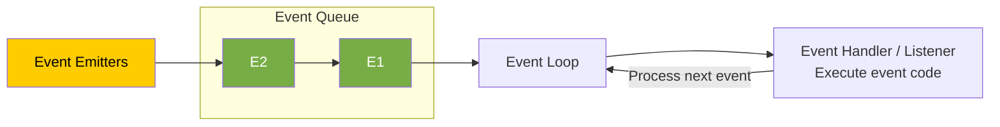

<br>

### What are the Main Features & Advantages of Node.js?

| Feature | Advantage |
|---|---|
| **1. Asynchronous** | Enables handling **multiple concurrent requests** and **non-blocking execution** of the thread. |
| **2. V8 JS Engine** | Built on the V8 JS engine from Google Chrome, Node.js **executes code fast**. |
| **3. Event-Driven Architecture** | **Efficient handling of events.** Great for real-time applications like chat applications and gaming applications (using WebSockets), where bidirectional communication is required. |
| **4. Cross-Platform** | Supports deployment on various operating systems, **enhancing flexibility**. |
| **5. JavaScript** | Coding in JavaScript means there is no need to learn a new language. |

<br>

### What are the Disadvantages of Node.js? When to Use and When Not to Use Node.js?

#### When to Use Node.js
- Ideal for **real-time applications** like chat applications, online gaming, and collaborative tools due to its event-driven architecture.
- Excellent for building **lightweight and scalable RESTful APIs** that handle a large number of concurrent connections.
- Well-suited for building **microservices-based architectures**, enabling modular and scalable systems.


#### When Not to Use Node.js (Disadvantages)

- **CPU-Intensive Tasks:** Avoid for applications that involve heavy CPU processing, such as image/video processing and data encryption/decryption. Node.js may not provide optimal performance in such scenarios because it is single-threaded, and for heavy computation, multithreading is better.


<br>

### What are Modules in Node.js? What is the Difference Between a Function & a Module?

<details>

- A module contains **specific functionality** that can be easily **reused** within a Node.js application.
- Ideally, in Node.js, a JavaScript file can be treated as a module.

module is like order module, and function is inside that modeule work like add or remove order function

```javascript
// myModule1.js
function sayHello(name) {
  console.log("Hello, " + name);
}

module.exports = sayHello;
```

#### Function vs. Module

- A **module** is a broader concept that encapsulates functionality, while a **function** is a specific set of instructions within that module.
- Modules can contain **multiple functions and variables**.

#### Diagram

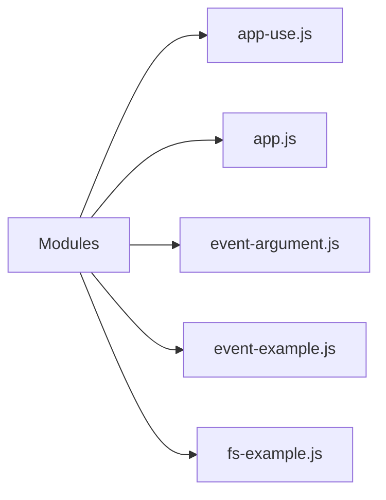
</details>

<br>

### How Many Ways Are There to Export a Module?

#### 1. Using `module.exports`

The `module.exports` object can be used to export the module.

```javascript
// Exporting a function
function sayHello(name) {
  console.log("Hello, " + name);
}

// Exporting a variable
const pi = 3.14159;

// Exporting an object
const myObject = {
  key: "value",
};

// Using module.exports
module.exports.sayHello = sayHello;
module.exports.pi = pi;
module.exports.myObject = myObject;
```

#### 2. Using `exports`

The `exports` object can also be used directly to export the module.

```javascript
// Exporting a function
exports.sayHello = function (name) {
  console.log("Hello, " + name);
};

// Exporting a variable
exports.pi = 3.14159;

// Exporting an object
exports.myObject = {
  key: "value",
};
```

<br>

### What is a Module Wrapper Function?

In Node.js, each module is wrapped in a function called the **module wrapper function** before it is executed.

#### Original Module

```javascript
// app.js
const message = 'Interview Happy';

console.log(message);

// Output: Interview Happy
```

#### Converted/Wrapped by Node.js

```javascript
// Wrapper function generated by Node
(function (exports, require, module, __filename, __dirname) {
  const message = "Interview Happy";

  console.log(message);

  // Output: Interview Happy
});
```

<br>

### What are the Types of Modules in Node.js?

#### 1. Built-in Modules (Core Modules)

These are **already present modules** in Node.js that provide essential functionalities.

Examples:

- `fs` — File system
- `http` — HTTP server
- `path` — Path manipulation
- `util` — Utilities

#### 2. Local Modules

These are **user-defined modules (JavaScript files)** created by developers for specific functionalities.

#### 3. Third-Party Modules

These are **external packages or libraries created by the community** that provide additional functionalities for Node.js projects.

You install third-party modules using the `npm install` command.

For example:

```bash
npm install lodash
```

<br>

### What are the Advantages of Using Express.js with Node.js?

| Advantage | Description |
|---|---|
| **1. Simplified Web Development** | Express.js provides a lightweight framework that simplifies the process of building web applications in Node.js. |
| **2. Middleware Support** | Easy integration of middleware functions into an application's request-response cycle. |
| **3. Flexible Routing System** | Defining routes for handling different HTTP methods (`GET`, `POST`, `PUT`, `DELETE`, etc.) and URL patterns is easy. |
| **4. Template Engine Integration** | Express.js supports various template engines, making it easy to generate dynamic HTML content on the server side. |

**Template engine:** HTML + Data.

<br>

### What is Middleware in Express.js and When to Use It?

A middleware in Express.js is a **function** that handles **HTTP requests**, performs **operations**, and passes control to the **next middleware**.

#### Diagram

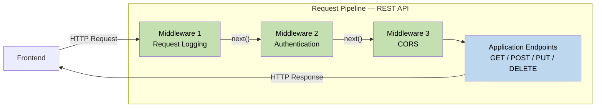

<br>

### How Do You Implement Middleware in Express.js?

#### 4 Steps to Use Middleware

1. Initialize an Express application.
2. Define a middleware function, `myMiddleware`.
3. Use `app.use()` to mount `myMiddleware` globally, meaning it will be executed for every incoming request to the application.
4. Start the server by listening on a specified port (defaulting to port `3000`) using `app.listen()`.

```javascript
// Create and execute middleware
const express = require("express");
const app = express();

// Define middleware function
const myMiddleware = (req, res, next) => {
  // Middleware logic goes here
  res.send("Interview Happy!");
  next(); // Call the next middleware function
};

// Use middleware globally for all routes
app.use(myMiddleware);

// Start the server
const PORT = 3000;
app.listen(PORT, () => {
  console.log(`Server is running ${PORT}`);
});
```

#### Browser Output

At `localhost:3000`:

```text
Interview Happy!
```

<br>

### What is the Purpose of the `app.use()` Function in Express.js?

The `app.use()` method is used to **execute (mount) middleware functions globally**.

```javascript
// Create and execute middleware
const express = require("express");
const app = express();

// Define middleware function
const myMiddleware = (req, res, next) => {
  // Middleware logic goes here
  res.send("Interview Happy!");
  next(); // Call the next middleware function
};

// Use middleware globally for all routes
app.use(myMiddleware);

// Start the server
const PORT = 3000;
app.listen(PORT, () => {
  console.log(`Server is running ${PORT}`);
});
```

<br>

### What is the Purpose of the `next` Parameter in Express.js?

The `next` parameter is a **callback function** used to **pass control to the next middleware function** in the stack.

<br>


### What are the Types of Middleware in Express.js?

1. **Application-level middleware**
2. **Router-level middleware**
3. **Error-handling middleware**
4. **Built-in middleware**
5. **Third-party middleware**

<br>

### What is the Difference Between Application-Level & Route-Level Middleware?

| Application-Level Middleware | Route-Level Middleware |
|---|---|
| Applies globally to all incoming requests in the entire Express.js application. | Applies only to specific routes, not to all incoming requests. |

<br>

### What is Error-Handling Middleware and How to Implement It?

- Error-handling middleware in Express is a special kind of middleware used to **manage errors** that occur while handling incoming requests.
- To implement error handling in Express, define middleware with four parameters: **`err`, `req`, `res`, `next`**. The additional **error object parameter (`err`)** is used for error handling.

```javascript
const express = require("express");
const app = express();

// Middleware generating error
app.use((req, res, next) => {
  // Simulate an error
  next(new Error("An error occurred"));
});

// Error-handling middleware
app.use((err, req, res, next) => {
  console.error(err.stack);
  res.status(500).send("Something went wrong!");
});

// Start the server
const PORT = 3000;
app.listen(PORT, () => {
  console.log(`Server is running on ${PORT}`);
});
```

#### Browser Output

At `localhost:3000`:

```text
Something went wrong!
```

#### Console Output

```text
Error: An error occurred
```

<br>

### If You Have 5 Middlewares, in Which Middleware Will You Handle Errors?

Error-handling middleware should be **defined last**, after all other middleware.

When an error occurs, Express.js searches for the next error-handling middleware, **skipping regular middleware and route handlers**.

```javascript
// Multiple middlewares
app.use(middleware1);
app.use(middleware2); // Error occurred
app.use(middleware3);
app.use(middleware4);

// Error-handling middleware
app.use((err, req, res, next) => {
  console.error(err.stack);
  res.status(500).send("Something went wrong!");
});
```
<br>

### What is Built-in Middleware? How to Serve Static Files from Express.js?

- **Built-in middleware** consists of functions built into the Express framework that provide common functionalities.
- **`express.static()`** middleware is used for serving static files.

```javascript
const express = require("express");
const app = express();

// Serve static files from the 'public' directory
app.use(express.static("public"));

// Other routes and middleware can be defined here

// Start the server
const PORT = 3000;
app.listen(PORT, () => {
  console.log(`Server is running on :${PORT}`);
});
```

#### Browser Output

At `localhost:3000/1.jpg`, the browser displays the image served from `public/1.jpg`.

<br>

### What are Route Handlers?

- A **route handler** is the second argument passed to `app.get()` or `app.post()`.
- A route handler function is used to **process the request and generate a response**.

```javascript
const express = require("express");
const app = express();

// Define a route for handling GET requests
app.get("/", (req, res) => {
  res.send("Interview Happy!");
});

// Define a route for handling POST requests
app.post("/login", (req, res) => {
  // Handle login logic
});

// Start the server
const PORT = 3000;
app.listen(PORT, () => {
  console.log(`Server is running on ${PORT}`);
});
```
<br>

### What are the Router Object & Router Methods, and How Do You Implement Them?

- The **Router object** is a mini version of an Express application used for **handling routes**.
- **Router methods** are functions provided by the Router object to define routes for different HTTP methods (`GET`, `POST`, `DELETE`, etc.).

#### Implement Router Method

```javascript
// router.js
const express = require("express");

// Create a router object
const router = express.Router();

// Define a route for the root URL ('/')
router.get("/", (req, res) => {
  res.send("Interview Happy");
});

// Export the router object
module.exports = router;
```

#### Use Router Method

```javascript
// app.js
const express = require("express");
const router = require("./router");
const app = express();

// Mount the router object on a path
app.use("/api", router);

// Start the server
app.listen(3000, () => {
  console.log("Server is running");
});
```

<br>

### What is the Difference Between `app.get()` and `router.get()`?

| `app.get()` | `router.get()` |
|---|---|
| Defines routes **directly on the application object**. | Defines routes on a **Router object**. |
| Routes are automatically mounted on the root path (`/`). | Routes are not automatically mounted; they must be explicitly mounted using `app.use()`. |
| Routes are not modular and cannot be reused in other applications. | Routes are modular and can be **reused in other applications** by exporting the Router object. |


#### `app.get()` Example

```javascript
// app-get.js
const express = require("express");
const app = express();

app.get("/", (req, res) => {
  res.send("Interview Happy");
});

app.listen(3000, () => {
  console.log("Server is running");
});
```

#### `router.get()` Example

```javascript
// router.js
const express = require("express");
const router = express.Router();

// Define a route for the root URL ('/')
router.get("/", (req, res) => {
  res.send("Interview Happy");
});

// Export the router object
module.exports = router;
```
<br>

### What are the Top 5 REST Guidelines and Their Advantages?

| Guideline | Description | Advantage |
|---|---|---|
| **1. Separation of Client & Server** | The implementation of the client and the server must be done independently. | Independence allows **easier maintenance, scalability, and evolution**. |
| **2. Stateless** | The server will not store anything about the latest HTTP request the client made. | Treats every request as a new request. It **simplifies server implementation** by avoiding the burden of state management. |
| **3. Uniform Interface** | Identify resources by URL, e.g., `www.abc.com/api/questions`. | Standardized URLs make it **easy to understand and use the API**. |
| **4. Cacheable** | The API response should be cacheable to improve performance. | Caching API responses **improves performance** by reducing repeated requests to the server. |
| **5. Layered System** | The system should follow a layered pattern. | A layered system, such as the Model-View-Controller (MVC) pattern, promotes **modular design** and separation of concerns. |

<br>

### Explain the Concept of Idempotence in RESTful APIs

**Idempotence** means performing an operation **multiple times** should have the same outcome as performing it once.


#### Methods

| Idempotent Methods | Non-Idempotent Methods |
|---|---|
| `GET` | `POST` |
| `PUT` | |
| `DELETE` | |

<br>


### What is the Typical Structure of a REST API Project in Node.js?

```text
ecommerce-project-root/
├── node_modules/
├── src/
│   ├── controllers/
│   │   ├── productController.js
│   │   └── userController.js
│   ├── models/
│   │   ├── productModel.js
│   │   └── userModel.js
│   ├── routes/
│   │   ├── productRoutes.js
│   │   └── userRoutes.js
│   ├── utils/
│   │   ├── errorHandlers.js
│   │   └── validators.js
│   └── app.js
├── .gitignore
└── package.json
```
<br>

### What are Authentication and Authorization?

- **Authentication** is the process of **verifying the identity** of a user by validating their credentials, such as a username and password.
- **Authorization** is the process of allowing an authenticated user **access to resources**.
- Authentication always precedes authorization.

#### Example

A student signs in to `www.school.com` using a username and password. After authentication, their permissions determine what they can access.

| Resource | Student Access |
|---|---|
| View Result | ✅ Allowed |
| Edit Result | ❌ Only teachers have rights |
| Fees | ✅ Allowed |
| Salary | ❌ Only teachers have rights |

<br>

### What are the Types of Authentication in Node.js?

1. **Basic (Username and Password) Authentication**
2. **API Key Authentication**
3. **Token-based Authentication (JWT)**
4. **Multi-factor Authentication (MFA)**
5. **Certificate-based Authentication**

<br>

### What is the Role of Hashing and Salt in Securing Passwords?

- **Hashing:** The process of converting a password into a fixed-size string of characters using a **mathematical algorithm**.
- **Salt:** A random string of data combined with a password before hashing.
  - Salting ensures security even if the hacker **knows the hashing algorithm**.
  - Even if two users **have the same password**, their hashed passwords will differ due to the unique salt.
  - Typically, each user has a unique salt.

#### Diagram

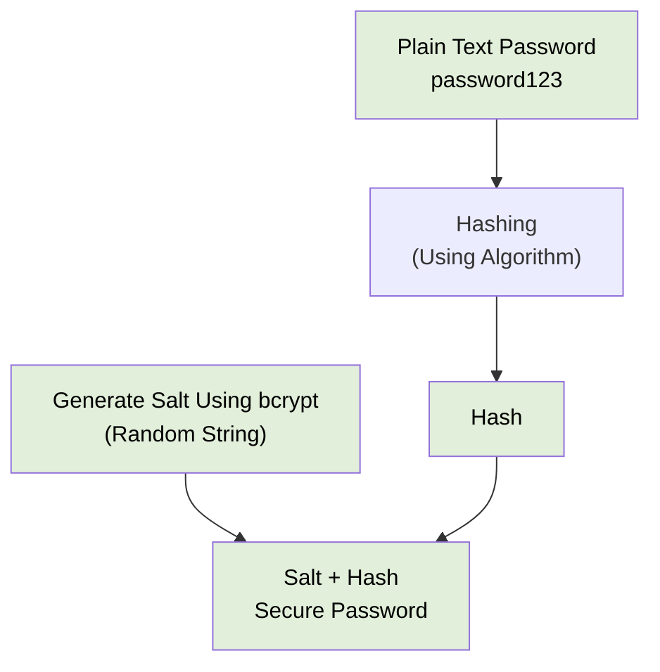

<br>

### How Can We Create Hashed Passwords in Node.js?

1. Generate a random salt.
2. Create a hash object using SHA-256.
3. Update the hash object with the salt and password.
4. Get the hashed data as a hexadecimal string.
5. Return the salt and hashed password as a string.

```javascript
const crypto = require("crypto");

// Define a function to hash and salt a password
function hashAndSaltPassword(password) {
  // 1. Generate a random salt
  const salt = crypto.randomBytes(16).toString("hex");

  // 2. Create a hash object using SHA-256
  const hash = crypto.createHash("sha256");

  // 3. Update the hash object with the salt and password
  hash.update(salt + password);

  // 4. Get the hashed data in a hexadecimal string
  const hexHash = hash.digest("hex");

  // 5. Return the salt and hashed password as a string
  return salt + ":" + hexHash;
}
```
<br>

### What is NoSQL?

**NoSQL (Not Only SQL)** databases are designed to handle **structured, semi-structured, and unstructured data**.

#### Diagram

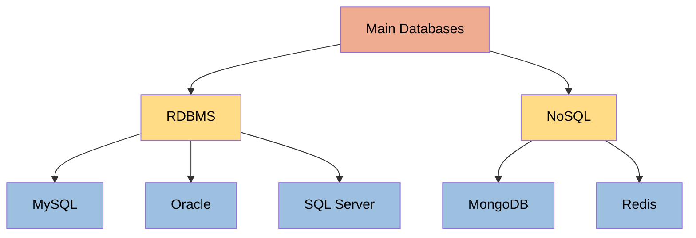
<br>

### What is Mongoose? What are the Advantages of Using It?

- **Mongoose** is an **Object Data Modeling (ODM)** library for MongoDB and Node.js.
- Mongoose provides a **schema-based solution** to model application data.

### Advantages of Mongoose over Directly Using MongoDB

1. **Data validation**
2. **Middleware support**
3. **Defining relationships between collections**

<br>

### What is SQL Injection attack?

**SQL Injection (SQLi)** is a vulnerability where an attacker manipulates a database query by supplying malicious input. It happens when an application combines untrusted data with SQL code, allowing the database to interpret that input as part of the query.

An attacker may read sensitive data, bypass authentication, or modify and delete records, depending on the database permissions.

For example, this Node.js code is vulnerable:

```js
const query = `
  SELECT id, email
  FROM users
  WHERE email = '${req.body.email}'
`;

const result = await pool.query(query);
```

If the attacker submits this email:

```text
' OR 1=1 --
```

The query becomes:

```sql
SELECT id, email
FROM users
WHERE email = '' OR 1=1 --'
```

Because `1=1` is always true, the query returns all users instead of matching one email. `--` comments out the remaining quote.

**How to prevent it**

The primary defense is **parameterized queries**, which keep SQL instructions separate from input values.

Using PostgreSQL’s `pg` package:

```js
const result = await pool.query(
  'SELECT id, email FROM users WHERE email = $1',
  [req.body.email]
);
```
<br>

### What are Query Operators in MongoDB?

**Query operators in MongoDB define conditions used to select matching documents.** They usually start with `$` and appear in filters for operations such as `find()`, `findOne()`, `updateOne()`, and `deleteMany()`.

For example:

```js
// Find users aged 18 or older.
db.users.find({ age: { $gte: 18 } });
```

The main groups are:

| Group | Common operators | Purpose |
|---|---|---|
| Comparison | `$eq`, `$ne`, `$gt`, `$gte`, `$lt`, `$lte`, `$in`, `$nin` | Compare field values |
| Logical | `$and`, `$or`, `$not`, `$nor` | Combine or negate conditions |
| Element / data type | `$exists`, `$type` | Check field presence or type |
| Array | `$all`, `$elemMatch`, `$size` | Match array contents or length |
| Evaluation / expressions | `$regex`, `$expr`, `$mod` | Match patterns or evaluate expressions |
| Geospatial | `$near`, `$geoWithin`, `$geoIntersects` | Query geographic data |

MongoDB also provides bitwise query operators. [Query operator reference](https://www.mongodb.com/docs/manual/reference/mql/query-predicates/)

**1. Comparison operators**

```js
// Age between 18 and 30, inclusive.
db.users.find({ age: { $gte: 18, $lte: 30 } });

// Role matches either value.
db.users.find({ role: { $in: ['admin', 'editor'] } });
```

`$gt` means greater than; `$gte` includes equality. `$in` matches any listed value, while `$nin` excludes listed values and can also match missing fields. [Comparison operators](https://www.mongodb.com/docs/manual/reference/mql/query-predicates/comparison/)

**2. Logical operators**

```js
// Active users who are either admins or editors.
db.users.find({
  active: true,
  $or: [
    { role: 'admin' },
    { role: 'editor' },
  ],
});
```

Conditions on different fields are implicitly combined with AND. `$not` negates a field condition; `$nor` matches documents satisfying none of its clauses.

**3. Field existence**

```js
db.users.find({ phone: { $exists: true } });
```

This includes documents where `phone` exists but is `null`. `$exists` checks presence, not whether the value is meaningful. [Existence operator](https://www.mongodb.com/docs/manual/reference/operator/query/exists/)

**4. Array operators**

```js
// Contains both skills.
db.users.find({
  skills: { $all: ['Node.js', 'MongoDB'] },
});

// Contains exactly three elements.
db.users.find({ skills: { $size: 3 } });

// One order must satisfy both conditions.
db.users.find({
  orders: {
    $elemMatch: {
      status: 'paid',
      total: { $gt: 1000 },
    },
  },
});
```

**`$elemMatch` ensures the same array element satisfies every condition.** Separate dotted-field conditions can be satisfied by different array elements. [Array matching documentation](https://www.mongodb.com/docs/manual/reference/operator/query/elemmatch/)

**5. Expressions**

```js
// Compare two fields in the same document.
db.products.find({
  $expr: { $gt: ['$salePrice', '$costPrice'] },
});
```

`$expr` allows aggregation expressions inside a query filter. [Expression documentation](https://www.mongodb.com/docs/manual/reference/operator/query/expr/)

In the Node.js driver, the same filter is passed to the collection:

```js
const users = await db.collection('users')
  .find({ active: true, age: { $gte: 18 } })
  .toArray();
```

Query operators determine **which documents match**. Update operators such as `$set` and `$inc` determine **how matching documents change**.

<br>

### Compare Query Operators in SQL & MongoDB?

**SQL uses expressions in a `WHERE` clause; MongoDB uses a filter document with operators such as `$gt`, `$in`, and `$or`.** Most common conditions have similar counterparts, but their handling of nulls, missing fields, and arrays differs.

For scalar fields, the common mappings are:

| Condition | SQL `WHERE` expression | MongoDB filter |
|---|---|---|
| Equal | `age = 25` | `{ age: { $eq: 25 } }` or `{ age: 25 }` |
| Not equal | `age <> 25` | `{ age: { $ne: 25 } }` |
| Greater than | `age > 25` | `{ age: { $gt: 25 } }` |
| Greater than or equal | `age >= 25` | `{ age: { $gte: 25 } }` |
| Less than | `age < 25` | `{ age: { $lt: 25 } }` |
| Less than or equal | `age <= 25` | `{ age: { $lte: 25 } }` |
| In a list | `age IN (20, 25, 30)` | `{ age: { $in: [20, 25, 30] } }` |
| Not in a list | `age NOT IN (20, 25)` | `{ age: { $nin: [20, 25] } }` |
| Inclusive range | `age BETWEEN 18 AND 30` | `{ age: { $gte: 18, $lte: 30 } }` |
| AND | `age >= 18 AND active = TRUE` | `{ age: { $gte: 18 }, active: true }` |
| OR | `age < 18 OR active = FALSE` | `{ $or: [{ age: { $lt: 18 } }, { active: false }] }` |
| NOT | `NOT (age >= 18)` | `{ age: { $not: { $gte: 18 } } }` |
| Starts with | `name LIKE 'A%'` | `{ name: { $regex: '^A' } }` |

<br>

**Note:** The pattern example assumes compatible case sensitivity; SQL `LIKE` and MongoDB regular expressions use different pattern syntax. [MongoDB SQL mapping](https://www.mongodb.com/docs/manual/reference/sql-comparison/), [comparison operators](https://www.mongodb.com/docs/manual/reference/mql/query-predicates/comparison/)

<br>

For example, these queries express the same condition when the fields have the expected scalar types:

```sql
SELECT *
FROM users
WHERE age >= 18
  AND role IN ('admin', 'editor');
```

```js
db.users.find({
  age: { $gte: 18 },
  role: { $in: ['admin', 'editor'] },
});
```

**The important differences are:**

- **NULL and missing fields:** SQL distinguishes null values using `IS NULL`. MongoDB distinguishes both null and absent fields:

  ```js
  { email: null }                  // Null OR missing
  { email: { $type: 'null' } }     // Explicit null, assuming a scalar field
  { email: { $exists: false } }    // Missing
  { email: { $ne: null } }         // Present and non-null
  ```

  [MongoDB null handling](https://www.mongodb.com/docs/manual/tutorial/query-for-null-fields/)

- **Negation behaves differently:** SQL comparisons involving NULL produce UNKNOWN, which `WHERE` excludes. MongoDB `$ne: 25`, `$nin: [20, 25]`, and `$not` can match documents with missing fields. These are therefore conceptual mappings rather than exact equivalents for every document. [SQL NULL semantics](https://www.postgresql.org/docs/current/functions-comparison.html)

- **Arrays have dedicated operators:** MongoDB provides `$all`, `$size`, and `$elemMatch`. In SQL, similar queries depend on whether the data uses related tables, arrays, or JSON. `$elemMatch` requires one array element to satisfy all specified conditions. [Array matching](https://www.mongodb.com/docs/manual/reference/operator/query/elemmatch/)

<br>

### What is projection in MongoDB? How to implement it?

**Projection in MongoDB controls which fields are returned by a query.** The filter selects **which documents** match; the projection selects **which fields** appear in those documents. It does not modify the stored data.

It is similar to selecting specific columns in SQL:

```sql
SELECT name, email FROM users WHERE active = TRUE;
```
<br>

### How do you perform sorting in ascending & descending order in MongoDB?

Use MongoDB’s **`.sort()`** method with:

- **`1`** for ascending order.
- **`-1`** for descending order.

**MongoDB shell:**

```js
// Sort by age: youngest first.
db.users.find().sort({ age: 1 });

// Sort by age: oldest first.
db.users.find().sort({ age: -1 });
```

**Sorting by multiple fields:**

```js
// Age ascending, then name descending for users with the same age.
db.users.find().sort({ age: 1, name: -1 });
```

Fields are prioritized in the order specified.

**Node.js MongoDB driver:**

```js
const users = await db.collection('users')
  .find({ active: true })
  .sort({ age: -1, _id: 1 })
  .limit(10)
  .toArray();
```

<br>

### Relationship in mongoose

**In Mongoose, relationships between collections are usually defined using document IDs and the `ref` option.** You retrieve the referenced documents using **`populate()`**.

The main relationship patterns are:

| Relationship | Example | Typical implementation |
|---|---|---|
| One-to-one | User → Profile | A reference with a unique index |
| One-to-many | User → Posts | Store the user reference in each post |
| Many-to-many | Students ↔ Courses | Arrays of references or a separate enrollment collection |

**1. Define a one-to-many relationship**

One user can write many posts:

```js
const mongoose = require('mongoose');
const { Schema } = mongoose;

const userSchema = new Schema({
  name: { type: String, required: true },
});

const postSchema = new Schema({
  title: { type: String, required: true },
  author: {
    type: Schema.Types.ObjectId,
    ref: 'User',
    required: true,
    index: true,
  },
});

const User = mongoose.model('User', userSchema);
const Post = mongoose.model('Post', postSchema);
```

`ref: 'User'` refers to the **registered model name**, not the collection name.

After connecting to MongoDB, save the referenced user’s ID:

```js
const user = await User.create({ name: 'Asha' });

await Post.create({
  title: 'Understanding Node.js',
  author: user._id,
});
```

Retrieve posts with author details:

```js
const posts = await Post.find({ author: user._id })
  .populate('author', 'name');
```

`populate()` replaces the returned `author` ID with the referenced user document. It generally performs additional queries; it does not rewrite the stored reference. [Mongoose population](https://mongoosejs.com/docs/populate.html)

**2. Define a one-to-one relationship**

Store a user reference in a profile, with a unique index:

```js
const profileSchema = new Schema({
  user: {
    type: Schema.Types.ObjectId,
    ref: 'User',
    required: true,
    unique: true,
  },
  bio: String,
});

const Profile = mongoose.model('Profile', profileSchema);
```

Once the unique index exists, a user can have **at most one profile**. This does not require every user to have a profile. `unique` declares an index rather than a Mongoose validator. [Validation documentation](https://mongoosejs.com/docs/validation.html)

**3. Define a many-to-many relationship**

For students and courses, a separate enrollment collection supports growing relationships and extra information:

```js
const enrollmentSchema = new Schema({
  student: { type: Schema.Types.ObjectId, ref: 'Student' },
  course: { type: Schema.Types.ObjectId, ref: 'Course' },
  enrolledAt: { type: Date, default: Date.now },
});

enrollmentSchema.index(
  { student: 1, course: 1 },
  { unique: true }
);
```

Register the `Student`, `Course`, and enrollment models before using population.

<br>

### How to define relationships between collections using Mongoose?

**In Mongoose, relationships between collections are usually defined using document IDs and the `ref` option.** You retrieve the referenced documents using **`populate()`**.

The main relationship patterns are:

| Relationship | Example | Typical implementation |
|---|---|---|
| One-to-one | User → Profile | A reference with a unique index |
| One-to-many | User → Posts | Store the user reference in each post |
| Many-to-many | Students ↔ Courses | Arrays of references or a separate enrollment collection |

**1. Define a one-to-many relationship**

One user can write many posts:

```js
const mongoose = require('mongoose');
const { Schema } = mongoose;

const userSchema = new Schema({
  name: { type: String, required: true },
});

const postSchema = new Schema({
  title: { type: String, required: true },
  author: {
    type: Schema.Types.ObjectId,
    ref: 'User',
    required: true,
    index: true,
  },
});

const User = mongoose.model('User', userSchema);
const Post = mongoose.model('Post', postSchema);
```

`ref: 'User'` refers to the **registered model name**, not the collection name.

After connecting to MongoDB, save the referenced user’s ID:

```js
const user = await User.create({ name: 'Asha' });

await Post.create({
  title: 'Understanding Node.js',
  author: user._id,
});
```

Retrieve posts with author details:

```js
const posts = await Post.find({ author: user._id })
  .populate('author', 'name');
```

`populate()` replaces the returned `author` ID with the referenced user document. It generally performs additional queries; it does not rewrite the stored reference. [Mongoose population](https://mongoosejs.com/docs/populate.html)

**2. Define a one-to-one relationship**

Store a user reference in a profile, with a unique index:

```js
const profileSchema = new Schema({
  user: {
    type: Schema.Types.ObjectId,
    ref: 'User',
    required: true,
    unique: true,
  },
  bio: String,
});

const Profile = mongoose.model('Profile', profileSchema);
```

Once the unique index exists, a user can have **at most one profile**. This does not require every user to have a profile. `unique` declares an index rather than a Mongoose validator. [Validation documentation](https://mongoosejs.com/docs/validation.html)

**3. Define a many-to-many relationship**

For students and courses, a separate enrollment collection supports growing relationships and extra information:

```js
const enrollmentSchema = new Schema({
  student: { type: Schema.Types.ObjectId, ref: 'Student' },
  course: { type: Schema.Types.ObjectId, ref: 'Course' },
  enrolledAt: { type: Date, default: Date.now },
});

enrollmentSchema.index(
  { student: 1, course: 1 },
  { unique: true }
);
```

Register the `Student`, `Course`, and enrollment models before using population.

**When should you embed instead?**

Embed small, bounded data that belongs to its parent and is commonly read together, such as a user’s address. Embedded subdocuments live inside the parent document; references point to separate documents. [Mongoose subdocuments](https://mongoosejs.com/docs/subdocs.html)

**A crucial distinction:** `ref` does not enforce foreign-key integrity or cascade deletes. Your application must handle missing references, authorization, and deletion rules.


<br>

### How Mongoose provide middleware support? What are Pre & Post Hooks?

**Mongoose provides middleware through schema-level functions called hooks.** They run before or after supported document, query, model, or aggregation operations.

| Hook | When it runs | Common uses |
|---|---|---|
| **Pre hook** | Before the operation | Transform data, perform checks, prepare values |
| **Post hook** | After successful completion | Logging, metrics, follow-up processing |

Register them using `schema.pre()` and `schema.post()`:

```js
const mongoose = require('mongoose');

const userSchema = new mongoose.Schema({
  name: String,
  lastSavedAt: Date,
});

// Document middleware: `this` is the document.
userSchema.pre('save', function () {
  this.lastSavedAt = new Date();
});

userSchema.post('save', function (doc) {
  console.log('User saved:', doc._id);
});

// Register hooks before compiling the model.
const User = mongoose.model('User', userSchema);

// After connecting to MongoDB:
await User.create({ name: 'Asha' });
```

The sequence is: **pre-save hook → database save → post-save hook**.

Mongoose supports four middleware types:

- **Document:** `this` is the document, such as in `save` hooks.
- **Query:** `this` is the query, such as in `findOneAndUpdate` hooks.
- **Model:** `this` is the model, such as in `insertMany` hooks.
- **Aggregate:** `this` is the aggregation object.

**Important details:**

- Use regular functions when accessing `this`.
- Hooks can be `async`; Mongoose awaits their promises.
- Throwing in a pre hook prevents the operation.
- `create()` triggers save hooks; `updateOne()` and `findOneAndUpdate()` do **not**.
- Validation normally runs before custom pre-save hooks.
- A post-hook failure does not automatically undo a completed database write.

[Mongoose middleware documentation](https://mongoosejs.com/docs/middleware.html)

<br>

### Sharding, Connection Pooling & Query Optimization – Database Interview Preparation


### 1. Database Sharding

Sharding is a database scaling technique in which we divide a large database into smaller databases (shards) and distribute them across multiple servers.

Each shard stores a portion of the overall data.
<br>

#### 1.2 Why do we need sharding?

Suppose your application has:

- 100 million users.
- 500 million orders.
- Millions of database queries per day.

A single database server may eventually struggle with:

1. Storage limitations.
2. High CPU utilization.
3. Memory pressure.
4. Too many concurrent queries.
5. Increased query latency.

Sharding distributes the data and workload across multiple database servers.

Important: Sharding is primarily a horizontal scaling technique.

<br>

#### 1.3 Types of sharding

There are four important approaches to understand.

#### A. Range-based sharding

Data is divided according to a range of values.

Example:

| Shard   | User ID       |
| ------- | ------------- |
| Shard 1 | 1–100000      |
| Shard 2 | 100001–200000 |
| Shard 3 | 200001–300000 |

Advantages:

- Easy to understand.
- Range queries can be efficient.

Disadvantages:

- Uneven data distribution.
- Hotspots can develop.

For example, if most new users have higher IDs, the latest shard receives most of the traffic.

#### B. Hash-based sharding

A hash function determines which shard stores the record.

Example:

```js
const shardNumber = userId % 3;
```

Suppose:

```js
userId = 101;

shardNumber = 101 % 3; // 2
```

The record goes to Shard 2 (using zero-based numbering).

Advantages:

- Generally better data distribution.
- Reduces range-based hotspots.

Disadvantages:

- Range queries become difficult.
- Changing the number of shards can require significant data redistribution.

<br>

#### C. Geographic sharding

Data is distributed based on geographical location.

Example:

| Shard   | Data   |
| ------- | ------ |
| Shard 1 | India  |
| Shard 2 | USA    |
| Shard 3 | Europe |

Advantages:

- Lower latency for regional users.
- Helps with data residency requirements.

<br>

#### D. Directory-based sharding

A separate lookup service maintains information about where each record is stored.

Example:

```js
{
  userId: 101,
  shard: "shard_2"
}
```

The application first checks the directory and then queries the appropriate database.

Advantages:

- Flexible shard assignment.
- Easy to manage custom distribution.

Disadvantages:

- Directory becomes another dependency.
- It needs high availability and caching.

<br>

#### 1.4 Sharding in SQL vs MongoDB

| Feature           | SQL                                            | MongoDB                                         |
| ----------------- | ---------------------------------------------- | ----------------------------------------------- |
| Sharding          | Usually application/proxy or database-specific | Native distributed sharding                     |
| Shard key         | Depends on architecture                        | Required                                        |
| Routing           | Application or routing layer                   | `mongos`                                        |
| Data distribution | Depends on implementation                      | Chunks distributed across shards                |
| Complexity        | Often application-dependent                    | Managed through MongoDB sharding infrastructure |

<br>

### 2. Database Connection Pooling

Connection pooling means maintaining a collection of reusable database connections instead of creating a new connection for every database request.

Let's understand with an example.

Imagine your Node.js application receives 1,000 API requests.

Without connection pooling:

```
Request 1 → Create DB connection → Query → Close
Request 2 → Create DB connection → Query → Close
Request 3 → Create DB connection → Query → Close
...
```

Creating database connections repeatedly is expensive.

With connection pooling:

```
              Node.js Application
                      |
               Connection Pool
                      |
          -------------------------
          |           |           |
       Conn 1       Conn 2       Conn 3
          |           |           |
          -------------------------
                      |
                 Database
```

Connections are reused by multiple requests.

<br>

#### Why is connection pooling important?

Creating a database connection involves:

1. Network communication.
2. Authentication.
3. TCP connection establishment.
4. Sometimes TLS handshake.
5. Database session initialization.

This introduces overhead.

Connection pooling reduces this overhead by reusing established connections.

Benefits:

- Faster database access.
- Reduced connection creation overhead.
- Better resource management.
- Controlled database concurrency.
- Improved application performance.

<br>

#### Connection pooling in Node.js with SQL

Let's use MySQL as an example.

Install:

```
npm install mysql2
```

Create a connection pool:

```js
const mysql = require("mysql2/promise");

const pool = mysql.createPool({
  host: "localhost",
  user: "root",
  password: "password",
  database: "ecommerce",

  waitForConnections: true,
  connectionLimit: 10,
  queueLimit: 0
});
```

Use the pool:

```js
async function getUsers() {
  const [rows] = await pool.execute(
    "SELECT * FROM users WHERE status = ?",
    ["active"]
  );

  return rows;
}
```

Notice something important:

We are not creating a new connection for every request. We are asking the pool to provide an available connection.

<br>

#### Connection pooling in MongoDB

MongoDB Node.js driver maintains an internal connection pool for each server in the topology.

Example:

```js
const { MongoClient } = require("mongodb");

const client = new MongoClient(
  "mongodb://localhost:27017",
  {
    maxPoolSize: 50,
    minPoolSize: 5,
    maxIdleTimeMS: 30000
  }
);

async function connectDB() {
  await client.connect();

  return client.db("ecommerce");
}
```

Use the database:

```js
const db = await connectDB();

const users = await db
  .collection("users")
  .find({ status: "active" })
  .toArray();
```

The driver reuses connections from its pool.

Important: In a production application, create the MongoClient once during application startup and reuse it. Do not create a new MongoClient for every API request.

<br>

#### Important connection pool parameters

| Parameter          | Meaning                                              |
| ------------------ | ---------------------------------------------------- |
| maxPoolSize        | Maximum number of connections in the pool            |
| minPoolSize        | Minimum connections maintained                       |
| connectionTimeout  | Time allowed to establish a connection               |
| idleTimeout        | How long an idle connection can remain               |
| waitForConnections | Whether requests wait if all connections are busy    |
| queueLimit         | Maximum number of queued requests in supported pools |

Exact parameter names differ between database drivers.

<br>

#### What happens if the pool is exhausted?

Suppose:

```js
connectionLimit: 10
```

And 100 requests arrive simultaneously.

Only 10 requests can use those connections at a time.

The remaining requests wait in the queue (assuming the pool is configured to wait).

If queries are slow, the queue grows and API response times increase.

Possible solutions:

1. Optimize slow SQL queries.
2. Reduce unnecessary database calls.
3. Increase pool size after checking database capacity.
4. Use caching.
5. Apply request concurrency limits.
6. Investigate connection leaks.

Senior-level point: Increasing the connection pool size blindly is not always a solution. Too many connections can overload the database and make performance worse.

<br>

### Query Optimization

Query optimization is the process of improving database query performance by reducing execution time, resource consumption and unnecessary data processing.

Example:

Suppose you have 10 million users.

You execute:

```
SELECT * FROM users;
```

This fetches every column and every row.

But your API only needs the user's name and email.

A better query:

```
SELECT id, name, email
FROM users;
```

You reduce unnecessary data transfer.

<br>

### 3.2 Indexing

Indexing is one of the most important database optimization techniques.

An index helps the database find records without scanning the entire table.

Imagine a book:

- Without an index: You read every page to find a topic.
- With an index: You directly locate the page.

#### Without an index

```
SELECT *
FROM users
WHERE email = 'amit@gmail.com';
```

The database might perform a full table scan.

#### With an index

```
CREATE INDEX idx_users_email
ON users(email);
```

Now the database can use the index to locate matching records more efficiently.

Important interview topic

#### Types of SQL indexes

| Index                  | Purpose                                       |
| ---------------------- | --------------------------------------------- |
| Primary index          | Identifies rows through the primary key       |
| Unique index           | Prevents duplicate indexed values             |
| Composite index        | Indexes multiple columns                      |
| B-tree index           | General-purpose indexing for many comparisons |
| Hash index             | Efficient equality lookup where supported     |
| Partial/filtered index | Indexes only rows matching a condition        |

#### Composite index

Suppose your query is:

```sql
SELECT *
FROM orders
WHERE user_id = 101
AND status = 'completed';
```

You can create:

```sql
CREATE INDEX idx_user_status
ON orders(user_id, status);
```

This can improve query performance.

Important: Column order matters in a composite index.

For a B-tree index on `(user_id, status)`, the database can generally use the leading `user_id` column and combinations beginning with it efficiently. It may not efficiently support queries filtering only on `status`.

<br>

### EXPLAIN and EXPLAIN ANALYZE

These are essential tools for understanding how a database executes your query.

Example:

```sql
EXPLAIN
SELECT *
FROM users
WHERE email = 'amit@gmail.com';
```

It helps you understand:

- Whether an index is used.
- Whether a sequential/full table scan happens.
- Estimated rows.
- Join strategy.
- Query execution plan.

In PostgreSQL:

```sql
EXPLAIN ANALYZE
SELECT *
FROM users
WHERE email = 'amit@gmail.com';
```

`EXPLAIN ANALYZE` actually executes the query and reports measured execution information.

Important terms:

| Term            | Meaning                                    |
| --------------- | ------------------------------------------ |
| Seq Scan        | Sequential table scan                      |
| Index Scan      | Reads through an index                     |
| Index Only Scan | Can retrieve required data from the index  |
| Nested Loop     | Join strategy                              |
| Hash Join       | Join using a hash table                    |
| Sort            | Sorting operation                          |
| Cost            | Planner's estimated cost, not milliseconds |
| Actual Time     | Measured execution time                    |

Note: A sequential scan is not always bad. For small tables or queries returning a large percentage of rows, it may be faster than using an index.

<br>

### Avoid N+1 query problems

This is a very important backend interview question.

Suppose you have an API that fetches 100 users and then fetches orders for each user.

Bad implementation:

```js
const users = await getUsers();

for (const user of users) {
  user.orders = await getOrders(user.id);
}
```

This executes:

- 1 query to get users.
- 100 queries to get orders.

Total = 101 queries.

Better approach:

```js
const users = await getUsers();

const userIds = users.map(user => user.id);

const orders = await getOrdersByUserIds(userIds);
```

SQL:

```sql
SELECT *
FROM orders
WHERE user_id IN (1, 2, 3, 4, 5);
```

Now you have significantly reduced the number of database round trips.

For larger datasets, use batching and pagination rather than an enormous `IN` clause.

<br>

### Pagination

Suppose you have 10 million records.

Avoid fetching everything:

```sql
SELECT *
FROM orders;
```

Use pagination:

```sql
SELECT *
FROM orders
ORDER BY id
LIMIT 20 OFFSET 0;
```

However, large offsets can become expensive because the database may still need to process and skip many rows.

For large datasets, use cursor/keyset pagination:

```sql
SELECT *
FROM orders
WHERE id > 1000
ORDER BY id
LIMIT 20;
```

This is generally more efficient when the cursor column is indexed and the ordering is suitable.

<br>

### Query optimization in MongoDB

MongoDB also supports indexes and query execution analysis.

Create an index:

```js
db.users.createIndex({
  email: 1
});
```

Query:

```js
db.users.find({
  email: "amit@gmail.com"
});
```

Analyze:

```js
db.users.find({
  email: "amit@gmail.com"
}).explain("executionStats");
```

Important MongoDB execution statistics:

| Field               | Meaning                 |
| ------------------- | ----------------------- |
| winningPlan         | Selected execution plan |
| COLLSCAN            | Collection scan         |
| IXSCAN              | Index scan              |
| nReturned           | Documents returned      |
| totalDocsExamined   | Documents examined      |
| totalKeysExamined   | Index keys examined     |
| executionTimeMillis | Execution time          |

For example:

```js
{
  nReturned: 1,
  totalDocsExamined: 1000000
}
```

This suggests MongoDB examined a million documents to return one result.

Creating a suitable index may significantly improve performance.

<br>

### 5. Most important interview questions

These are questions I recommend preparing for senior backend interviews.

10 senior-level questions

Interview practice

1.What is the difference between sharding and replication?

2.What happens when a shard goes down?

3.What is a hot shard?

4.What happens when all database pool connections are occupied?

5.Should we always increase connection pool size to improve performance?

6.What is the difference between an index scan and a full table scan?

7.What is a covering index?

8.What is the N+1 query problem?

9.What is the difference between offset and cursor pagination?

10.Can a query be slow even when an index exists?

<br>

### Explain how you would diagnose a slow database query and choose an index based on its execution plan.

#### 1. First, identify the slow query

Suppose we have an `orders` table containing 10 million records.

We are executing:

```sql
SELECT *
FROM orders
WHERE customer_id = 101
ORDER BY created_at DESC
LIMIT 10;
```

This query takes 3–4 seconds.

Before creating an index, I would investigate:

1. How frequently is this query executed?
2. How many rows does it return?
3. How many rows does the database scan?
4. Is the query waiting for disk I/O?
5. Is sorting or joining consuming time?
6. Is the query using an existing index?

I would also check whether the query itself is unnecessarily fetching columns using `SELECT *`.

<br>

#### 2. Analyze the execution plan

In PostgreSQL, I would execute:

```sql
EXPLAIN ANALYZE
SELECT *
FROM orders
WHERE customer_id = 101
ORDER BY created_at DESC
LIMIT 10;
```

For more detailed diagnosis, I would use:

```sql
EXPLAIN (ANALYZE, BUFFERS)
SELECT *
FROM orders
WHERE customer_id = 101
ORDER BY created_at DESC
LIMIT 10;
```

Important difference:

- `EXPLAIN` shows the estimated execution plan.
- `EXPLAIN ANALYZE` actually executes the query and shows the actual execution statistics.
- `BUFFERS` provides information about memory and disk buffer activity.

`EXPLAIN ANALYZE` executes the query, so be careful when using it with queries that modify data.

<br>

### Understand important execution plan operations

These are the operations I would primarily look for.

#### A. Sequential Scan

Example:

```
Seq Scan on orders
(cost=0.00..250000.00 rows=1000000)
(actual time=0.050..2500.000 rows=1000000)
```

Potential performance issue

What does it mean?

The database is scanning the table row by row to find matching records.

Imagine you have 10 million orders and want orders belonging to customer 101.

Without a suitable index, PostgreSQL might examine all 10 million rows.

What would I do?

Check whether a suitable index exists on the filtering column.

```
CREATE INDEX idx_orders_customer_id
ON orders(customer_id);
```

Note: Sequential scans are not always bad. If a query needs most of the table, scanning the whole table can be faster than using an index.

#### B. Index Scan

Example:

```
Index Scan using idx_orders_customer_id
on orders
```

Index being used

The database uses an index to locate matching records instead of scanning the entire table.

However, an Index Scan doesn't automatically mean the query is optimal. It might still fetch many rows from the table.

#### C. Index Only Scan

Example:

```
Index Only Scan using idx_orders_customer_id
on orders
```

The database can retrieve the required columns directly from the index without needing to access the table for every matching row.

This can be faster, although PostgreSQL's visibility map determines whether heap access is still necessary.

#### D. Bitmap Heap Scan

Example:

```
Bitmap Heap Scan on orders
  -> Bitmap Index Scan on idx_orders_customer_id
```

The database first collects matching row locations using an index and then accesses the corresponding table pages in batches.

This is useful when multiple rows match the condition.

#### E. Sort

Example:

```
Sort
  Sort Key: created_at DESC
  Sort Method: external merge
  Disk: 25000kB
```

Potential performance issue

The database is sorting records before returning the result.

If sorting uses disk instead of memory, it can become expensive.

I would investigate whether a suitable index can provide the required ordering and avoid an explicit sort.

#### F. Nested Loop, Hash Join and Merge Join

These operations are important when diagnosing queries involving multiple tables.

| Operation   | Meaning                                                           | When it can be expensive                                         |
| ----------- | ----------------------------------------------------------------- | ---------------------------------------------------------------- |
| Nested Loop | For each row from one table, searches matching rows in another    | When outer table returns many rows and inner lookup is expensive |
| Hash Join   | Builds a hash table from one side and matches rows from the other | When hash table is large or spills to disk                       |
| Merge Join  | Joins two sorted datasets                                         | When sorting both datasets is expensive                          |

For example:

```sql
SELECT c.name, o.total_amount
FROM customers c
JOIN orders o ON c.id = o.customer_id
WHERE c.city = 'Delhi';
```

If the execution plan shows an expensive Nested Loop, I would check:

- How many rows the outer table returns.
- Whether the inner table has an index on `customer_id`.
- Whether the join is processing more rows than expected.

I wouldn't automatically replace a Nested Loop with a Hash Join. The correct join strategy depends on the amount of data and its distribution.

<br>

### 4. Understand the most important execution plan metrics

When reading `EXPLAIN ANALYZE`, I focus on these metrics:

| Metric                 | What it tells us                        |
| ---------------------- | --------------------------------------- |
| Cost                   | Estimated relative execution cost       |
| Actual Time            | Actual execution time                   |
| Rows                   | Number of rows returned by an operation |
| Loops                  | Number of times an operation executed   |
| Buffers                | How many database pages were accessed   |
| Rows Removed by Filter | Rows examined but rejected by a filter  |

One important interview point:

Suppose you see:

```
Index Scan
(actual time=0.05..100.00 rows=10 loops=1000)
```

The operation executes 1,000 times.

Even though each execution looks relatively inexpensive, the total work can be significant.

Also, estimated rows versus actual rows is extremely important.

If PostgreSQL estimates 100 rows but actually processes 500,000 rows, its statistics may be outdated or insufficient. I would investigate table statistics and data distribution before changing indexes.

You can refresh statistics using:

```
ANALYZE orders;
```
<br>

### How would I choose the correct index?

This is the most important part of the question.

Let's return to our original query:

```sql
SELECT *
FROM orders
WHERE customer_id = 101
ORDER BY created_at DESC
LIMIT 10;
```

Assume the table contains:

| id | customer_id | created_at | total_amount |
| -- | ----------- | ---------- | ------------ |
| 1  | 101         | 2026-11-01 | 500          |
| 2  | 102         | 2026-11-02 | 700          |
| 3  | 101         | 2026-11-03 | 900          |
| 4  | 103         | 2026-11-04 | 300          |

We have two requirements:

1. Filter records using `customer_id`.
2. Sort records using `created_at DESC`.

#### Option 1: Single-column index

```sql
CREATE INDEX idx_orders_customer
ON orders(customer_id);
```

This helps the database locate records for customer 101.

However, it may still need to sort all matching records by `created_at`.

#### Option 2: Composite index

```sql
CREATE INDEX idx_orders_customer_created
ON orders(customer_id, created_at DESC);
```

Preferred candidate for this query

Why?

Because the index supports both operations:

- First, it locates records using `customer_id`.
- Then, records are already ordered by `created_at DESC` within that customer.

This can eliminate the separate sorting operation.

The database can also stop after finding the first 10 matching rows because of `LIMIT 10`.

This is an example of a composite index.

### How does column order matter?

Consider these indexes:

```sql
CREATE INDEX idx1
ON orders(customer_id, created_at);

CREATE INDEX idx2
ON orders(created_at, customer_id);
```

They are not equivalent.

| Query condition                                         | More suitable index         |
| ------------------------------------------------------- | --------------------------- |
| `WHERE customer_id = 101`                               | `(customer_id, created_at)` |
| `WHERE customer_id = 101 ORDER BY created_at`           | `(customer_id, created_at)` |
| `WHERE created_at > '2026-01-01'`                       | `(created_at, customer_id)` |
| `WHERE customer_id = 101 AND created_at > '2026-01-01'` | `(customer_id, created_at)` |

The general principle is to consider equality conditions first, followed by range conditions and ordering requirements.

However, actual index selection depends on selectivity, workload, and the complete query.

<br>

### Other types of indexes I would consider

A senior developer should know that not every problem requires a normal B-tree index.

| Index type | When to use                                                      |
| ---------- | ---------------------------------------------------------------- |
| B-tree     | Equality, range queries, sorting; default index type             |
| Hash       | Equality comparisons                                             |
| GIN        | JSONB, arrays, full-text search                                  |
| GiST       | Geometric data, ranges, specialized searches                     |
| BRIN       | Very large tables where values correlate with physical row order |

Some practical examples:

#### A. Partial index

Suppose 90% of orders are completed, but we frequently query pending orders.

```sql
CREATE INDEX idx_pending_orders
ON orders(created_at)
WHERE status = 'pending';
```

This creates an index only for pending orders.

Useful when queries frequently target a small subset of records.

#### B. Expression index

Suppose we frequently search emails without considering uppercase or lowercase characters.

```sql
CREATE INDEX idx_users_email_lower
ON users(LOWER(email));
```

Query:

```sql
SELECT *
FROM users
WHERE LOWER(email) = 'test@gmail.com';
```

#### C. Covering index

Suppose we execute:

```sql
SELECT customer_id, created_at, total_amount
FROM orders
WHERE customer_id = 101
ORDER BY created_at DESC
LIMIT 10;
```

We can consider:

```sql
CREATE INDEX idx_orders_covering
ON orders(customer_id, created_at DESC)
INCLUDE (total_amount);
```

`INCLUDE` stores additional columns in the index without making them part of the index's search ordering.

This can enable an Index Only Scan.

<br>

### Verify whether the index actually improved performance

Creating an index doesn't guarantee that PostgreSQL will use it.

After creating the index, I would execute:

```sql
EXPLAIN (ANALYZE, BUFFERS)
SELECT customer_id, created_at, total_amount
FROM orders
WHERE customer_id = 101
ORDER BY created_at DESC
LIMIT 10;
```

Then compare the old and new execution plans.

I would look for:

1. Did Sequential Scan change to Index Scan?
2. Did the Sort operation disappear?
3. Did the number of rows scanned decrease?
4. Did execution time improve?
5. Did shared buffer reads decrease?
6. Did the query avoid unnecessary heap access?

I would also test with representative data and different customer IDs because one customer might have 10 records while another has 500,000.

One more important consideration: Indexes consume disk space and increase the cost of INSERT, UPDATE and DELETE operations. Therefore, I wouldn't create indexes on every frequently queried column.

I would also check whether an existing composite index already covers the query before creating another one.

<br>

### how we know the load is coming is big and now we need to make the new instance

In a production Node.js application, we don't wait until the server crashes or becomes slow to create a new instance. We use monitoring, metrics, and auto-scaling policies to detect increasing traffic and automatically launch new instances before the application becomes unhealthy.

This is called Horizontal Auto Scaling.

Let's understand how it works from a senior backend developer's perspective.

#### How do we know that load is increasing?

We monitor a few important metrics for every running Node.js instance.

| Metric             | What it tells us                                   |
| ------------------ | -------------------------------------------------- |
| CPU utilization    | How much CPU the application is consuming          |
| Memory usage       | How much RAM the application is consuming          |
| Request rate (RPS) | How many requests are coming per second            |
| Response time      | How long APIs take to respond                      |
| Error rate         | Percentage of failed requests                      |
| Event loop lag     | Whether Node.js is struggling to process callbacks |
| Active connections | Number of concurrent connections                   |

**For example**, imagine we have one Node.js instance.

Instance 1 — Current metrics

CPU utilization - 85%

Memory utilization - 78%

Average response time - 1.8 seconds

Potential overload

These metrics indicate that our instance may not be able to handle additional traffic efficiently.

<br>

#### 2. Who monitors these metrics?

Depending on the infrastructure, we use tools such as:

- AWS CloudWatch: Monitors EC2, ECS, CPU, memory, etc.
- Prometheus + Grafana: Collects and visualizes application metrics.
- Datadog / New Relic: Application performance monitoring.
- Kubernetes Metrics Server: Provides resource metrics for pods.

For Node.js specifically, we can expose custom metrics such as event loop lag, active requests, and request duration.

<br>

#### 3. When do we decide to create a new instance?

We configure scaling rules (thresholds).

For example:

| Condition                                  | Action                            |
| ------------------------------------------ | --------------------------------- |
| CPU above 70% for 2 minutes                | Add one instance                  |
| CPU above 80% for 3 minutes                | Add another instance              |
| CPU below 30% for 10 minutes               | Remove one instance               |
| Response time consistently above 2 seconds | Investigate and potentially scale |

These are example thresholds, not universal production settings.

**Important:** We don't scale based on CPU alone. Sometimes CPU is low, but the application is overloaded because of database connection limits, slow external APIs, or event loop blocking.

<br>

#### How is a new instance created automatically?

Let's take an AWS example.

We use:

- AWS EC2 Auto Scaling Group
- Application Load Balancer (ALB)
- CloudWatch

The process looks like this:

Incoming user traffic

Application Load Balancer

Distributes requests across healthy instances

Instance 1 - Healthy

Instance 2 - Healthy

Instance 3 - New

CloudWatch monitors metrics

If scaling policy threshold is crossed, Auto Scaling launches another EC2 instance.

The actual sequence is:

1. Traffic increases.
2. CloudWatch detects that CPU utilization has crossed the configured threshold.
3. CloudWatch triggers the Auto Scaling policy.
4. Auto Scaling launches a new EC2 instance using the configured launch template.
5. The new instance starts the Node.js application.
6. The load balancer performs health checks.
7. Once healthy, the load balancer starts sending traffic to the new instance.

Notice: We don't manually add the new instance to the load balancer. With the correct Auto Scaling Group and target group configuration, registration happens automatically.

<br>

#### 5. How many instances should we create?

We can configure minimum, maximum, and desired capacity.

For example:

| Configuration     | Value |
| ----------------- | ----- |
| Minimum instances | 2     |
| Desired instances | 2     |
| Maximum instances | 10    |

Suppose traffic increases:

Normal traffic - 2 instances

Traffic increases - 3 instances

Peak traffic - 6 instances

Traffic decreases - 2 instances

When traffic decreases, the scaling policy can terminate unnecessary instances, but it must respect the minimum capacity.

<br>

#### 6. What about sudden traffic spikes?

Suppose your application normally receives 1,000 requests per second, but suddenly receives 20,000 requests per second.

If we wait for CPU utilization to reach 80%, it might already be too late.

We use three strategies:

1. **Reactive scaling:** Create instances when metrics cross thresholds.
2. **Predictive scaling:** Use historical traffic patterns to anticipate demand.
3. **Scheduled scaling:** Increase capacity before known peak periods, such as a sale starting at 12 PM.

We can also maintain extra ready capacity to handle sudden spikes.

<br>

#### 7. What if creating a new instance takes time?

This is another important consideration.

Launching an EC2 instance might take 1–3 minutes or more, depending on configuration.

To handle this, we use:

- **Minimum instances:** Always keep a baseline capacity available.
- **Warm-up period:** Give new instances time to initialize before evaluating their metrics for scaling.
- **Cooldown:** Prevent repeatedly launching instances due to short-lived spikes.
- **Health checks:** Send traffic only to healthy instances.
- **Load testing:** Determine capacity before production traffic arrives.

<br>

### CAP Theorem

Video - https://www.youtube.com/watch?v=rb2R5I9S5d8

It explains the trade-offs a distributed system faces when multiple servers communicate with each other and store data.

CAP stands for:

1. C – Consistency
2. A – Availability
3. P – Partition Tolerance

Let's understand each one with simple examples.

#### 1. Consistency (C)

Consistency means every user should get the latest updated data, regardless of which server handles the request.

Imagine you have two servers:

- Server A
- Server B

Initially, both have a bank balance of ₹10,000.

You withdraw ₹2,000 from Server A.

Now:

- Server A: ₹8,000
- Server B: ₹10,000 (old data)

If another user requests the balance from Server B, it should not return ₹10,000 if the system promises strong consistency.

It should return the latest value: ₹8,000.


[aymanace2049.hashnode.dev](https://aymanace2049.hashnode.dev/abcs-of-databases?utm_source=chatgpt.com)

In simple words: All users should see the latest committed data.

<br>

#### 2. Availability (A)

Availability means every request received by the system should get a response, even if some servers are unavailable.

Imagine an e-commerce application running on two servers:

- Server A
- Server B

Server A goes down.

Server B is still working.

The application should continue responding to user requests through Server B.

The response might contain slightly outdated data, but the system remains available.

In simple words: The system should always respond to requests, even if some components fail.

Note: Availability does not mean every response must be successful. It means every request to a non-failing node receives a non-error response within a reasonable time.

<br>

#### 3. Partition Tolerance (P)

Partition tolerance means the system continues operating even when communication between servers breaks.

Imagine two servers in different locations:

- Server A (Delhi)
- Server B (Mumbai)

Both servers are working, but due to a network failure, they cannot communicate with each other.


[community.broadcom.com](https://community.broadcom.com/education/blogs/kamilla-aslami/2023/04/27/outsmarting-network-partitions-with-gemfire?utm_source=chatgpt.com)

This situation is called a Network Partition.

The system must decide how to behave:

- Should it reject some requests to maintain consistency?
- Or should it continue accepting requests, potentially returning outdated data?

This is where the CAP trade-off comes in.

<br>

### Understanding the CAP trade-off

The CAP theorem says:

When a network partition occurs, a distributed system must choose between Consistency and Availability.

It cannot guarantee both simultaneously during a partition.


[blog.bytebytego.com](https://blog.bytebytego.com/p/dark-side-of-distributed-systems?utm_source=chatgpt.com)

There are three commonly discussed combinations:

#### 1. CP – Consistency + Partition Tolerance

Prioritizes consistency

The system maintains consistent data even during network failures.

If servers cannot communicate, some requests may be rejected or delayed.

Example use cases:

- Banking transactions
- Financial systems
- Inventory reservation

For example:

You have ₹10,000 in your bank account.

Two servers cannot communicate.

Instead of allowing both servers to process withdrawals independently, the system may reject one transaction until consistency can be guaranteed.

#### 2. AP – Availability + Partition Tolerance

Prioritizes availability

The system continues accepting requests even when servers cannot communicate.

However, users might temporarily receive outdated data.

When connectivity is restored, the system reconciles the data.

Example use cases:

- Social media feeds
- Distributed shopping carts
- Some NoSQL databases

For example:

You update your profile picture.

Due to network partition:

- Server A shows the new picture.
- Server B still shows the old picture.

Both servers continue responding.

Eventually, both servers synchronize.

#### 3. CA – Consistency + Availability

No partition tolerance

The system provides consistency and availability as long as there is no network partition.

However, in a genuinely distributed system, network partitions are possible.

Therefore, CA cannot be guaranteed alongside partition tolerance.

A traditional single-node relational database is sometimes used as an approximate CA example, but it is not a distributed CA system in the strict CAP sense.

#### Real-world database examples

| Database         | Common CAP behavior                                                                                    |
| ---------------- | ------------------------------------------------------------------------------------------------------ |
| MongoDB          | CP-oriented                                                                                            |
| Apache Cassandra | AP-oriented by default                                                                                 |
| HBase            | CP-oriented                                                                                            |
| DynamoDB         | Configurable consistency; availability and consistency behavior depends on operation and configuration |

Important: These classifications are simplified. Actual behavior depends on configuration, replication, consistency levels, and failure conditions.

## CAP Theorem in a Node.js application

Imagine you are building a food delivery application.

Your architecture:

```
          Node.js API
               |
        Load Balancer
          /       \
      Server A   Server B
          \       /
         Database
```

Suppose Server A and Server B are in different regions.

A network partition occurs between them.

Now you have two choices:

Option 1: CP approach

- Stop processing certain operations.
- Wait until consistency can be guaranteed.
- Avoid accepting conflicting updates.

Option 2: AP approach

- Continue processing requests.
- Allow temporary data differences.
- Synchronize data after connectivity is restored.

The right choice depends on business requirements.

For example:

- Payment processing: prioritize strong consistency.
- Likes and social media feeds: temporary inconsistency may be acceptable.

<br>

### Q2. Is MongoDB CP or AP?

MongoDB is generally considered CP-oriented because its replica sets prioritize consistency through a primary-based architecture. During certain failures, writes may become unavailable until a primary is elected.

### Is Cassandra CP or AP?

Cassandra is generally considered AP-oriented by default, but it supports configurable consistency levels, allowing different consistency/availability trade-offs.

### What happens when a network partition occurs in a CP system?

Some requests may be rejected or delayed to prevent inconsistent data.

### What happens when a network partition occurs in an AP system?

The system continues responding, but some responses may contain stale data. Conflicts may need reconciliation later.

### Does CAP mean we can only choose two out of three at all times?

No. This is a common misconception.

The actual trade-off between consistency and availability happens when a network partition occurs. Without a partition, a system may provide both consistency and availability.

<br>

### Choosing the Best Database

video - https://youtu.be/SxkdolSNZPc?si=znbRVonoIye2XK1U

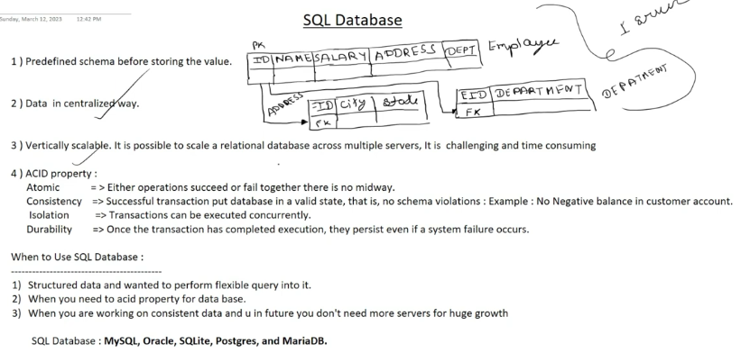

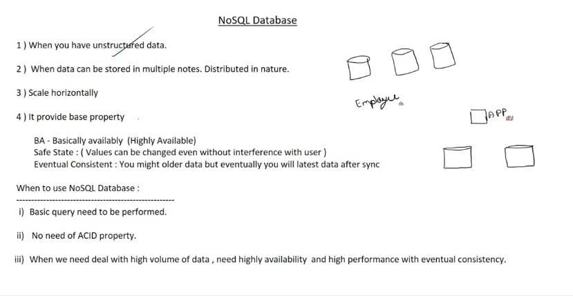


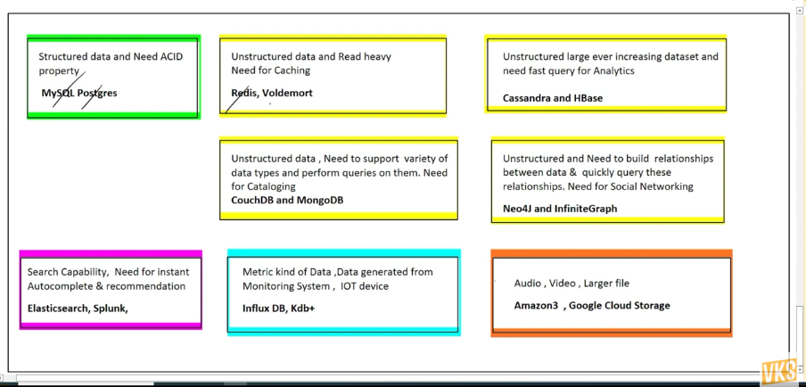

### Database replication

video - https://www.youtube.com/watch?v=3CF4mVEhMKE

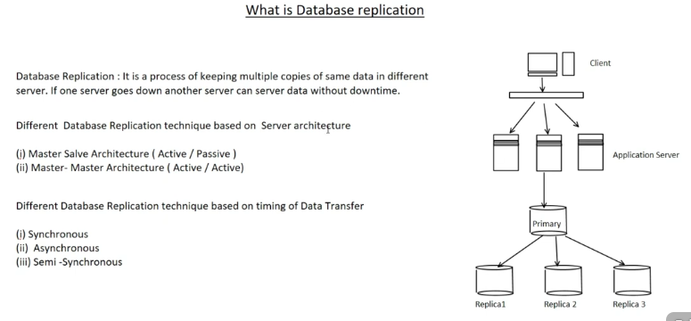

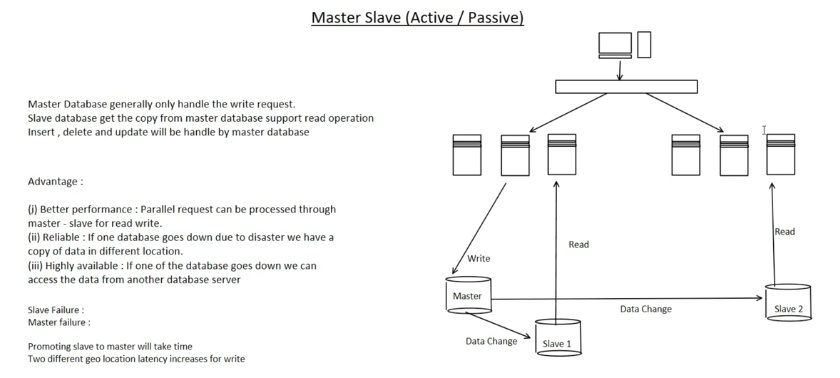

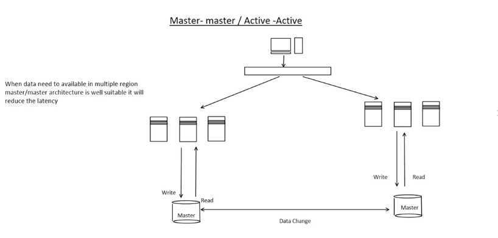

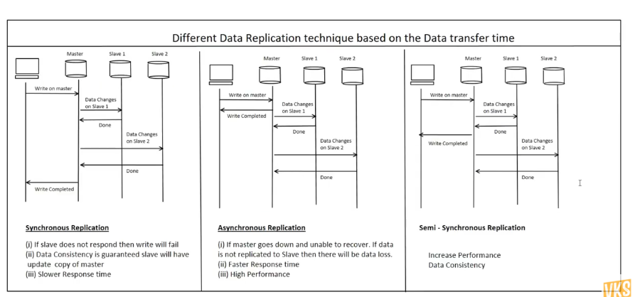

<br>

### What is Message Queue | RabbitMQ | Kafka

video - https://www.youtube.com/watch?v=IeLP6UhdT78

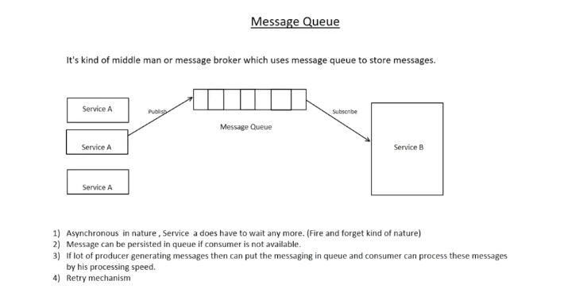

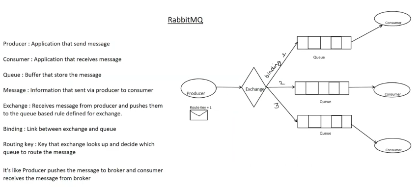

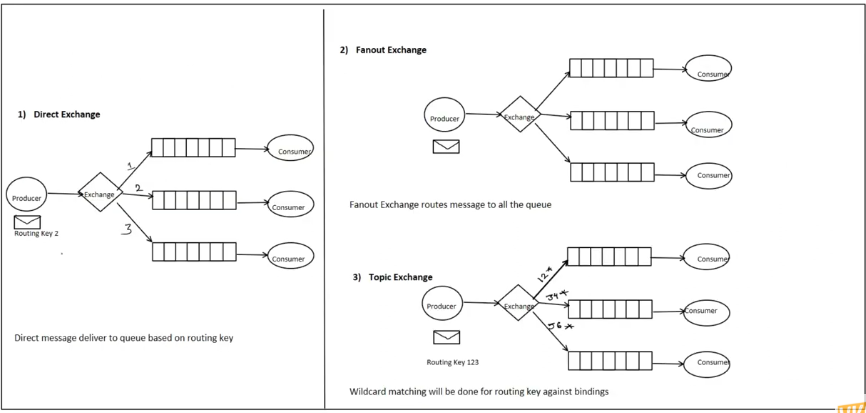

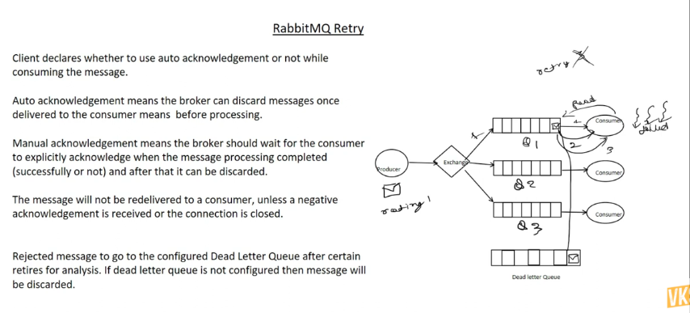

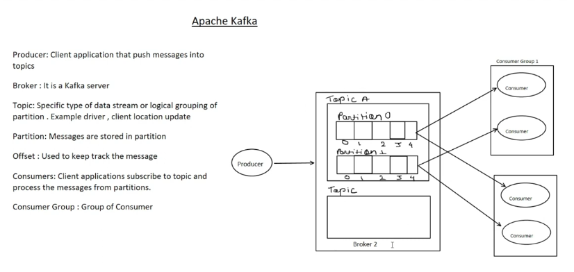

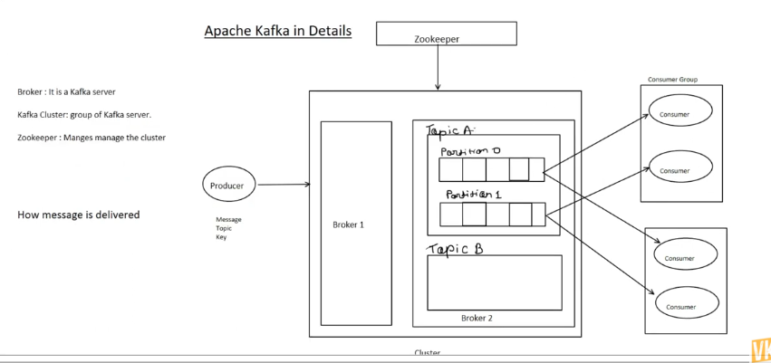

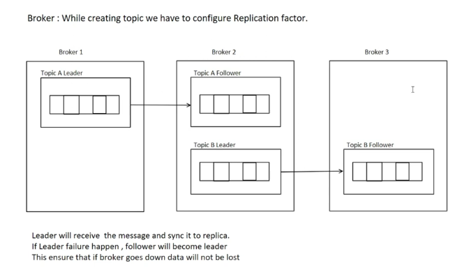

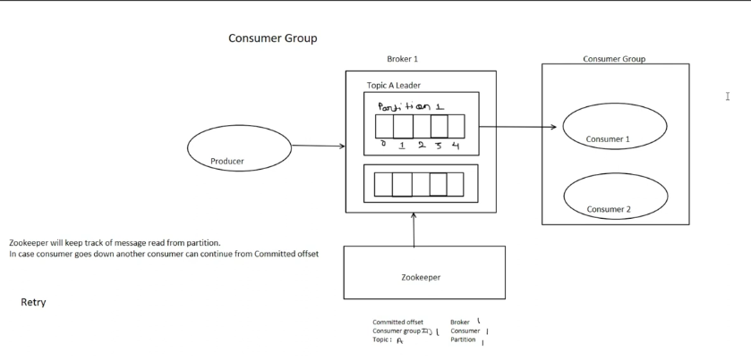

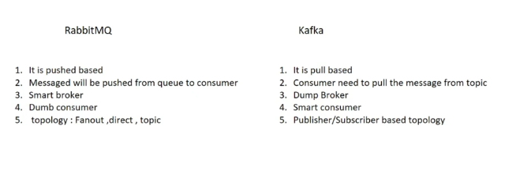

<br>


### How to Scale the Database | System Design Basics

video - https://youtu.be/Am9LI2Ea6Xo?si=f8_bF_a4t9ip2xV0

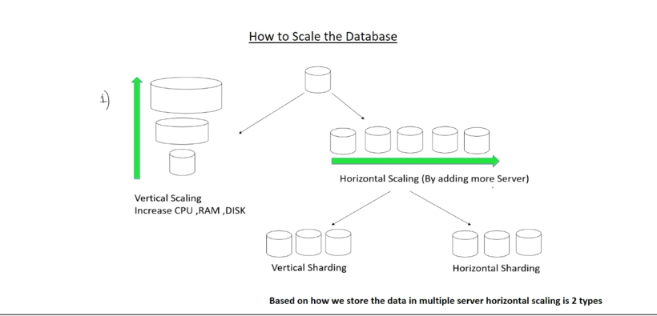


<br>

### How will you Scale from ZERO to MILLION Users

1. Single server
2. Application and DB server separation
3. Load balancer + Multi server separation
4. Database replication (master - slave)
5. Cache - redis
6. CDN
7. Messaging Queue
8. Database scaling

<br>

### Design URL Shortening Service TinyURL

Requirement
1. Ask - incoming request - 100 million/day
2. Ask - Length of url - as short as possible
3. Ask - allowed character in url - 0-9,a-z,A-Z
4. Ask - url updation - can not be updated or deleted

//--------------------Schema and Model-------------
We make schema(condition ) fist and then we make the model form it. Model is function used to connect to schema(blueprint) with a name. Layered form of schema is the model. schema => model => model instance
Generally the collection name is plural
First argument of the model of mongoose is the collection or table name
eg const data = mongoose.model('collection_name', dataSchema)

    image: {
        type: [String],   // Here how we define the type is important
        required: [true, "Please share the images"]
    },


In Schema, we have 
- unique
- default
- required
- min and max
- validate or validator
- trim (only for string)
- select - if it is false means it will not be visible in response api
- get
- set
- alias
- immutable
- transform

String
- lowercase
- uppercase
- trim
- match
- enum
- minLength
- maxLength
- populate

Number
- min
- max
- enum
- populate

Date
- min
- max
- expires


- Model Layer - It is concerned with everything about application data and business logic
- Controller Layer - It's function is to handle the application's request, interect with models, and send back responses to the client
- View Layer - used for the graphical interface, ssr website, template to generate the view. Basically presenation logic
- FAT Model/THIN Controllers - Offload as much logic as possible into the models and keep the cotrollers as simple and lean as possible.
- We have the pre and post save middleware ie Document middleware which work before and after saving the document. "This" points towards the schema
- how to decide which type of data referencing we should use like embedding or referencing. see video 148,151,152 is must
- ek hoto h child referencing and ek hoti h parent referencng
- ek hota h virtual, ek hota h populate, phir ek hota h virtual populate
- Ja child me parent ki id mark ki ho(parent referencing) and then child ko call kr k parent ki detail nikalni ho to populate use hoga. same case me agr parent ko call kr k child ki detail nikalni ho to virtual populate hoga
- virtual me as ek additional node add krna api me jo kuch calculate kr k de, without storing/adding/using the database
- populate or virtual populate me hum kabhi query nhi kr sakte like sum, avg. just we can show the data
- methods vs static in mongoose, the differece is that one is called after making the instance and other one is called directly
- Jab calculation karni ho to aggregation agar data dikhana ho to populate
