```
https://nodejs.org/learn/asynchronous-work/event-loop-timers-and-nexttick?utm_source=chatgpt.com
```

Visit above url

### concurrency versus parallelism - get answer of it

### We have the pre and post method in model schema of mongodb

### Configuration for uniform error and response, also async handler in node js

```js
// src/utils/ApiError.js

class ApiError extends Error {
    constructor(
        statusCode,
        message= "Something went wrong",
        errors = [],
        stack = ""
    ){
        super(message)
        this.statusCode = statusCode
        this.data = null
        this.message = message
        this.success = false;
        this.errors = errors

        if (stack) {
            this.stack = stack
        } else{
            Error.captureStackTrace(this, this.constructor)
        }

    }
}

export {ApiError}
```

```js
// src/utils/ApiResponse.js
class ApiResponse {
    constructor(statusCode, data, message = "Success"){
        this.statusCode = statusCode
        this.data = data
        this.message = message
        this.success = statusCode < 400
    }
}

export { ApiResponse }
```

```js
// src/utils/asyncHandler.js
const asyncHandler = (requestHandler) => {
    return (req, res, next) => {
        Promise.resolve(requestHandler(req, res, next)).catch((err) => next(err))
    }
}


export { asyncHandler }


// const asyncHandler = () => {}
// const asyncHandler = (func) => () => {}
// const asyncHandler = (func) => async () => {}


// const asyncHandler = (fn) => async (req, res, next) => {
//     try {
//         await fn(req, res, next)
//     } catch (error) {
//         res.status(err.code || 500).json({
//             success: false,
//             message: err.message
//         })
//     }
// }
```

usage

```js
// src/controllers/user.controller.js
import { asyncHandler } from "../utils/asyncHandler.js";
import {ApiError} from "../utils/ApiError.js"
import { User} from "../models/user.model.js"
import {uploadOnCloudinary} from "../utils/cloudinary.js"
import { ApiResponse } from "../utils/ApiResponse.js";
import jwt from "jsonwebtoken"
import mongoose from "mongoose";


const registerUser = asyncHandler( async (req, res) => {

    const {fullName, email, username, password } = req.body
    //console.log("email: ", email);

    if (
        [fullName, email, username, password].some((field) => field?.trim() === "")
    ) {
        throw new ApiError(400, "All fields are required")
    }

    const existedUser = await User.findOne({
        $or: [{ username }, { email }]
    })

    if (existedUser) {
        throw new ApiError(409, "User with email or username already exists")
    }
    //console.log(req.files);

    const avatarLocalPath = req.files?.avatar[0]?.path;
    //const coverImageLocalPath = req.files?.coverImage[0]?.path;

    let coverImageLocalPath;
    if (req.files && Array.isArray(req.files.coverImage) && req.files.coverImage.length > 0) {
        coverImageLocalPath = req.files.coverImage[0].path
    }
    

    if (!avatarLocalPath) {
        throw new ApiError(400, "Avatar file is required")
    }

    const avatar = await uploadOnCloudinary(avatarLocalPath)
    const coverImage = await uploadOnCloudinary(coverImageLocalPath)

    if (!avatar) {
        throw new ApiError(400, "Avatar file is required")
    }
   

    const user = await User.create({
        fullName,
        avatar: avatar.url,
        coverImage: coverImage?.url || "",
        email, 
        password,
        username: username.toLowerCase()
    })

    const createdUser = await User.findById(user._id).select(
        "-password -refreshToken"
    )

    if (!createdUser) {
        throw new ApiError(500, "Something went wrong while registering the user")
    }

    return res.status(201).json(
        new ApiResponse(200, createdUser, "User registered Successfully")
    )

} )

const loginUser = asyncHandler(async (req, res) =>{
    // req body -> data
    // username or email
    //find the user
    //password check
    //access and referesh token
    //send cookie

    const {email, username, password} = req.body
    console.log(email);

    if (!username && !email) {
        throw new ApiError(400, "username or email is required")
    }
    
    // Here is an alternative of above code based on logic discussed in video:
    // if (!(username || email)) {
    //     throw new ApiError(400, "username or email is required")
        
    // }

    const user = await User.findOne({
        $or: [{username}, {email}]
    })

    if (!user) {
        throw new ApiError(404, "User does not exist")
    }

   const isPasswordValid = await user.isPasswordCorrect(password)

   if (!isPasswordValid) {
    throw new ApiError(401, "Invalid user credentials")
    }

   const {accessToken, refreshToken} = await generateAccessAndRefereshTokens(user._id)

    const loggedInUser = await User.findById(user._id).select("-password -refreshToken")

    const options = {
        httpOnly: true,
        secure: true
    }

    return res
    .status(200)
    .cookie("accessToken", accessToken, options)
    .cookie("refreshToken", refreshToken, options)
    .json(
        new ApiResponse(
            200, 
            {
                user: loggedInUser, accessToken, refreshToken
            },
            "User logged In Successfully"
        )
    )

})

const logoutUser = asyncHandler(async(req, res) => {
    await User.findByIdAndUpdate(
        req.user._id,
        {
            $unset: {
                refreshToken: 1 // this removes the field from document
            }
        },
        {
            new: true
        }
    )

    const options = {
        httpOnly: true,
        secure: true
    }

    return res
    .status(200)
    .clearCookie("accessToken", options)
    .clearCookie("refreshToken", options)
    .json(new ApiResponse(200, {}, "User logged Out"))
})

const updateUserAvatar = asyncHandler(async(req, res) => {
    const avatarLocalPath = req.file?.path

    if (!avatarLocalPath) {
        throw new ApiError(400, "Avatar file is missing")
    }

    //TODO: delete old image - assignment

    const avatar = await uploadOnCloudinary(avatarLocalPath)

    if (!avatar.url) {
        throw new ApiError(400, "Error while uploading on avatar")
        
    }

    const user = await User.findByIdAndUpdate(
        req.user?._id,
        {
            $set:{
                avatar: avatar.url
            }
        },
        {new: true}
    ).select("-password")

    return res
    .status(200)
    .json(
        new ApiResponse(200, user, "Avatar image updated successfully")
    )
})

export {
    registerUser,
    loginUser,
    logoutUser,
    refreshAccessToken,
    changeCurrentPassword,
    getCurrentUser,
    updateAccountDetails,
    updateUserAvatar,
    updateUserCoverImage,
    getUserChannelProfile,
    getWatchHistory
}
```


### Using middleware

Middleware functions are functions that have access to:

- The request object (req)
- The response object (res)
- The next middleware function in the application’s request-response cycle, commonly named next


Middleware functions can perform the following tasks:

- Execute any code.
- Modify the request and response objects.
- End the request-response cycle.
- Pass control to the next middleware function.


If a middleware function does not end the request-response cycle, it must call next() to pass control to the next middleware function. Otherwise, the request will be left hanging.


### What is node js
- Node is neither a language nor a framework
- It is a runtime environment for executing JS code on the server side
- JS is high level language while express is its framework
- Node.js is a JavaScript runtime environment built on Chrome's **V8 engine**.
- It allows JavaScript to run outside the browser, making it a powerful tool for various applications beyond web development.


### Architecture Diagram
```
┌──────────────────────────────┐
│           NODE.JS            │
│                              │
│    ┌────────────────────┐    │
│    │     V8 Engine      │    │
│    └────────────────────┘    │
│                              │
│    ┌────────────────────┐    │
│    │ Node APIs & Modules│    │
│    └────────────────────┘    │
│                              │
└──────────────────────────────┘
```

### How Node.js is a runtime environment on the server side, what is V8

- Browsers execute the JS on the clinet and similarly node js executes on the server side
- V8 is the JS engine

- **Runtime Environment:** Primarily focuses on providing the necessary infrastructure for **code execution**, including services like memory management and I/O operations. eg Node js

- **Framework:** Primarily focuses on **simplifying the development process** by offering a structured set of tools, libraries, and best practices. eg express js

## What are the 7 Main Features of Node.js?

1. **Single Threaded**
2. **Asynchronous**
3. **Event-Driven**
4. **V8 JavaScript Engine**
5. **Cross-Platform**
6. **NPM (Node Package Manager)**
7. **Real-Time Capabilities**

###  Node.js Code Conversion: High-Level code to Machine Code

### Module Export & Requirements.
We all know that keeping all the Node.js code in a single file is not good practice, right? We need multiple files to create a large project , so in this chapter, we will explore how we can create those file and import concepts like modules and export requirements. lets start

These two files, **app.js and xyz.js**, have different code that is not related to each other, so in NodeJS we call them separate modules.

**Q: How do you make two modules work together?**
-using a require function

**Q: What is the required function?**
In Node.js, the require() function is a built-in function that allows you to include or require other modules into your main modules.

Since in node js we can only provide the single entry file, so we need to use second file in first file then we use the require function, 

```js
// in xyz.js
console.log("Reached at the sum module")

function calculateSum(a, b) {
    const sum = a + b;
    console.log(sum);
}

```

```js
// in app.js
require('./xyz');
console.log('Hello World');
var a = 10;
var b = 20;
calculateSum(a, b);
```

In console we see

```
Reached at the sum module
Hello World

and error which calculateSum is not defined
```

### Big question is how we console "Reached at the sum module" but the function error why ?

- Modules protects their variables and fucntion to leak
- so when we used the require then it runs the file but prevent the variable and function from leak, to use it then we need to export it

```js
// in xyz.js
console.log("Reached at the sum module")

function calculateSum(a, b) {
    const sum = a + b;
    console.log(sum);
}

module.export = calculateSum
```

```js
// in app.js
const calculateSum = require('./xyz');
console.log('Hello World');
var a = 10;
var b = 20;
calculateSum(a, b);
```

- module is the built-in
- The importing module is of two type `CommonJS modules (CJS) and ES modules (ESM)`.

###  CommonJS Modules (CJS) vs ES Modules (ESM)
```
| CommonJS Modules (CJS) | ES Modules (ESM) |
|------------------------|------------------|
| `module.exports`, `require()` | `import`, `export` |
| By default used in Node.js (traditionally) | Commonly used in frameworks like React and Angular |
| Older module system | Modern module system |
| Synchronous loading | Supports asynchronous module loading |
| Non-strict mode by default | Strict mode by default |
| File extension: `.cjs` | File extension: `.mjs` |
```

Note: Modern Node.js supports both CommonJS and ES Modules. ESM is not always asynchronous—static imports are resolved and evaluated through the module loading process, while `import()` supports dynamic asynchronous loading.

In node, CJS is default, if we want to use the ESM then we need to pas `type: module` in package.json


# `require` Mechanism in Node.js

The `require()` function in Node.js is used to import **CommonJS modules**.

Here's a detailed five-step mechanism of how `require()` works:

### 1. Resolve
Node.js determines the full path of the module.

- First, it checks whether the module is a built-in module (like `fs` or `path`).
- If not, it checks relative or absolute file paths when specified.
- For package imports, it searches `node_modules` directories.

### 2. Load
Node.js loads the module based on its resolved filename and format.

- JavaScript files are loaded as CommonJS modules when applicable.
- JSON files are parsed into JavaScript objects.
- Native addons (`.node`) are loaded through the native module loader.

### 3. Wrap
Node.js wraps CommonJS module code inside a function to provide **module-level scope**.

The wrapper function looks like this:

~~~javascript
(function (exports, require, module, __filename, __dirname) {
    // Module code
});
~~~

This prevents variables declared inside a module from becoming global variables.

### 4. Compile
Node.js uses the **V8 engine** to compile JavaScript code for execution.

- V8 parses and compiles JavaScript.
- V8 uses Just-In-Time (JIT) compilation to optimize execution.

### 5. Execute
The module code is executed inside the wrapper function.

- The module's code runs.
- `module.exports` contains the exported values.
- Node.js caches the module after loading, so subsequent `require()` calls normally reuse the cached exports.

---

## Example

**myModule.js**

~~~javascript
function publicFunction() {
    console.log("This is a public function");
}

module.exports = {
    publicFunction
};
~~~

**index.js**

~~~javascript
const myModule = require('./myModule');

myModule.publicFunction();

// Output: This is a public function
~~~

In this example, `require('./myModule')` goes through the five-step mechanism to load and execute `myModule.js`.

---

## Important Interview Points

- `require()` is part of the **CommonJS module system**.
- CommonJS `require()` normally loads modules **synchronously**.
- Every CommonJS module has its own scope because of the module wrapper.
- Modules are **cached** after their first successful load.
- Requiring the same resolved module again usually returns the cached `module.exports` without executing the module again.
- `module.exports` defines what is returned by `require()`.

### Interview Question: What happens when we require the same module multiple times?

~~~javascript
// counter.js
console.log("Module loaded");

module.exports = {
    count: 10
};
~~~

~~~javascript
// index.js
const first = require('./counter');
const second = require('./counter');

console.log(first === second);

// Output:
// Module loaded
// true
~~~

**Explanation:**

Node.js executes `counter.js` only once because the module is cached after the first successful `require()`.

The second `require()` returns the cached exported object rather than executing the module again.


### LIBUV

Wikipedia page - Node.js has an event-driven architecture capable of asynchronous I/O.

JavaScript itself is synchronous, but with the power of Node.js, it can handle asynchronous operations, allowing JavaScript to perform multiple tasks concurrently.


Since JS is sync in nature, if any long or blocking task comes which can cause the performance issue. So the longer time consuming task is operated in async mode. Below is the diagram, basically all the async task were handled by the LIBUV library which is written in c, then we can say node is async in nature.


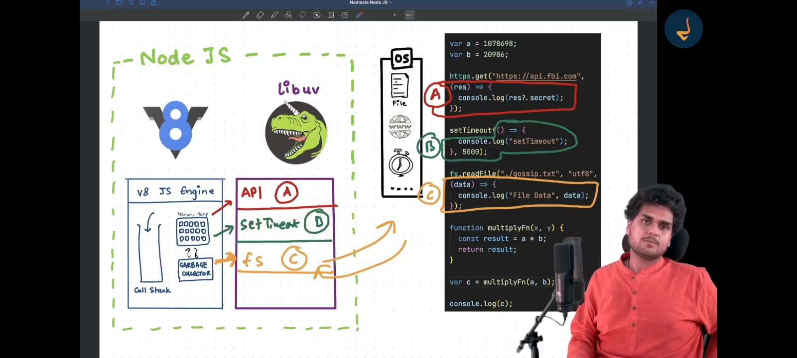

Line form node official website - A Node.js app runs in a single process, without creating a new thread for every request. Node.js provides a set of asynchronous I/O primitives in its standard library that prevent JavaScript code from blocking. In addition, libraries in Node.js are generally written using non-blocking paradigms. Accordingly, blocking behavior is the exception rather than the norm in Node.js.

Node is async I/O due to libuv

### V8 engine

# V8 JavaScript Engine: Code Execution Phases
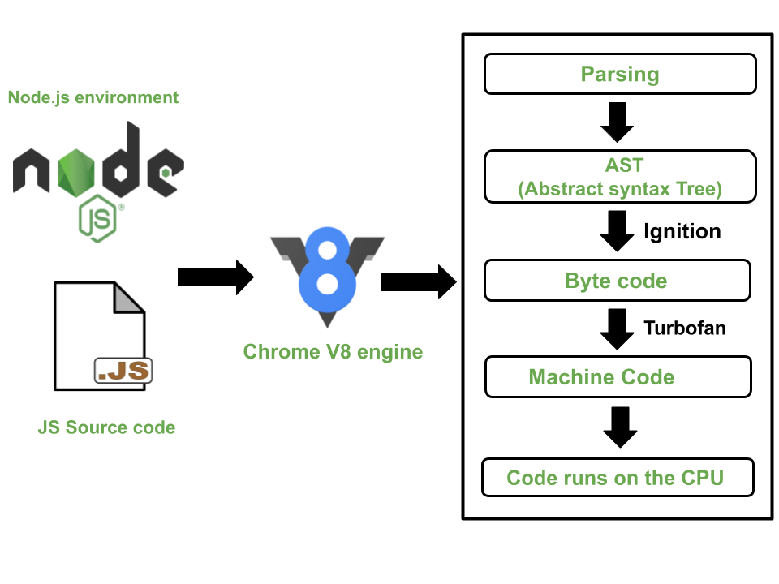
## 1. Parsing Stage
- **Lexical Analysis:** V8 reads the JavaScript code and breaks it down into tokens, which are small chunks like keywords, operators, and identifiers.
- **Syntax Analysis:** The tokens are then arranged into a structure called an Abstract Syntax Tree (AST), which represents the code's structure and logic.

## 2. Ignition (Interpreter)
- **Bytecode Generation:** V8 converts the AST into bytecode, a simpler, intermediate form of the code that’s easier to run.
- **Execution:** The Ignition interpreter runs this bytecode directly, allowing the code to start executing quickly, but not yet fully optimized.

## 3. Profiling
- **Hotspot Detection:** As the code runs, V8 watches for parts of the code that are used a lot, called "hot" functions. It gathers data on these parts to decide if they should be optimized.

## 4. TurboFan (Optimizing Compiler)
- **Optimization:** For the frequently used "hot" code, V8 uses the TurboFan compiler to turn the bytecode into highly optimized machine code, making it run much faster.
- **Deoptimization:** If the assumptions used to optimize the code turn out to be wrong (like a variable type changing), V8 can revert the code back to a slower, but safer, execution mode.

## 5. Garbage Collection
- **Memory Management:** V8 regularly cleans up memory by removing data that the program no longer needs, making sure that memory usage stays efficient.

## 6. Final Execution
- **Execution:** The optimized code continues to run efficiently until the program finishes or until changes in the code require adjustments.

This step-by-step process ensures that JavaScript code is executed as quickly and efficiently as possible.
"""
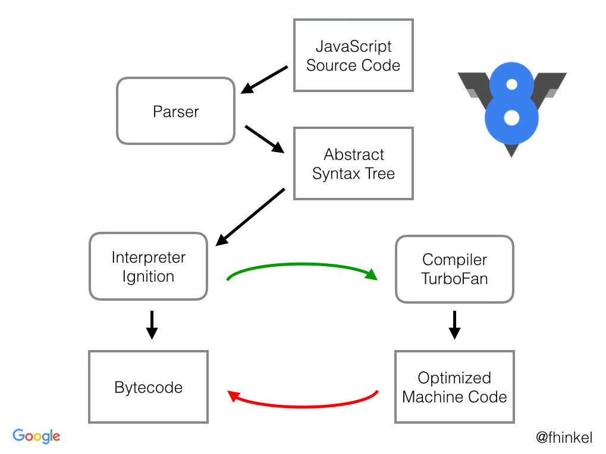


### Below is more detailed structiure of node
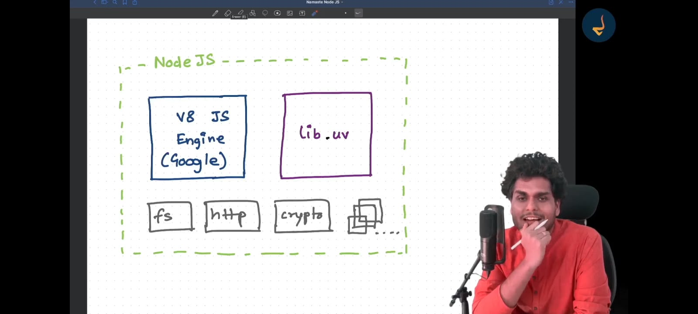

### Below is the event loop diagram

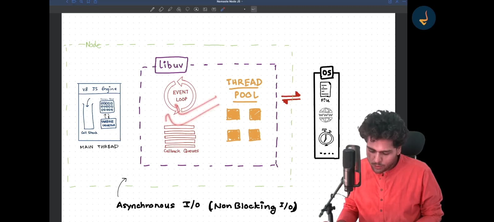

**Note: Event loop lies inside the libuv libraray**

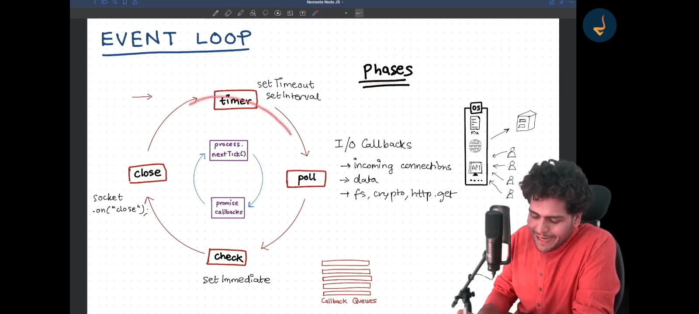

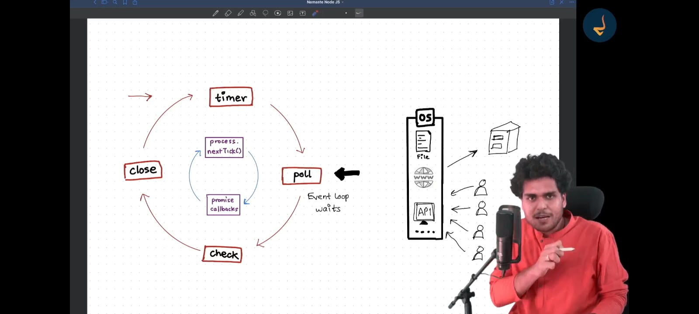

**Note: when there is nothing in callstack and event queue, then event loop wait at polls**

**nextTick and promises cycles runs before each time ie timers,poll,check,close**


1  **Timers Phase:** In this phase, all callbacks that were set using  `setTimeout` or `setInterval` are executed. These timers are checked, and if their time has expired, their corresponding callbacks are added to the callback queue for execution.

2  **Poll Phase:** After timers, the event loop enters the Poll phase, which is crucial because it handles I/O callbacks. For instance, when you perform a file read operation using `fs.readFile` , the callback associated with this I/O operation will be executed in this phase. The Poll phase is responsible for handling all I/Orelated tasks, making it one of the most important phases in the event loop.

3  **Check Phase:** Next is the Check phase, where callbacks scheduled by the `setImmediate` function are executed. This utility API allows you to execute callbacks immediately after the Poll phase, giving you more control over the order of operations.

4  **Close Callbacks Phase:** Finally, in the Close Callbacks phase, any callbacks associated with closing operations, such as socket closures, are handled. This phase is typically used for cleanup tasks, ensuring that resources are properly released.


- *Event Loop Cycle with `process.nextTick()` and `Promises`*

### One More Important Note
*When the event loop is empty and there are no more tasks to execute, it enters the `poll phase` and essentially waits for incoming events*

# Thread pool in libuv

Whenever there's an asynchronous task, V8 offloads it to libuv. For example, when reading a file, libuv uses one of the threads in its thread pool. The file system (fs) call is assigned to a thread in the pool, and that thread makes a request to the OS. While the file is being read, the thread in the pool is fully occupied and cannot perform any other tasks. Once the file reading is complete, the engaged thread is freed up and becomes available for other operations. For instance, if you're performing a cryptographic operation like hashing, it will be assigned to another thread. There are certain functions for which libuv uses the thread pool.

` In Node.js, the default size of the thread pool is 4 threads:`
```
    UV_THREADPOOL_SIZE=4
```

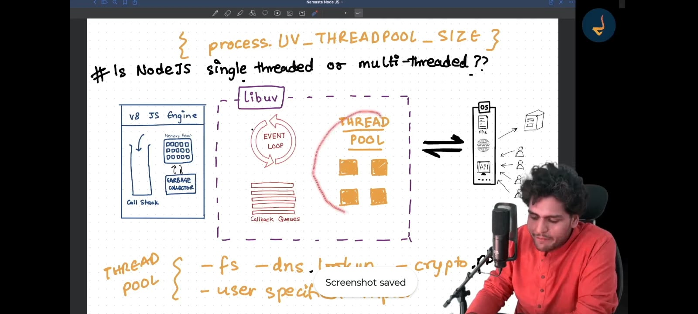

### Q - Is node js single thread or multi thread
- So answer is if the operation is sync in nature then it is single thread, if it is async in nature then it is multi thread beacuse async task is handled by libuv, and in libuv has thread pool ie 4 in count, so each task gets occupied by single thread in libuv which performs the task like fs. and keeps separate the main thread from blocking.

Below is the examle that thread pool size is 4 in libuv

```js
const fs = require("fs");
const crypto = require("crypto")

process.env.UV_THREADPOOL_SIZE = 5;

// fs.readFile("./file.txt", "utf-8", (err, data) => {
//     console.log(data);
// })
//The 4 keys will generate first and after that remaining one will be generated after some time because nodejs has only 4 threads at a time 
crypto.pbkdf2("Akshad", "salt", 500000, 10, "sha512", (err, key) => {
    console.log("1st key generated below:")
    console.log(key);
})
crypto.pbkdf2("Akshad", "salt", 500000, 10, "sha512", (err, key) => {
    console.log("2 nd key generated below:")
    console.log(key);
})
crypto.pbkdf2("Akshad", "salt", 500000, 10, "sha512", (err, key) => {
    console.log("3 nd key generated below:")
    console.log(key);
})
crypto.pbkdf2("Akshad", "salt", 500000, 10, "sha512", (err, key) => {
    console.log("4 nd key generated below:")
    console.log(key);
})
crypto.pbkdf2("Akshad", "salt", 500000, 10, "sha512", (err, key) => {
    console.log("5 nd key generated below:")
    console.log(key);
})
```

If you run above code then you see that 4 logs at a single time and 5th logs after some time. This is because 4 thread block by 4 task. then anyone task which completes then it unblocks the thraed and 5th task handed to that thread.

## Q: Suppose you have a server with many incoming requests, and users are hitting APIs. Do these APIs use the thread pool?
 A : No.

 In the libuv library, when it interacts with the OS for networking tasks, it uses sockets. Networking operations occur through these sockets. Each socket has a socket descriptor, also known as a file descriptor (although this has nothing to do with the file system). 
 
 When an incoming request arrives on a socket, and you want to write data to this connection, it involves blocking operations. To handle this, a thread is created for each request. However, creating a separate thread for each connection is not practical, especially when dealing with thousands of requests.
 
  Instead, the system uses efficient mechanisms provided by the OS, such as `epoll` (on Linux) or `kqueue` on macOS. These mechanisms handle multiple file descriptors (sockets) without needing a thread per connection:

  Here How it works:
  - `epoll` (**Linux**) and `kqueue` (**macOS**) are notification mechanisms used to manage many connections efficiently.
  -  When you create an `epoll` or `kqueue` descriptor, it monitors multiple file descriptors (sockets) for activity.
  -  The OS kernel manages these mechanisms and notifies libuv of any changes or activity on the sockets.
  -  This approach allows the server to handle a large number of connections efficiently without creating a thread for each one.

  The kernel-level mechanisms, like epoll and kqueue , provide a scalable way to manage multiple connections, significantly improving performance and resource utilization in a high-concurrency environment.

## Important points to follow:

 1 **DON'T BLOCK THE MAIN THREAD**
 - Don't use `sync` methods
 - Don't do operations on `heavy JSON Object` it will make load on main thread.
 - Avoid complex `Regular Expression`.
 - Avoid `Complex calculations` and big or `infine loops`.


### route exception case

```js
app.get("/ab?c", ()=>{})
```

Here means route will work for /abc, /ac also ie b is optional


```js
app.get("/ab+c", ()=>{})
```

Here measn route will work for /abc,/abbbc also. b can be of any count

```js
app.get("/ab*cd", ()=>{})
```

Here measn it will work for abcd, also what ever you will write between ab and cd.

### Instaed of making functions in the utils, We can also make function in the model or schema file. So the function related to that schema to be available in the file.


### How does Node.js handle child threads? or simply worker threads

visit video - https://www.youtube.com/watch?v=JTl6tQ4bqYA

site link - https://nodejs.org/api/worker_threads.html?utm_source=chatgpt.com

While Node.js operates off a `single main thread`, it can harness the full power of multi-core systems by launching child threads for specific tasks, such as file compression or image processing

**Thread Pool and Worker Threads**
To manage these child threads, Node.js uses a combination of:

- A `thread pool`, powered by the libuv library.
- `Worker threads` for dedicated, offloaded computation.

```js
// index.js

const express = require("express");
const { Worker } = require("worker_threads");

const app = express();
const port = process.env.PORT || 3000;

app.get("/non-blocking", (req, res) => {
    res.status(200).send("This page is non-blocking.");
});

app.get("/blocking", (req, res) => {
    const worker = new Worker("./worker.js");

    worker.on("message", (data) => {
        res.status(200).send(`Result is ${data}`);
    });

    worker.on("error", (err) => {
        res.status(400).send(`An Error occured : ${err}`);
    });
});

app.listen(port, () => {
    console.log(`App listening on port ${port}`);
});
```

```js
// worker.js

const { parentPort } = require("worker_threads");

let result = 0;
for (let i = 0; i < 10000000000; i++) {
    result++;
}

parentPort.postMessage(result);
```

### Describe the event-driven programming in Node.js.

`Event-driven programming`, a hallmark of Node.js, uses an `event, listener, and emitter` architecture to handle asynchronous tasks. This design centers around events and how they trigger actions in the attached listeners.

Core Components
- **Event Emitter**: Acts as the event registry and dispatcher, letting objects register interest in particular events and emit these events when they occur.

- **Event Handler (Listener)**: Associates with a particular event through registration. These callback functions will be asynchronously carried out when a matching event is emitted.

**Code Example: Event Emitter and Handlers**

Here is the Node.js code:

```js
const { EventEmitter } = require('events');
const emitter = new EventEmitter();

emitter.on('event-name', (eventArgs) => {
    console.log(`Event-name was emitted with arguments: ${eventArgs}`);
});

emitter.emit('event-name', 'Some Payload');
```

In this code, when `emit` is called, the `on` method’s callback is executed asynchronously.

**Event Loop Mechanism in Node.js**
- **Call Stack**: Maintains the call order of the functions and methods being executed.
- **Node APIs and Callbacks Queue**: Handle I/O tasks and timers.
- **Event Loop**: Constantly watches the execution stack and checks whether it’s clear to execute pending tasks from the Callback Queue.

Practical Applications in Node.js
- **HTTP Server**: Listens for and serves requests.
- **File System Operations**: Execute I/O tasks.
- **Database Operations**: Such as data retrieval.

### Core Modules in node .js

- os: Provides system-related utility functions. Example: os.freemem(), os.totalmem().
- util: General utility functions primarily used for debugging. Example: util.inspect().
- fs: Offers extensive file system capabilities. Commonly used methods include fs.readFile() and fs.writeFile().
- http/https: Implements web server and client. Example: http.createServer().
- net: Facilitates low-level networking tasks. Example: net.createServer().
- dgram: Delivers UDP Datagram Socket support for messaging.
- crypto: Encompasses cryptographic operations. Common methods include crypto.createHash() and crypto.createHmac().
- **zlib**: Offers data compression capabilities integrated with various modules like http.
- stream: Facilitates event-based data stream processing.
- path: Aids in file path string manipulation.
- url: Parses and formats URL strings, especially beneficial in web applications and server operations.

### What are streams in Node.js and what types are available? 

video - https://www.youtube.com/watch?v=64LJJhT6Ybo

`Node.js` utilizes `streams` for efficient handling of input/output data, offering two main varieties: readable and writable.

Categories of Streams
- `Standard Streams`: Represent standard input, output, and error. These are instances of Readable or Writable streams.
- `Duplex Streams`: Facilitate both reading and writing. They can be connected to processes or handling pipelines.
- `Transform Streams`: A special type that acts as an intermediary, modifying the data as it passes through.

Practical Implementations
- `HTTP Transactions`: HTTP clients use readable and writable streams for sending requests and receiving responses. HTTP servers also apply these streams for similar actions in the opposite direction.
- `File System`: Reading and writing files in Node.js utilizes these streams. For instance, the fs.createReadStream() method generates a readable stream whereas fs.createWriteStream() creates a writable one.


### How do you read and write files in Node.js?

```js
import { readFile, writeFile, appendFile } from 'node:fs/promises';

try {
  // Write a file (creates it or overwrites existing contents).
  await writeFile('example.txt', 'Hello, Node.js!\n', 'utf8');

  // Read the file as text.
  const contents = await readFile('example.txt', 'utf8');
  console.log(contents);

  // Add text without overwriting.
  await appendFile('example.txt', 'Another line.\n', 'utf8');
} catch (error) {
  console.error('File operation failed:', error.message);
}
```

### How do you use the EventEmitter in Node.js?

Node.js’s built-in `EventEmitter` lets you register listeners for named events and trigger them with data.

```js
import { EventEmitter } from 'node:events';

const emitter = new EventEmitter();

// Listen for an event.
function greet(name) {
  console.log(`Hello, ${name}!`);
}

emitter.on('greet', greet);

// Trigger the event and pass data to listeners.
emitter.emit('greet', 'Alice'); // Hello, Alice!

// Listen only once.
emitter.once('connected', () => {
  console.log('Connected!');
});

emitter.emit('connected'); // Connected!
emitter.emit('connected'); // No output.

// Remove a specific listener.
emitter.off('greet', greet);
```

Key points:

- **`.on(event, listener)`** registers a listener.
- **`.emit(event, ...args)`** calls listeners synchronously, in registration order.
- **`.once(event, listener)`** automatically removes the listener after its first call.
- **`.off(event, listener)`** removes a listener using the same function reference.

Handle the special `'error'` event: emitting it without a registered listener throws an error.

```js
emitter.on('error', (error) => {
  console.error('Something failed:', error.message);
});

emitter.emit('error', new Error('Connection lost'));
```

For CommonJS, use:

```js
const { EventEmitter } = require('node:events');
```

### How do you manage path operations in Node.js?

Use Node.js’s built-in **`path` module** to construct and inspect file paths.

```js
const path = require('node:path');

// Join path segments using the operating system’s separator.
const filePath = path.join('users', 'alice', 'notes.txt');

// Resolve a path into an absolute path.
console.log(path.resolve('notes.txt'));

// Extract parts of a path.
console.log(path.basename(filePath)); // 'notes.txt'
console.log(path.dirname(filePath));  // 'users/alice' on macOS/Linux
console.log(path.extname(filePath));  // '.txt'

// Simplify redundant separators and "." or ".." segments.
console.log(path.normalize('users/alice/../bob/notes.txt'));

// Check whether a path is absolute.
console.log(path.isAbsolute(filePath)); // false
```

Common methods:

| Method | Purpose |
|---|---|
| `join()` | Combine path segments and normalize the result |
| `resolve()` | Produce an absolute path, using the current working directory when needed |
| `basename()` | Get the final filename or directory name |
| `dirname()` | Get the parent directory |
| `extname()` | Get the file extension |
| `parse()` | Split a path into `root`, `dir`, `base`, `name`, and `ext` |
| `relative()` | Calculate a relative path between two locations |

Path operations manipulate strings; they don’t check whether files exist. Use `path.win32` or `path.posix` when you need a specific platform’s path rules.


### Explain process.nextTick().

**`process.nextTick(callback)` schedules a callback to run after the current synchronous code finishes, before Node.js continues processing the event loop**, including timers and I/O callbacks. [Node.js documentation](https://nodejs.org/api/process.html#processnexttickcallback-args)

```js
console.log('Start');

setTimeout(() => {
  console.log('Timer');
}, 0);

process.nextTick(() => {
  console.log('Next tick');
});

console.log('End');
```

Output:

```text
Start
End
Next tick
Timer
```

The synchronous statements run first. Node.js then processes the next-tick queue before handling the timer.

It’s useful for deferring a callback so callers can finish setup—for example, registering event listeners before an object emits an event.

Avoid repeatedly scheduling `nextTick()` callbacks recursively: Node.js drains this queue before continuing, so an endless chain can prevent timers and I/O from running.

For most new code that simply needs to defer work, Node.js recommends **`queueMicrotask()`** and marks `process.nextTick()` as Legacy. To yield to the event loop between chunks of work, use `setImmediate()`. [Scheduling guidance](https://nodejs.org/api/process.html#when-to-use-queuemicrotask-vs-processnexttick)


### What is the global object in Node.js?

The **global object** in Node.js provides values and functions accessible throughout your application without importing them.

You can access it through **`globalThis`** (standard JavaScript) or **`global`** (Node.js-specific):

```js
console.log(globalThis === global); // true

// Examples of globally available APIs:
console.log(process.version);
setTimeout(() => console.log('Hello!'), 1000);
```

Common globals include:

| Global | Purpose |
|---|---|
| `console` | Log messages and errors |
| `process` | Access process information and environment variables |
| `Buffer` | Work with binary data |
| `setTimeout()` | Schedule a callback after a delay |
| `setInterval()` | Schedule repeated callbacks |

You can also attach your own properties:

```js
globalThis.appName = 'My App';

console.log(globalThis.appName); // 'My App'
```

However, shared global state can make code harder to maintain; module exports and imports usually provide clearer dependencies.

**Top-level variables in Node.js modules are not global:**

```js
var message = 'Hello'; // Scoped to this module.
console.log(globalThis.message); // undefined
```

Also, `require`, `module`, `__filename`, and `__dirname` are supplied to individual CommonJS modules; they aren’t properties of the global object.

### How do you connect a MySQL database with Node.js?

Use the **`mysql2` package**, which supports promises, connection pools, and prepared statements. [MySQL2 documentation](https://sidorares.github.io/node-mysql2/docs)

1. **Install the driver:**

   ```bash
   npm install mysql2
   ```

2. **Create a `.env` file** with credentials for an existing MySQL database and user:

   ```dotenv
   DB_HOST=localhost
   DB_PORT=3306
   DB_USER=app_user
   DB_PASSWORD=your_password
   DB_NAME=my_database
   ```

   Keep this file out of version control.

3. **Create `database.cjs`:**

   ```js
   const mysql = require('mysql2/promise');

   const pool = mysql.createPool({
     host: process.env.DB_HOST,
     port: Number(process.env.DB_PORT || 3306),
     user: process.env.DB_USER,
     password: process.env.DB_PASSWORD,
     database: process.env.DB_NAME,
     connectionLimit: 10
   });

   async function main() {
     try {
       // Executes a query to verify the connection.
       const [rows] = await pool.execute(
         'SELECT ? AS message',
         ['Connected to MySQL!']
       );

       console.log(rows[0].message);
     } catch (error) {
       console.error('Database operation failed:', error.message);
       process.exitCode = 1;
     } finally {
       await pool.end();
     }
   }

   main().catch(console.error);
   ```

4. **Run with a current Node.js version:**

   ```bash
   node --env-file=.env database.cjs
   ```

The pool opens connections as needed and reuses them. Calling `pool.execute()` automatically acquires and releases a connection. Use `?` placeholders for data values instead of inserting user input into SQL strings. [Queries and pools](https://sidorares.github.io/node-mysql2/docs)

For a web server, keep one shared pool and call `pool.end()` during shutdown, rather than after each request.

### What’s the role of ORM in Node.js?

An **ORM (Object-Relational Mapper)** connects your Node.js application’s objects and models to relational database tables. It translates operations such as creating, finding, and updating records into SQL.

For example, with a Sequelize model named `User`:

```js
const users = await User.findAll({
  where: { active: true }
});
```

This produces a query conceptually like:

```sql
SELECT * FROM users WHERE active = true;
```

An ORM commonly helps with:

- **Models:** Define how application data maps to tables and columns.
- **CRUD operations:** Create, read, update, and delete records.
- **Relationships:** Represent associations, such as users having many posts.
- **Migrations:** Manage database schema changes.
- **Transactions:** Group operations so they succeed or fail together.

Examples used with Node.js include **Sequelize, TypeORM, and Prisma**.

Compared with using a driver such as `mysql2` directly, an ORM adds a higher-level interface and reduces repetitive database code. You still need to understand SQL, indexes, and query performance; complex operations may benefit from raw SQL.

ORMs can help parameterize queries, but unsafe raw SQL can still introduce SQL injection vulnerabilities.


### How can you monitor the performance of a Node.js app?

“I’d monitor three layers: **request performance, the Node.js process, and its dependencies**.

- **Requests:** Throughput, error rate, and p95/p99 response times, broken down by route. Average latency alone can hide slow requests.
- **Runtime:** CPU, RSS and heap usage, garbage-collection pauses, event-loop delay, and event-loop utilization. Node provides `process.memoryUsage()` and `perf_hooks` for these.
- **Dependencies:** Database query duration, connection-pool wait time, and external API latency and failures.

I’d use **OpenTelemetry** to instrument requests and dependencies, export telemetry to a monitoring backend, and correlate traces with structured logs using request or trace IDs.” [OpenTelemetry Node.js guide](https://opentelemetry.io/docs/languages/js/getting-started/nodejs/)

“For example, if p99 latency increases alongside CPU and event-loop delay, I’d investigate blocking or CPU-heavy JavaScript with a CPU profile. If request latency rises while event-loop delay stays low, I’d inspect database and external-service traces.

For memory growth, I’d look at the trend across garbage collections before concluding there’s a leak, then investigate retained objects with heap snapshots.

Finally, I’d configure alerts around service targets and sustained resource pressure, compare performance before and after deployments, and validate capacity under realistic load.”

### What is clustering in Node.js and how does it work?

video - https://www.youtube.com/watch?v=JoPZ9gEvpz8

**Clustering lets a Node.js application use multiple CPU cores by running multiple worker processes that share a server port.** Each worker has its own JavaScript event loop, V8 instance, and memory.

It works like this:

1. A **primary process** creates workers using `cluster.fork()`.
2. Each worker runs the application and calls `server.listen()` on the same port.
3. Incoming **connections** are distributed among workers—round-robin by default on most platforms; Windows defaults to OS-managed distribution.
4. Workers communicate with the primary through IPC. If a worker crashes, other workers continue serving, but replacement requires application or supervisor logic. [Node.js cluster documentation](https://nodejs.org/api/cluster.html#how-it-works)

For a production system, I’d pay attention to:

- **Shared state:** Sessions and caches stored in one worker aren’t visible to others. Use an external store when consistency is required.
- **Resource limits:** Every worker creates its own database pool. Four workers with ten connections each can consume forty database connections.
- **Lifecycle:** Drain connections during shutdown and prevent uncontrolled restart loops.

Clustering increases service capacity; it **doesn’t make an individual CPU-heavy request faster**. Worker threads suit parallel computation within a process. If deployment infrastructure already manages multiple application instances, I’d assess whether adding clustering provides a benefit.

### How can you prevent memory leaks in a Node.js application?

**Preventing memory leaks comes down to controlling object lifetimes.** V8 garbage collection reclaims unreachable objects; it cannot reclaim data your application still references, even if that data is no longer useful.

In production, I’d focus on these common causes:

- **Unbounded caches and collections:** Set size limits and eviction policies. Ensure expired entries are actually removed.
- **Event listeners:** Remove listeners when their owner finishes. Use `.once()` where appropriate, but clean up if the event never occurs. Investigate `MaxListenersExceededWarning` before increasing the limit. [EventEmitter documentation](https://nodejs.org/api/events.html#eventsdefaultmaxlisteners)
- **Timers and closures:** Clear timers during cleanup and avoid long-lived callbacks retaining entire request objects or large buffers.
- **Unfinished operations:** Apply timeouts and cancellation, bound concurrency, and release resources in `finally`.
- **Excessive buffering:** Stream large payloads and respect backpressure. Growing queues can exhaust memory even without a traditional leak. [Node.js backpressure guide](https://nodejs.org/learn/modules/backpressuring-in-streams)

A typical issue is attaching a listener to a shared emitter on every request without removing it. The emitter keeps the callbacks—and anything those callbacks reference—alive.

**To verify a fix**, I’d run a sustained, repeatable workload and check whether the heap baseline stabilizes across garbage collections. I’d compare heap snapshots and inspect retaining paths to identify what keeps growing. [Heap snapshot guide](https://nodejs.org/learn/diagnostics/memory/using-heap-snapshot)

I’d also track RSS and external memory: stable JavaScript heap usage doesn’t rule out growing buffers or native allocations.

### How does Node.js handle concurrency?

**Node.js handles concurrency through an event loop and non-blocking I/O.** By default, application JavaScript runs on one main thread, while multiple I/O operations can remain in progress simultaneously.

For example, when an HTTP handler queries a database:

1. Node.js initiates the operation through a network socket.
2. The handler yields while waiting, allowing other requests to run.
3. When data becomes available, the event loop processes the relevant callbacks. **Keep in mind yha libvu process krta h async I/O operations ko, complete k badd callback function ko main thread me execute krta h**
4. The promise resolves, and execution after `await` can continue.

The underlying mechanism depends on the operation:

- **Network I/O:** Generally uses operating-system facilities for non-blocking sockets.
- **Some filesystem, crypto, compression, and DNS operations:** Use libuv’s worker pool.
- **CPU-heavy JavaScript:** Runs on the main thread unless explicitly moved to worker threads or another process.

The key distinction is **concurrency versus parallelism**: Node.js can manage many overlapping requests without executing their JavaScript simultaneously on the main thread.

Also, **`async`/`await` doesn’t move computation to another thread**:

```js
async function calculate() {
  expensiveSynchronousCalculation(); // Still blocks the event loop.
}
```

For a production application, I’d keep request handlers short, bound concurrent work to protect dependencies, and use worker threads for CPU-intensive tasks. Multiple processes or application instances can distribute requests across CPU cores.


### What is the difference between process and child_process modules?

video - https://www.youtube.com/watch?v=C1v4MXGhpcM

**`process` represents the current Node.js process; `child_process` lets it start and communicate with other processes.**

| Aspect | `process` | `child_process` |
|---|---|---|
| Purpose | Inspect and control the current process | Create and manage child processes |
| Access | Globally available as `process` | Import from `node:child_process` |
| Typical uses | Read environment variables, arguments, memory usage; handle signals | Run commands, scripts, or separate Node.js applications |
| Examples | `process.pid`, `process.env`, `process.argv` | `spawn()`, `exec()`, `execFile()`, `fork()` |

```js
const { spawn } = require('node:child_process');

console.log('Parent PID:', process.pid);

const child = spawn(process.execPath, ['worker.js'], {
  stdio: 'inherit'
});

child.on('error', console.error);
child.on('exit', (code) => {
  console.log('Child exited:', code);
});
```

Here, `process.execPath` is the current Node.js executable. `worker.js` runs in a **separate process with its own memory and event loop**.

The important interview follow-up is choosing the child-process API:

- **`spawn()`** streams output; useful for long-running commands or large output.
- **`exec()`** runs through a shell and buffers output. Avoid interpolating untrusted input into its command string.
- **`execFile()`** runs an executable directly without a shell by default.
- **`fork()`** starts another Node.js process with an IPC channel; it doesn’t copy the parent’s JavaScript heap.

The asynchronous APIs let the parent continue working. Their synchronous counterparts, such as `execSync()`, block the parent’s event loop until completion.


### What are some common security best practices for Node.js applications?

For a production Node.js application, **I’d prioritize access control, safe input handling, resource limits, and keeping the runtime and dependencies patched.**

1. **Validate input and prevent injection.** Validate request bodies, parameters, and headers against schemas. Use parameterized SQL, escape rendered output appropriately, and avoid passing user input into shell commands.

2. **Enforce authorization on every operation.** Authentication identifies the caller; authorization determines which records and actions they can access. For `/orders/:id`, verify ownership or permissions—not just whether the user has a valid token. [OWASP Node.js guidance](https://cheatsheetseries.owasp.org/cheatsheets/Nodejs_Security_Cheat_Sheet.html)

3. **Protect credentials and sessions.** Hash passwords with Argon2id using appropriate parameters. Use `Secure`, `HttpOnly`, and suitable `SameSite` cookie settings, plus CSRF protection where required. [Password storage guidance](https://cheatsheetseries.owasp.org/cheatsheets/Password_Storage_Cheat_Sheet.html), [session guidance](https://cheatsheetseries.owasp.org/cheatsheets/Nodejs_Security_Cheat_Sheet.html)

4. **Limit resource consumption.** Set request-body limits, header/request timeouts, rate limits, and concurrency bounds. Watch for expensive regexes, large JSON parsing, and synchronous work that can block the event loop. [Node.js security guidance](https://nodejs.org/learn/getting-started/security-best-practices)

5. **Manage dependencies deliberately.** Use a supported Node.js release, commit lockfiles, scan dependencies in CI, and review vulnerabilities for actual exposure before applying fixes.

6. **Protect secrets and minimize privileges.** Use a secrets manager, rotate credentials, restrict database permissions, and run the application without unnecessary OS privileges.

7. **Secure HTTP and browser interactions.** Use HTTPS, configure security headers through Helmet, and restrict CORS to required origins. CORS does not replace authorization.

8. **Log and test security failures.** Redact credentials and tokens, avoid exposing stack traces, audit sensitive actions, and test unauthorized access and abuse cases. [OWASP application security guidance](https://cheatsheetseries.owasp.org/cheatsheets/Nodejs_Security_Cheat_Sheet.html)


### What are WebSockets and how do they work with Node.js?

**WebSockets provide a persistent, bidirectional connection between a client and server.** Either side can send messages at any time, making them useful for chat, multiplayer games, and live dashboards.

The usual HTTP/1.1 connection flow is:

1. The client sends an HTTP request asking to upgrade to WebSocket.
2. The server accepts with **`101 Switching Protocols`**.
3. Both sides exchange text or binary messages over the established connection.
4. The connection remains open until closed or interrupted.

Node.js handles socket activity through its event loop, allowing many connections without assigning a dedicated thread to each one. For a WebSocket server, a library such as **`ws`** handles the protocol and exposes connection and message events. [Node.js WebSocket guide](https://nodejs.org/learn/getting-started/websocket), [`ws` documentation](https://github.com/websockets/ws)

In production, I’d address:

- **Security:** Use `wss://`, authenticate connections, validate browser origins, and authorize individual operations.
- **Connection health:** Use ping/pong heartbeats to detect broken connections.
- **Resource control:** Limit message sizes, rates, and outgoing buffers for slow clients.
- **Recovery:** Implement reconnect behavior and application-level replay where messages must survive disconnects.
- **Scaling:** Each connection belongs to one instance; coordinate broadcasts across instances through a shared messaging layer.

A common interview distinction: **Socket.IO adds its own protocol and features**, including reconnection, rooms, and acknowledgments. A plain WebSocket client cannot communicate directly with a Socket.IO server. [Socket.IO documentation](https://socket.io/docs/v4/)


### How do you set up a WebSocket server in Node.js?

Use **`ws`** to handle the WebSocket handshake, connections, and messages. Here’s a minimal echo server.

1. **Install the package:**

   ```bash
   npm install ws
   ```

2. **Create `server.cjs`:**

   ```js
   const { WebSocketServer } = require('ws');

   const wss = new WebSocketServer({
     port: 8080,
     maxPayload: 64 * 1024 // Maximum message size: 64 KiB.
   });

   wss.on('error', console.error);

   wss.on('connection', (socket) => {
     console.log('Client connected');

     socket.on('error', console.error);

     socket.on('message', (data, isBinary) => {
       // Echo the message, preserving its text/binary type.
       socket.send(data, { binary: isBinary });
     });

     socket.on('close', () => {
       console.log('Client disconnected');
     });
   });

   wss.on('listening', () => {
     console.log('Listening on ws://localhost:8080');
   });
   ```

3. **Start it:**

   ```bash
   node server.cjs
   ```

4. **Connect from a browser frontend served over local HTTP:**

   ```js
   const socket = new WebSocket('ws://localhost:8080');

   socket.addEventListener('open', () => {
     socket.send('Hello from the client!');
   });

   socket.addEventListener('message', (event) => {
     console.log('Received:', event.data);
   });

   socket.addEventListener('error', console.error);
   ```

The server accepts the upgrade automatically, creates a socket for each client, and handles incoming messages through events. You can also attach `ws` to an existing HTTP server. [`ws` documentation](https://github.com/websockets/ws)

**For production**, I’d authenticate and validate browser origins before accepting the upgrade, authorize message operations, use `wss://`, add ping/pong heartbeats, bound outgoing buffers, and drain connections during deployment. Those controls turn the basic server into something suitable for sustained traffic.

### What are semantic versioning (semver) and its importance in Node.js development?

Semantic versioning communicates how a release changes a package’s public API. It uses MAJOR.MINOR.PATCH, such as 2.4.1.

### How can you create a simple TCP server in Node.js?

Use Node.js’s built-in **`net` module**. It creates TCP servers without HTTP routing or headers.

Save this as `server.cjs`:

```js
const net = require('node:net');

const server = net.createServer((socket) => {
  console.log('Client connected');

  socket.on('error', (error) => {
    console.error('Socket error:', error.message);
  });

  // Echo incoming bytes back to the client.
  // pipe() handles stream backpressure.
  socket.pipe(socket);
});

server.on('error', (error) => {
  console.error('Server error:', error.message);
});

server.listen(4000, '127.0.0.1', () => {
  console.log('TCP server listening on port 4000');
});
```

Run it:

```bash
node server.cjs
```

To test it, save this as `client.cjs` and run it in another terminal:

```js
const net = require('node:net');

const client = net.createConnection({
  host: '127.0.0.1',
  port: 4000
}, () => {
  client.end('Hello TCP!\n');
});

client.on('data', (chunk) => process.stdout.write(chunk));
client.on('error', console.error);
```

```bash
node client.cjs
```

The client prints `Hello TCP!`.

**The important interview detail:** TCP is an ordered byte stream, with **no message boundaries**. One write can arrive across multiple `data` events, and multiple writes can arrive together. For a real application protocol, define framing—for example, newline-delimited messages or length-prefixed payloads—and enforce buffer limits.

For production, also handle idle timeouts, connection limits, graceful shutdown, and TLS through `node:tls` when encryption is required.

### What is REPL in Node.js?

**REPL stands for Read–Eval–Print Loop.** It’s Node.js’s interactive JavaScript environment:

- **Read:** Accept an expression or statement.
- **Eval:** Execute it.
- **Print:** Display the result.
- **Loop:** Wait for the next input.

Start it by running `node` without a filename:

```bash
node
```

Then enter JavaScript:

```js
> const price = 100;
undefined

> price * 1.18
118

> await Promise.resolve('Hello')
'Hello'
```

### Explain the role of a reverse proxy with Node.js applications.

**A reverse proxy sits between clients and your Node.js application.** It receives requests, forwards them to an application instance, and returns the response.

```text
Client → HTTPS :443 → Reverse proxy → Node.js instances :3000
```

Its main responsibilities are:

- **TLS termination:** Manage HTTPS certificates and encryption at the public entry point. Upstream connections can also use TLS.
- **Load balancing:** Distribute traffic across Node.js instances and support deployment traffic shifts.
- **Routing:** Send requests to different services based on hostname or path.
- **Traffic protection:** Apply request-size limits, timeouts, and rate limits.
- **Offloading:** Serve static files, compress responses, and cache suitable content to reduce application work. [NGINX documentation](https://docs.nginx.com/nginx/admin-guide/web-server/reverse-proxy/), [Express production guidance](https://expressjs.com/en/advanced/best-practice-performance/)

**The key Node.js configuration detail is trusting forwarded headers correctly.** Behind a proxy, the socket’s remote address is usually the proxy’s address. Headers such as `X-Forwarded-For` and `X-Forwarded-Proto` convey the original client IP and protocol.

In Express, I’d configure `trust proxy` to match the actual trusted proxy addresses or topology. Incorrect configuration can let clients spoof information used for rate limiting, logging, redirects, or secure-cookie behavior. The trusted proxy must handle forwarded headers consistently. [Express proxy guidance](https://expressjs.com/en/guide/behind-proxies/)

I’d also verify WebSocket upgrade handling and streaming behavior: response buffering that helps ordinary HTTP traffic may delay server-sent events. The application instances should be reachable only through the intended ingress path.

### How do Node.js streams enhance performance?

video - https://www.youtube.com/watch?v=64LJJhT6Ybo

**Streams improve performance by processing data incrementally, instead of loading the entire payload into memory.** This is useful for large files, uploads, downloads, and database exports.

Their main benefits are:

- **Lower memory usage:** Process chunks rather than retaining the whole payload.
- **Earlier output:** Start sending or transforming data before the entire input arrives.
- **Overlapping work:** Reading, transformation, and writing can progress as data becomes available.
- **Backpressure:** A slow consumer causes the producer to slow down, preventing uncontrolled buffering. This reduces memory pressure and garbage-collection overhead. [Node.js backpressure guide](https://nodejs.org/learn/modules/backpressuring-in-streams)

For example, compress a large file:

```js
const { createReadStream, createWriteStream } = require('node:fs');
const { createGzip } = require('node:zlib');
const { pipeline } = require('node:stream/promises');

pipeline(
  createReadStream('large.log'),
  createGzip(),
  createWriteStream('large.log.gz')
).catch((error) => {
  console.error('Compression failed:', error);
  process.exitCode = 1;
});
```

Here, `pipeline()` coordinates backpressure and propagates errors across the streams.

**The important interview distinction:** Streams primarily improve resource efficiency and responsiveness; they don’t guarantee faster execution. A CPU-heavy synchronous transform can still block the event loop.

Also, `highWaterMark` is a buffering threshold, not a hard memory limit. I’d check that application code respects backpressure and doesn’t accumulate chunks in arrays, which would defeat the benefit.


### What is Buffer in Node.js?

Buffer is a temporary storage for binary data. It is similar to an array of integers but corresponds to a fixed-sized chunk of memory allocated outside the V8 heap.

```js
// Creating buffers
const buf1 = Buffer.alloc(10); // Allocate 10 bytes
const buf2 = Buffer.from('Hello'); // From string
const buf3 = Buffer.from([1, 2, 3]); // From array

// Reading and writing
const buf = Buffer.alloc(5);
buf.write('Hello');
console.log(buf.toString()); // Hello

// Buffer operations
const buffer = Buffer.from('Hello World');
console.log(buffer.length); // 11
console.log(buffer.toString('hex')); // 48656c6c6f20576f726c64
console.log(buffer.toString('base64')); // SGVsbG8gV29ybGQ=

// Concatenating buffers
const buf4 = Buffer.from('Hello ');
const buf5 = Buffer.from('World');
const buf6 = Buffer.concat([buf4, buf5]);
console.log(buf6.toString()); // Hello World
```


### What is the difference between process.nextTick() and setImmediate()?

| process.nextTick() | setImmediate() |
|-------------------|----------------|
| Executes before I/O events | Executes after I/O events |
| Executes in current phase | Executes in check phase |
| Can cause I/O starvation | Better for I/O operations |
| Higher priority | Lower priority |

```javascript
console.log('Start');

setImmediate(() => {
  console.log('setImmediate');
});

process.nextTick(() => {
  console.log('nextTick');
});

console.log('End');

// Output:
// Start
// End
// nextTick
// setImmediate

// Multiple nextTick calls
process.nextTick(() => console.log('nextTick 1'));
process.nextTick(() => console.log('nextTick 2'));
setImmediate(() => console.log('setImmediate 1'));
setImmediate(() => console.log('setImmediate 2'));

// Output:
// nextTick 1
// nextTick 2
// setImmediate 1
// setImmediate 2
```


### What is the purpose of the cluster module?

The cluster module allows you to create child processes (workers) that share the same server port, enabling you to take advantage of multi-core systems.

```javascript
const cluster = require('cluster');
const http = require('http');
const os = require('os');

if (cluster.isMaster) {
  const numCPUs = os.cpus().length;
  console.log(`Master process ${process.pid} is running`);

  // Fork workers
  for (let i = 0; i < numCPUs; i++) {
    cluster.fork();
  }

  cluster.on('exit', (worker, code, signal) => {
    console.log(`Worker ${worker.process.pid} died`);
    cluster.fork(); // Restart worker
  });
} else {
  // Workers share the TCP connection
  http.createServer((req, res) => {
    res.writeHead(200);
    res.end(`Worker ${process.pid} handled request\n`);
  }).listen(8000);

  console.log(`Worker ${process.pid} started`);
}
```


### What is the purpose of the crypto module?

The crypto module provides cryptographic functionality including hashing, encryption, decryption, and generating random values.

```javascript
const crypto = require('crypto');

// Hash (MD5, SHA256, etc.)
const hash = crypto.createHash('sha256');
hash.update('password123');
console.log(hash.digest('hex'));

// HMAC (Hash-based Message Authentication Code)
const hmac = crypto.createHmac('sha256', 'secret-key');
hmac.update('data to authenticate');
console.log(hmac.digest('hex'));

// Encryption and Decryption
const algorithm = 'aes-256-cbc';
const key = crypto.randomBytes(32);
const iv = crypto.randomBytes(16);

function encrypt(text) {
  const cipher = crypto.createCipheriv(algorithm, key, iv);
  let encrypted = cipher.update(text, 'utf8', 'hex');
  encrypted += cipher.final('hex');
  return encrypted;
}

function decrypt(encrypted) {
  const decipher = crypto.createDecipheriv(algorithm, key, iv);
  let decrypted = decipher.update(encrypted, 'hex', 'utf8');
  decrypted += decipher.final('utf8');
  return decrypted;
}

// Random bytes
const randomBytes = crypto.randomBytes(16).toString('hex');
console.log(randomBytes);
```


### 28. What is the difference between readFile and createReadStream?

| readFile | createReadStream |
|----------|------------------|
| Reads entire file into memory | Reads file in chunks |
| Not suitable for large files | Suitable for large files |
| Simple to use | More complex |
| Returns all data at once | Returns data in streams |
| Higher memory usage | Lower memory usage |

```javascript
const fs = require('fs');

// readFile - loads entire file
fs.readFile('large-file.txt', 'utf8', (err, data) => {
  if (err) throw err;
  console.log(data); // Entire file content
});

// createReadStream - reads in chunks
const readStream = fs.createReadStream('large-file.txt', {
  encoding: 'utf8',
  highWaterMark: 16 * 1024 // 16KB chunks
});

readStream.on('data', (chunk) => {
  console.log('Chunk:', chunk.length);
});

readStream.on('end', () => {
  console.log('Finished reading');
});

// Practical example: Copy large file
const readStream = fs.createReadStream('source.txt');
const writeStream = fs.createWriteStream('destination.txt');
readStream.pipe(writeStream);
```

### 29. How do you handle errors in Node.js?

Error handling in Node.js can be done using:

1. **Try-Catch** (for synchronous code)
2. **Callbacks** (error-first callbacks)
3. **Promises** (.catch())
4. **Async/Await** (try-catch)
5. **Event Emitters** (error events)
6. **Error Middleware** (Express.js)


### 30. What is global object in Node.js?

The global object in Node.js provides variables and functions that are available in all modules without requiring them.

**Common Global Objects:**
- `__dirname` - Current directory
- `__filename` - Current file
- `console` - Console functions
- `process` - Process information
- `Buffer` - Binary data
- `setTimeout`, `setInterval`, `setImmediate`
- `require()` - Import modules

```javascript
// Global variables
console.log(__dirname); // Current directory path
console.log(__filename); // Current file path
console.log(process.version); // Node.js version

// Custom global variables (not recommended)
global.myVariable = 'Hello';
console.log(myVariable); // Accessible anywhere

// Process object
console.log(process.env.NODE_ENV); // Environment variables
console.log(process.argv); // Command line arguments
console.log(process.pid); // Process ID

// Console
console.log('Log message');
console.error('Error message');
console.warn('Warning message');
console.time('label');
console.timeEnd('label');
```


### 31. What is the purpose of __dirname and __filename?

- `__dirname`: Returns the absolute path of the directory containing the currently executing file
- `__filename`: Returns the absolute path of the currently executing file

```js
// current file: /home/user/project/app.js

console.log(__dirname);  // /home/user/project
console.log(__filename); // /home/user/project/app.js
```

### 41. What is piping in Node.js?

Piping is a mechanism to connect the output of one stream to the input of another stream, enabling efficient data transfer without loading all data into memory.

```javascript
const fs = require('fs');
const zlib = require('zlib');

// Basic piping
const readStream = fs.createReadStream('input.txt');
const writeStream = fs.createWriteStream('output.txt');

readStream.pipe(writeStream);

// Multiple pipes (chaining)
fs.createReadStream('input.txt')
  .pipe(zlib.createGzip())
  .pipe(fs.createWriteStream('input.txt.gz'));

// HTTP response piping
const http = require('http');
http.createServer((req, res) => {
  const stream = fs.createReadStream('large-file.pdf');
  stream.pipe(res);
}).listen(3000);

// Error handling in pipes
const pipeline = require('stream').pipeline;

pipeline(
  fs.createReadStream('input.txt'),
  zlib.createGzip(),
  fs.createWriteStream('input.txt.gz'),
  (err) => {
    if (err) {
      console.error('Pipeline failed:', err);
    } else {
      console.log('Pipeline succeeded');
    }
  }
);

// Transform stream in pipe
const { Transform } = require('stream');

const upperCase = new Transform({
  transform(chunk, encoding, callback) {
    this.push(chunk.toString().toUpperCase());
    callback();
  }
});

fs.createReadStream('input.txt')
  .pipe(upperCase)
  .pipe(fs.createWriteStream('output.txt'));
```

### 45. What is the purpose of the os module?

The os module provides operating system-related utility methods and properties.

```javascript
const os = require('os');

// Platform information
console.log(os.platform()); // 'win32', 'linux', 'darwin'
console.log(os.type()); // 'Windows_NT', 'Linux', 'Darwin'
console.log(os.arch()); // 'x64', 'arm', 'ia32'
console.log(os.release()); // OS release version

// CPU information
console.log(os.cpus()); // Array of CPU cores
console.log(os.cpus().length); // Number of cores

// Memory information
console.log(os.totalmem()); // Total memory in bytes
console.log(os.freemem()); // Free memory in bytes

// Convert to GB
const totalMemGB = (os.totalmem() / 1024 / 1024 / 1024).toFixed(2);
console.log(`Total Memory: ${totalMemGB} GB`);

// User information
console.log(os.userInfo());
// {
//   username: 'user',
//   homedir: '/home/user',
//   shell: '/bin/bash'
// }

// Network interfaces
console.log(os.networkInterfaces());

// System uptime
console.log(os.uptime()); // Seconds since system boot

// Temporary directory
console.log(os.tmpdir()); // /tmp or C:\Users\...\AppData\Local\Temp

// Hostname
console.log(os.hostname());

// End of line marker
console.log(os.EOL); // '\n' on POSIX, '\r\n' on Windows

// Constants
console.log(os.constants.signals); // Signal constants
console.log(os.constants.errno); // Error constants
```


### 47. What is the purpose of the fs module?

The fs (File System) module provides an API for interacting with the file system, including reading, writing, and manipulating files and directories.

```javascript
const fs = require('fs');
const fsPromises = require('fs').promises;

// Read file (synchronous)
const data = fs.readFileSync('file.txt', 'utf8');
console.log(data);

// Read file (asynchronous - callback)
fs.readFile('file.txt', 'utf8', (err, data) => {
  if (err) throw err;
  console.log(data);
});

// Read file (Promise)
fsPromises.readFile('file.txt', 'utf8')
  .then(data => console.log(data))
  .catch(err => console.error(err));

// Write file
fs.writeFileSync('output.txt', 'Hello World');
fs.writeFile('output.txt', 'Hello World', (err) => {
  if (err) throw err;
});

// Append to file
fs.appendFileSync('log.txt', 'New log entry\n');

// Delete file
fs.unlinkSync('file.txt');
fs.unlink('file.txt', (err) => {
  if (err) throw err;
});

// Check if file exists
if (fs.existsSync('file.txt')) {
  console.log('File exists');
}

// Get file stats
const stats = fs.statSync('file.txt');
console.log(stats.isFile());
console.log(stats.isDirectory());
console.log(stats.size);

// Directory operations
fs.mkdirSync('newDir');
fs.rmdirSync('oldDir');
const files = fs.readdirSync('directory');

// Watch file changes
fs.watch('file.txt', (eventType, filename) => {
  console.log(`${filename} changed: ${eventType}`);
});

// Copy file
fs.copyFileSync('source.txt', 'destination.txt');

// Rename/Move file
fs.renameSync('old.txt', 'new.txt');
```

### 51. What is backpressure in Node.js?

Backpressure occurs when the data producer writes data faster than the consumer can read it. This can lead to memory issues if not handled properly. Node.js streams have built-in backpressure handling.

**Why Backpressure Happens:**
- Fast data source (reading from disk)
- Slow data destination (writing to network)
- Buffer overflow
- Memory exhaustion

```javascript
const fs = require('fs');

// ❌ BAD - No backpressure handling
const readStream = fs.createReadStream('large-file.txt');
const writeStream = fs.createWriteStream('output.txt');

readStream.on('data', (chunk) => {
  writeStream.write(chunk); // May cause backpressure
});

// ✅ GOOD - Using pipe() handles backpressure automatically
readStream.pipe(writeStream);

// ✅ GOOD - Manual backpressure handling
readStream.on('data', (chunk) => {
  const canContinue = writeStream.write(chunk);
  
  if (!canContinue) {
    // Pause reading until drain event
    readStream.pause();
  }
});

writeStream.on('drain', () => {
  // Resume reading when buffer is drained
  readStream.resume();
});

// Using pipeline for better error handling
const { pipeline } = require('stream');

pipeline(
  fs.createReadStream('input.txt'),
  fs.createWriteStream('output.txt'),
  (err) => {
    if (err) {
      console.error('Pipeline failed:', err);
    } else {
      console.log('Pipeline succeeded');
    }
  }
);

// Transform stream with backpressure
const { Transform } = require('stream');

const slowTransform = new Transform({
  transform(chunk, encoding, callback) {
    // Simulate slow processing
    setTimeout(() => {
      this.push(chunk.toString().toUpperCase());
      callback();
    }, 100);
  }
});

fs.createReadStream('input.txt')
  .pipe(slowTransform)
  .pipe(fs.createWriteStream('output.txt'));
```

### 53. What is the difference between cluster and worker threads?

Both allow parallel processing, but they serve different purposes and work differently.

| Cluster | Worker Threads |
|---------|---------------|
| Multiple processes | Multiple threads in one process |
| Share server ports | Share memory (SharedArrayBuffer) |
| Each has its own memory | Share same memory space |
| Better for I/O scaling | Better for CPU-intensive tasks |
| Higher overhead | Lower overhead |
| Communication via IPC | Communication via message passing |
| Each has own event loop | Share event loop resources |

```javascript
// CLUSTER - For I/O scaling
const cluster = require('cluster');
const http = require('http');
const os = require('os');

if (cluster.isMaster) {
  const numCPUs = os.cpus().length;
  
  // Fork workers (separate processes)
  for (let i = 0; i < numCPUs; i++) {
    cluster.fork();
  }
  
  cluster.on('exit', (worker) => {
    console.log(`Worker ${worker.process.pid} died`);
    cluster.fork(); // Restart
  });
} else {
  // Each worker is a separate process
  http.createServer((req, res) => {
    res.end(`Worker ${process.pid}`);
  }).listen(8000);
  
  console.log(`Worker ${process.pid} started`);
}

// WORKER THREADS - For CPU-intensive tasks
const { Worker, isMainThread, parentPort } = require('worker_threads');

if (isMainThread) {
  // Main thread
  const worker = new Worker(__filename);
  
  worker.on('message', (msg) => {
    console.log('From worker:', msg);
  });
  
  worker.postMessage('Hello from main thread');
} else {
  // Worker thread (same process, different thread)
  parentPort.on('message', (msg) => {
    console.log('From main:', msg);
    
    // CPU-intensive work
    const result = heavyComputation();
    parentPort.postMessage(result);
  });
}

// Combining both for optimal performance
if (cluster.isMaster) {
  // Master process forks workers
  for (let i = 0; i < os.cpus().length; i++) {
    cluster.fork();
  }
} else {
  // Each cluster worker can use worker threads
  const express = require('express');
  const app = express();
  
  app.get('/compute', async (req, res) => {
    // Offload CPU work to worker thread
    const worker = new Worker('./compute-worker.js', {
      workerData: req.query
    });
    
    worker.on('message', (result) => {
      res.json({ result });
    });
  });
  
  app.listen(3000);
}

// When to use what:
// 1. Cluster: Scale HTTP server across CPU cores
// 2. Worker Threads: CPU-intensive operations (crypto, image processing)
// 3. Child Process: Running external programs
// 4. Async I/O: Most I/O operations (already non-blocking)
```

### 54. How do you detect and prevent memory leaks?

Memory leaks occur when memory that is no longer needed is not released. Node.js provides several tools to detect and prevent them.

**Common Causes:**
- Global variables
- Forgotten timers/callbacks
- Event listeners not removed
- Closures holding references
- Large caches without limits

```javascript
// ❌ MEMORY LEAK EXAMPLES

// 1. Global variables
global.cache = {};
function addToCache(key, value) {
  global.cache[key] = value; // Never cleared
}

// 2. Forgotten timers
function startTimer() {
  setInterval(() => {
    console.log('Running...');
  }, 1000);
  // Timer never cleared
}

// 3. Event listeners
const EventEmitter = require('events');
const emitter = new EventEmitter();

function addListener() {
  emitter.on('event', () => {
    console.log('Event fired');
  });
  // Listener never removed
}

// 4. Closures
function createLeak() {
  const largeData = new Array(1000000).fill('data');
  return function() {
    console.log(largeData[0]); // Holds reference to largeData
  };
}

// ✅ PREVENTING MEMORY LEAKS

// 1. Clear timers
function startTimerSafe() {
  const timer = setInterval(() => {
    console.log('Running...');
  }, 1000);
  
  // Clear when done
  setTimeout(() => {
    clearInterval(timer);
  }, 10000);
  
  return timer;
}

// 2. Remove event listeners
function addListenerSafe() {
  const handler = () => console.log('Event fired');
  emitter.on('event', handler);
  
  // Remove when done
  return () => emitter.removeListener('event', handler);
}

// 3. Use WeakMap/WeakSet
const weakCache = new WeakMap();
function addToWeakCache(obj, value) {
  weakCache.set(obj, value);
  // Automatically garbage collected when obj is no longer referenced
}

// 4. Limit cache size
class LRUCache {
  constructor(maxSize) {
    this.maxSize = maxSize;
    this.cache = new Map();
  }
  
  set(key, value) {
    if (this.cache.size >= this.maxSize) {
      const firstKey = this.cache.keys().next().value;
      this.cache.delete(firstKey);
    }
    this.cache.set(key, value);
  }
  
  get(key) {
    return this.cache.get(key);
  }
}

// DETECTING MEMORY LEAKS

// 1. Using process.memoryUsage()
function monitorMemory() {
  const usage = process.memoryUsage();
  console.log({
    rss: `${Math.round(usage.rss / 1024 / 1024)} MB`,
    heapTotal: `${Math.round(usage.heapTotal / 1024 / 1024)} MB`,
    heapUsed: `${Math.round(usage.heapUsed / 1024 / 1024)} MB`,
    external: `${Math.round(usage.external / 1024 / 1024)} MB`
  });
}

setInterval(monitorMemory, 5000);

// 2. Using heap snapshots
const v8 = require('v8');
const fs = require('fs');

function takeHeapSnapshot() {
  const filename = `heap-${Date.now()}.heapsnapshot`;
  const snapshot = v8.writeHeapSnapshot(filename);
  console.log('Snapshot written to', snapshot);
}

// 3. Using Node.js --inspect flag
// Run: node --inspect app.js
// Open chrome://inspect in Chrome
// Take heap snapshots and compare

// 4. Using clinic.js
// npm install -g clinic
// clinic doctor -- node app.js
// clinic heapprofiler -- node app.js

// 5. Monitor with process events
process.on('warning', (warning) => {
  console.warn(warning.name);
  console.warn(warning.message);
  console.warn(warning.stack);
});

// 6. Set memory limits
// node --max-old-space-size=4096 app.js

// Best practices
// - Use 'use strict'
// - Avoid global variables
// - Clean up timers and listeners
// - Use WeakMap/WeakSet for caches
// - Implement cache size limits
// - Monitor memory in production
// - Use proper error handling
```

### 56. How do you optimize Node.js performance?

Performance optimization in Node.js involves multiple strategies at different levels.

```javascript
// 1. USE CLUSTERING
const cluster = require('cluster');
const os = require('os');

if (cluster.isMaster) {
  for (let i = 0; i < os.cpus().length; i++) {
    cluster.fork();
  }
} else {
  require('./app');
}

// 2. IMPLEMENT CACHING
const NodeCache = require('node-cache');
const cache = new NodeCache({ stdTTL: 600 });

app.get('/api/data/:id', async (req, res) => {
  const cacheKey = `data_${req.params.id}`;
  
  // Check cache first
  const cached = cache.get(cacheKey);
  if (cached) {
    return res.json(cached);
  }
  
  // Fetch from database
  const data = await db.getData(req.params.id);
  
  // Store in cache
  cache.set(cacheKey, data);
  res.json(data);
});

// 3. USE COMPRESSION
const compression = require('compression');
app.use(compression());

// 4. OPTIMIZE DATABASE QUERIES
// ❌ BAD - N+1 query problem
async function getUsersWithPosts() {
  const users = await User.find();
  for (let user of users) {
    user.posts = await Post.find({ userId: user.id });
  }
  return users;
}

// ✅ GOOD - Single query with join
async function getUsersWithPostsOptimized() {
  return User.find().populate('posts');
}

// 5. USE STREAMS FOR LARGE DATA
// ❌ BAD - Loads entire file into memory
app.get('/download', (req, res) => {
  const data = fs.readFileSync('large-file.zip');
  res.send(data);
});

// ✅ GOOD - Streams data
app.get('/download', (req, res) => {
  const stream = fs.createReadStream('large-file.zip');
  stream.pipe(res);
});

// 6. IMPLEMENT CONNECTION POOLING
const { Pool } = require('pg');
const pool = new Pool({
  max: 20,
  idleTimeoutMillis: 30000,
  connectionTimeoutMillis: 2000,
});

// 7. USE ASYNC/AWAIT PROPERLY
// ❌ BAD - Sequential execution
async function fetchDataSlow() {
  const user = await getUser();
  const posts = await getPosts();
  const comments = await getComments();
  return { user, posts, comments };
}

// ✅ GOOD - Parallel execution
async function fetchDataFast() {
  const [user, posts, comments] = await Promise.all([
    getUser(),
    getPosts(),
    getComments()
  ]);
  return { user, posts, comments };
}

// 8. OPTIMIZE REGULAR EXPRESSIONS
// ❌ BAD - Catastrophic backtracking
const badRegex = /^(a+)+$/;

// ✅ GOOD - Optimized
const goodRegex = /^a+$/;

// 9. USE WORKER THREADS FOR CPU-INTENSIVE TASKS
const { Worker } = require('worker_threads');

app.post('/process-image', (req, res) => {
  const worker = new Worker('./image-processor.js', {
    workerData: req.body.image
  });
  
  worker.on('message', (result) => {
    res.json(result);
  });
});

// 10. IMPLEMENT RATE LIMITING
const rateLimit = require('express-rate-limit');

const limiter = rateLimit({
  windowMs: 15 * 60 * 1000, // 15 minutes
  max: 100 // limit each IP to 100 requests per windowMs
});

app.use('/api/', limiter);

// 11. OPTIMIZE JSON PARSING
// Use fast-json-stringify for serialization
const fastJson = require('fast-json-stringify');
const stringify = fastJson({
  type: 'object',
  properties: {
    name: { type: 'string' },
    age: { type: 'number' }
  }
});

app.get('/user', (req, res) => {
  const user = { name: 'John', age: 30 };
  res.send(stringify(user));
});

// 12. USE PROFILING TOOLS
// Run with profiling: node --prof app.js
// Process profiling data: node --prof-process isolate-*.log

// 13. MONITOR PERFORMANCE
const monitoring = {
  requestCount: 0,
  responseTime: [],
  
  middleware(req, res, next) {
    const start = Date.now();
    this.requestCount++;
    
    res.on('finish', () => {
      const duration = Date.now() - start;
      this.responseTime.push(duration);
      
      if (this.responseTime.length > 1000) {
        this.responseTime.shift();
      }
    });
    
    next();
  },
  
  getStats() {
    const avg = this.responseTime.reduce((a, b) => a + b, 0) / this.responseTime.length;
    return {
      totalRequests: this.requestCount,
      avgResponseTime: avg.toFixed(2),
      memoryUsage: process.memoryUsage()
    };
  }
};

app.use(monitoring.middleware.bind(monitoring));

// 14. ENABLE HTTP/2
const http2 = require('http2');
const server = http2.createSecureServer({
  key: fs.readFileSync('server-key.pem'),
  cert: fs.readFileSync('server-cert.pem')
}, app);

// 15. LAZY LOAD MODULES
// ❌ BAD - Load all modules upfront
const heavy1 = require('./heavy-module-1');
const heavy2 = require('./heavy-module-2');

// ✅ GOOD - Load only when needed
app.get('/feature1', (req, res) => {
  const heavy1 = require('./heavy-module-1');
  heavy1.process();
});
```


### How do you version an API

API versioning is a technique used to manage changes in an API without breaking existing clients.

For example, suppose you have a REST API:

```
GET /api/v1/users/123
```

It returns:

```
{
  "id": 123,
  "name": "Pradeep Kumar"
}
```

Now your business requirement changes. You want to return `firstName` and `lastName` separately.

```
GET /api/v2/users/123
```

Response:

```
{
  "id": 123,
  "firstName": "Pradeep",
  "lastName": "Kumar"
}
```

If you modify the existing API response, older frontend or mobile applications expecting `name` may break.

Solution: Maintain both API versions until consumers migrate to the newer version.

## 2. Different ways to version an API

| Strategy              | Example                                 | When to use                                     |
| --------------------- | --------------------------------------- | ----------------------------------------------- |
| URL versioning        | `/api/v1/users`                         | Public REST APIs                                |
| Header versioning     | `API-Version: 2`                        | Internal or enterprise APIs                     |
| Media type versioning | `Accept: application/vnd.myapp.v2+json` | APIs using media-type negotiation               |
| Query parameter       | `/api/users?version=2`                  | Simple APIs, less preferred for major contracts |

### Which approach would I choose?

For most REST APIs built with Node.js and Express, I prefer URL-based major versioning.

Why?

- Easy for frontend and backend developers to understand.
- Simple to test through Postman or curl.
- Easy to configure in API gateways and reverse proxies.
- Allows multiple versions to run simultaneously.
- Makes deprecation and migration easier to manage.

However, versioning strategy should be consistent across the organization.

## 3. How I would implement API versioning in Node.js

One `mistake` developers make is `duplicating the entire backend for each API version`.

For example:

```
❌ Bad architecture

v1/
  userController.js
  userService.js
  userRepository.js

v2/
  userController.js
  userService.js
  userRepository.js
```

This can lead to duplication of business logic, bugs, and maintenance overhead.

Instead, I would separate the API contract from the business logic.

### Recommended modular architecture

Version-specific API layer with shared business logic and persistence

Folder structure:

```
src/
├── app.js
├── modules/
│   └── users/
│       ├── v1/
│       │   ├── user.routes.js
│       │   └── user.controller.js
│       ├── v2/
│       │   ├── user.routes.js
│       │   └── user.controller.js
│       ├── user.service.js
│       └── user.repository.js
└── middleware/
    └── errorHandler.js
```

Here:

- Controllers handle version-specific HTTP contracts.
- Services contain reusable business logic.
- Repositories handle database queries.
- Routes expose version-specific endpoints.

This structure helps prevent business logic duplication while supporting backward compatibility.

### Step 1: Shared service

```
// user.service.js
const getUserById = async (id) => {
  // Fetch user from repository/database
  return {
    id,
    firstName: "Pradeep",
    lastName: "Kumar",
  };
};

module.exports = { getUserById };
```

### Step 2: V1 controller

```
// v1/user.controller.js
const userService = require("../user.service");

const getUser = async (req, res, next) => {
  try {
    const user = await userService.getUserById(req.params.id);

    res.json({
      id: user.id,
      name: `${user.firstName} ${user.lastName}`,
    });
  } catch (error) {
    next(error);
  }
};

module.exports = { getUser };
```

### Step 3: V2 controller

```
// v2/user.controller.js
const userService = require("../user.service");

const getUser = async (req, res, next) => {
  try {
    const user = await userService.getUserById(req.params.id);

    res.json({
      id: user.id,
      firstName: user.firstName,
      lastName: user.lastName,
    });
  } catch (error) {
    next(error);
  }
};

module.exports = { getUser };
```

### Step 4: Register version-specific routes

```
// app.js
const express = require("express");
const app = express();

const v1Controller = require("./modules/users/v1/user.controller");
const v2Controller = require("./modules/users/v2/user.controller");

app.get("/api/v1/users/:id", v1Controller.getUser);
app.get("/api/v2/users/:id", v2Controller.getUser);

app.listen(3000);
```

Both versions call the same service, but each controller returns its own response contract. In a larger application, I would put route definitions in their respective `user.routes.js` files and mount the routers centrally.

## 4. When should you create a new API version?

Not every change requires a new version. Versioning is primarily necessary when introducing breaking changes.&#x20;

[image](https://www.google.com/s2/favicons?domain=https://learn.microsoft.com\&sz=32)

Microsoft Learn+1


| Change                                     | New major version? |
| ------------------------------------------ | ------------------ |
| Fix internal bug without changing contract | No                 |
| Improve database performance               | No                 |
| Add optional response field                | Usually no         |
| Rename or remove response field            | Yes                |
| Change response data type                  | Yes                |
| Remove an endpoint                         | Yes                |
| Make an optional request field mandatory   | Yes                |
| Change established endpoint behavior       | Potentially yes    |

One important nuance: even adding response fields can break clients that enforce strict schemas. Compatibility depends on your documented API contract and consumers.

## 5. How do you manage old API versions in production?

In a large-scale application, I follow a defined API lifecycle:

V1 — Existing API

Supported

Existing clients continue functioning without changes.

V2 — New API

Preferred

Publish documentation, migration guide, and contract tests.

V1 — Deprecation

Scheduled

Notify consumers, track usage, and communicate the sunset date.

V1 — Retirement

Removed

Retire V1 after the migration window and agreed support period.

I would also enforce contract tests for every supported version, monitor traffic by version, and maintain separate OpenAPI specifications where necessary.

## 6. How I would answer in a senior developer interview

> In my projects, I generally prefer URL-based API versioning, such as `/api/v1/users` and `/api/v2/users`, because it is simple, explicit, and easy to maintain.
>
> I follow the principle that a new major API version should be introduced primarily for breaking changes. For non-breaking changes, I extend the existing API while preserving backward compatibility.
>
> From an architectural perspective, I avoid duplicating the entire codebase for each version. Instead, I maintain version-specific routes, controllers, validation, and response transformations, while sharing service and repository layers wherever the business logic remains compatible.
>
> When introducing a new version, I maintain the older version during a defined migration period, monitor existing consumers, document changes, and follow a controlled deprecation strategy.
>
> This approach keeps the application scalable, modular, and backward compatible.

### Important senior-level follow-up

Interviewer: What if V2 requires completely different business logic from V1? Would you still use the same service?

My answer: Not necessarily. I would share only the logic that is genuinely common. If V2 has fundamentally different business rules, I would introduce version-specific application services instead of adding repeated `if (version === "v2")` conditions throughout the shared service.

Key architectural principle: Version the API contract, reuse stable business logic, and isolate differences rather than forcing all versions through the same implementation.


### Rate limting
# API Rate Limiting — Senior Developer (10+ YOE)

Interview Question: How do you implement rate limiting in a scalable backend application?

## 1. What is rate limiting?

Rate limiting is a technique used to control how many requests a client can make to an API within a specified period.

For example, suppose your application allows:

100 requests per user per minute.

If a user sends 150 requests within one minute:

- First 100 requests → Allowed.
- Next 50 requests → Rejected with `HTTP 429 Too Many Requests`.

Rate limiting helps us:

1. Prevent API abuse and brute-force attempts.
2. Protect backend services and databases from excessive traffic.
3. Prevent individual users from monopolizing resources.
4. Manage infrastructure costs.
5. Enforce different limits for free and premium users.

## 2. How does rate limiting work?

Before a request reaches the business logic, the rate limiter checks how much quota the caller has consumed.

If the limit is exceeded, it returns:

```
HTTP/1.1 429 Too Many Requests
Retry-After: 30
```

The `Retry-After` header tells the client how long to wait before trying again.

## 3. Common rate-limiting algorithms

As a senior developer, I wouldn't immediately jump into implementation. First, I would select the algorithm based on traffic patterns and business requirements.

| Algorithm              | How it works                                  | Trade-off                             |
| ---------------------- | --------------------------------------------- | ------------------------------------- |
| Fixed Window Counter   | Count requests within fixed intervals         | Simple, but boundary bursts           |
| Sliding Window Log     | Track timestamps of individual requests       | Accurate, higher memory usage         |
| Sliding Window Counter | Estimate usage across adjacent windows        | Efficient and smoother                |
| Token Bucket           | Requests consume tokens that refill over time | Supports controlled bursts            |
| Leaky Bucket           | Processes requests at a steady rate           | Smooths traffic, may require queueing |

### Example: Fixed window

Suppose the limit is 5 requests per minute.

Requests in a 60-second window

\#1

\#2

\#3

\#4

\#5

Request #6

Rejected — 429

Next window

Counter resets

A fixed-window counter has a drawback: a client may send 5 requests near the end of one minute and another 5 at the beginning of the next minute, effectively sending 10 requests within a few seconds.

For APIs that need controlled bursts and steady average throughput, Token Bucket is often an excellent choice.

## 4. Implement rate limiting in Node.js and Express

### Approach A: Single-server application

For a simple application, we can use `express-rate-limit`.

Installation:

```
npm install express express-rate-limit
```

Implementation:

```
const express = require("express");
const { rateLimit } = require("express-rate-limit");

const app = express();

const apiLimiter = rateLimit({
  windowMs: 60 * 1000,
  limit: 100,
  standardHeaders: "draft-8",
  legacyHeaders: false,
  message: {
    error: "Too many requests. Please try again later.",
  },
});

app.use("/api", apiLimiter);

app.get("/api/users", (req, res) => {
  res.json({ users: [] });
});

app.listen(3000);
```

This allows 100 requests per minute for each client identity tracked by the middleware, typically its IP address by default.

But this setup has an important limitation: its default in-memory store isn't shared across multiple Node.js instances.

## 5. How would I design it for a scalable production application?

Imagine your backend runs across three Node.js servers behind a load balancer.

### Why Redis?

Suppose we allow 100 requests per minute per user.

Without a shared store:

- Server 1 allows 100 requests.
- Server 2 allows another 100.
- Server 3 allows another 100.

A user could potentially send 300 requests instead of 100.

This breaks our intended global rate limit.

With Redis, all three instances reference the same counter, so the quota applies across the application cluster.

### Production implementation using Redis

```
npm install express express-rate-limit rate-limit-redis redis
```

```
const express = require("express");
const { rateLimit } = require("express-rate-limit");
const { RedisStore } = require("rate-limit-redis");
const { createClient } = require("redis");

async function startServer() {
  const app = express();

  const redis = createClient({
    url: process.env.REDIS_URL,
  });

  redis.on("error", (err) => {
    console.error("Redis error:", err);
  });

  await redis.connect();

  const limiter = rateLimit({
    windowMs: 60 * 1000,
    limit: 100,

    standardHeaders: "draft-8",
    legacyHeaders: false,

    store: new RedisStore({
      sendCommand: (...args) => redis.sendCommand(args),
      prefix: "rate-limit:api:",
    }),

    message: {
      error: "Rate limit exceeded",
    },
  });

  app.use("/api", limiter);

  app.get("/api/users", (req, res) => {
    res.json({ message: "Success" });
  });

  app.listen(3000);
}

startServer().catch(console.error);
```

All Node.js instances share Redis-based rate-limit counters.&#x20;

[image](https://www.google.com/s2/favicons?domain=https://redis.io\&sz=32)

Docs+1


For authenticated APIs, I would generally limit by verified user ID, tenant ID, or API key instead of relying only on IP addresses. The identity should come from trusted authentication middleware, not an arbitrary client-supplied header.

For high-concurrency custom rate limiting, I would use Redis atomic operations or Lua scripts so concurrent requests cannot bypass quota checks.&#x20;

[image](https://www.google.com/s2/favicons?domain=https://redis.io\&sz=32)

Docs+1


## 6. Different endpoints should have different limits

I wouldn't apply one universal limit to every endpoint.

For example:

| API             | Illustrative limit  | Reason                           |
| --------------- | ------------------- | -------------------------------- |
| `POST /login`   | 5 attempts / minute | Brute-force protection           |
| `GET /products` | 100 / minute        | Normal browsing                  |
| `POST /orders`  | 10 / minute         | Prevent excessive order creation |
| `GET /reports`  | 5 / minute          | Resource-intensive operations    |

The exact values should be established using traffic metrics, business requirements, and load testing.

## 7. Important senior-level considerations

When designing rate limiting for production, I would also consider:

- API gateway: Enforce coarse-grained limits at the gateway or edge so abusive traffic is rejected before reaching application servers.
- Application layer: Apply additional user-specific or endpoint-specific limits.
- Redis failure: Decide whether to fail open or fail closed based on endpoint risk. For example, a public read API may prioritize availability, while an expensive sensitive operation may need stricter protection.
- Trusted client IP: Configure reverse-proxy trust carefully so clients cannot spoof rate-limit identities.
- Monitoring: Track rejected requests, Redis latency, error rates, and usage by endpoint.
- Multiple regions: A single-region Redis store does not automatically provide globally consistent limits across separate regional deployments.
- Layered protection: Rate limiting complements, but does not replace, authentication, authorization, WAF rules, and concurrency limits.

## 8. How I would answer in an interview

> Rate limiting is a mechanism to control how frequently clients can access an API within a specific period.
>
> In Node.js, for a small application, I can implement rate limiting using Express middleware such as express-rate-limit.
>
> However, in a scalable application with multiple backend instances, I would not rely on an in-memory counter because every server would maintain a separate limit.
>
> Instead, I would use Redis as a centralized counter store and enforce rate limits using atomic operations.
>
> Depending on the requirements, I would choose fixed window, sliding window, or token bucket algorithms. For APIs that need controlled bursts, I would generally consider token bucket.
>
> I would also enforce different limits based on user identity, subscription plan, and endpoint sensitivity. When a client exceeds the allowed quota, the API returns HTTP 429 with appropriate retry information.
>
> For large-scale systems, I would combine API-gateway-level rate limiting with application-level controls and monitor the effectiveness of those limits.

Advanced interview follow-up: Suppose your application receives 1 million requests per second across multiple regions. How would you design a globally distributed rate limiter without making Redis a bottleneck?

This is where topics such as local token buckets, regional quotas, distributed state, and consistency-versus-latency trade-offs become important.


# OAuth 2.0 in API Security — Senior Developer (10+ YOE)

Interview Question: Describe the concept of OAuth in relation to API security.

## 1. What is OAuth?

OAuth (Open Authorization) is an authorization framework that allows an application to access protected resources on behalf of a user without sharing the user's password with that application.

OAuth 2.0 is widely used to secure APIs by granting applications limited, controlled access through access tokens.

### Real-world example: Login with Google

Suppose you're building a React application and want users to connect their Google account.

Instead of asking users for their Google credentials, your application redirects them to Google, where they can approve the requested permissions.

Your application then receives authorization to access specific resources.

For example, a user might grant your application permission to read their Google Calendar events without giving it access to their Gmail messages.

Important distinction: OAuth is primarily about authorization, not authentication. For standardized user login and identity information, we typically use OpenID Connect (OIDC), which is built on top of OAuth 2.0.

## 2. How does OAuth 2.0 work?

OAuth involves four primary roles:

| Role                 | Responsibility                      | Example                     |
| -------------------- | ----------------------------------- | --------------------------- |
| Resource Owner       | Owns the protected resources        | User                        |
| Client               | Application requesting access       | React application           |
| Authorization Server | Authorizes access and issues tokens | Google authorization server |
| Resource Server      | Hosts protected APIs                | Google Calendar API         |

### OAuth 2.0 Authorization Code Flow with PKCE

This is the preferred approach for modern browser-based and mobile applications.

Conceptual browser-based OAuth flow. Login and consent occur at the authorization server; token exchange and API requests use secure HTTPS connections.

### Step-by-step explanation

1. The React application redirects the user to the authorization server with a client ID, requested scopes, redirect URI, and PKCE code challenge.
2. The user authenticates with the authorization server and grants permission if required.
3. The authorization server redirects back with a short-lived authorization code.
4. The client exchanges the authorization code and PKCE code verifier for tokens.
5. The authorization server issues an access token, and optionally a refresh token.
6. The client sends the access token to the protected API.
7. The API validates the token and permissions before returning protected data.

PKCE helps protect against authorization-code interception. The `state` parameter is also commonly used to defend against authorization response CSRF, depending on the client's security design.

## 3. Access token vs refresh token

| Access Token                            | Refresh Token                          |
| --------------------------------------- | -------------------------------------- |
| Used to access protected APIs           | Used to obtain new access tokens       |
| Usually short-lived                     | Often longer-lived                     |
| Sent to the resource server             | Sent only to the authorization server  |
| Represents authorized access and scopes | Represents a grant that can be renewed |

Example of an API request:

```
GET /api/user/profile
Authorization: Bearer eyJhbGciOi...
```

A successful response:

```
{
  "id": 101,
  "name": "Rahul",
  "email": "rahul@example.com"
}
```

Access tokens can be JWTs or opaque strings. OAuth does not require access tokens to be JWTs.

## 4. How does the backend secure an OAuth-protected API?

Suppose your Node.js API receives an OAuth access token formatted as a JWT.

Your backend must validate that token before allowing access.

```
const express = require("express");
const { createRemoteJWKSet, jwtVerify } = require("jose");

const app = express();

const JWKS = createRemoteJWKSet(
  new URL("https://auth.example.com/.well-known/jwks.json")
);

async function authenticate(req, res, next) {
  try {
    const header = req.headers.authorization;

    if (!header?.startsWith("Bearer ")) {
      return res.sendStatus(401);
    }

    const token = header.substring(7);

    const { payload } = await jwtVerify(token, JWKS, {
      issuer: "https://auth.example.com/",
      audience: "https://api.example.com",
      algorithms: ["RS256"],
    });

    req.auth = payload;

    next();
  } catch (error) {
    return res.sendStatus(401);
  }
}
```

Now protect the API and check the token's permissions:

```
app.get("/api/profile", authenticate, (req, res) => {
  const scopes = req.auth.scope?.split(" ") || [];

  if (!scopes.includes("profile:read")) {
    return res.sendStatus(403);
  }

  res.json({
    userId: req.auth.sub,
    message: "Authorized",
  });
});
```

This is an illustrative implementation for a provider issuing compatible JWT access tokens. Production verification must follow the authorization server's token format and metadata, including expected token type and claims. Opaque tokens require introspection or another provider-supported validation mechanism.

## 5. OAuth security best practices

For enterprise-scale applications, I would follow these practices:

- Use Authorization Code Flow with PKCE, rather than implicit flow.
- Use HTTPS for all token exchanges and protected API communication.
- Apply least-privilege scopes; request only necessary permissions.
- Validate token signatures, issuer, audience, expiration, and applicable authorization claims.
- Avoid storing long-lived tokens in browser `localStorage`. Consider a Backend-for-Frontend architecture with secure, HttpOnly cookies.
- Use refresh-token rotation or sender-constrained refresh tokens where applicable.
- Never put OAuth client secrets in frontend code.
- Enforce authorization on the backend; don't rely solely on frontend route protection.

These recommendations are consistent with the OAuth Security Best Current Practice and browser-based application guidance.&#x20;

[image](https://www.google.com/s2/favicons?domain=https://www.rfc-editor.org\&sz=32)

RFC Editor+1


## 6. OAuth vs JWT vs OpenID Connect

A common senior-level interview question is: What is the difference between OAuth, JWT, and OIDC?

| Technology     | Purpose                                              |
| -------------- | ---------------------------------------------------- |
| OAuth 2.0      | Framework for delegated authorization                |
| JWT            | Token format for securely conveying claims           |
| OpenID Connect | Identity and authentication layer built on OAuth 2.0 |

OAuth and JWT are not alternatives. An OAuth authorization server may issue a JWT access token, but it can also issue an opaque access token.

## 7. Senior developer interview answer

> OAuth 2.0 is an authorization framework that allows applications to obtain limited access to protected APIs without sharing the user's credentials.
>
> It works through an authorization server that issues access tokens containing or representing specific permissions, commonly called scopes.
>
> The client uses the access token to call protected APIs, and the resource server validates the token and verifies the required permissions before processing the request.
>
> In modern React and Node.js applications, I prefer Authorization Code Flow with PKCE. For more sensitive applications, I would consider a Backend-for-Frontend architecture to avoid exposing access tokens directly to browser JavaScript.
>
> I also implement short-lived access tokens, secure refresh-token handling, least-privilege permissions, and proper token validation.
>
> For authentication, I use OpenID Connect on top of OAuth 2.0.
>
> This architecture enables secure, scalable, and maintainable access control across frontend applications, backend services, and third-party integrations.

Important follow-up question: If OAuth uses access tokens, and JWT-based authentication also uses tokens, what is the difference between OAuth 2.0 and JWT authentication?

This is one of the most useful follow-up questions to prepare for a senior Node.js/backend interview.


# API Backward Compatibility — Senior Developer (10+ YOE)

Interview Question: What strategies would you use to ensure the backward compatibility of an API?

## 1. What is API backward compatibility?

API backward compatibility means ensuring that existing clients continue to work correctly even after the backend API is updated.

For example, suppose your React frontend or mobile application consumes this API:

```
GET /api/users/101
```

Response:

```
{
  "id": 101,
  "name": "Rahul",
  "email": "rahul@example.com"
}
```

Now the business requires storing the first and last names separately.

If the backend suddenly changes the response to:

```
{
  "id": 101,
  "firstName": "Rahul",
  "lastName": "Sharma"
}
```

The existing frontend may break because it expects `user.name`.

### How would I handle this?

Instead of removing `name`, I would introduce additional fields while maintaining the existing contract.

```
{
  "id": 101,
  "name": "Rahul Sharma",
  "firstName": "Rahul",
  "lastName": "Sharma",
  "email": "rahul@example.com"
}
```

Now:

- Older clients can continue using `name`.
- New clients can use `firstName` and `lastName`.
- We can gradually migrate existing consumers.

This is called an additive or non-breaking API change, assuming clients tolerate additional response fields.

## 2. Strategies to ensure backward compatibility

As a senior developer, I generally follow these strategies:

| Strategy                  | Purpose                                           |
| ------------------------- | ------------------------------------------------- |
| Additive API changes      | Add new fields without removing existing ones     |
| API versioning            | Isolate breaking changes using V1, V2, etc.       |
| Deprecation strategy      | Give consumers time to migrate                    |
| Consumer contract testing | Detect changes that break existing clients        |
| Expand-and-contract       | Safely evolve database and API contracts          |
| Default values            | Preserve behavior when optional fields are absent |
| Feature flags             | Gradually introduce new behavior                  |
| Monitoring and rollout    | Identify affected consumers before retirement     |

## 3. API versioning

For significant breaking changes, I prefer versioned endpoints.

```
GET /api/v1/users/101
GET /api/v2/users/101
```

V1 response:

```
{
  "id": 101,
  "name": "Rahul Sharma"
}
```

V2 response:

```
{
  "id": 101,
  "firstName": "Rahul",
  "lastName": "Sharma"
}
```

Both APIs can exist simultaneously.

But I would avoid duplicating the entire business logic for every version.

### Scalable architecture

Example in Node.js:

```
// Shared service
async function getUser(id) {
  return {
    id,
    firstName: "Rahul",
    lastName: "Sharma",
  };
}

// V1 response adapter
function toV1(user) {
  return {
    id: user.id,
    name: `${user.firstName} ${user.lastName}`,
  };
}

// V2 response adapter
function toV2(user) {
  return {
    id: user.id,
    firstName: user.firstName,
    lastName: user.lastName,
  };
}
```

Controllers can share the same service while returning version-specific contracts.

This follows separation of concerns and avoids unnecessary code duplication.

## 4. Expand-and-contract pattern

This is particularly important in enterprise applications where multiple backend versions may run simultaneously during deployment.

Suppose the database currently has:

```
users
----------------
id
name
email
```

You want to replace `name` with `first_name` and `last_name`.

I wouldn't simply delete the old database column.

Instead, I would use the expand-and-contract pattern.

1. Expand

   Add `first_name` and `last_name` columns while keeping `name`.
2. Migrate

   Backfill historical data and temporarily synchronize old and new representations where needed.
3. Transition

   Deploy updated code, migrate consumers, and monitor usage of the old field.
4. Contract

   Remove `name` only when all dependent application versions and consumers have migrated.

This approach allows gradual deployments without unexpectedly breaking old clients or backend instances.

One important detail: splitting a full name into first and last names cannot always be done accurately, so a real migration needs a data-quality and fallback strategy.

## 5. Contract testing to prevent breaking changes

One of the most important strategies is automated API contract testing.

For example, your V1 API contract requires:

```
{
  "id": 101,
  "name": "Rahul"
}
```

We can write an integration test using Jest and Supertest.

```
const request = require("supertest");
const app = require("../app");

describe("V1 User API Contract", () => {
  test("should maintain legacy response", async () => {
    const response = await request(app)
      .get("/api/v1/users/101");

    expect(response.status).toBe(200);

    expect(response.body).toEqual(
      expect.objectContaining({
        id: 101,
        name: expect.any(String),
      })
    );
  });
});
```

If a developer accidentally removes `name`, this test fails.

For larger microservice architectures, I would consider consumer-driven contract testing using tools such as Pact.

My recommendation: Run contract tests in the CI/CD pipeline before deploying API changes.

## 6. Deprecation and sunset strategy

Sometimes breaking changes are unavoidable.

Instead of immediately removing the old API, I would introduce a gradual migration process.

For example:

```
GET /api/v1/users/101
```

Response headers:

```
HTTP/1.1 200 OK
Deprecation: @1790812800
Sunset: Thu, 31 Dec 2026 23:59:59 GMT
Link: <https://api.example.com/docs/migration>; rel="deprecation"
```

The dates above are illustrative. They communicate the deprecation date and the planned retirement date.

For large-scale applications, I would additionally monitor:

- Which consumers still access V1.
- How many requests V1 receives.
- Whether critical mobile application versions still depend on it.
- Whether consumers have completed migration to V2.

I would only retire V1 after its communicated support period and after verifying the migration impact.

## 7. Additional backward-compatibility considerations

| Area               | What I would avoid                          | Preferred approach               |
| ------------------ | ------------------------------------------- | -------------------------------- |
| Response fields    | Renaming or removing fields unexpectedly    | Add fields or introduce V2       |
| Request parameters | Making optional parameters mandatory        | Keep defaults or version         |
| Data types         | Changing `id` from number to string         | Preserve existing types          |
| Error responses    | Unexpectedly changing error structures      | Maintain a stable error contract |
| Pagination         | Changing response structure without warning | Preserve legacy format           |
| Authentication     | Suddenly requiring new scopes               | Plan scope migration             |
| Business behavior  | Changing meaning of existing fields         | Version or explicitly migrate    |

A particularly important consideration is semantic compatibility.

Suppose an API returns:

```
{
  "price": 100
}
```

Earlier, `price` represented INR, but the new implementation returns the value in USD.

Even though the field name and data type haven't changed, this is still a breaking change because its meaning has changed.

Backward compatibility is not just about JSON structure. It includes the API's observable behavior and semantics.

## 8. Senior developer interview answer

> To ensure backward compatibility, my primary approach is to design APIs around stable contracts and avoid introducing breaking changes wherever possible.
>
> I generally prefer additive changes, such as introducing optional fields instead of removing or renaming existing fields.
>
> When breaking changes are unavoidable, I introduce a new API version while continuing to support existing consumers.
>
> From an architectural perspective, I separate version-specific controllers and response transformations from shared business logic so that we don't duplicate the entire implementation.
>
> At the database level, I use the expand-and-contract migration pattern to support rolling deployments safely.
>
> I also implement API contract tests in CI/CD to detect compatibility issues before production deployments.
>
> Finally, I follow a controlled deprecation strategy, monitor old-version usage, communicate migration timelines, and retire old versions only after consumers have had a reasonable migration period.
>
> The goal is to introduce new functionality without unexpectedly affecting existing web applications, mobile clients, or third-party integrations.

## 9. Advanced interview follow-up

Interviewer: Suppose your API is used by 1 million mobile users, and 30% of them are still using an old version of the app. You want to remove an existing API field. How would you handle it?

Answer: I would not immediately remove the field because mobile clients cannot be updated instantly.

I would introduce the new representation while retaining the old one, or introduce a V2 endpoint if the change is incompatible. I would monitor usage by application version, communicate deprecation timelines, and encourage migration through app updates.

If the old version must eventually be retired, I would coordinate that with a minimum supported app version and a clear user migration strategy.

Key senior-level principle: Backward compatibility is not just API versioning. It is a combination of stable contracts, architectural isolation, automated testing, safe migrations, and controlled deprecation.


### How can you design an API to be easily consumable by clients

1. Use Predictable Endpoint Naming
2. Provide Pagination and Filtering for Large Data Sets
3. Establish Versioning for Future Compatibility


# API Gateway — Benefits and Architecture (10+ YOE)

Interview Question: What are the benefits of using API Gateways?

## 1. What is an API Gateway?

An API Gateway is a centralized entry point that receives client requests, applies cross-cutting policies, and routes requests to the appropriate backend services.

It is especially useful in microservices architectures where an application has multiple independent backend services.

For example, suppose you have an e-commerce application built with React and Node.js.

Your backend contains:

- User Service
- Product Service
- Order Service
- Payment Service

Without an API Gateway, the frontend may need to communicate with multiple backend services directly.

With an API Gateway, the frontend communicates through a single public entry point.

## 2. How does an API Gateway work?

Example:

```
GET https://api.example.com/users/101
GET https://api.example.com/products
POST https://api.example.com/orders
```

Internally, the gateway routes these requests:

```
/users/*     → User Service
/products/*  → Product Service
/orders/*    → Order Service
/payments/*  → Payment Service
```

The frontend doesn't need to know the actual internal service locations.

## 3. Major benefits of using an API Gateway

| Benefit                 | Explanation                                           |
| ----------------------- | ----------------------------------------------------- |
| Centralized routing     | Route requests to the appropriate microservice        |
| Authentication          | Validate access tokens before forwarding requests     |
| Rate limiting           | Protect services from excessive traffic               |
| Load balancing          | Distribute traffic across healthy backend instances   |
| Security                | Hide internal services and enforce edge policies      |
| Response aggregation    | Combine responses from multiple services              |
| Caching                 | Cache suitable responses to reduce backend load       |
| Monitoring              | Collect request metrics, logs, and traces             |
| API versioning          | Route V1 and V2 requests to different implementations |
| Protocol transformation | Support compatible client and backend protocols       |

Let's understand the most important benefits from an architectural perspective.

### A. Centralized authentication and authorization

Without a gateway, each service may independently perform the same token-validation work.

With a gateway, we can validate authentication centrally and reject invalid requests before they reach the backend.

```
Client
  |
  | JWT Access Token
  v
API Gateway
  |
  | Validate token
  |
  +-- Invalid → 401 Unauthorized
  |
  +-- Valid → Forward request
                  |
                  v
              User Service
```

Important: The gateway can validate authentication, but individual services must still enforce their own resource-level authorization.

For example, the gateway may verify that a user is logged in, while the Order Service checks whether that user actually owns order `101`.

### B. Rate limiting

Suppose each user is allowed 100 requests per minute.

Instead of implementing rate limiting independently in every microservice, we can apply the global policy at the API Gateway.

```
User makes 150 requests

First 100 → Allowed
Next 50  → HTTP 429
```

This reduces unnecessary traffic reaching backend services.

For expensive or sensitive endpoints, I would additionally implement service-level limits.

### C. Load balancing and service discovery

Suppose the Order Service runs on three instances:

```
                  API Gateway
                       |
             Load Balancing
              /    |     \
             v     v      v
          Order1 Order2 Order3
```

The gateway or its supporting infrastructure can distribute requests among healthy instances.

If one instance becomes unhealthy, traffic can be routed to the remaining healthy instances.

This improves availability and helps support horizontal scaling, although the gateway and its control plane must also be highly available.

### D. Response aggregation

Suppose your frontend needs an order-details page displaying user, order, and payment information.

Without aggregation:

```
const [user, order, payment] = await Promise.all([
  fetch("/api/users/101"),
  fetch("/api/orders/501"),
  fetch("/api/payments/801"),
]);
```

With aggregation, the client might call:

```
GET /api/order-details/501
```

Response:

```
{
  "order": {
    "id": 501,
    "status": "confirmed"
  },
  "user": {
    "id": 101,
    "name": "Rahul"
  },
  "payment": {
    "id": 801,
    "status": "paid"
  }
}
```

This can simplify frontend integration and reduce client-to-server round trips.

However, I would not put complex business orchestration directly inside a generic infrastructure gateway. For complex aggregations, I prefer a dedicated Backend for Frontend (BFF) or aggregation service behind the gateway.

### E. Caching

An API Gateway can cache suitable responses.

For example:

```
GET /api/products/categories
```

If product categories rarely change, the gateway may serve a cached response rather than contacting the Product Service for every request.

This can reduce backend load and improve response times.

Caching must respect HTTP semantics, user-specific data, authorization context, and invalidation requirements.

### F. API versioning

An API Gateway can route different API versions independently:

```
/api/v1/orders → Order Service V1
/api/v2/orders → Order Service V2
```

This helps support gradual migrations and backward compatibility without requiring frontend consumers to know the internal deployment architecture.

## 4. Which API Gateway tools would I use?

| Tool                 | Suitable use case                                |
| -------------------- | ------------------------------------------------ |
| Amazon API Gateway   | AWS-based serverless and managed APIs            |
| Kong Gateway         | Microservices with plugin-based gateway policies |
| NGINX                | Reverse proxying, routing, TLS, load balancing   |
| Traefik              | Docker and Kubernetes environments               |
| Azure API Management | Enterprise APIs hosted on Azure                  |

For a Node.js application running on AWS, I would evaluate Amazon API Gateway. For containerized microservices, I would consider Kong, NGINX, or a Kubernetes-native gateway depending on infrastructure and operational requirements.

## 5. API Gateway vs Load Balancer vs Reverse Proxy

This is an important interview follow-up.

| Component     | Primary responsibility                                                               |
| ------------- | ------------------------------------------------------------------------------------ |
| Load Balancer | Distribute traffic across backend instances                                          |
| Reverse Proxy | Forward client requests to backend servers                                           |
| API Gateway   | Manage API traffic, routing, security policies, quotas, and other API-level concerns |

These capabilities overlap. For example, NGINX can perform reverse proxying, load balancing, and some API gateway functions.

An API gateway is therefore not necessarily a completely separate physical service.

## 6. Are there disadvantages?

Yes. As a senior developer, I would also explain the trade-offs.

- Single point of failure: An unavailable gateway can make multiple services inaccessible. Use multiple instances or managed high-availability infrastructure.
- Additional latency: Every request passes through another network component.
- Potential bottleneck: If gateway capacity is insufficient, it can limit overall system throughput.
- Operational complexity: Adds routing rules, security configurations, deployments, and monitoring responsibilities.
- Overcentralization: Too much business logic in the gateway creates tight coupling and makes independent service deployments harder.

These are recognized architectural trade-offs of the API Gateway pattern.&#x20;

[image](https://www.google.com/s2/favicons?domain=https://learn.microsoft.com\&sz=32)

Microsoft Learn+1


My architectural preference: Keep the gateway focused on cross-cutting infrastructure concerns. Business logic should remain inside domain services or dedicated orchestration layers.

## 7. Senior developer interview answer

> An API Gateway acts as a single entry point for client requests in a microservices architecture.
>
> Its primary benefit is that it centralizes common responsibilities such as routing, authentication, rate limiting, logging, monitoring, caching, and API version management.
>
> For example, in an e-commerce application with separate User, Product, Order, and Payment services, the frontend can communicate with a single API Gateway instead of managing multiple backend service URLs.
>
> From a scalability perspective, the gateway can distribute traffic across service instances, apply rate limits to protect backend resources, and cache appropriate responses to reduce unnecessary processing.
>
> From a security perspective, it helps reduce the public exposure of internal services and enforce common security policies.
>
> It also reduces coupling between frontend applications and internal service architecture, allowing backend services to evolve independently.
>
> However, I would make sure that the gateway is highly available and horizontally scalable, because it can otherwise become a bottleneck or single point of failure.
>
> I would also avoid putting complex business logic inside the gateway and keep domain-specific responsibilities within the respective microservices.
>
> Overall, I see an API Gateway as a way to simplify client integration, centralize cross-cutting concerns, and improve the manageability of large-scale distributed systems.

### Advanced interview follow-up

Interviewer: If your API Gateway is responsible for authentication, rate limiting, and routing, what happens when the API Gateway itself goes down?

Answer: I would deploy multiple gateway instances across availability zones, put them behind a highly available traffic entry point, and configure health checks, autoscaling, monitoring, and failover. I would also avoid depending on a single unreplicated configuration store or authentication dependency.

Key senior-level principle: An API Gateway simplifies distributed-system communication, but its own architecture must be resilient enough to avoid becoming the weakest part of the system.


# File Uploads in API Design — Senior Developer (10+ YOE)

Interview Question: How would you approach handling file uploads in an API design?

## 1. Overview

When designing a file upload API, I focus on five important aspects:

1. Security — Validate file types, sizes, and permissions.
2. Scalability — Support large files and concurrent uploads without overloading backend servers.
3. Performance — Avoid unnecessary file processing and memory consumption.
4. Reliability — Support retries, resumable uploads, and failure recovery.
5. Maintainability — Separate file storage, metadata, and business logic.

For small applications, we can use Node.js with Multer to handle multipart uploads.

However, for large-scale applications, I prefer uploading files directly to object storage such as Amazon S3 using presigned URLs.

This avoids routing every file's bytes through the Node.js application.

## 2. Different approaches to handling uploads

| Approach                                  | Suitable for                             | Limitation                           |
| ----------------------------------------- | ---------------------------------------- | ------------------------------------ |
| Multipart upload through backend          | Small files, simple applications         | Backend handles all file traffic     |
| Streaming through backend                 | Uploads requiring server-side inspection | Still consumes backend bandwidth     |
| Presigned URL direct upload               | Scalable web and mobile applications     | Requires upload lifecycle management |
| Multipart/resumable object-storage upload | Large files and unreliable networks      | More complex coordination            |

### Approach A: Uploading files through Node.js

Basic Express implementation:

```
npm install express multer
```

```
const express = require("express");
const multer = require("multer");

const app = express();

const upload = multer({
  storage: multer.memoryStorage(),
  limits: {
    fileSize: 5 * 1024 * 1024, // 5 MB
    files: 1,
  },
});

app.post(
  "/api/upload",
  upload.single("file"),
  async (req, res) => {
    if (!req.file) {
      return res.status(400).json({
        error: "File is required",
      });
    }

    // Validate and securely store the file here.
    // Do not trust the supplied MIME type alone.

    return res.status(202).json({
      message: "File received for processing",
    });
  }
);
```

This is a simplified demonstration, not a complete production upload endpoint. It still needs authentication, content validation, persistent storage, error handling, and resource limits.

Also, `memoryStorage()` keeps uploaded files in RAM. For larger uploads, I would prefer streaming or direct-to-storage uploads.

## 3. Recommended: Direct upload using presigned URLs

In a scalable production system, I generally prefer the following architecture.

### How the flow works

1. The frontend requests an upload URL from the Node.js API.
2. The backend authenticates the user, validates file metadata, creates a pending upload record, and generates a short-lived presigned URL.
3. The frontend uploads the actual file directly to S3.
4. The frontend calls a completion endpoint, or an object-storage event triggers backend processing.
5. The backend verifies the uploaded object, performs necessary scanning and validation, and marks it available.

Major advantage: The Node.js server handles authorization and metadata rather than transporting the entire file.

This reduces backend bandwidth and makes horizontal scaling easier.

## 4. Implement presigned URL uploads using Node.js and S3

### Step 1: Install dependencies

```
npm install @aws-sdk/client-s3 @aws-sdk/s3-request-presigner
```

### Step 2: Generate a presigned upload URL

```
const crypto = require("node:crypto");
const {
  S3Client,
  PutObjectCommand,
} = require("@aws-sdk/client-s3");

const {
  getSignedUrl,
} = require("@aws-sdk/s3-request-presigner");

const s3 = new S3Client({
  region: process.env.AWS_REGION,
});

const BUCKET = process.env.S3_BUCKET;

async function createUploadUrl(req, res, next) {
  try {
    const { fileName, contentType, fileSize } = req.body;

    const allowedTypes = [
      "image/jpeg",
      "image/png",
      "application/pdf",
    ];

    if (
      !allowedTypes.includes(contentType) ||
      !Number.isSafeInteger(fileSize) ||
      fileSize <= 0 ||
      fileSize > 10 * 1024 * 1024
    ) {
      return res.status(400).json({
        code: "INVALID_UPLOAD",
        message: "Invalid file type or size",
      });
    }

    // req.user is provided by authentication middleware.
    const userId = req.user.id;

    const uploadId = crypto.randomUUID();
    const key = `pending/${userId}/${uploadId}`;

    const command = new PutObjectCommand({
      Bucket: BUCKET,
      Key: key,
      ContentType: contentType,
    });

    const uploadUrl = await getSignedUrl(
      s3,
      command,
      { expiresIn: 300 }
    );

    // Persist uploadId, key, owner, expected size,
    // content type and status=PENDING in the database.

    return res.json({
      uploadId,
      uploadUrl,
      expiresIn: 300,
    });
  } catch (error) {
    next(error);
  }
}
```

This is the URL-generation portion of the workflow. It assumes authentication has run beforehand, and the upload record must actually be persisted before returning the URL.

A presigned PUT URL alone does not reliably enforce the declared `fileSize` limit. I would enforce size restrictions using an appropriate storage-upload policy and verify the actual uploaded object size before accepting it. The storage bucket must remain private, with restrictive IAM permissions.

### Step 3: Upload directly from React

```
async function uploadFile(file) {
  // 1. Ask backend for upload permission
  const response = await fetch("/api/uploads/initiate", {
    method: "POST",
    headers: {
      "Content-Type": "application/json",
    },
    body: JSON.stringify({
      fileName: file.name,
      contentType: file.type,
      fileSize: file.size,
    }),
  });

  if (!response.ok) {
    throw new Error("Failed to initiate upload");
  }

  const { uploadId, uploadUrl } = await response.json();

  // 2. Upload directly to S3
  const uploadResponse = await fetch(uploadUrl, {
    method: "PUT",
    headers: {
      "Content-Type": file.type,
    },
    body: file,
  });

  if (!uploadResponse.ok) {
    throw new Error("File upload failed");
  }

  // 3. Confirm upload
  const completeResponse = await fetch(
    `/api/uploads/${uploadId}/complete`,
    { method: "POST" }
  );

  if (!completeResponse.ok) {
    throw new Error("Upload verification failed");
  }

  return completeResponse.json();
}
```

The S3 bucket also needs an appropriate CORS configuration allowing requests from the trusted frontend origin.

The completion API should verify the object against its stored metadata before marking it ready. It must not blindly trust the frontend's success notification.

## 5. How would I handle large files?

For very large files, such as 1 GB videos, I would use multipart uploads with resumable capability.

Instead of sending the entire file in one request, the client uploads smaller parts independently.

Example: 100 MB file divided into 4 parts

Part 1

25 MB

Part 2

25 MB

Part 3

25 MB

Part 4

25 MB

Upload independently and retry failed parts

Complete Multipart Upload

S3 assembles the uploaded parts into one object

Benefits include resumability, retrying failed parts, configurable parallelism, and better handling of unstable networks. For S3, incomplete multipart uploads must be completed or aborted to avoid ongoing storage costs.

## 6. Security best practices

File uploads are a common attack surface. I would implement multiple layers of validation.

| Security concern       | Recommended solution                                        |
| ---------------------- | ----------------------------------------------------------- |
| Oversized files        | Enforce upload-size limits and storage quotas               |
| Malicious file content | Validate file signatures and perform malware scanning       |
| Spoofed MIME type      | Inspect actual content, not just extensions or headers      |
| Unauthorized uploads   | Authenticate and authorize upload initiation and completion |
| Filename attacks       | Generate server-controlled object keys                      |
| Public file exposure   | Keep objects private and use controlled download access     |
| Resource exhaustion    | Apply rate limits, concurrency limits, and upload quotas    |
| Infected files         | Quarantine until security checks pass                       |

Important: File extensions and client-provided MIME types are not sufficient proof of file safety.

For images, I would also consider decoding and re-encoding them using a trusted image-processing library to reduce malicious payload risks.

For documents, I would use a dedicated scanning process before making the file accessible.

## 7. How would I manage the upload lifecycle?

For a production system, I would track uploads in a database.

Example table:

| Column         | Purpose                   |
| -------------- | ------------------------- |
| `id`           | Unique upload ID          |
| `user_id`      | File owner                |
| `object_key`   | Storage object identifier |
| `file_name`    | Original display filename |
| `file_size`    | Verified size             |
| `content_type` | Verified media type       |
| `status`       | Upload lifecycle status   |
| `created_at`   | Upload creation timestamp |

A typical lifecycle might be:

PENDING

UPLOADED

SCANNING

READY

REJECTED

Only `READY` files should be exposed through normal download APIs.

I would use background workers and object-storage events for scanning, thumbnail generation, and video transcoding. These processes should be idempotent because events and jobs can be delivered more than once.

I would also clean up abandoned uploads using scheduled jobs or storage lifecycle rules.

## 8. Senior developer interview answer

> When designing a file-upload API, I focus on security, scalability, performance, and reliability.
>
> For small files and simple applications, I can use multipart/form-data with Node.js middleware such as Multer, while enforcing limits on size, file count, and permitted content types.
>
> However, for a production-scale application, I prefer direct uploads to object storage such as Amazon S3 using presigned URLs.
>
> In this architecture, the frontend first requests an upload URL from the backend. The backend authenticates the user, validates the upload request, creates an upload record, and generates a short-lived presigned URL.
>
> The frontend then uploads the file directly to S3, avoiding unnecessary file traffic through the Node.js application.
>
> Once the upload is completed, the backend verifies the object, performs security scanning, and updates its status in the database.
>
> For large files, I would use multipart or resumable uploads, allowing failed parts to be retried without restarting the entire upload.
>
> From a security perspective, I would enforce file-type and size validation, access control, private storage, malware scanning, and rate limits.
>
> Finally, I would process expensive operations such as thumbnail generation and video transcoding asynchronously using background workers.
>
> This approach keeps the application modular and makes it easier to scale file uploads independently of the main backend services.

## 9. Advanced interview follow-up

Interviewer: What happens if a user successfully uploads a 500 MB file to S3, but the backend crashes before updating the database?

My approach would be:

1. Create a `PENDING` upload record before issuing the presigned URL.
2. Make completion processing idempotent.
3. Use S3 object events and a reconciliation worker to detect successfully uploaded files whose database status was not updated.
4. Verify ownership, size, content, and object existence before marking the file ready.
5. Clean up incomplete or abandoned uploads after a defined expiration period.

Key senior-level principle: Separate file transfer from business processing. Let object storage handle file bytes, the backend handle authorization and metadata, and background workers handle expensive processing.


# API Caching — Senior Developer (10+ YOE)

Interview Question: How can caching be incorporated into API design to improve performance?

## 1. What is API caching?

API caching is a technique in which frequently requested data is temporarily stored in a faster storage layer so subsequent requests can be served without repeatedly executing database queries or expensive business logic.

For example, suppose an e-commerce application has a product listing API:

```
GET /api/products
```

Without caching, every request might query the database.

```
Client → Node.js API → Database → Response
```

With caching:

```
Client → Node.js API → Redis Cache
                            |
                    Cache Hit? 
                      /    \
                    Yes     No
                     |       |
                  Return   Database
                   data      |
                        Update Cache
                             |
                         Return data
```

### Benefits of caching

- Reduced latency: Frequently requested data can be retrieved faster.
- Reduced database load: Fewer repeated database queries.
- Higher throughput: The backend can serve more requests with the same resources.
- Reduced infrastructure cost: Less unnecessary database and compute work.
- Improved resilience: Some previously cached data may remain available during temporary downstream failures.

However, caching introduces additional complexity around data freshness, invalidation, memory usage, and consistency.

## 2. Different caching layers

In a scalable application, I wouldn't rely on just one caching mechanism.

I would use caching at different architectural layers depending on the type of data.

Typical caching layers in a production API architecture

| Caching layer  | Technology             | Suitable for                     |
| -------------- | ---------------------- | -------------------------------- |
| Browser / HTTP | `Cache-Control`, ETag  | Cacheable GET responses          |
| Client-side    | TanStack Query, SWR    | User data, UI navigation         |
| CDN            | CloudFront, Cloudflare | Public API responses, images     |
| Application    | Redis, Memcached       | Frequently accessed backend data |
| In-memory      | LRU cache              | Local, noncritical data          |

My recommendation: For most Node.js applications with multiple server instances, Redis is an effective choice for shared application caching, while HTTP caching is valuable for endpoints that support it.

## 3. Common caching strategies

As a senior developer, I would choose the strategy based on the consistency and performance requirements.

### A. Cache-aside (Lazy Loading)

This is one of the most commonly used patterns.

The application checks the cache first. If the data is missing, it queries the database and stores the result in cache.

Cache-aside request flow

1. Client requests product details.
2. Backend checks Redis using `product:101`.
3. If cache hit, return cached product.
4. If cache miss, query database.
5. Save the result in Redis with a TTL and return it.

Best for: Product catalogs, category listings, user-independent reference data, and read-heavy APIs.

### B. Write-through caching

Whenever data changes, the application updates the database and cache as part of the write workflow.

```
Update API
    |
    v
Database updated
    |
    v
Cache updated
```

This can keep frequently accessed data warm, but coordinating database and cache updates is difficult because they typically do not share one atomic transaction.

### C. Write-behind (Write-back)

The application writes to a cache or durable buffer first, and the data is persisted to the database asynchronously.

It can improve write throughput, but introduces durability and data-loss risks if implemented without reliable persistence, replay, and recovery mechanisms.

I would not use it by default for critical operations such as financial transactions.

### D. Stale-while-revalidate

The system serves cached data while refreshing it in the background.

This is useful when slightly stale data is acceptable, such as product listings, news feeds, and public content.

It is generally inappropriate for data that must always reflect the latest confirmed state, such as an available account balance.

## 4. Implement Redis caching in Node.js

Let's implement a modular, production-oriented caching solution using the cache-aside pattern.

### Step 1: Install Redis

```
npm install redis express
```

### Step 2: Redis configuration

```
// config/redis.js
const { createClient } = require("redis");

const redis = createClient({
  url: process.env.REDIS_URL,
});

redis.on("error", (err) => {
  console.error("Redis error:", err);
});

async function connectRedis() {
  await redis.connect();
}

module.exports = { redis, connectRedis };
```

### Step 3: Create reusable caching functions

Rather than accessing Redis directly in every controller, I would create a shared caching module.

```
// shared/cache.service.js
const { redis } = require("../config/redis");

async function getCache(key) {
  const data = await redis.get(key);
  return data === null ? null : JSON.parse(data);
}

async function setCache(key, data, ttl = 300) {
  await redis.set(key, JSON.stringify(data), {
    EX: ttl,
  });
}

async function deleteCache(key) {
  await redis.del(key);
}

module.exports = {
  getCache,
  setCache,
  deleteCache,
};
```

### Step 4: Implement cache-aside in the service layer

```
// modules/products/product.service.js
const cache = require("../../shared/cache.service");
const productRepository = require("./product.repository");

async function getProductById(id) {
  const key = `product:${id}`;

  // 1. Check cache
  const cachedProduct = await cache.getCache(key);

  if (cachedProduct !== null) {
    return cachedProduct;
  }

  // 2. Cache miss: query database
  const product = await productRepository.findById(id);

  if (!product) {
    return null;
  }

  // 3. Store in Redis for 5 minutes
  await cache.setCache(key, product, 300);

  return product;
}

module.exports = { getProductById };
```

### Step 5: Controller

```
// modules/products/product.controller.js
const productService = require("./product.service");

async function getProduct(req, res, next) {
  try {
    const product = await productService.getProductById(
      req.params.id
    );

    if (!product) {
      return res.status(404).json({
        message: "Product not found",
      });
    }

    return res.status(200).json(product);
  } catch (error) {
    next(error);
  }
}
```

This allows all backend instances to share the same Redis cache.

Production consideration: The example propagates Redis failures, so a Redis outage can also cause API failures. For data where caching is an optimization rather than a requirement, I would implement a controlled database fallback, Redis timeouts, and appropriate monitoring.

## 5. Cache invalidation — the most important challenge

Interviewer: What happens if product data changes in the database but Redis still has the old value?

Suppose:

```
Database price: ₹1,200
Redis price:    ₹1,000
```

The user receives stale data.

This is why cache invalidation is as important as caching itself.

I would use a combination of TTL and explicit invalidation.

### Invalidate cache after an update

```
async function updateProduct(id, data) {
  const product = await productRepository.update(id, data);

  // Invalidate cached product after DB update
  await cache.deleteCache(`product:${id}`);

  return product;
}
```

Now the next request fetches fresh data from the database and repopulates Redis.

This is a common cache-aside strategy also described in Redis's caching guidance.&#x20;

[image](https://www.google.com/s2/favicons?domain=https://redis.io\&sz=32)

Docs


However, deleting the key after updating the database is not sufficient to guarantee strong consistency under concurrency. A concurrent read may refill the cache with an older value.

For stricter consistency, I would consider versioned cache keys, coordinated invalidation, or bypassing caches for critical reads.

### What TTL should I choose?

There is no universal TTL. It depends on how frequently the data changes and how much staleness the business allows.

| Data type              | Example TTL            | Strategy                         |
| ---------------------- | ---------------------- | -------------------------------- |
| Product categories     | 30–60 minutes          | TTL + invalidation               |
| Product details        | 1–5 minutes            | Cache-aside                      |
| Public configuration   | 5–30 minutes           | TTL                              |
| User profile           | Short TTL              | User-scoped cache + invalidation |
| Inventory availability | Very short or none     | Prefer authoritative checks      |
| Financial balances     | Usually no stale cache | Read authoritative data          |

These are illustrative starting points, not universal production recommendations.

## 6. HTTP caching using Cache-Control and ETag

Not every cache needs Redis.

HTTP already provides powerful caching mechanisms.

### A. Cache-Control

For a public product API, we could return:

```
HTTP/1.1 200 OK
Cache-Control: public, max-age=60
```

This allows eligible caches to consider the response fresh for 60 seconds.

Another useful strategy is:

```
Cache-Control: public, max-age=60, stale-while-revalidate=30
```

A compatible cache can serve a stale response for up to 30 additional seconds while revalidating it.&#x20;

[image](https://www.google.com/s2/favicons?domain=https://developer.mozilla.org\&sz=32)

MDN


### B. ETag

ETag allows conditional requests to reduce response bandwidth.

First request:

```
GET /api/products/101
```

Response:

```
HTTP/1.1 200 OK
ETag: "product-101-v5"
```

Next request:

```
GET /api/products/101
If-None-Match: "product-101-v5"
```

If the representation hasn't changed:

```
HTTP/1.1 304 Not Modified
```

The server doesn't need to send the complete response again.&#x20;

[image](https://www.google.com/s2/favicons?domain=https://developer.mozilla.org\&sz=32)

MDN


One important distinction: ETag revalidation saves bandwidth, but it doesn't automatically eliminate database queries. The backend still needs an efficient way to determine whether the resource changed.

## 7. Production challenges with caching

At scale, I would address these situations:

| Problem                | Solution                                                                |
| ---------------------- | ----------------------------------------------------------------------- |
| Cache stampede         | Request coalescing, locking, TTL jitter                                 |
| Cache penetration      | Validate IDs, optionally cache safe negative results                    |
| Cache avalanche        | Stagger expiration times with jitter                                    |
| Stale data             | TTL, invalidation, versioning                                           |
| Redis failure          | Timeouts, circuit breaker, controlled DB fallback                       |
| Memory pressure        | Eviction policies and bounded cache sizes                               |
| Cache poisoning        | Validate inputs and build trusted cache keys                            |
| Sensitive data leakage | Partition caches by user or tenant and apply correct HTTP cache headers |

### Example: Cache stampede

Suppose 10,000 users simultaneously request a popular product just after its cached entry expires.

Without protection:

```
10,000 requests → Cache miss → 10,000 database queries
```

With request coalescing or a distributed lock:

```
10,000 requests → Cache miss
                         |
                  One cache refresh
                         |
                     Database
                         |
                    Redis updated
                         |
                  Remaining requests
                   use cached data
```

This is especially important for high-traffic endpoints.

## 8. What metrics would I monitor?

I would monitor cache effectiveness instead of assuming caching improves performance.

Illustrative cache performance dashboard

Cache hit ratio

# 90%

Illustrative target

Cache miss ratio

# 10%

Illustrative

Cache hits

900

Cache misses

100

Example based on 1,000 requests. Actual targets depend on workload and cache policy.

I would also monitor P95/P99 response latency, database query volume, Redis memory utilization, eviction rates, cache refresh failures, and stale data incidents.

A high cache-hit ratio isn't necessarily good if users are receiving incorrect or outdated data.

## 9. Senior developer interview answer

> When designing caching for an API, I first identify frequently accessed or computationally expensive data and determine the consistency requirements.
>
> I use a layered caching approach depending on the use case. At the HTTP level, I leverage Cache-Control and ETag headers, and for public content, I may use CDN caching.
>
> At the application level, I generally prefer Redis for shared caching across multiple Node.js instances.
>
> One of my preferred patterns is cache-aside. When a request arrives, the backend checks Redis first. If the data exists, it returns the cached value. Otherwise, it fetches the data from the database, stores it in Redis with a TTL, and returns the result.
>
> I also implement cache invalidation whenever the underlying data changes, rather than relying only on TTL expiration.
>
> From a scalability perspective, I consider cache stampede prevention, TTL jitter, eviction policies, and Redis failure recovery.
>
> For critical data, such as payments or inventory reservations, I don't rely on potentially stale cached values for authoritative decisions.
>
> Finally, I monitor cache-hit ratios, response times, database load, and cache errors to verify that the strategy actually improves performance.
>
> My goal is not simply to introduce caching, but to improve latency and throughput while maintaining appropriate data consistency.

### Advanced interview follow-up

Interviewer: Suppose two requests arrive simultaneously after a Redis cache entry expires. Both requests query the database. How would you prevent duplicate database calls?

Answer: I would implement request coalescing or a locking mechanism. For a distributed Node.js application, a Redis-based lock with expiry can ensure that only one instance refreshes a popular cache entry while others wait briefly or serve acceptable stale data.

For production, I would also use bounded waiting, safe lock release, and database fallback to avoid hanging requests.

Key senior-level principle: Caching improves performance only when data freshness, concurrency, invalidation, and failure handling are designed alongside it.


# Handling High Traffic in Scalable APIs — Senior Developer (10+ YOE)

Interview Question: What strategies would you use to handle high traffic volumes in a scalable API?

## 1. Overview

When designing an API that handles millions of requests, my primary focus would be on horizontal scaling, load balancing, caching, database optimization, asynchronous processing, and fault tolerance.

However, as a senior developer, I wouldn't immediately add Redis, Kafka, or microservices.

First, I would understand the requirements:

- How many requests per second (RPS) are expected?
- Is the traffic read-heavy or write-heavy?
- Are there sudden traffic spikes?
- What are the expected P95/P99 response times?
- Which endpoints are consuming the most CPU, memory, or database resources?
- What level of availability and data consistency is required?

The core principle is to identify bottlenecks through metrics and scale the components that actually need scaling.

## 2. Strategies for handling high API traffic

| Strategy                    | Purpose                                           |
| --------------------------- | ------------------------------------------------- |
| Horizontal scaling          | Add backend instances to increase capacity        |
| Load balancing              | Distribute requests across healthy servers        |
| Caching                     | Reduce repeated database and computational work   |
| Database optimization       | Improve query efficiency and throughput           |
| Asynchronous processing     | Move long-running operations off the request path |
| Rate limiting               | Protect services from excessive traffic           |
| Auto-scaling                | Adjust infrastructure to demand                   |
| CDN / edge caching          | Serve cacheable content closer to users           |
| Connection pooling          | Reuse connections and limit resource consumption  |
| Circuit breakers            | Prevent cascading failures                        |
| Monitoring and load testing | Detect bottlenecks before production incidents    |

## 3. How would I design the architecture?

Suppose we're building an e-commerce platform that receives a high number of concurrent requests.

Reference architecture for handling high traffic; components are introduced based on actual system requirements.

The idea is to keep the synchronous request path fast, distribute traffic, and independently scale the application, database, and background workers.

## 4. Horizontal scaling and load balancing

### Vertical vs horizontal scaling

Vertical scaling: Increase CPU and RAM on an existing server.

Horizontal scaling: Add more servers or application instances.

For example:

```
Before:

Load Balancer
     |
 Node.js Server


After:

       Load Balancer
       /     |     \
   Node1   Node2   Node3
```

For production, I generally prefer horizontal scaling because it provides additional capacity and redundancy.

But it works best when the application is stateless.

### How do I make Node.js stateless?

Avoid storing session information in local memory:

```
// Bad for horizontally scaled applications
const sessions = new Map();
```

Instead, use a shared session store such as Redis or another suitable centralized store.

Requests can then reach different Node.js instances without relying on one specific server's memory.

Important: Horizontal scaling is not infinite. Adding more API instances won't improve performance if every instance is blocked by the same overloaded database.

## 5. Caching to reduce backend load

Suppose your application receives 10,000 requests per second for product information.

If 90% of those requests can be served from Redis:

Incoming traffic

# 10,000

Requests / second

Database requests

# 1,000

Requests / second

Redis cache hits

90%

Cache misses

10%

Illustrative scenario, assuming every cache miss requires one database request.

For a Node.js application, I would typically implement the cache-aside pattern:

```
async function getProduct(id) {
  const key = `product:${id}`;

  const cached = await redis.get(key);

  if (cached !== null) {
    return JSON.parse(cached);
  }

  const product = await productRepository.findById(id);

  if (product) {
    await redis.set(key, JSON.stringify(product), {
      EX: 300,
    });
  }

  return product;
}
```

In production, I would also account for cache stampedes, stale data, Redis failures, and TTL jitter.

Caching is particularly useful for read-heavy traffic, but not every resource should be cached.

## 6. Database optimization and scaling

In many high-traffic systems, the database becomes the primary bottleneck before the Node.js API servers.

I would first optimize queries and indexes before considering more complex scaling approaches.

### A. Create appropriate indexes

Suppose we frequently query orders by user ID:

```
await Order.find({ userId: 101 });
```

Without an appropriate index, the database may need to scan a large number of documents.

For MongoDB:

```
db.orders.createIndex({
  userId: 1,
  createdAt: -1
});
```

This index can support queries that filter by `userId` and sort by `createdAt` descending.

I would verify the benefit using `explain()` rather than assuming every index improves performance.

### B. Read replicas

For read-heavy workloads, I may introduce read replicas.

```
                 Primary Database
                  /           \
                 v             v
           Read Replica 1   Read Replica 2
```

Writes go to the primary, while suitable reads can be distributed across replicas.

However, asynchronous replication can introduce replication lag. I would avoid reading from lagging replicas when the application requires immediate read-after-write consistency.

### C. Connection pooling

Instead of creating a new database connection for every API request, I would reuse connections through a pool.

This reduces connection overhead and helps control database resource consumption.

I would size pools based on the number of backend instances and the database's total connection capacity.

### D. Pagination

I would never return millions of records in a single API response.

For large datasets, I would prefer cursor-based pagination over deep offset pagination.

```
GET /api/orders?limit=20&cursor=eyJpZCI6MTAxfQ
```

This helps limit response size and avoid increasingly expensive deep-offset queries.

Sharding or partitioning may become necessary at very large scale, but I would introduce them only when measurements justify the operational complexity.

## 7. Asynchronous processing using message queues

Suppose a user places an order, and your API performs all these operations synchronously:

1. Save the order.
2. Send a confirmation email.
3. Generate an invoice PDF.
4. Send a notification.
5. Update analytics.

If each task is executed sequentially, the response time can become unnecessarily high.

Instead, I would separate essential synchronous operations from background work.

### Node.js example with BullMQ

```
const { Queue } = require("bullmq");

const orderQueue = new Queue("order-tasks", {
  connection: {
    host: "localhost",
    port: 6379,
  },
});

async function createOrder(data) {
  // Persist essential order data
  const order = await orderRepository.create(data);

  // Schedule noncritical background work
  await orderQueue.add(
    "send-confirmation",
    { orderId: order.id },
    {
      jobId: `order-confirmation-${order.id}`,
      attempts: 3,
      backoff: {
        type: "exponential",
        delay: 1000,
      },
    }
  );

  return order;
}
```

For production, I would use a transactional outbox pattern when reliable coordination between saving the order and publishing an event is necessary. Otherwise, a crash between those two actions could leave an order persisted without its background task being scheduled.

I would also design workers to be idempotent and monitor queue depth, retry counts, and processing latency.

## 8. Rate limiting, backpressure, and circuit breakers

These mechanisms become very important under extreme traffic.

### Rate limiting

Protect the API from clients exceeding their quotas.

```
HTTP/1.1 429 Too Many Requests
Retry-After: 30
```

I would typically implement gateway-level limits and more specific application-level limits using shared counters where required.

### Backpressure and load shedding

Suppose your application can reliably process 5,000 requests per second, but it suddenly receives 20,000.

Instead of accepting every request and allowing queues to grow indefinitely, I would enforce concurrency limits and bounded queues, rejecting excess work quickly when necessary.

This prevents uncontrolled memory growth and cascading failures.

### Circuit breakers

Suppose the Payment Service becomes unavailable.

Without a circuit breaker, every request may continue waiting for a timeout, exhausting connections and resources.

With a circuit breaker, repeated failures can temporarily stop calls to the unhealthy dependency and return a controlled error or fallback.

I would combine circuit breakers with request timeouts and carefully bounded retries.

## 9. Auto-scaling and monitoring

In production, I would configure auto-scaling using metrics that reflect actual workload.

For example:

| Metric                 | What it tells us                           |
| ---------------------- | ------------------------------------------ |
| Requests per second    | Incoming traffic volume                    |
| P95/P99 latency        | Performance experienced by slower requests |
| CPU utilization        | Compute pressure                           |
| Memory utilization     | Memory pressure                            |
| Event-loop delay       | Node.js responsiveness                     |
| Database query latency | Database bottlenecks                       |
| Queue depth / job age  | Background processing backlog              |
| Error rate             | Availability and failure trends            |

I would use tools such as Prometheus, Grafana, OpenTelemetry, and cloud-specific monitoring services.

For performance testing, I would use k6 or Artillery to simulate realistic traffic, including sudden spikes and sustained workloads.

A key consideration for Node.js is that asynchronous I/O improves concurrency, but CPU-intensive JavaScript still blocks the main event loop. I would move heavy CPU tasks into worker threads, dedicated workers, or separate services when appropriate.

## 10. What would I prioritize?

I wouldn't implement every strategy on day one.

| Application stage | My approach                                                                  |
| ----------------- | ---------------------------------------------------------------------------- |
| Small application | Efficient queries, indexes, pagination, basic rate limits                    |
| Growing traffic   | Load balancing, horizontal scaling, Redis caching                            |
| High traffic      | CDN, auto-scaling, async workers, database optimization                      |
| Very high traffic | Regional scaling, advanced data partitioning, load shedding, fault isolation |

The key is to evolve the architecture according to measured demand rather than introduce unnecessary complexity.

## 11. Senior developer interview answer

> When designing an API to handle high traffic, my first step is to understand the expected throughput, traffic patterns, latency requirements, and system bottlenecks.
>
> I start by optimizing the existing architecture, including efficient database queries, proper indexing, pagination, and connection pooling.
>
> For horizontal scalability, I design stateless Node.js services and deploy multiple instances behind a load balancer. This allows us to distribute traffic and scale backend instances independently.
>
> For read-heavy APIs, I introduce Redis caching using strategies such as cache-aside, along with appropriate cache invalidation and TTL policies. I also use CDN caching for static assets and eligible public API responses.
>
> For operations that don't need to complete synchronously, such as sending emails, generating reports, or processing notifications, I use message queues and background workers.
>
> To protect the system during traffic spikes, I implement rate limiting, concurrency controls, timeouts, circuit breakers, and load shedding.
>
> At the database level, I optimize queries first, then consider read replicas, partitioning, or sharding when necessary.
>
> Finally, I use monitoring and load testing to measure P95/P99 latency, throughput, database load, error rates, and resource utilization.
>
> My goal is to design a system that can scale horizontally, remain available during traffic spikes, and maintain predictable response times without unnecessary architectural complexity.

### Advanced interview follow-up

Interviewer: Your Node.js API runs on 10 servers behind a load balancer. During a sale, traffic increases from 5,000 RPS to 50,000 RPS. You add another 20 servers, but the response time becomes even worse. Why?

Answer: Adding API servers increases the number of concurrent requests reaching shared downstream dependencies. If the database, connection pool, cache, or external service is already the bottleneck, adding application instances can actually increase contention and queueing.

I would investigate distributed traces, database latency, connection saturation, and P95/P99 response times. Depending on the bottleneck, I might optimize queries, add appropriate caching, limit backend concurrency, shed excess traffic, or scale the constrained dependency.

Key senior-level principle: Scalability is not simply adding more servers. It is ensuring that every critical component can handle increased traffic without creating a new bottleneck.


# Connection Pooling in APIs — Senior Developer (10+ YOE)

Interview Question: How does connection pooling work, and how can it benefit API performance?

## 1. What is connection pooling?

Connection pooling is a technique where an application creates and maintains a reusable pool of database connections instead of establishing a new connection for every API request.

When an API needs to communicate with a database, it borrows an available connection from the pool, executes its query, and releases the connection back to the pool for reuse.

### Without connection pooling

Suppose your Node.js API receives 1,000 requests.

For every request:

1. Establish a new database connection.
2. Perform authentication and network handshakes.
3. Execute the database query.
4. Close the connection.

```
Request 1 → New Connection → Query → Close
Request 2 → New Connection → Query → Close
Request 3 → New Connection → Query → Close
...
Request 1000 → New Connection → Query → Close
```

This increases connection establishment overhead and can put unnecessary pressure on the database.

### With connection pooling

Instead, suppose we maintain a pool of 10 reusable connections.

```
Request 1 → Connection 1 → Query → Release
Request 2 → Connection 2 → Query → Release
Request 3 → Connection 3 → Query → Release

Request 4 → Reuse available Connection 1
```

Here, release means returning the connection to the pool, not physically closing the database connection.

## 2. How connection pooling works internally

The pool manages connection reuse and limits concurrent database connections.

When a new database query arrives:

- If an idle connection exists, the pool assigns it to the request.
- If no idle connection exists but the pool can grow, it may establish another connection.
- If the pool has reached its maximum size, the request waits in a queue.
- When another query finishes, its connection becomes available for reuse.
- If a request waits beyond the configured timeout, it fails with a connection acquisition error.

This provides controlled access to a limited database resource.

## 3. How does connection pooling improve API performance?

| Benefit                 | Explanation                                                             |
| ----------------------- | ----------------------------------------------------------------------- |
| Lower latency           | Avoids repeated connection setup                                        |
| Higher throughput       | Supports efficient reuse under concurrent load                          |
| Resource management     | Controls the number of connections                                      |
| Lower database overhead | Reduces frequent authentication and connection establishment            |
| Improved stability      | Prevents uncontrolled connection creation                               |
| Better scalability      | Allows multiple backend instances to manage database access predictably |

### Example: Performance impact

Suppose these are hypothetical timings:

| Operation                                 | Time    |
| ----------------------------------------- | ------- |
| Establish database connection             | 40 ms   |
| Execute query                             | 10 ms   |
| Total without pooling                     | 50 ms   |
| Total with an available pooled connection | \~10 ms |

In this simplified scenario, connection reuse saves approximately 40 ms of setup time.

Actual improvement depends on network latency, database driver, TLS configuration, query execution, and connection availability. A saturated pool may add significant waiting time.

## 4. Implement connection pooling in Node.js

Let's understand how I would implement it in a production-oriented application using PostgreSQL.

### Step 1: Install dependencies

```
npm install express pg
```

### Step 2: Create a shared connection pool

```
// config/database.js

const { Pool } = require("pg");

const pool = new Pool({
  connectionString: process.env.DATABASE_URL,

  max: 10,                    // Maximum connections
  min: 2,                     // Minimum retained connections
  idleTimeoutMillis: 30000,  // Close idle connections
  connectionTimeoutMillis: 5000,
  maxLifetimeSeconds: 1800,
});

pool.on("error", (error) => {
  console.error("Idle database connection error", error);
});

module.exports = pool;
```

One important architectural decision is to create the connection pool once per Node.js process, not inside every API request.

### Step 3: Use the pool in the repository

```
// modules/users/user.repository.js

const pool = require("../../config/database");

async function findUserById(id) {
  const result = await pool.query(
    "SELECT id, name, email FROM users WHERE id = $1",
    [id]
  );

  return result.rows[0] ?? null;
}

module.exports = { findUserById };
```

Notice that we are not creating or closing connections manually.

`pool.query()` automatically borrows a connection, executes the query, and releases it when finished.

### Step 4: What if we need multiple queries in a transaction?

In that case, we must acquire a dedicated client and explicitly release it.

```
async function transferMoney(fromId, toId, amount) {
  const client = await pool.connect();

  try {
    await client.query("BEGIN");

    await client.query(
      `UPDATE accounts
       SET balance = balance - $1
       WHERE id = $2`,
      [amount, fromId]
    );

    await client.query(
      `UPDATE accounts
       SET balance = balance + $1
       WHERE id = $2`,
      [amount, toId]
    );

    await client.query("COMMIT");
  } catch (error) {
    await client.query("ROLLBACK");
    throw error;
  } finally {
    // Return connection to the pool
    client.release();
  }
}
```

This demonstrates transaction handling and proper connection release. It is not a complete production money-transfer implementation; a real financial transaction also needs balance validation, concurrency controls, idempotency, and other safeguards.

Important: Every successful `pool.connect()` must eventually be paired with `client.release()`, preferably in a `finally` block.

Otherwise, the application may suffer from a connection leak.

## 5. How do you decide the connection pool size?

This is one of the most important senior-level interview follow-ups.

Suppose:

- You have 10 Node.js application instances.
- Each instance has a maximum pool size of 20.
- Your PostgreSQL database supports 250 concurrent connections.

Maximum application connections:

\\[ 10 \times 20 = 200 \\]

Connection pool capacity calculator

Node.js instances

10

Maximum connections per instance

20

Database connection limit

250

Maximum app connections

# 200

Database capacity remaining

# 50

Maximum possible pool usage

80%

This is maximum possible usage, not necessarily the number of open connections.

However, a pool size of 20 is not necessarily optimal.

Increasing the pool size doesn't always increase performance.

Too many simultaneous database queries can cause CPU contention, lock contention, memory pressure, and slower overall query execution.

I would tune pool sizes using load testing and metrics, while reserving database capacity for migrations, administrative access, workers, and other services.

## 6. What happens when all connections are busy?

Suppose your connection pool has a maximum of 10 connections, and 100 API requests arrive concurrently.

The first 10 queries can acquire connections. The remaining requests wait for connections to become available.

If the queries take longer than expected, the waiting time increases.

Eventually, requests may hit the connection acquisition timeout.

### How would I handle it?

I would use:

- Bounded pool sizes to avoid overloading the database.
- Connection timeouts so requests don't wait indefinitely.
- Query optimization to reduce how long connections remain occupied.
- Monitoring of waiting clients, active clients, and idle clients.
- Backpressure to reject excessive work rather than creating unbounded queues.
- Connection proxies such as PgBouncer when database connection management becomes a bottleneck.

In `node-postgres`, useful pool metrics include:

```
console.log({
  total: pool.totalCount,
  idle: pool.idleCount,
  waiting: pool.waitingCount,
});
```

If `waitingCount` stays high, that may indicate pool saturation, slow database queries, or insufficient capacity.

I wouldn't blindly increase the pool size without identifying the cause.

## 7. Connection pooling in MongoDB

Since Node.js applications frequently use MongoDB, you should also understand pooling with Mongoose.

Mongoose uses the MongoDB Node.js driver's connection pooling capabilities.

```
const mongoose = require("mongoose");

async function connectDB() {
  await mongoose.connect(process.env.MONGO_URI, {
    maxPoolSize: 20,
    minPoolSize: 2,
    maxIdleTimeMS: 30000,
    waitQueueTimeoutMS: 5000,
  });
}

module.exports = connectDB;
```

Now multiple API requests reuse connections managed by the MongoDB driver.

You should not call `mongoose.connect()` inside every controller.

I would establish the connection during application startup and let Mongoose manage the pool.

One nuance: MongoDB drivers may maintain separate pools for different servers in a topology, so the total number of connections can exceed a single `maxPoolSize` value.

## 8. Senior developer interview answer

> Connection pooling is a technique used to maintain and reuse a predefined number of database connections instead of creating a new connection for every API request.
>
> In a Node.js application, establishing database connections repeatedly introduces unnecessary network, authentication, and resource overhead.
>
> With connection pooling, when an API needs database access, it acquires an available connection, executes the query, and releases the connection back into the pool for reuse.
>
> This reduces connection establishment latency, improves resource utilization, and helps control the number of concurrent database operations.
>
> For PostgreSQL, I generally use the `pg` connection pool, while for MongoDB, I configure the connection pool through the MongoDB driver or Mongoose.
>
> From a scalability perspective, I carefully configure the maximum pool size, connection acquisition timeout, and idle connection timeout.
>
> In a horizontally scaled application, I also consider the total number of connections across all backend instances so that the database isn't overloaded.
>
> I monitor active, idle, and waiting connections along with database query latency, and adjust the pool size based on actual workload.
>
> Finally, I ensure connections are released properly, especially during transactions, to prevent connection leaks and pool exhaustion.
>
> Overall, connection pooling improves API performance by reducing connection overhead and controlling database resource usage.

### Advanced interview follow-up

Interviewer: Your Node.js application has a connection pool of 20, but suddenly 1,000 concurrent requests arrive. Would increasing the pool size to 1,000 improve performance?

Answer: Not necessarily. A larger connection pool may actually degrade performance by overwhelming the database.

I would first measure query latency, pool wait time, database CPU utilization, and connection usage. Then I would optimize slow queries, add suitable caching, enforce concurrency limits, and only increase pool capacity if the database can efficiently handle the additional parallelism.

Key senior-level principle: Connection pooling is not about creating as many connections as possible. It's about finding the right balance between connection reuse, concurrency, and database capacity.


# Synchronous vs Asynchronous Processing in APIs — Senior Developer (10+ YOE)

Interview Question: When is it appropriate to use synchronous vs asynchronous processing in an API?

## 1. What is synchronous and asynchronous API processing?

When designing an API, we need to decide whether the client should receive the final result immediately or whether the operation should be processed independently and the result retrieved later.

### Synchronous API processing

In synchronous request-response processing, the client sends a request and waits for the operation to complete before receiving the final result.

Example:

```
GET /api/users/101
```

Response:

```
{
  "id": 101,
  "name": "Rahul"
}
```

The API retrieves the user and returns the result within the same HTTP request.

Best for: Fast operations where the client needs an immediate result.

### Asynchronous API processing

In asynchronous API processing, the server accepts the request, schedules the work, and returns an acknowledgment without waiting for the entire operation to finish.

Example:

```
POST /api/reports/generate
```

Response:

```
HTTP/1.1 202 Accepted
```

```
{
  "jobId": "job_123",
  "status": "pending",
  "statusUrl": "/api/jobs/job_123"
}
```

The API returns immediately, while a background worker generates the report.

The client can later check:

```
GET /api/jobs/job_123
```

This is particularly useful for long-running operations.

## 2. Synchronous vs asynchronous processing

| Factor           | Synchronous                          | Asynchronous                        |
| ---------------- | ------------------------------------ | ----------------------------------- |
| Response         | Final result in same request         | Acknowledgment, result later        |
| Client waiting   | Waits for completion                 | Can continue other work             |
| Best suited for  | Short operations                     | Long-running operations             |
| Implementation   | Usually simpler                      | Requires additional coordination    |
| Scalability      | Depends on duration and resource use | Work can be independently scaled    |
| Failure handling | Return error directly                | Retry, track, and recover jobs      |
| Examples         | Login, fetching products             | Report generation, video processing |

Important Node.js distinction: Asynchronous API processing is different from asynchronous JavaScript execution.

For example:

```
app.get("/users", async (req, res) => {
  const users = await User.find();

  res.json(users);
});
```

Although this code uses `async/await` and non-blocking database I/O, the API follows a synchronous request-response workflow because the client waits for the result.

An `async` function doesn't automatically mean the API uses background processing.

## 3. When would I choose synchronous processing?

I would choose synchronous processing when:

- The operation completes within an acceptable response-time budget.
- The client needs an immediate result to continue.
- The workload is relatively predictable.
- The operation doesn't involve expensive long-running tasks.

Examples:

| API                | Why synchronous?                            |
| ------------------ | ------------------------------------------- |
| `GET /users/101`   | User details are needed immediately         |
| `POST /login`      | Client needs an authentication result       |
| `GET /products`    | Product data is required for rendering      |
| `PATCH /users/101` | Client needs confirmation of a short update |
| `GET /orders/101`  | Order details should be returned directly   |

### Node.js example

```
app.get("/api/users/:id", async (req, res, next) => {
  try {
    const user = await userService.getById(
      req.params.id
    );

    if (!user) {
      return res.status(404).json({
        code: "USER_NOT_FOUND",
      });
    }

    return res.status(200).json(user);
  } catch (error) {
    next(error);
  }
});
```

The backend waits for the database operation and then returns the final response.

## 4. When would I choose asynchronous processing?

I prefer asynchronous background processing for operations that:

1. Take several seconds or minutes.
2. Don't require an immediate final result.
3. Can be processed independently of the HTTP request.
4. Benefit from retries and durable queues.
5. Are resource-intensive or depend on slow external services.

Examples:

| Operation                      | Recommended approach |
| ------------------------------ | -------------------- |
| Sending confirmation email     | Asynchronous         |
| Generating a large PDF report  | Asynchronous         |
| Video transcoding              | Asynchronous         |
| Image thumbnail generation     | Asynchronous         |
| Sending push notifications     | Asynchronous         |
| Bulk importing 100,000 records | Asynchronous         |
| Processing analytics events    | Asynchronous         |
| Updating a simple user profile | Usually synchronous  |

For payments and orders, the choice depends on the business contract. A payment API might return a final result synchronously, or return `pending` while an external payment process completes. We shouldn't treat a queued payment as a successful payment.

## 5. Scalable architecture using message queues

For a large Node.js application, I would use a message queue or durable job system such as BullMQ with Redis, RabbitMQ, AWS SQS, or Kafka where its event-streaming capabilities are appropriate.

This separates API servers from background workers, allowing each to scale according to its workload.

## 6. Implement asynchronous processing with Node.js and BullMQ

Let's implement an API for generating reports asynchronously.

### Step 1: Install BullMQ

```
npm install express bullmq
```

### Step 2: Create a queue

```
// queues/report.queue.js

const { Queue } = require("bullmq");

const connection = {
  host: "localhost",
  port: 6379,
};

const reportQueue = new Queue("report-generation", {
  connection,
});

module.exports = { reportQueue, connection };
```

### Step 3: Create the API endpoint

```
// controllers/report.controller.js

const { reportQueue } = require("../queues/report.queue");

async function generateReport(req, res, next) {
  try {
    const job = await reportQueue.add(
      "generate-report",
      {
        userId: req.user.id,
        reportType: req.body.reportType,
      },
      {
        attempts: 3,
        backoff: {
          type: "exponential",
          delay: 2000,
        },
      }
    );

    return res.status(202).json({
      jobId: job.id,
      status: "pending",
      statusUrl: `/api/reports/jobs/${job.id}`,
    });
  } catch (error) {
    next(error);
  }
}
```

The request is acknowledged only after the queue accepts the job.

### Step 4: Background worker

```
// workers/report.worker.js

const { Worker } = require("bullmq");
const { connection } = require("../queues/report.queue");

const worker = new Worker(
  "report-generation",

  async (job) => {
    const report = await reportService.generate({
      userId: job.data.userId,
      reportType: job.data.reportType,
    });

    return {
      reportId: report.id,
      downloadUrl: report.downloadUrl,
    };
  },

  {
    connection,
    concurrency: 5,
  }
);

worker.on("failed", (job, error) => {
  console.error("Report job failed", job?.id, error);
});
```

For production, the worker and API should run as separate processes, and the worker should not import the queue singleton merely to obtain configuration.

The worker's `concurrency` setting supports concurrent processing, especially for I/O-heavy tasks. CPU-heavy report generation may require separate processes or worker threads rather than increasing JavaScript concurrency.

### Step 5: Job status endpoint

```
async function getReportStatus(req, res, next) {
  try {
    const job = await reportQueue.getJob(req.params.jobId);

    if (!job) {
      return res.sendStatus(404);
    }

    // Verify the authenticated user owns this job.
    if (job.data.userId !== req.user.id) {
      return res.sendStatus(404);
    }

    const status = await job.getState();

    return res.json({
      jobId: job.id,
      status,
      result: status === "completed"
        ? job.returnvalue
        : null,
    });
  } catch (error) {
    next(error);
  }
}
```

The client can poll this endpoint, or the backend can provide progress updates through SSE or WebSockets.

For longer-lived report histories, I would persist job ownership, state, and result metadata in a database rather than depending exclusively on queue retention.

## 7. How do we notify the client when processing finishes?

There are three common approaches.

| Technique                | How it works                                 | Suitable for                          |
| ------------------------ | -------------------------------------------- | ------------------------------------- |
| Polling                  | Client periodically checks job status        | Simple applications                   |
| Server-Sent Events (SSE) | Server pushes one-way status updates         | Progress and completion notifications |
| WebSockets               | Persistent bidirectional communication       | Real-time interactive applications    |
| Webhooks                 | Server sends HTTP callback to another system | Server-to-server integrations         |

For a React application that generates reports, I would generally start with polling or SSE rather than introducing WebSockets unnecessarily.

## 8. Production considerations

Asynchronous processing improves scalability only when its reliability and resource usage are managed correctly.

| Challenge                      | My approach                               |
| ------------------------------ | ----------------------------------------- |
| Duplicate jobs                 | Idempotency keys and deduplication        |
| Worker failure                 | Retries with backoff                      |
| Poison messages                | Dead-letter queue or failed-job retention |
| Queue overload                 | Backpressure and bounded admission        |
| Job visibility                 | Persistent job status and monitoring      |
| Database and queue consistency | Transactional outbox when necessary       |
| Long-running jobs              | Progress tracking, timeout, cancellation  |
| Worker scaling                 | Scale based on queue depth and job age    |

Important: Most practical job queues offer at-least-once processing semantics. A job can execute more than once due to retries or worker failures.

Therefore, workers should be idempotent whenever possible.

For example, if an invoice generation job is retried, it should not create duplicate invoices or charge the customer again.

## 9. Senior developer interview answer

> When deciding between synchronous and asynchronous processing in an API, I primarily consider the operation's execution time, business requirements, latency expectations, and reliability needs.
>
> I prefer synchronous processing for lightweight operations where the client needs an immediate result, such as fetching user details, authenticating users, or updating simple records.
>
> For long-running or resource-intensive operations, such as report generation, video processing, sending bulk emails, or importing large datasets, I prefer asynchronous processing using message queues and background workers.
>
> In a Node.js application, I can use BullMQ with Redis, RabbitMQ, or AWS SQS depending on the infrastructure and reliability requirements.
>
> The API validates the request, queues the task, and returns HTTP 202 Accepted along with a job identifier. The background worker processes the task independently, while the client can track its progress through polling, SSE, or WebSockets.
>
> From a scalability perspective, this allows API instances and worker instances to scale independently and prevents long-running operations from occupying the HTTP request lifecycle.
>
> I also implement retries, idempotency, dead-letter handling, job monitoring, and backpressure to ensure reliability under high traffic.
>
> My approach is to keep critical, short operations synchronous and move noncritical or long-running work to asynchronous processing when it improves the system's performance and resilience.

### Advanced interview follow-up

Interviewer: Suppose a user places an order. The order is saved successfully in PostgreSQL, but the backend crashes before publishing the confirmation event to RabbitMQ. How would you ensure the event is eventually processed?

Answer: I would use the Transactional Outbox Pattern.

The order and an outbox event are inserted into PostgreSQL within the same database transaction. A separate publisher reads pending outbox records and publishes them to the message broker, retrying failures.

This prevents the database operation and event publication from becoming an unreliable dual-write operation.

Consumers must still be idempotent because an event can be published or delivered more than once.

Key senior-level principle: `async/await` makes I/O non-blocking in Node.js, whereas asynchronous API processing decouples business operations from the HTTP request lifecycle. Understanding this distinction is essential in senior backend interviews.


### We can use the zod validation of the payload. first we define the schema and then validate it

### Check code structure of authorization


# Handling Large Volumes of Data in API Responses — Senior Developer (10+ YOE)

Interview Question: How do you handle large volumes of data in API responses?

## 1. Overview

When designing an API that handles millions of database records, I would avoid returning the entire dataset in a single response.

For example, suppose an e-commerce application contains 10 million orders.

A poorly designed API might return:

```
GET /api/orders
```

with all 10 million records.

This creates several problems:

- High response times and network bandwidth consumption.
- Excessive memory usage in Node.js.
- Expensive database queries.
- Slow frontend rendering.
- Increased risk of request timeouts.
- Poor user experience, especially on mobile networks.

My primary approach is to transfer only the data the client needs, in manageable portions, while keeping the database query and API response efficient.

## 2. Strategies for handling large API responses

| Strategy              | Purpose                                       |
| --------------------- | --------------------------------------------- |
| Pagination            | Return data in smaller batches                |
| Filtering and sorting | Retrieve only relevant records                |
| Field selection       | Avoid unnecessary response properties         |
| Compression           | Reduce network transfer size                  |
| Streaming             | Deliver large datasets incrementally          |
| Caching               | Avoid repeated expensive queries              |
| Asynchronous exports  | Handle very large reports outside the request |
| Database optimization | Improve retrieval performance                 |
| Response limits       | Prevent unbounded client requests             |

## 3. Pagination — the first strategy I would use

Pagination allows clients to request data in smaller chunks instead of fetching the entire dataset.

There are two common approaches.

### A. Offset-based pagination

Example:

```
GET /api/orders?page=2&limit=20
```

Node.js + MongoDB implementation:

```
async function getOrders(req, res, next) {
  try {
    const page = Math.max(1, Number(req.query.page) || 1);
    const limit = Math.min(
      100,
      Math.max(1, Number(req.query.limit) || 20)
    );

    const skip = (page - 1) * limit;

    const orders = await Order.find()
      .sort({ createdAt: -1, _id: -1 })
      .skip(skip)
      .limit(limit)
      .lean();

    return res.json({
      data: orders,
      pagination: {
        page,
        limit,
        hasMore: orders.length === limit,
      },
    });
  } catch (error) {
    next(error);
  }
}
```

This is easy to implement and works well for small to medium datasets.

However, deep offsets can become expensive because the database may need to traverse many records before returning the requested page.

Also, `orders.length === limit` doesn't conclusively prove another page exists. I would fetch `limit + 1` records or use another reliable mechanism if accurate `hasMore` is required.

### B. Cursor-based pagination — my preference for large datasets

Instead of skipping thousands of rows, we use an indexed position from the previous page.

```
GET /api/orders?limit=20
```

Response:

```
{
  "data": [
    {
      "id": "order_101",
      "amount": 1500
    }
  ],
  "pagination": {
    "nextCursor": "opaque-cursor-value",
    "hasMore": true
  }
}
```

Next request:

```
GET /api/orders?limit=20&cursor=opaque-cursor-value
```

Cursor pagination concept

### Production-oriented MongoDB example

Algorithm: Keyset (Cursor-Based) Pagination

```
async function listOrders({ limit = 20, cursor }) {
  const pageSize = Math.min(Math.max(limit, 1), 100);

  // Cursor contains a validated last-seen createdAt and _id.
  const filter = cursor
    ? {
        $or: [
          { createdAt: { $lt: cursor.createdAt } },
          {
            createdAt: cursor.createdAt,
            _id: { $lt: cursor.id },
          },
        ],
      }
    : {};

  const orders = await Order.find(filter)
    .sort({ createdAt: -1, _id: -1 })
    .limit(pageSize + 1)
    .select("_id amount status createdAt")
    .lean();

  const hasMore = orders.length > pageSize;
  const data = orders.slice(0, pageSize);
  const last = data[data.length - 1];

  return {
    data,
    pagination: {
      hasMore,
      nextCursor: hasMore
        ? encodeCursor({
            createdAt: last.createdAt,
            id: last._id,
          })
        : null,
    },
  };
}
```

Here, `encodeCursor` is a helper that creates an opaque cursor. On incoming requests, the cursor must be decoded and validated, and ideally signed to prevent tampering. The implementation must also scope queries to the authorized user or tenant and preserve any filters across pages.

The MongoDB collection should have a suitable index:

```
db.orders.createIndex({
  createdAt: -1,
  _id: -1
});
```

For user-scoped queries, a compound index such as `{ userId: 1, createdAt: -1, _id: -1 }` may be more appropriate.

### Offset vs cursor pagination

| Factor                     | Offset                         | Cursor                            |
| -------------------------- | ------------------------------ | --------------------------------- |
| Implementation             | Simple                         | More involved                     |
| Jump to page 50            | Easy                           | Not naturally supported           |
| Large datasets             | Deep offsets can be slow       | Generally efficient with an index |
| Concurrent inserts/deletes | Can cause duplicates/skips     | More stable with ordered keys     |
| Best for                   | Admin tables, smaller datasets | Feeds, orders, large datasets     |

Cursor pagination is my default for high-volume endpoints with sequential browsing.

## 4. Filtering, sorting, and selecting only required fields

Even with pagination, returning unnecessary fields increases response size.

Suppose a user only needs an order summary.

### Bad approach

```
const orders = await Order.find();
```

This might return full addresses, detailed item lists, payment metadata, and other unnecessary fields.

### Better approach

```
const orders = await Order.find({
  userId: req.user.id,
  status: "completed",
})
  .select("_id amount status createdAt")
  .sort({ createdAt: -1 })
  .limit(20)
  .lean();
```

Here:

- We filter by user and order status.
- We fetch only required fields.
- We limit the number of records.
- We use `.lean()` to avoid unnecessary Mongoose document hydration.

I would also ensure that appropriate database indexes support the query.

## 5. Response compression

Compression helps reduce network bandwidth when returning large JSON responses.

For Express:

```
npm install compression
```

```
const express = require("express");
const compression = require("compression");

const app = express();

app.use(compression());

app.get("/api/products", async (req, res) => {
  const products = await productService.getProducts();

  res.json(products);
});
```

Compression may use gzip or other supported algorithms depending on the server and client configuration.

For example, a 1 MB JSON response might compress to 150–300 KB, depending on its content.

In production, I generally prefer enabling compression at an appropriate reverse proxy, CDN, or application layer and measuring CPU overhead to avoid redundant compression.

Important: Compression reduces transfer size, not the database query cost or the number of records loaded into memory.

## 6. Streaming for very large datasets

Sometimes pagination isn't the right solution.

For example:

- Exporting 1 million transaction records.
- Generating a CSV file.
- Sending large log datasets.
- Transferring large files.

Instead of loading the entire dataset into memory, I would use streaming.

Traditional response vs streaming

Without streaming

Load entire result

Large memory usage

With streaming

Chunk 1

Chunk 2

Chunk 3

### Node.js example: Streaming CSV exports

Pattern: Database Cursor + HTTP Streaming

```
const { once } = require("node:events");

app.get("/api/orders/export", authenticate, async (req, res, next) => {
  let cursor;

  try {
    res.setHeader("Content-Type", "text/csv");
    res.setHeader(
      "Content-Disposition",
      'attachment; filename="orders.csv"'
    );

    res.write("id,amount,status\n");

    cursor = Order.find({
      userId: req.user.id,
    })
      .select("_id amount status")
      .lean()
      .cursor();

    for await (const order of cursor) {
      const row = [
        order._id,
        order.amount,
        order.status,
      ].join(",") + "\n";

      // Respect backpressure
      if (!res.write(row)) {
        await once(res, "drain");
      }
    }

    res.end();
  } catch (error) {
    if (res.headersSent) {
      res.destroy(error);
    } else {
      next(error);
    }
  } finally {
    await cursor?.close();
  }
});
```

This example demonstrates incremental iteration and HTTP backpressure. A production implementation should use proper CSV escaping, validate exported values, handle client disconnects, and impose export resource limits.

Streaming avoids materializing the entire dataset in Node.js memory, but the database still performs the underlying query.

## 7. Asynchronous processing for extremely large responses

For datasets containing millions of records, I would often avoid keeping an HTTP request open during a lengthy export.

Instead, I would use asynchronous report generation.

POST /api/exports

Client requests a large export

HTTP 202 Accepted

Return job ID and status URL

Queue + Background Worker

Generate CSV in batches

Store File in S3

Update export job status

Download Ready

Return a short-lived authorized download URL

The frontend can poll the job-status endpoint or use SSE/WebSockets to receive progress updates.

This avoids keeping API connections open for potentially long-running exports and allows export workers to scale independently.

## 8. Additional production considerations

| Challenge                            | My approach                                |
| ------------------------------------ | ------------------------------------------ |
| Large JSON payloads                  | Pagination, projection, filtering          |
| Slow database queries                | Indexing, execution-plan analysis          |
| Expensive total counts               | Optional counts, estimates when acceptable |
| High network usage                   | Compression and CDN caching                |
| Large file exports                   | Streaming or background jobs               |
| Concurrent updates during pagination | Stable sorting and cursor semantics        |
| Excessively large `limit` parameters | Server-enforced maximum page sizes         |
| Sensitive information                | Authorization and field-level filtering    |
| Memory pressure                      | Cursors, streaming, backpressure           |
| Repeated requests                    | Redis/HTTP caching where appropriate       |

I would also measure P95/P99 response times, database execution time, response payload sizes, memory consumption, and network throughput.

One important senior-level consideration: I would avoid calculating an exact total record count on every paginated request if it becomes expensive. Many infinite-scroll interfaces only need `hasMore` and `nextCursor`, not an exact total.

## 9. Senior developer interview answer

> When dealing with large volumes of data in API responses, my first priority is to avoid transferring unnecessary data and reduce resource consumption across the database, backend, and network.
>
> I generally implement pagination to return data in manageable batches. For small datasets or administrative interfaces, offset pagination may be sufficient, but for large datasets, I prefer cursor-based pagination because it avoids expensive deep-offset queries.
>
> I also implement filtering, sorting, and field selection so the API returns only the information required by the client.
>
> At the database level, I optimize queries, create appropriate indexes, and avoid unnecessary full-table scans or expensive count operations.
>
> To reduce network transfer costs, I use HTTP compression and caching where appropriate.
>
> When the requirement involves exporting millions of records, I prefer streaming to avoid loading the complete dataset into application memory.
>
> For extremely large or long-running exports, I use asynchronous processing with message queues and background workers. The API returns a job ID, and the generated file is stored in object storage for later download.
>
> From a scalability perspective, I also enforce response-size and pagination limits, handle backpressure, and monitor memory usage, database latency, and response times.
>
> My overall goal is to keep API responses lightweight and predictable while supporting high data volumes without exhausting backend resources.

## 10. Advanced interview follow-up

Interviewer: Suppose your MongoDB collection has 100 million records. The frontend asks for page 50,000 with 20 records per page. Would you use `.skip()` and `.limit()`?

Answer: I would avoid deep offset pagination because MongoDB may need to scan or traverse a large number of index entries before returning the requested records.

Instead, I'd use cursor-based pagination with a stable indexed sort, typically based on a timestamp and unique identifier.

For example:

```
db.orders.find({
  createdAt: {
    $lt: lastSeenDate
  }
})
.sort({
  createdAt: -1,
  _id: -1
})
.limit(20);
```

This demonstrates the idea, but a production cursor needs both `createdAt` and `_id` as the comparison boundary, since multiple documents can share the same timestamp.

If the business genuinely requires random access to page 50,000, I'd evaluate a different query or navigation model rather than assuming cursor pagination directly supports arbitrary page jumps.

Key senior-level principle: For large datasets, optimize the amount of data read, processed, and transferred—not just the size of the final JSON response.


# Supporting Multiple Data Formats in APIs — Senior Developer (10+ YOE)

Interview Question: How can an API be designed to support multiple data formats?

## 1. What does supporting multiple data formats mean?

An API can be designed to accept and return different representations of the same data, depending on client requirements.

For example, an API might support:

- JSON — Web and mobile applications.
- XML — Legacy enterprise integrations.
- CSV — Reporting and data exports.
- Protocol Buffers — Compact binary communication between services.

As a senior developer, I would use HTTP Content Negotiation to support multiple formats while keeping the core business logic independent of how data is represented.

### Example

Suppose we have a user API:

```
GET /api/users/101
```

A React application requests JSON:

```
Accept: application/json
```

Response:

```
{
  "id": 101,
  "name": "Rahul",
  "email": "rahul@example.com"
}
```

A legacy application requests XML:

```
Accept: application/xml
```

Response:

```
<user>
  <id>101</id>
  <name>Rahul</name>
  <email>rahul@example.com</email>
</user>
```

Both responses represent the same user but use different serialization formats.

Important principle: The business logic remains the same. Only the representation changes.

## 2. How does HTTP Content Negotiation work?

There are two important HTTP headers:

| Header         | Purpose                                                     |
| -------------- | ----------------------------------------------------------- |
| `Accept`       | Specifies which response formats the client can accept      |
| `Content-Type` | Specifies the actual format of the request or response body |

### Example: Requesting JSON

```
GET /api/users/101
Accept: application/json
```

Response:

```
HTTP/1.1 200 OK
Content-Type: application/json
```

### Example: Requesting XML

```
GET /api/users/101
Accept: application/xml
```

Response:

```
HTTP/1.1 200 OK
Content-Type: application/xml
```

### What if the API doesn't support the requested format?

I would return:

```
HTTP/1.1 406 Not Acceptable
```

For example, if the API supports only JSON and XML but the client requests `application/pdf`, the server may return 406.

For unsupported request body formats, I would return:

```
HTTP/1.1 415 Unsupported Media Type
```

The distinction between 406 and 415 is especially important in interviews.

## 3. Recommended scalable architecture

I wouldn't create separate business services for JSON, XML, and CSV.

Instead, I would use a common internal representation and separate serialization logic.

This architecture follows the separation-of-concerns principle.

The service retrieves and processes data, while the serializer converts it into the format requested by the client.

## 4. Implementation in Node.js and Express

I would implement serialization using the Strategy Design Pattern, so adding a new format doesn't require changing business logic.

### Recommended folder structure

```
src/
├── modules/
│   └── users/
│       ├── user.routes.js
│       ├── user.controller.js
│       ├── user.service.js
│       └── user.repository.js
├── serializers/
│   ├── json.serializer.js
│   ├── xml.serializer.js
│   └── index.js
├── middleware/
│   └── errorHandler.js
└── app.js
```

### Step 1: Install dependencies

```
npm install express fast-xml-parser
```

### Step 2: Create serializers

```
// serializers/json.serializer.js

function serializeJSON(data) {
  return JSON.stringify(data);
}

module.exports = serializeJSON;
```

```
// serializers/xml.serializer.js

const { XMLBuilder } = require("fast-xml-parser");

const builder = new XMLBuilder({
  ignoreAttributes: false,
});

function serializeXML(data) {
  return builder.build({
    user: data,
  });
}

module.exports = serializeXML;
```

### Step 3: Create a serializer registry

```
// serializers/index.js

const serializeJSON = require("./json.serializer");
const serializeXML = require("./xml.serializer");

const serializers = {
  "application/json": serializeJSON,
  "application/xml": serializeXML,
};

function serialize(data, contentType) {
  const serializer = serializers[contentType];

  if (!serializer) {
    throw new Error("Unsupported response format");
  }

  return serializer(data);
}

module.exports = { serialize };
```

This makes it easy to introduce a new supported representation in the future.

### Step 4: Implement the controller

```
// modules/users/user.controller.js

const { serialize } = require("../../serializers");
const userService = require("./user.service");

async function getUser(req, res, next) {
  try {
    const contentType = req.accepts([
      "application/json",
      "application/xml",
    ]);

    if (!contentType) {
      return res.status(406).json({
        code: "NOT_ACCEPTABLE",
      });
    }

    const user = await userService.getUserById(
      req.params.id
    );

    if (!user) {
      return res.status(404).json({
        code: "USER_NOT_FOUND",
      });
    }

    // Include fields approved for API exposure.
    const response = {
      id: user.id,
      name: user.name,
      email: user.email,
    };

    res.vary("Accept");

    return res
      .status(200)
      .type(contentType)
      .send(serialize(response, contentType));
  } catch (error) {
    next(error);
  }
}
```

Now the same endpoint can return JSON or XML depending on the `Accept` header.

For a production implementation, I'd also ensure error responses follow a documented negotiation policy and that every supported representation has automated contract tests.

## 5. What about supporting different request body formats?

So far, we've discussed response serialization.

An API can also accept different input formats.

For example:

```
POST /api/users
Content-Type: application/json
```

or:

```
POST /api/users
Content-Type: application/xml
```

My approach would be:

Request received

Inspect Content-Type

Format-specific parser

JSON parser / XML parser

Schema validation

Convert and validate normalized input

Shared business service

Independent of incoming media type

I would validate both the media type and parsed data. For XML, I would configure the parser securely to avoid XML-related vulnerabilities, and for all formats, enforce request-size and nesting limits.

## 6. Performance and caching considerations

Supporting multiple data formats introduces additional architectural concerns.

| Concern                | Recommended approach                            |
| ---------------------- | ----------------------------------------------- |
| Serialization overhead | Use efficient serializers and benchmark         |
| Large responses        | Pagination, streaming, compression              |
| Caching                | Include representation format in cache identity |
| Security               | Validate input and configure parsers securely   |
| API documentation      | Define media types and schemas in OpenAPI       |
| Error responses        | Document a consistent error format              |
| Versioning             | Preserve existing media-type contracts          |

### Important: Cache variation

Suppose the same endpoint supports JSON and XML.

If a CDN caches the JSON response and serves it to a client expecting XML, the application breaks.

Therefore, when response representations depend on `Accept`, I would return:

```
Vary: Accept
```

This tells compatible HTTP caches that different `Accept` headers can produce different representations.

For application-level Redis caching, I would either cache the normalized data before serialization or include the representation type in the cache key.

## 7. Should every API support multiple formats?

No. Supporting multiple formats should be driven by actual client requirements.

For example:

| Scenario                                       | My preference                                |
| ---------------------------------------------- | -------------------------------------------- |
| React + Node.js application                    | JSON                                         |
| Public API with legacy enterprise clients      | JSON + XML if required                       |
| Reporting and downloads                        | JSON for API data, CSV for exports           |
| Internal high-throughput service communication | Consider Protocol Buffers/gRPC               |
| Standard CRUD application                      | JSON only, unless another format is required |

Supporting unnecessary formats increases testing, documentation, maintenance, and security overhead.

## 8. Senior developer interview answer

> When designing an API to support multiple data formats, I would use HTTP Content Negotiation through the `Accept` and `Content-Type` headers.
>
> The `Accept` header tells the server which response formats the client supports, while the `Content-Type` header identifies the format of the request or response body.
>
> From an architectural perspective, I would separate business logic from data serialization. The service layer would return a normalized representation, and a dedicated serializer layer would convert it into JSON, XML, CSV, or another supported format.
>
> I would use a Strategy Pattern or serializer registry to keep the implementation modular and extensible.
>
> If the client requests an unsupported response format, the API should return HTTP 406 Not Acceptable. For unsupported request payload formats, it should return HTTP 415 Unsupported Media Type.
>
> I would also document supported media types using OpenAPI, implement schema validation for each format, and maintain automated contract tests.
>
> For performance, I would consider serialization overhead, compression, streaming for large datasets, and correct caching using the `Vary: Accept` header.
>
> However, I wouldn't introduce multiple formats unnecessarily. For most modern web applications, JSON is sufficient. I would add XML, CSV, or binary formats only when client requirements justify them.
>
> This approach ensures flexibility without compromising maintainability, performance, or backward compatibility.

## 9. Advanced interview follow-up

Interviewer: Suppose your API supports JSON and XML, and a client sends:

```
Accept: application/xml;q=0.9, application/json;q=1.0
```

Which response format should the API return?

Answer: The API should prefer JSON because it has a higher quality value (`q=1.0`) than XML (`q=0.9`), assuming both are supported and other negotiation factors are equal.

Quality values allow clients to express their preferred representation.

Key senior-level principle: Supporting multiple formats is not about duplicating APIs. It is about keeping the underlying business functionality independent of the data representation and using standardized HTTP content negotiation.


# Managing Sensitive Data in APIs — Senior Developer (10+ YOE)

Interview Question: What are the best practices for managing sensitive data through an API?

## 1. What is sensitive data in API design?

Sensitive data is any information that could harm users or an organization if exposed, modified, or accessed without authorization.

Examples include:

- Personal Identifiable Information (PII): Email addresses, phone numbers, home addresses, government identifiers.
- Authentication information: Passwords, access tokens, refresh tokens, API keys.
- Financial information: Bank account details, payment information, transaction records.
- Health information: Medical records, prescriptions, patient details.
- Business secrets: Internal credentials, confidential documents, proprietary information.

As a senior developer, I would follow one important principle:

> Sensitive data must be protected throughout its entire lifecycle — collection, transmission, processing, storage, logging, and deletion.

I would use a defense-in-depth approach, meaning multiple security controls protect the same data.

## 2. Best practices for protecting sensitive data

| Practice                | Why it matters                                   |
| ----------------------- | ------------------------------------------------ |
| HTTPS/TLS               | Protects data transmitted over networks          |
| Authentication          | Verifies the identity of API consumers           |
| Authorization           | Restricts access to permitted resources          |
| Encryption at rest      | Protects stored sensitive information            |
| Data minimization       | Reduces unnecessary data exposure                |
| Password hashing        | Prevents plaintext password storage              |
| Secrets management      | Protects API keys and database credentials       |
| Input validation        | Reduces injection and malformed request risks    |
| Secure logging          | Prevents sensitive information appearing in logs |
| Token management        | Controls credential expiration and revocation    |
| Rate limiting           | Reduces automated abuse                          |
| Auditing and monitoring | Helps detect suspicious access                   |
| Data retention policies | Limits how long sensitive data is stored         |

## 3. Encrypt data in transit using HTTPS

All sensitive API communication should use HTTPS rather than HTTP.

For example:

```
POST https://api.example.com/payments
Authorization: Bearer ACCESS_TOKEN
```

TLS helps prevent network attackers from reading or modifying transmitted information.

In production, I would also ensure valid certificates, strong TLS configurations, HTTPS enforcement, and appropriate protection for internal service-to-service communication.

Important: HTTPS protects data in transit. It doesn't prevent a compromised backend or an authorized but malicious user from accessing sensitive information.

## 4. Implement authentication and authorization

Authentication verifies identity, while authorization determines which data a caller can access.

Suppose user `101` wants to retrieve their profile:

```
GET /api/users/101
```

A valid token alone should not allow them to access user `102`'s profile.

### Bad implementation

```
const user = await User.findById(req.params.id);

res.json(user);
```

Any authenticated user might be able to access another user's record.

### Secure implementation

```
async function getUser(req, res, next) {
  try {
    const user = await User.findOne({
      _id: req.params.id,
      tenantId: req.user.tenantId,
    }).select("_id name email");

    if (!user) {
      return res.status(404).json({
        code: "USER_NOT_FOUND",
      });
    }

    // Requires an explicit permission to read
    // users within this tenant.
    if (!req.permissions.includes("users:read")) {
      return res.sendStatus(403);
    }

    res.json(user);
  } catch (error) {
    next(error);
  }
}
```

Here, authentication middleware supplies trusted `req.user` and permissions. If ordinary users may only view their own records, I would additionally filter by `req.user.id` or enforce an equivalent ownership policy.

For enterprise systems, I would implement:

- RBAC (Role-Based Access Control).
- ABAC (Attribute-Based Access Control) where needed.
- Resource-level authorization.
- Tenant isolation.
- Least-privilege permissions.

Senior-level principle: Authorization must be enforced server-side for every sensitive operation, not just through frontend route protection.

## 5. Encrypt sensitive data at rest

I would encrypt sensitive information stored in databases, object storage, and backups.

For example, a database record might contain:

```
{
  "id": 101,
  "name": "Rahul",
  "bankAccount": "1234567890"
}
```

For particularly sensitive fields, I might use application-level encryption in addition to database/storage encryption.

### Node.js example using AES-256-GCM

Algorithm: AES-256-GCM (Authenticated Encryption)

```
const crypto = require("node:crypto");

const key = Buffer.from(
  process.env.DATA_ENCRYPTION_KEY,
  "base64"
); // Must be exactly 32 bytes

function encrypt(text) {
  const iv = crypto.randomBytes(12);

  const cipher = crypto.createCipheriv(
    "aes-256-gcm",
    key,
    iv
  );

  const encrypted = Buffer.concat([
    cipher.update(text, "utf8"),
    cipher.final(),
  ]);

  return {
    iv: iv.toString("base64"),
    data: encrypted.toString("base64"),
    tag: cipher.getAuthTag().toString("base64"),
  };
}
```

AES-GCM provides both confidentiality and integrity protection when used correctly.

For decryption, the server must verify the authentication tag.

In production, I would store encryption keys in a managed service such as AWS KMS, use secure key rotation, and ensure a fresh nonce is used for each encryption under a given key.

Important distinction: Passwords should not be encrypted for later decryption. They should be hashed using a password-specific algorithm such as Argon2id.

## 6. Never store passwords in plaintext

For passwords, I would use a strong password-hashing algorithm such as Argon2id, bcrypt, or scrypt.

Example using Argon2:

```
const argon2 = require("argon2");

// Registration
async function hashPassword(password) {
  return argon2.hash(password, {
    type: argon2.argon2id,
  });
}

// Login
async function verifyPassword(password, hash) {
  return argon2.verify(hash, password);
}
```

Password hashing is fundamentally different from encryption.

| Encryption                   | Password hashing                 |
| ---------------------------- | -------------------------------- |
| Reversible with a key        | Designed to be one-way           |
| Useful for data needed later | Useful for password verification |
| Example: Bank account number | Example: User password           |

I would never store plaintext passwords or log them.

## 7. Data minimization and response filtering

One of the most common API security mistakes is returning entire database documents.

### Bad approach

```
const user = await User.findById(id);
res.json(user);
```

This may inadvertently expose password hashes, internal flags, or other confidential fields.

### Recommended approach: Response DTO

```
function toUserResponse(user) {
  return {
    id: user.id,
    name: user.name,
    email: user.email,
  };
}
```

Controller:

```
const user = await userService.getById(id);

res.json(toUserResponse(user));
```

This follows an explicit allowlist approach.

For example, a profile API should not return these fields unless specifically required and authorized:

```
{
  "passwordHash": "...",
  "refreshToken": "...",
  "internalNotes": "...",
  "bankAccount": "..."
}
```

I would also avoid collecting sensitive information that the application doesn't actually require.

## 8. Secure token and secrets management

For a React and Node.js application, token management is another important concern.

I would follow these practices:

- Use short-lived access tokens and secure refresh-token handling.
- Prefer HttpOnly, Secure cookies for browser-based sessions where practical.
- Use CSRF protection when authenticating through cookies.
- Store backend API keys and database credentials in a secrets manager.
- Never expose private secrets through frontend environment variables.
- Support secret rotation and credential revocation.

For example:

```
res.cookie("session", sessionId, {
  httpOnly: true,
  secure: true,
  sameSite: "lax",
});
```

This prevents ordinary browser JavaScript from directly reading the cookie, but it does not eliminate all XSS or CSRF risks.

## 9. Avoid logging sensitive data

Logging can become an unexpected source of data exposure.

### Bad approach

```
console.log("Request body:", req.body);
console.log("Authorization:", req.headers.authorization);
```

These statements may expose credentials, passwords, financial information, or personal data.

### Better approach

Use structured logging with redaction.

```
const pino = require("pino");

const logger = pino({
  redact: {
    paths: [
      "req.headers.authorization",
      "req.headers.cookie",
      "password",
      "accessToken",
      "refreshToken",
      "bankAccount",
    ],
    censor: "[REDACTED]",
  },
});
```

The actual redaction configuration must match the structure of the objects being logged.

I would also configure appropriate log retention periods and access controls.

## 10. Production security architecture

Defense in depth for sensitive data throughout the API lifecycle

For a large-scale application, I would add security-focused operational controls.

| Concern             | My approach                                    |
| ------------------- | ---------------------------------------------- |
| Unauthorized access | Audit logs and anomaly detection               |
| Database exposure   | Least-privilege database users                 |
| Data breaches       | Incident response and credential rotation      |
| Sensitive caching   | `Cache-Control: no-store` where appropriate    |
| Compliance          | Applicable GDPR, DPDP, or PCI DSS requirements |
| Data deletion       | Retention schedules and deletion workflows     |
| Backup security     | Encryption and restricted backup access        |
| Third-party access  | Minimize shared data and enforce contracts     |

One additional security consideration is preventing sensitive data from being cached accidentally by browsers, CDNs, or shared proxies.

For sensitive API responses, I would generally use:

```
Cache-Control: no-store
```

when retaining the response in HTTP caches is not appropriate.

## 11. Senior developer interview answer

> When managing sensitive data through APIs, I follow a defense-in-depth approach and ensure security throughout the entire data lifecycle.
>
> First, I enforce HTTPS to protect sensitive information during transmission.
>
> Second, I implement strong authentication and authorization, including resource-level permissions and tenant isolation, so users can only access the information they're permitted to see.
>
> For stored data, I use encryption at rest and application-level encryption for particularly sensitive fields where necessary. I manage encryption keys securely using a secrets-management service.
>
> For passwords, I use strong one-way hashing algorithms such as Argon2id rather than reversible encryption.
>
> I also follow data minimization principles. My APIs return only required fields through explicit response DTOs instead of exposing complete database objects.
>
> Another important consideration is secure logging. I ensure that passwords, authentication tokens, financial information, and other sensitive values are not exposed in logs or error responses.
>
> From an architectural perspective, I separate authentication, authorization, validation, and data-access responsibilities into reusable layers.
>
> I also implement rate limiting, secure token management, encryption key rotation, audit logging, and monitoring for suspicious activities.
>
> Finally, I ensure compliance with applicable data-protection regulations and establish appropriate data retention and deletion policies.
>
> My overall objective is to protect sensitive information without compromising the API's scalability, performance, or maintainability.

## 12. Advanced interview follow-up

Interviewer: Suppose you encrypt sensitive customer data in the database. An attacker compromises your Node.js application server. Is the data still secure?

Answer: Not necessarily.

If the compromised application has access to the decryption keys or can request decryption through a key-management service, the attacker may still be able to access plaintext data.

Encryption at rest mainly protects against certain storage-level compromises. It doesn't guarantee protection from a compromised application with legitimate decryption permissions.

I would therefore implement least-privilege key access, workload identity, separation of duties, monitoring, audit trails, data minimization, and key rotation.

Key senior-level principle: Protecting sensitive API data is not just about encryption. It requires controlling who can access the information, reducing unnecessary exposure, and securing the entire data lifecycle.

# Transaction Management in API Endpoints — Senior Developer (10+ YOE)

Interview Question: Can you discuss strategies for transaction management within API endpoints?

## 1. What is transaction management?

Transaction management is the process of ensuring that multiple related database operations are executed as a single logical unit, maintaining data integrity and consistency even when failures occur.

Suppose you're building a banking application where User A transfers ₹5,000 to User B.

This requires two database operations:

1. Deduct ₹5,000 from User A.
2. Add ₹5,000 to User B.

If the first operation succeeds but the second fails, the system becomes inconsistent.

A database transaction ensures that either both operations succeed or neither operation is committed.

This is called atomicity.

## 2. ACID properties of database transactions

Before discussing implementation, you should understand ACID.

| Property    | Meaning                                                               | Example                                       |
| ----------- | --------------------------------------------------------------------- | --------------------------------------------- |
| Atomicity   | All operations succeed or all roll back                               | Debit and credit happen together              |
| Consistency | Transactions preserve defined data rules                              | Balances obey constraints                     |
| Isolation   | Concurrent transactions interact according to the isolation level     | Simultaneous transfers don't corrupt balances |
| Durability  | Committed changes survive failures according to durability guarantees | Successful transfer remains recorded          |

### Example: Money transfer

Account A

# ₹10,000

₹5,000

Account B

# ₹2,000

₹5,000

After successful transaction

Committed

Account A

## ₹5,000

Account B

## ₹7,000

Both balances change together. If the transaction fails before commit, neither change should persist.

## 3. Common transaction management strategies

| Strategy                       | When I would use it                                       |
| ------------------------------ | --------------------------------------------------------- |
| Database transactions          | Multiple related operations within one database           |
| Optimistic concurrency control | Low-conflict concurrent updates                           |
| Pessimistic locking            | High-contention updates requiring serialization           |
| Transactional Outbox           | Reliable coordination between database writes and events  |
| Saga Pattern                   | Business transactions across multiple microservices       |
| Idempotency keys               | Prevent duplicate processing caused by client retries     |
| Compensating transactions      | Reverse or correct previously committed distributed steps |

The most important distinction is between single-database transactions and distributed transactions.

For a modular monolith with one transactional database, I'd normally begin with native database transactions.

For microservices with independently owned databases, I'd consider orchestration and eventual-consistency patterns instead of assuming one transaction can cover every service.

## 4. Implement transactions in Node.js with PostgreSQL

Let's use the `pg` library.

### Recommended modular architecture

```
src/
├── config/
│   └── database.js
├── modules/
│   └── transfers/
│       ├── transfer.routes.js
│       ├── transfer.controller.js
│       ├── transfer.service.js
│       └── transfer.repository.js
├── shared/
│   └── transaction.js
└── app.js
```

The controller handles HTTP concerns, the service coordinates the business transaction, and the repository executes queries.

### Step 1: Create a connection pool

```
// config/database.js
const { Pool } = require("pg");

const pool = new Pool({
  connectionString: process.env.DATABASE_URL,
  max: 20,
});

module.exports = pool;
```

### Step 2: Create a reusable transaction helper

```
// shared/transaction.js
const pool = require("../config/database");

async function withTransaction(callback) {
  const client = await pool.connect();

  try {
    await client.query("BEGIN");

    const result = await callback(client);

    await client.query("COMMIT");

    return result;
  } catch (error) {
    try {
      await client.query("ROLLBACK");
    } catch (rollbackError) {
      client.release(true);
      throw error;
    }

    throw error;
  } finally {
    // Release normally unless the client was destroyed.
    if (!client._ending) {
      client.release();
    }
  }
}
```

The core pattern is `BEGIN → operations → COMMIT`, with `ROLLBACK` on failure. In production I'd use an explicit flag to ensure a client is released exactly once, rather than relying on driver internals.

### Step 3: Implement the transfer service

Use integer minor units (paise) or a properly configured decimal type for financial values, not JavaScript floating-point arithmetic.

```
// transfer.service.js

async function transferMoney(fromId, toId, amountPaise) {
  if (
    !Number.isSafeInteger(amountPaise) ||
    amountPaise <= 0 ||
    fromId === toId
  ) {
    throw new Error("Invalid transfer");
  }

  return withTransaction(async (client) => {
    const debit = await client.query(
      `UPDATE accounts
       SET balance_paise = balance_paise - $1
       WHERE id = $2
         AND balance_paise >= $1
       RETURNING id`,
      [amountPaise, fromId]
    );

    if (debit.rowCount !== 1) {
      throw new Error("Insufficient funds or account missing");
    }

    const credit = await client.query(
      `UPDATE accounts
       SET balance_paise = balance_paise + $1
       WHERE id = $2
       RETURNING id`,
      [amountPaise, toId]
    );

    if (credit.rowCount !== 1) {
      throw new Error("Destination account missing");
    }

    return {
      fromId,
      toId,
      amountPaise,
      status: "completed",
    };
  });
}
```

The conditional debit prevents the source account from going below zero under concurrent requests, assuming no other code bypasses the database invariants.

For a real financial system, this would additionally need a durable ledger, transfer identifiers, idempotency, auditing, and robust handling of uncertain commit outcomes.

Critical rule: Every query belonging to a PostgreSQL transaction must execute using the same database client connection. Don't call `pool.query()` for some of the operations inside the transaction.

### Important correction: Safely releasing the connection

In the transaction helper above, I would use an explicit release flag rather than accessing `_ending`, which is a driver implementation detail.

A safer reusable helper is:

```
async function withTransaction(callback) {
  const client = await pool.connect();
  let destroyClient = false;

  try {
    await client.query("BEGIN");

    const result = await callback(client);

    await client.query("COMMIT");
    return result;
  } catch (error) {
    try {
      await client.query("ROLLBACK");
    } catch {
      destroyClient = true;
    }

    throw error;
  } finally {
    client.release(destroyClient);
  }
}
```

This ensures that the connection is released once and discarded if rollback itself fails.

## 5. How do you handle concurrent transactions?

Suppose two API requests attempt to withdraw ₹8,000 from the same account, which has ₹10,000.

Both requests could initially read the same balance.

Without appropriate concurrency control, both might incorrectly conclude that sufficient funds exist.

There are two common approaches.

### A. Optimistic concurrency control

Algorithm: Optimistic Locking / Version Checking

Best when write conflicts are relatively rare.

Each record maintains a version number.

```
const result = await pool.query(
  `UPDATE products
   SET stock = $1,
       version = version + 1
   WHERE id = $2 AND version = $3`,
  [newStock, productId, expectedVersion]
);

if (result.rowCount === 0) {
  throw new Error("Concurrent modification detected");
}
```

If another transaction changed the record, the version will no longer match.

The operation fails rather than silently overwriting newer data.

### B. Pessimistic locking

Algorithm: Row-Level Locking

Best when conflicts are common or operations need exclusive access to specific rows during a transaction.

```
BEGIN;

SELECT balance_paise
FROM accounts
WHERE id = 101
FOR UPDATE;

-- Perform validated updates.

COMMIT;
```

`FOR UPDATE` locks the selected row against conflicting operations until the transaction completes.

However, pessimistic locking can increase waiting time and introduce deadlocks if locks are acquired in inconsistent orders.

My recommendation: Prefer conditional atomic updates or optimistic locking where sufficient. Introduce explicit pessimistic locks when business invariants require them.

## 6. How do you manage transactions across microservices?

This is where transaction management becomes more challenging.

Suppose an e-commerce application has separate databases for:

- Order Service
- Payment Service
- Inventory Service

A single local SQL transaction cannot automatically provide atomicity across all three independent services.

I would consider the Saga Pattern.

Saga: Order processing workflow

1\. Create Order

Order Service

2\. Reserve Inventory

Inventory Service

3\. Authorize Payment

Payment Service

Success

Confirm order

Failure

Release reservation / compensate

With a Saga, each service commits its own local transaction.

If a later step fails, the system executes compensating operations.

For example, if payment authorization fails after inventory reservation, the system can release the reserved inventory and mark the order as failed.

### Saga coordination strategies

| Strategy      | Description                                     |
| ------------- | ----------------------------------------------- |
| Choreography  | Services react to each other's events           |
| Orchestration | A coordinator explicitly manages workflow steps |

I generally prefer orchestration for complex business workflows requiring clear visibility into execution state, retries, and compensation.

A Saga provides business-level recovery, but it does not provide the same atomic isolation guarantees as a single database transaction.

## 7. Transactional Outbox Pattern

Another common challenge is reliably publishing messages after a database transaction.

Suppose the Order Service performs:

```
await orderRepository.create(order);

await messageBroker.publish("order.created", order);
```

What happens if the order is saved successfully, but the backend crashes before publishing the event?

The database and messaging system become inconsistent.

### Solution: Transactional Outbox

Within one database transaction:

1. Save the order.
2. Save an event in the `outbox_events` table.
3. Commit both operations.

A separate publisher reads pending outbox events and delivers them to the message broker.

```
await withTransaction(async (client) => {
  const result = await client.query(
    `INSERT INTO orders (user_id, status)
     VALUES ($1, $2)
     RETURNING id`,
    [userId, "pending"]
  );

  const orderId = result.rows[0].id;

  await client.query(
    `INSERT INTO outbox_events
     (event_type, payload)
     VALUES ($1, $2)`,
    [
      "ORDER_CREATED",
      JSON.stringify({ orderId }),
    ]
  );

  return orderId;
});
```

The outbox publisher needs durable retries and should mark events delivered only according to its delivery protocol. Consumers must tolerate duplicate events.

This provides reliable eventual event publication without requiring a distributed transaction between the database and broker.

## 8. Production best practices

| Practice                                     | Why it's important                              |
| -------------------------------------------- | ----------------------------------------------- |
| Keep transactions short                      | Reduce lock contention                          |
| Use appropriate isolation levels             | Balance consistency and throughput              |
| Implement idempotency                        | Prevent duplicate operations on retries         |
| Avoid external API calls inside transactions | Prevent long-held database locks                |
| Handle deadlocks                             | Retry eligible transactions safely              |
| Use database constraints                     | Enforce invariants at the data layer            |
| Monitor transaction duration                 | Detect bottlenecks                              |
| Handle uncertain commit outcomes             | Avoid duplicate operations during recovery      |
| Use outbox for event publishing              | Prevent unreliable database/message dual writes |

One particularly important practice: I would avoid calling a slow external payment gateway while holding a database transaction open.

Instead, I would persist the workflow state, call the external service through a controlled process, and update the database as the operation progresses.

## 9. Senior developer interview answer

> When managing transactions within API endpoints, my primary goal is to maintain data consistency, atomicity, and reliability, especially when multiple operations are related.
>
> For operations within a single database, I use native database transactions following ACID principles.
>
> In Node.js with PostgreSQL, I use a connection pool and ensure all transaction queries execute on the same database connection. I start the transaction with BEGIN, commit it on success, and roll it back on failure.
>
> I also consider concurrency. Depending on the business requirements, I may use optimistic locking, pessimistic locking, or atomic conditional updates to prevent race conditions and lost updates.
>
> From a performance perspective, I keep transactions short and avoid unnecessary network calls while holding database locks.
>
> When operations span multiple microservices with independent databases, I consider Saga patterns and compensating transactions rather than trying to use one local database transaction across services.
>
> I also use the Transactional Outbox Pattern when a database change must reliably publish an event to a message broker.
>
> Finally, I implement idempotency keys, safe retries, database constraints, and transaction monitoring to protect against duplicate processing and partial failures.
>
> My overall objective is to maintain consistency without sacrificing scalability and system reliability.

## 10. Advanced interview follow-up

Interviewer: Suppose an API transfers ₹5,000 between two accounts. The database successfully commits the transfer, but the Node.js server crashes before sending the HTTP response. The client retries the request. How would you prevent transferring another ₹5,000?

My approach: I would use a client-provided idempotency key associated with the logical transfer.

Within the same database transaction, I would persist the transfer, ledger entries, and the idempotency record with an appropriate unique constraint.

If the client retries using the same key, the backend retrieves the existing transaction result instead of executing another transfer.

This is particularly important because the client cannot always distinguish between an operation that failed and an operation that succeeded but whose response was lost.

Key senior-level principle: Database transactions protect atomicity within a database. Idempotency protects against duplicate requests. Sagas coordinate business operations across services. Transactional Outbox ensures reliable event publication. These patterns solve different problems and are often used together.


### How would you integrate a Node.js app with a third-party API?

**I’d put the integration behind a dedicated client or adapter**, keeping authentication, timeouts, response validation, and error handling separate from business logic.

First, I’d review the provider’s authentication, rate limits, pagination, error responses, and retry guarantees. For straightforward HTTP calls, Node.js’s built-in `fetch` is sufficient. [Node.js fetch guide](https://nodejs.org/learn/getting-started/fetch)

A minimal request could look like:

```js
async function getCustomer(customerId) {
  const url = new URL(
    `/customers/${encodeURIComponent(customerId)}`,
    process.env.PROVIDER_BASE_URL
  );

  const response = await fetch(url, {
    headers: {
      Authorization: `Bearer ${process.env.PROVIDER_API_KEY}`,
      Accept: 'application/json'
    },
    signal: AbortSignal.timeout(3000)
  });

  if (!response.ok) {
    await response.body?.cancel();
    throw new Error(`Provider returned HTTP ${response.status}`);
  }

  return response.json();
}
```

`fetch` requires explicit HTTP-status checks; a `404` or `500` isn’t automatically a rejected promise. The abort signal bounds how long the request can wait. [Fetch guide](https://nodejs.org/learn/getting-started/fetch), [AbortSignal documentation](https://nodejs.org/api/globals.html#static-method-abortsignaltimeoutdelay)

For production, I’d add:

- **Validation:** Check the response against a runtime schema and map provider data into application-owned models.
- **Resilience:** Retry eligible transient failures with bounded exponential backoff and jitter, respecting `Retry-After`. Bound concurrency to avoid exhausting provider quotas. [Retry-After](https://developer.mozilla.org/en-US/docs/Web/HTTP/Reference/Headers/Retry-After)
- **Security:** Keep credentials in a secrets manager and redact sensitive headers and payloads.
- **Observability and tests:** Record latency, status, and trace IDs; test timeouts, malformed responses, rate limits, and provider failures.

**A critical distinction:** A timeout doesn’t prove the provider failed to execute the operation. For payments or other writes, I’d use provider-supported idempotency keys and reconciliation before retrying.


### What is Socket.IO and how does it work with Node.js?

**Socket.IO is a library for real-time, bidirectional, event-based communication between clients and a Node.js server.** It’s commonly used for chat, live notifications, collaborative editing, and dashboards.

It works through two layers:

1. **Engine.IO manages the connection:** Transport selection, upgrades, and heartbeat-based disconnection detection. Supported transports include WebSocket, HTTP long-polling, and WebTransport.
2. **Socket.IO provides application features:** Named events, acknowledgments, rooms, namespaces, and broadcasting. The client also supports automatic reconnection. [Connection architecture](https://socket.io/docs/v4/how-it-works/), [features](https://socket.io/docs/v4/)

On Node.js, you attach a Socket.IO server to an HTTP server—or start it standalone—and register event handlers:

```js
const { Server } = require('socket.io');
const io = new Server(3000);

io.on('connection', (socket) => {
  socket.on('chat:message', (message) => {
    // Production code should validate and authorize the message.
    io.emit('chat:message', message); // Broadcast to connected clients.
  });
});
```

Clients connect using the compatible Socket.IO client library. [Server initialization](https://socket.io/docs/v4/server-initialization/)

Two important interview distinctions:

- **Socket.IO has its own protocol.** A native WebSocket client cannot communicate directly with a Socket.IO server. [Protocol distinction](https://socket.io/docs/v4/#what-socketio-is-not)
- **Reconnection does not guarantee message delivery.** Socket.IO preserves event ordering, but delivery is **at most once by default**. Important events need application-level persistence, acknowledgments, retries, replay, and idempotency according to the required guarantees. [Delivery guarantees](https://socket.io/docs/v4/delivery-guarantees/)

For production, I’d also enforce authentication, room-level authorization, payload limits, and coordination between instances for broadcasts.


### Explain how GraphQL can be used with Node.js.

**GraphQL provides a typed API where clients specify the fields they need.** In Node.js, a server library such as Apollo Server executes those requests through resolver functions. Resolvers can fetch data from databases, REST APIs, or other services. [Apollo Server documentation](https://www.apollographql.com/docs/apollo-server)

The main pieces are:

- **Schema:** Defines available types and operations.
- **Resolvers:** Connect schema fields to application logic.
- **Request context:** Carries the authenticated user, services, and request-scoped dependencies.

For example, a schema could expose:

```graphql
type User {
  id: ID!
  name: String!
  email: String!
}

type Query {
  user(id: ID!): User
}
```

A client requests:

```graphql
query {
  user(id: "42") {
    name
  }
}
```

The Node.js server parses and validates the operation, invokes the relevant resolvers, and returns the requested response shape. **Queries** retrieve data, **mutations** perform changes, and **subscriptions** support ongoing updates. [GraphQL fundamentals](https://graphql.org/learn/)

For production, I’d focus on:

- **N+1 queries:** Nested resolvers can trigger many database calls. Use request-scoped DataLoader instances to batch and cache appropriate lookups. [DataLoader](https://github.com/graphql/dataloader)
- **Authorization:** Enforce access to individual resources and sensitive fields through the business layer.
- **Query cost:** Bound pagination, depth, breadth, and complexity. A small HTTP request can request expensive computation. [GraphQL security guidance](https://graphql.org/learn/security/)
- **Observability:** Track operation latency, resolver failures, and downstream calls.

I’d consider GraphQL when multiple clients need different data shapes or a unified interface across several sources. The tradeoff is additional schema governance, authorization, caching, and query-cost management. Requesting fewer fields doesn’t automatically mean the database performs less work.


### How do you ensure your Node.js application adheres to the twelve-factor app principles?

**I’d translate the twelve factors into application design, deployment configuration, and checks in CI.** The goal is an application that can be reproduced, configured, scaled, and replaced predictably. [Original methodology](https://12factor.net/)

| Factor | Practical Node.js implementation |
|---|---|
| **1. Codebase** | Track application code in Git and deploy the same codebase across environments. |
| **2. Dependencies** | Declare dependencies explicitly, commit the lockfile, and use `npm ci`. Avoid relying on globally installed packages. |
| **3. Config** | Read deployment-specific configuration from environment variables, validate it at startup, and inject secrets securely. |
| **4. Backing services** | Access databases, caches, and brokers through configurable connection details so resources can change without code changes. |
| **5. Build, release, run** | Build an immutable artifact; combine it with configuration to create a versioned release; run that release without editing it. |
| **6. Processes** | Keep durable data and sessions outside application memory and local disk. Instances should be replaceable. |
| **7. Port binding** | Start the application’s HTTP server on a configured port, such as `process.env.PORT`. |
| **8. Concurrency** | Scale web processes and background workers independently according to their workloads. |
| **9. Disposability** | Start quickly and handle `SIGTERM`: stop accepting work, drain requests, and release resources within a deadline. |
| **10. Dev/prod parity** | Keep runtime versions and backing-service types consistent; minimize differences between development, staging, and production. |
| **11. Logs** | Emit structured logs to standard output streams; let the platform handle collection, storage, and retention. |
| **12. Admin processes** | Run migrations and maintenance as controlled one-off jobs using the same release, dependencies, and configuration. |

The key deployment distinctions come from the original guidance on [releases](https://12factor.net/build-release-run), [stateless processes](https://12factor.net/processes), [shutdown](https://12factor.net/disposability), and [administrative jobs](https://12factor.net/admin-processes).

**To verify adherence**, I’d test clean-environment startup, missing-config failures, multiple replicas, graceful termination, and recovery after abrupt process loss. I’d also verify that deploying the same artifact with different configuration requires no source changes, and that migrations run once through the release workflow.


### What are some strategies for scaling Node.js applications?

**I’d scale based on the measured bottleneck: CPU, memory, database capacity, or dependency latency.** Adding Node.js instances helps only if the downstream systems can support them.

The main strategies are:

1. **Optimize each instance.** Remove blocking operations, improve database queries and indexes, cache appropriate results, and stream large payloads. This establishes a useful baseline before adding capacity.

2. **Scale horizontally.** Run multiple instances behind a load balancer. Keep durable state and sessions external so requests can reach any healthy instance.

3. **Use CPU cores appropriately.** Worker threads suit CPU-intensive JavaScript. Multiple processes—through clustering or deployment replicas—distribute request handling across cores. Increasing CPU allocation alone won’t parallelize the main JavaScript thread. [Node.js cluster guidance](https://nodejs.org/api/cluster.html)

4. **Move suitable work to queues.** Process emails, reports, and other deferred tasks through independently scaled workers. Bound concurrency and make retryable jobs idempotent.

5. **Protect shared dependencies.** Budget database connections across replicas, use backpressure, and cap concurrent downstream requests. Ten replicas with twenty connections each can consume two hundred database connections.

6. **Autoscale using relevant signals.** Consider CPU, event-loop delay, request latency, and queue backlog or oldest-job age. Vertical scaling can help memory pressure or workloads that already use multiple threads.

**For example:** If latency rises while CPU stays low and database-pool wait time increases, I’d investigate database capacity and query behavior before adding application replicas.

Finally, I’d load-test realistic traffic, confirm graceful scale-down, and watch error rates and tail latency during rollout. New instances should receive traffic only when ready. [Health checks and shutdown](https://expressjs.com/en/advanced/healthcheck-graceful-shutdown/)


### How do you handle session management in a scaled Node.js application?

**I’d keep session state in a shared external store, typically Redis, so any Node.js replica can handle the next request.** The browser holds an opaque session ID in a cookie; the application retrieves the session data from the shared store.

```text
Browser cookie → Load balancer → Any Node.js replica → Shared session store
```

In Express, a common implementation is **`express-session` with `connect-redis`**. The default `MemoryStore` is unsuitable for production and doesn’t scale across processes. [Express session documentation](https://expressjs.com/en/resources/middleware/session/), [Redis store](https://github.com/tj/connect-redis)

The important details are:

- **Consistent configuration:** All replicas use compatible session settings, the same signing secrets, and coordinated secret rotation.
- **Secure cookies:** Use HTTPS, `Secure`, `HttpOnly`, an appropriate `SameSite` setting, and CSRF protection where required. Configure trusted proxies correctly.
- **Session lifecycle:** Regenerate the session ID after login or privilege changes. Destroy the server-side session on logout and clear its cookie.
- **Expiration:** Enforce idle and absolute timeouts server-side. Coordinate cookie expiration with store TTL; sliding expiration alone shouldn’t allow indefinite sessions. [OWASP session guidance](https://cheatsheetseries.owasp.org/cheatsheets/Session_Management_Cheat_Sheet.html)
- **Minimal mutable state:** Store identifiers and necessary session metadata. Concurrent requests can overwrite session changes, so business transactions belong in the database.
- **Store availability:** Monitor latency, connection failures, capacity, and eviction. If session verification is unavailable, fail closed and return a controlled service error rather than trusting an unverified session.

For ordinary HTTP sessions, this removes the need for sticky routing. I’d verify login across different replicas, restart an instance, test logout and expiration, and simulate store failures before production.


### How does the use of microservices affect the scalability of a Node.js application?

**Microservices allow parts of a Node.js application to scale independently.** Instead of replicating the entire application, you add capacity to the services experiencing demand.

For example, if product-search traffic increases while checkout traffic stays stable, you can scale the search service independently. A CPU-heavy reporting service can also have separate resources, protecting request-serving services from its workload.

The main scalability benefits are:

- **Targeted resource allocation:** Give different services the CPU, memory, and replica counts their workloads require.
- **Independent worker scaling:** Scale background consumers according to queue backlog.
- **Smaller failure boundaries:** Resource exhaustion in one service can be contained when dependencies and limits are designed properly.
- **Independent deployment:** Increase capacity or change implementation without redeploying every component.

However, distribution introduces costs:

- **Network overhead:** A request passing through several services accumulates latency and failure opportunities.
- **Cascading overload:** Unbounded retries or synchronous dependency chains can overwhelm otherwise healthy services.
- **Shared bottlenecks:** A common database or broker can limit the whole system. More replicas also mean more connection pools.
- **Operational complexity:** Autoscaling, tracing, service discovery, deployment, and data consistency need coordinated management.

**Node.js’s event-loop constraints still apply inside each service.** CPU-heavy JavaScript can block that instance even when the application uses microservices.

I’d measure service latency, saturation, dependency capacity, and queue backlog before scaling. Microservices provide finer control over capacity; the actual improvement depends on well-chosen boundaries and sufficient downstream capacity.


### What are message queues and how are they used in Node.js?

**A message queue buffers work between a producer and consumers, allowing them to operate independently.** In Node.js, queues commonly handle background jobs, traffic spikes, and communication between services.

```text
Node.js API → Queue → Worker processes
```

For example, a report-generation API can:

1. Publish a job containing a report ID and parameters.
2. Return `202 Accepted` once the work has been reliably accepted.
3. Let a worker generate the report.
4. Store the result and notify the client or expose job status.

Multiple workers can consume from a work queue to distribute processing. [RabbitMQ work-queue tutorial](https://www.rabbitmq.com/tutorials/tutorial-two-javascript)

Common Node.js options include **RabbitMQ with `amqplib`** for broker-based messaging and **BullMQ** for background-job processing, retries, and scheduling. [RabbitMQ client example](https://www.rabbitmq.com/tutorials/tutorial-two-javascript), [BullMQ documentation](https://docs.bullmq.io/)

The important production considerations are:

- **Acknowledgments:** Mark work complete after its required effects are durably committed.
- **Idempotency:** A worker can finish processing and crash before acknowledging, causing redelivery. Repeating the job must not duplicate business effects. [Idempotent jobs](https://docs.bullmq.io/patterns/idempotent-jobs)
- **Retries:** Use bounded retries with backoff; isolate permanently failing messages for investigation.
- **Capacity:** Bound worker concurrency and monitor backlog, oldest-message age, and failure rate.
- **Durability:** Configure persistence and publisher confirmations according to the broker and required guarantees.
- **Consistency:** Use an outbox when a database update and message publication must stay coordinated.

**Queues move work out of the request path; they don’t remove its processing cost.** Parallel consumers and retries can also change completion order, so ordering requirements need explicit design.


### How do you implement RabbitMQ with Node.js?

Use **`amqplib`** to connect Node.js to RabbitMQ. The usual flow is **connect → create a channel → declare a queue → publish or consume messages**.

Assume RabbitMQ is running locally on port `5672`.

```bash
npm install amqplib
```

Create a producer, `producer.mjs`:

```js
import amqp from 'amqplib';
import { randomUUID } from 'node:crypto';

const connection = await amqp.connect(
  process.env.RABBITMQ_URL || 'amqp://localhost'
);
connection.on('error', console.error);

try {
  const channel = await connection.createConfirmChannel();
  channel.on('error', console.error);

  await channel.assertQueue('report_jobs', { durable: true });

  const job = { id: randomUUID(), reportId: 'report-42' };

  channel.sendToQueue(
    'report_jobs',
    Buffer.from(JSON.stringify(job)),
    { persistent: true, contentType: 'application/json' }
  );

  await channel.waitForConfirms();
  console.log('Broker confirmed publication:', job.id);
} finally {
  await connection.close();
}
```

Create a consumer, `worker.mjs`:

```js
import amqp from 'amqplib';

const connection = await amqp.connect(
  process.env.RABBITMQ_URL || 'amqp://localhost'
);
connection.on('error', console.error);

const channel = await connection.createChannel();
channel.on('error', console.error);

await channel.assertQueue('report_jobs', { durable: true });
await channel.prefetch(5);

await channel.consume('report_jobs', async (message) => {
  if (!message) return; // Consumer was cancelled.

  try {
    const job = JSON.parse(message.content.toString());

    // Replace this log with validated, awaited business processing.
    console.log('Processing:', job);

    channel.ack(message);
  } catch (error) {
    console.error('Processing failed:', error.message);

    // Dead-letters if configured; otherwise discards the message.
    channel.nack(message, false, false);
  }
}, { noAck: false });

console.log('Waiting for jobs...');
```

Run them in separate terminals:

```bash
node worker.mjs
```

```bash
node producer.mjs
```

The important interview details are:

- **Publisher confirms** indicate broker acceptance; they don’t mean a consumer completed the job.
- **Manual acknowledgments** happen after successful processing. Unacknowledged messages can be redelivered when a worker disconnects.
- **`prefetch(5)`** limits outstanding unacknowledged deliveries to this consumer.
- **`sendToQueue()` returns a backpressure boolean**, not a promise. A high-volume publisher must also respect `'drain'`. [amqplib API](https://amqp-node.github.io/amqplib/channel_api.html)

For production, I’d add idempotent processing, bounded retries and a configured dead-letter queue, connection recovery, graceful worker shutdown, TLS, and restricted credentials. Durable queues and persistent messages also need an appropriate broker replication and durability configuration. [RabbitMQ work-queue guidance](https://www.rabbitmq.com/tutorials/tutorial-two-javascript)


### What is serverless architecture, and how does it relate to Node.js?

**Serverless architecture delegates infrastructure provisioning and scaling to a cloud platform.** You deploy application code and configure its resources, permissions, and triggers; the provider manages the underlying servers. Billing is commonly usage-based. [Serverless overview](https://aws.amazon.com/serverless/)

Node.js fits naturally into **function-based serverless platforms**, such as AWS Lambda. You export a handler that processes an event instead of managing a continuously running HTTP server yourself.

A typical flow is:

```text
HTTP request / Queue message / Scheduled event
                    ↓
             Node.js handler
                    ↓
          Database or external service
```

The platform starts or reuses an execution environment, invokes the handler, and manages capacity. Node.js’s asynchronous I/O works well for handlers that call databases, APIs, or storage services. [Node.js Lambda handlers](https://docs.aws.amazon.com/lambda/latest/dg/nodejs-handler.html)

The important production considerations are:

- **Cold starts:** Initializing a new environment adds latency.
- **State:** Keep durable state external. An environment may be reused, but reuse is not guaranteed.
- **Connection reuse:** Initialize reusable clients outside the handler, while avoiding request-specific data in shared state.
- **Completion:** Await required asynchronous work before returning; background work may not finish after the invocation ends.
- **Retries:** Handle duplicate events through idempotency.
- **Downstream capacity:** Control concurrency so automatic scaling doesn’t overwhelm databases or APIs. [Lambda best practices](https://docs.aws.amazon.com/lambda/latest/dg/best-practices.html)

I’d consider it for event-driven workloads, webhooks, scheduled tasks, and APIs with variable demand. I’d evaluate cold-start requirements, execution limits, provider coupling, and cost under sustained traffic before choosing it for a workload.


### How can you manage multiple Node.js versions on the same machine?
We can use nvm


### Describe the usage of the config module in Node.js.

The **`config` npm package**, commonly called **node-config**, manages application configuration through defaults, environment-specific overrides, and environment-variable mappings. It’s a third-party package, not a built-in Node.js module.

Install it:

```bash
npm install config
```

Create `config/default.json`:

```json
{
  "server": { "port": 3000 },
  "database": { "host": "localhost" }
}
```

Add `config/production.json` containing only production overrides:

```json
{
  "database": { "host": "db.internal" }
}
```

When `NODE_ENV=production`, the production values override the defaults; `server.port` remains `3000`. Additional supported configuration layers have their own precedence. [Configuration loading rules](https://github.com/node-config/node-config/wiki/Configuration-Files)

Access values in `app.cjs`:

```js
const config = require('config');

const port = config.get('server.port');
const databaseHost = config.get('database.host');

console.log({ port, databaseHost });

if (config.has('database.password')) {
  // A password has been configured.
}
```

`config.get()` throws if a property is missing; `config.has()` checks for its existence.

For deployment settings and secrets, create `config/custom-environment-variables.json`:

```json
{
  "database": {
    "host": "DB_HOST",
    "password": "DB_PASSWORD"
  }
}
```

The package reads these environment variables and overrides the corresponding configuration values. **Arbitrary environment variables aren’t automatically mapped**; define the mapping explicitly. Numeric values can use its `__format: "number"` support. [Environment-variable documentation](https://github.com/node-config/node-config/wiki/Environment-Variables)

On PowerShell, select production configuration before starting:

```powershell
$env:NODE_ENV = 'production'
node app.cjs
```

**In production**, I’d commit non-secret defaults and mappings, inject credentials through the deployment platform, and validate the complete configuration at startup. Missing-key checks alone don’t validate types, allowed values, or ranges.


### What is continuous integration/deployment and how is it implemented for Node.js apps?

**CI/CD automates validating and releasing application changes.** The terms have distinct meanings:

- **Continuous integration:** Developers integrate changes frequently; automated builds and tests detect problems early.
- **Continuous delivery:** Passing changes remain deployable, with production release potentially requiring approval.
- **Continuous deployment:** Every change that passes the pipeline is automatically deployed to production.

For Node.js, the pipeline typically looks like:

```text
Commit → Install → Lint/type-check → Test → Build
       → Package → Staging → Verify → Production → Monitor
```

For example, this GitHub Actions workflow runs CI. It assumes the repository contains a lockfile, `.node-version`, and the referenced npm scripts:

```yaml
# .github/workflows/ci.yml
name: Node CI

on:
  pull_request:
  push:
    branches: [main]

permissions:
  contents: read

jobs:
  validate:
    runs-on: ubuntu-latest
    steps:
      - uses: actions/checkout@v7
      - uses: actions/setup-node@v7
        with:
          node-version-file: .node-version
          cache: npm

      - run: npm ci
      - run: npm run lint
      - run: npm test
      - run: npm run build
```

Add a type-check step for TypeScript projects and integration tests against suitable database or broker services. [`setup-node` documentation](https://github.com/actions/setup-node), [Node.js CI guide](https://docs.github.com/en/actions/tutorials/build-and-test-code/nodejs)

**For deployment**, I’d extend this with:

1. **Versioned artifacts:** Publish a container image or deployment bundle identified by commit SHA. Promote the same artifact through environments.
2. **Controlled access:** Restrict deployment jobs to trusted branches, use scoped credentials, and keep secrets outside the repository. Environment protection rules can gate production access. [Deployment environments](https://docs.github.com/en/actions/concepts/workflows-and-actions/deployment-environments)
3. **Safe rollout:** Run backward-compatible migrations, deploy gradually, and verify readiness and smoke tests.
4. **Release verification:** Watch error rates and latency, and retain a tested rollback path.

A successful deployment means the new version serves traffic correctly—not merely that the deployment command exited successfully.


### How would you troubleshoot a slow running Node.js application?

**I’d first identify where time is being spent, then investigate the constrained resource.** “Slow” could mean one endpoint, intermittent tail latency, or throughput collapsing under load.

1. **Establish the scope.** Check p50/p95/p99 latency, throughput, errors, affected routes, and recent deployments or configuration changes. Compare against a known baseline.

2. **Trace a slow request.** Break its duration into application processing, database queries, connection-pool waits, and external calls. Look for repeated queries, sequential independent calls, retries, and oversized responses.

3. **Correlate with runtime signals:**

   | Signal | What I’d investigate |
   |---|---|
   | High CPU and event-loop delay | Expensive JavaScript, large JSON processing, regexes, or garbage collection |
   | Low CPU but slow requests | Database/API latency, pool exhaustion, locks, or other waiting |
   | Increasing heap and GC activity | Retained objects, unbounded caches, or excessive allocation |
   | Growing queues | Consumers or dependencies unable to sustain incoming traffic |

   These are investigation leads, not definitive diagnoses. Node’s `perf_hooks` provides event-loop measurements. [Performance APIs](https://nodejs.org/api/perf_hooks.html)

4. **Collect targeted evidence.** Use a CPU profile for computation hotspots, query plans for slow SQL, and heap snapshots for suspected retention. For filesystem or crypto-heavy workloads, investigate libuv worker-pool contention.

5. **Fix and verify.** Depending on the evidence, optimize queries, remove blocking work, introduce bounded concurrency, improve caching, or move CPU-heavy processing to workers. Repeat representative load tests and compare latency, throughput, errors, and resource usage.

For example, if latency increases while CPU remains low and database-pool wait time rises, I’d investigate query duration and connection usage. Adding application replicas could increase database pressure.

During an incident, I’d also consider rollback, load shedding, or temporarily reducing expensive work while investigating.


### Describe how to handle file uploads in a Node.js application.

**I’d handle uploads as a bounded pipeline: authenticate, receive, validate, store, and clean up.** The key concerns are security, memory usage, and incomplete uploads.

In Express, **Multer** handles `multipart/form-data` and exposes uploaded files through `req.file` or `req.files`. For lower-level streaming control, **Busboy** is another option. `express.json()` doesn’t parse multipart uploads. [Multer documentation](https://expressjs.com/en/resources/middleware/multer/), [Busboy](https://github.com/mscdex/busboy)

My implementation would follow these steps:

1. **Authorize before processing.** Confirm who can upload and enforce per-user quotas. Configure file-size, file-count, field-count, and request-duration limits.

2. **Receive without excessive buffering.** Apply upload middleware only to relevant routes. Stream large files to temporary storage or object storage; buffering complete uploads in memory multiplies memory consumption under concurrency.

3. **Validate the actual content.** Allowlist supported formats and inspect file signatures and content. The filename extension and client-supplied MIME type are insufficient. Apply malware scanning or document/image processing where required.

4. **Store safely.** Generate server-controlled filenames or object keys. Keep untrusted files outside the public web root, enforce download authorization, and store ownership and metadata in the database.

5. **Handle failures.** Remove partial or rejected uploads after errors, validation failures, or disconnects. Add cleanup for abandoned temporary files. [OWASP upload guidance](https://cheatsheetseries.owasp.org/cheatsheets/File_Upload_Cheat_Sheet.html)

For expensive scanning, resizing, or transcoding, I’d quarantine the upload and enqueue processing, exposing a pending status until validation succeeds.

**In a scaled deployment**, durable files belong in shared storage. Instance-local disk can serve as temporary workspace, but another replica must be able to retrieve the completed upload.


### How would you handle heavy computation tasks in a Node.js application?

**I’d move CPU-intensive work off the main event loop**, after profiling confirms that computation is the bottleneck. Making a function `async` or wrapping it in a promise doesn’t move its JavaScript to another thread.

The execution model depends on the workload:

| Approach | When I’d use it |
|---|---|
| **Worker threads** | CPU-heavy JavaScript that needs parallel execution within the application process |
| **Child processes** | External executables or computation requiring process isolation |
| **Queue with separate workers** | Long-running jobs that can complete asynchronously and scale independently |

For example, a report-generation API could enqueue work, return `202 Accepted` with a job ID, and expose progress or completion separately.

With **worker threads**, I’d use a reusable pool rather than creating a thread for every request; worker startup can outweigh the benefit for small tasks. I’d also account for message serialization and use transferable buffers where appropriate. [Node.js worker-thread guidance](https://nodejs.org/api/worker_threads.html)

Production controls matter as much as offloading:

- Bound worker count and queue length to protect CPU and memory.
- Apply execution deadlines and cancellation or termination policies.
- Handle worker crashes and propagate failures to callers.
- Make queued jobs idempotent when retries are possible.
- Measure execution time, queue wait, throughput, and event-loop delay.

For smaller computations, dividing work into chunks and yielding with `setImmediate()` can improve responsiveness, although it doesn’t provide parallel execution. [Event-loop guidance](https://nodejs.org/learn/asynchronous-work/dont-block-the-event-loop)

**Clustering distributes requests across processes, but CPU-heavy code still blocks the event loop of the worker executing it.** The aim is to keep request handling responsive while allocating computation its own bounded capacity.


# Deployment

- Signup on AWS 
- Launch instance
- chmod 400 <secret>.pem
- ssh -i "devTinder-secret.pem" ubuntu@ec2-43-204-96-49.ap-south-1.compute.amazonaws.com
- Install Node version 16.17.0
- Git clone
- Frontend    
    - npm install  -> dependencies install
    - npm run build
    - sudo apt update
    - sudo apt install nginx
    - sudo systemctl start nginx
    - sudo systemctl enable nginx
    - Copy code from dist(build files) to /var/www/html/
    - sudo scp -r dist/* /var/www/html/
    - Enable port :80 of your instance
- Backend
    - updated DB password
    - allowed ec2 instance public IP on mongodb server
    - npm intsall pm2 -g
    - pm2 start npm --name "devTinder-backend" -- start
    - pm2 logs
    - pm2 list, pm2 flush <name> , pm2 stop <name>, pm2 delete <name>
    - config nginx - /etc/nginx/sites-available/default
    - restart nginx - sudo systemctl restart nginx
    - Modify the BASEURL in frontend project to "/api"


# Ngxinx config: 

        Frontend = http://43.204.96.49/
        Backend = http://43.204.96.49:7777/
    
        Domain name = devtinder.com => 43.204.96.49

        Frontend = devtinder.com
        Backend = devtinder.com:7777 => devtinder.com/api

        nginx config : 

        server_name 43.204.96.49;

        location /api/ {
            proxy_pass http://localhost:7777/;  # Pass the request to the Node.js app
            proxy_http_version 1.1;
            proxy_set_header Upgrade $http_upgrade;
            proxy_set_header Connection 'upgrade';
            proxy_set_header Host $host;
            proxy_cache_bypass $http_upgrade;
        }


# Addding a custom Domain name

    - purchased domain name from godaddy
    - signup on cloudflare & add a new domain name
    - change the nameservers on godaddy and point it to cloudflare
    - wait for sometime till your nameservers are updated ~15 minutes
    - DNS record: A devtinder.in 43.204.96.49
    - Enable SSL for website 


# Sending Emails via SES

    - Create a IAM user
    - Give Access to AmazonSESFullAccess
    - Amazon SES: Create an Identity
    - Verify your domain name
    - Verify an email address identity
    - Install AWS SDK - v3 
    - Code Example https://github.com/awsdocs/aws-doc-sdk-examples/tree/main/javascriptv3/example_code/ses#code-examples
    - Setup SesClient
    - Access Credentials should be created in IAm under SecurityCredentials Tab
    - Add the credentials to the env file
    - Write code for SESClient
    - Write code for Sending email address
    - Make the email dynamic by passing more params to the run function

        ```js
        const sendEmail = require("../utils/sendEmail");

        requestRouter.post(
            "/request/send/:status/:toUserId",
            userAuth,
            async (req, res) => {
                try {
                const fromUserId = req.user._id;
                const toUserId = req.params.toUserId;
                const status = req.params.status;

                // below code for send email sns
                const emailRes = await sendEmail.run(
                  "A new friend request from " + req.user.firstName,
                  req.user.firstName + " is " + status + " in " + toUser.firstName
                );
                console.log(emailRes);

                res.json({
                    message:
                    req.user.firstName + " is " + status + " in " + toUser.firstName,
                    data,
                });
                } catch (err) {
                res.status(400).send("ERROR: " + err.message);
                }
            }
            );
        ```
        ```js
        // sendEmail.js
        const { SendEmailCommand } = require("@aws-sdk/client-ses");
        const { sesClient } = require("./sesClient.js");

        const createSendEmailCommand = (toAddress, fromAddress, subject, body) => {
        return new SendEmailCommand({
            Destination: {
            CcAddresses: [],
            ToAddresses: [toAddress],
            },
            Message: {
            Body: {
                Html: {
                Charset: "UTF-8",
                Data: `<h1>${body}</h1>`,
                },
                Text: {
                Charset: "UTF-8",
                Data: "This is the text format email",
                },
            },
            Subject: {
                Charset: "UTF-8",
                Data: subject,
            },
            },
            Source: fromAddress,
            ReplyToAddresses: [
            /* more items */
            ],
        });
        };

        const run = async (subject, body, toEmailId) => {
        const sendEmailCommand = createSendEmailCommand(
            "akshaysaini.in@gmail.com",
            "akshay@devtinder.in",
            subject,
            body
        );

        try {
            return await sesClient.send(sendEmailCommand);
        } catch (caught) {
            if (caught instanceof Error && caught.name === "MessageRejected") {
            const messageRejectedError = caught;
            return messageRejectedError;
            }
            throw caught;
        }
        };

        // snippet-end:[ses.JavaScript.email.sendEmailV3]
        module.exports = { run };
        ```


# Scheduling cron jobs in NodeJS
    - Installing node-cron package
    - Learning about cron expressions syntax - crontab.guru
    - Schedule a job
    - date-fns
    - Find all the unique  email Id who have got connection Request in previous day
    - Send Email
    - Explore queue mechanim to send bulk emails
    - Amazon SES Bulk Emails
    - Make sendEmail function dynamic
    - bee-queue & bull npm packages

    ```js
    const cron = require("node-cron");
    const { subDays, startOfDay, endOfDay } = require("date-fns");
    const sendEmail = require("./sendEmail");
    const ConnectionRequestModel = require("../models/connectionRequest");

    // This job will run at 8 AM in the morning everyday
    cron.schedule("0 8 * * *", async () => {
    // Send emails to all people who got requests the previous day
    try {
        const yesterday = subDays(new Date(), 1);

        const yesterdayStart = startOfDay(yesterday);
        const yesterdayEnd = endOfDay(yesterday);

        const pendingRequests = await ConnectionRequestModel.find({
        status: "interested",
        createdAt: {
            $gte: yesterdayStart,
            $lt: yesterdayEnd,
        },
        }).populate("fromUserId toUserId");

        const listOfEmails = [
        ...new Set(pendingRequests.map((req) => req.toUserId.emailId)),
        ];

        console.log(listOfEmails);

        for (const email of listOfEmails) {
        // Send Emails
        try {
            const res = await sendEmail.run(
            "New Friend Requests pending for " + email,
            "Ther eare so many frined reuests pending, please login to DevTinder.in and accept or reject the reqyests."
            );
            console.log(res);
        } catch (err) {
            console.log(err);
        }
        }
    } catch (err) {
        console.error(err);
    }
    });
    ```


# Razorpay Payment Gateway Inegration
    - Sign up on Razorpay & complete KYC 
    - Cerated a UI for premium page
    - Creating an API for create order in backend
    - added my key and secret in env file
    - Intialized Razorpay in utils
    - creating order on Razorpay
    - create Schema and model
    - saved the order in payments collection
    - make the API dynamic
    - Setup RRazorpay webhook on your live APi
    - Ref - https://github.com/razorpay/razorpay-node/tree/master/documents
    - Ref - https://razorpay.com/docs/payments/server-integration/nodejs/integration-steps/#integrate-with-razorpay-payment-gateway
    - Ref - https://razorpay.com/docs/webhooks/validate-test/
    - Ref - https://razorpay.com/docs/webhooks/payloads/payments/


# Real Time Chat using Websocket(Socket.io)
    - Build the UI for a chat window on /chat/:targetUserId
    - Setup socket.io in backend
    - npm i socket.io
    - Setup frontend socket.io-client
    - Initialise the chat
    - createSocketConnection
    - Listen to events
    - Homework:  improve the UI
    - Homework: Fix Security Bug - auth in web ockets
    - Homework: Fix bug - If I'm not fried, then I should not be able to send message
    - Homework: feat: Show Green Symbol when online???? - [last Seen 2 hours ago]
    - Homework: Limit messages when fetching from DB
    - Project Ideas: Tic tac toe game
    - Project Idea 2 : Chess


## What is Asynchronous Programming?

- In Node.js, asynchronous flow can be achieved by its **single-threaded, non-blocking, and event-driven architecture**.
- In Node.js, if there are 4 tasks (Task1, Task2, Task3, Task4) to be completed for an event, then the following steps will be executed:

1. First, **Thread T1** will be created.
2. Thread T1 initiates Task1, but it won't wait for Task1 to complete. Instead, T1 proceeds to initiate Task2, then Task3 and Task4. This asynchronous execution allows T1 to efficiently handle multiple tasks concurrently.
3. Whenever Task1 completes, an event is emitted.
4. Thread T1, being event-driven, promptly responds to this event, interrupting its current task and delivering the result of Task1.

### Asynchronous Execution

| Task | Time |
|---|---|
| Task 1 | 10 sec |
| Task 2 | 8 sec |
| Task 3 | 4 sec |
| Task 4 | 5 sec |

**Time taken (as shown):** 10 sec to 27 sec.

## What are Events, Event Emitter, Event Queue, Event Loop & Event Driven?

- **Event:** Signals that something has happened in a program.
- **Event Emitter:** Creates or emits events.
- **Event Queue:** Events emitted are queued (stored) in the event queue.
- **Event Handler (Event Listener):** A function that responds to specific events.
- **Event Loop:** Picks up events from the event queue and executes them in the order they were added.
- **Event Driven Architecture:** Operations in Node.js are driven by or based on events.

### Diagram

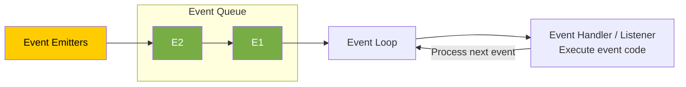

## What are the Main Features & Advantages of Node.js?

| Feature | Advantage |
|---|---|
| **1. Asynchronous** | Enables handling **multiple concurrent requests** and **non-blocking execution** of the thread. |
| **2. V8 JS Engine** | Built on the V8 JS engine from Google Chrome, Node.js **executes code fast**. |
| **3. Event-Driven Architecture** | **Efficient handling of events.** Great for real-time applications like chat applications and gaming applications (using WebSockets), where bidirectional communication is required. |
| **4. Cross-Platform** | Supports deployment on various operating systems, **enhancing flexibility**. |
| **5. JavaScript** | Coding in JavaScript means there is no need to learn a new language. |


## What are the Disadvantages of Node.js? When to Use and When Not to Use Node.js?

### When to Use Node.js

- Ideal for **real-time applications** like chat applications, online gaming, and collaborative tools due to its event-driven architecture.
- Excellent for building **lightweight and scalable RESTful APIs** that handle a large number of concurrent connections.
- Well-suited for building **microservices-based architectures**, enabling modular and scalable systems.

### When Not to Use Node.js (Disadvantages)

- **CPU-Intensive Tasks:** Avoid for applications that involve heavy CPU processing, such as image/video processing and data encryption/decryption. Node.js may not provide optimal performance in such scenarios because it is single-threaded, and for heavy computation, multithreading is better.

## What are Modules in Node.js? What is the Difference Between a Function & a Module?

- A module contains **specific functionality** that can be easily **reused** within a Node.js application.
- Ideally, in Node.js, a JavaScript file can be treated as a module.

module is like order module, and function is inside that modeule work like add or remove order function

```javascript
// myModule1.js
function sayHello(name) {
  console.log("Hello, " + name);
}

module.exports = sayHello;
```

### Function vs. Module

- A **module** is a broader concept that encapsulates functionality, while a **function** is a specific set of instructions within that module.
- Modules can contain **multiple functions and variables**.

### Diagram

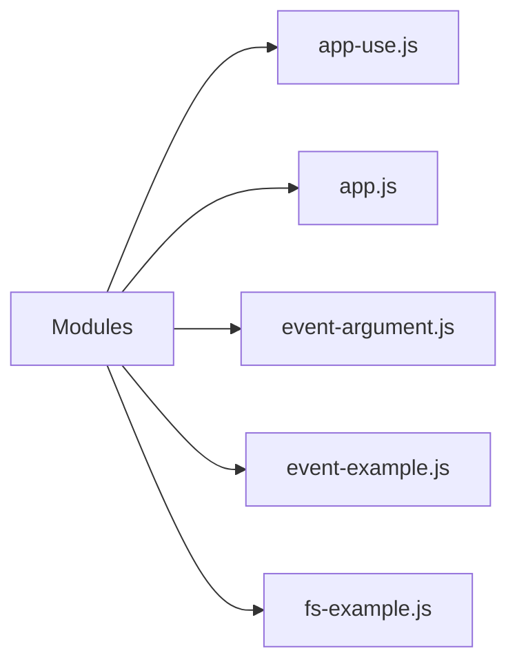


## How Many Ways Are There to Export a Module?

### 1. Using `module.exports`

The `module.exports` object can be used to export the module.

```javascript
// Exporting a function
function sayHello(name) {
  console.log("Hello, " + name);
}

// Exporting a variable
const pi = 3.14159;

// Exporting an object
const myObject = {
  key: "value",
};

// Using module.exports
module.exports.sayHello = sayHello;
module.exports.pi = pi;
module.exports.myObject = myObject;
```

### 2. Using `exports`

The `exports` object can also be used directly to export the module.

```javascript
// Exporting a function
exports.sayHello = function (name) {
  console.log("Hello, " + name);
};

// Exporting a variable
exports.pi = 3.14159;

// Exporting an object
exports.myObject = {
  key: "value",
};
```

## What is a Module Wrapper Function?

In Node.js, each module is wrapped in a function called the **module wrapper function** before it is executed.

### Original Module

```javascript
// app.js
const message = 'Interview Happy';

console.log(message);

// Output: Interview Happy
```

### Converted/Wrapped by Node.js

```javascript
// Wrapper function generated by Node
(function (exports, require, module, __filename, __dirname) {
  const message = "Interview Happy";

  console.log(message);

  // Output: Interview Happy
});
```

## What are the Types of Modules in Node.js?

### 1. Built-in Modules (Core Modules)

These are **already present modules** in Node.js that provide essential functionalities.

Examples:

- `fs` — File system
- `http` — HTTP server
- `path` — Path manipulation
- `util` — Utilities

### 2. Local Modules

These are **user-defined modules (JavaScript files)** created by developers for specific functionalities.

### 3. Third-Party Modules

These are **external packages or libraries created by the community** that provide additional functionalities for Node.js projects.

You install third-party modules using the `npm install` command.

For example:

```bash
npm install lodash
```

## Explain the Role of the `fs` Module. Name Some of Its Functions.

### 7 Main Functions of the `fs` Module

| Function | Description |
|---|---|
| `fs.readFile()` | Reads the content of the specified file. |
| `fs.writeFile()` | Writes data to the specified file, creating the file if it does not exist. |
| `fs.appendFile()` | Appends data to a file. If the file does not exist, it is created. |
| `fs.unlink()` | Deletes the specified file. |
| `fs.readdir()` | Reads the contents of a directory. |
| `fs.mkdir()` | Creates a new directory. |
| `fs.rmdir()` | Removes the specified directory. |

## Explain the Role of the `path` Module. Name Some of Its Functions.

The `path` module provides utilities for **joining, resolving, parsing, formatting, normalizing, and manipulating paths**.

```javascript
// path-example.js

const path = require('path');

// Joining Path Segments
const fullPath = path.join('/docs', 'file.txt');
console.log(fullPath);
// Output: /docs/file.txt

// Parsing Path
const parsedPath = path.parse('/docs/file.txt');
console.log(parsedPath);
/*
Output: {
  root: '/',
  dir: '/docs',
  base: 'file.txt',
  ext: '.txt',
  name: 'file'
}
*/
```

### 5 Main Functions of the `path` Module

```javascript
const path = require('path');

// Joining path segments together
const fullPath = path.join(__dirname, 'folder', 'file.txt');

// Resolving the absolute path
const absolutePath = path.resolve('folder', 'file.txt');

// Getting the directory name of a path
const directoryName = path.dirname('/folder/file.txt');

// Getting the file extension of a path
const fileExtension = path.extname('/folder/file.txt');

// Parsing a path into an object with its components
const pathObject = path.parse('/folder/file.txt');
```

## Explain the Role of the OS Module. Name Some of Its Functions.

- The `os` module in Node.js provides a set of methods for **interacting with the operating system**.
- Developers can use it for building **cross-platform applications** or performing system-related tasks in Node.js applications.

```javascript
const os = require('os');

// 1. Get Platform Information
console.log(os.type());
// Output: 'Windows_NT' or 'Linux'...

// 2. Get Current User Information
console.log(os.userInfo());
// Output: { uid: -1, gid: -1, username: 'anaya', ... }

// 3. Get Memory Information in bytes
console.log(os.totalmem()); // Output: 14877265920
console.log(os.freemem());  // Output: 4961570816
```

The Node.js **`events` module is useful when one action should trigger several independent reactions**.

Think of an online store: when a customer places an order, your application may need to send a confirmation email, generate an invoice, and notify the warehouse.

Your order code can announce **“an order was placed”**, and separate functions can react to that announcement.

```text
Customer places an order
          │
          ▼
   "orderPlaced" event
          │
          ├── Send confirmation email
          ├── Generate invoice
          └── Notify warehouse
```

Here’s a runnable example. Save it as `shop.cjs`. The email, invoice, and warehouse actions are simulated using console messages.

```javascript
const EventEmitter = require("node:events");

// Create an object that can announce events.
const shop = new EventEmitter();

// Register listeners BEFORE emitting the event.

// Listener 1: confirmation email
shop.on("orderPlaced", (order) => {
  console.log(`Sending confirmation email to ${order.email}`);
});

// Listener 2: invoice
shop.on("orderPlaced", (order) => {
  console.log(`Generating invoice for order #${order.id}`);
});

// Listener 3: warehouse notification
shop.on("orderPlaced", (order) => {
  console.log(`Warehouse: pack ${order.quantity} × ${order.product}`);
});

function placeOrder(order) {
  // A real application would validate and save the order first.
  console.log(`Order #${order.id} placed successfully`);

  // Announce what happened and pass the order to every listener.
  shop.emit("orderPlaced", order);

  console.log("Finished notifying listeners");
}

placeOrder({
  id: 101,
  email: "customer@example.com",
  product: "Keyboard",
  quantity: 1,
});
```

Run it with Node.js—no package installation is needed:

```bash
node shop.cjs
```

Output:

```text
Order #101 placed successfully
Sending confirmation email to customer@example.com
Generating invoice for order #101
Warehouse: pack 1 × Keyboard
Finished notifying listeners
```

The two key methods are:

| Method | Meaning |
|---|---|
| `shop.on("orderPlaced", handler)` | “Whenever this event happens, run this function.” |
| `shop.emit("orderPlaced", order)` | “This event happened; here is its data.” |

Node calls the registered listeners when you emit the event. See the [official Node.js events documentation](https://nodejs.org/api/events.html).

**Why use this instead of calling three functions directly?**

Both approaches work. Events help when the reactions may grow or change. For example, you could add an analytics listener without changing `placeOrder()`:

```javascript
shop.on("orderPlaced", (order) => {
  console.log(`Analytics: recorded sale of ${order.product}`);
});
```

**How does this relate to real-time applications?**

An `EventEmitter` communicates inside your running Node.js process. To show an order update immediately in a customer’s browser, you would also use a connection such as WebSockets or Server-Sent Events:

```text
Order status changes
    → Node event listener
    → WebSocket message
    → Customer’s page updates
```

One detail to remember: **listeners run synchronously, in registration order**. Using events does not automatically make work asynchronous or run it in parallel. An asynchronous listener can start an email request, but `emit()` does not wait for its promise to finish. [Node.js documentation](https://nodejs.org/api/events.html#asynchronous-vs-synchronous)


## What are the Advantages of Using Express.js with Node.js?

| Advantage | Description |
|---|---|
| **1. Simplified Web Development** | Express.js provides a lightweight framework that simplifies the process of building web applications in Node.js. |
| **2. Middleware Support** | Easy integration of middleware functions into an application's request-response cycle. |
| **3. Flexible Routing System** | Defining routes for handling different HTTP methods (`GET`, `POST`, `PUT`, `DELETE`, etc.) and URL patterns is easy. |
| **4. Template Engine Integration** | Express.js supports various template engines, making it easy to generate dynamic HTML content on the server side. |

**Template engine:** HTML + Data.

## What is Middleware in Express.js and When to Use It?

A middleware in Express.js is a **function** that handles **HTTP requests**, performs **operations**, and passes control to the **next middleware**.

### Diagram

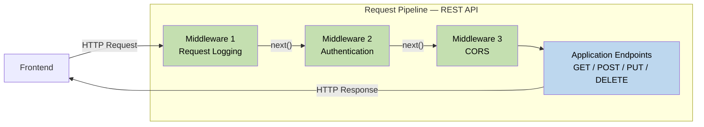

## How Do You Implement Middleware in Express.js?

### 4 Steps to Use Middleware

1. Initialize an Express application.
2. Define a middleware function, `myMiddleware`.
3. Use `app.use()` to mount `myMiddleware` globally, meaning it will be executed for every incoming request to the application.
4. Start the server by listening on a specified port (defaulting to port `3000`) using `app.listen()`.

```javascript
// Create and execute middleware
const express = require("express");
const app = express();

// Define middleware function
const myMiddleware = (req, res, next) => {
  // Middleware logic goes here
  res.send("Interview Happy!");
  next(); // Call the next middleware function
};

// Use middleware globally for all routes
app.use(myMiddleware);

// Start the server
const PORT = 3000;
app.listen(PORT, () => {
  console.log(`Server is running ${PORT}`);
});
```

### Browser Output

At `localhost:3000`:

```text
Interview Happy!
```

## What is the Purpose of the `app.use()` Function in Express.js?

The `app.use()` method is used to **execute (mount) middleware functions globally**.

```javascript
// Create and execute middleware
const express = require("express");
const app = express();

// Define middleware function
const myMiddleware = (req, res, next) => {
  // Middleware logic goes here
  res.send("Interview Happy!");
  next(); // Call the next middleware function
};

// Use middleware globally for all routes
app.use(myMiddleware);

// Start the server
const PORT = 3000;
app.listen(PORT, () => {
  console.log(`Server is running ${PORT}`);
});
```

## What is the Purpose of the `next` Parameter in Express.js?

The `next` parameter is a **callback function** used to **pass control to the next middleware function** in the stack.

## How to Use Middleware Globally for a Specific Route?

```javascript
const express = require('express');
const app = express();

const middleware = (req, res, next) => {
  res.send('Middleware for specific route');
  next();
};

// Use middleware globally for specific routes
app.use('/example', middleware);

const PORT = 3000;
app.listen(PORT, () => {
  console.log(`Server is running ${PORT}`);
});
```

### Browser Output

At `localhost:3000/example`:

```text
Middleware for specific route
```

## What is a Request Pipeline in Express?

The request pipeline in Express.js is a **series of middleware functions** that handle incoming HTTP requests and pass control to the next function.

### Diagram


## What are the Types of Middleware in Express.js?

1. **Application-level middleware**
2. **Router-level middleware**
3. **Error-handling middleware**
4. **Built-in middleware**
5. **Third-party middleware**

### Diagram

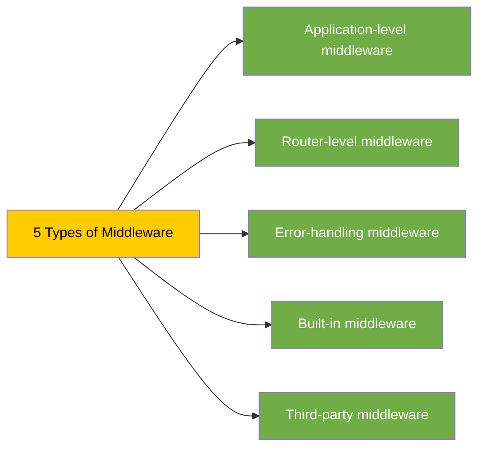

## What is the Difference Between Application-Level & Route-Level Middleware?

| Application-Level Middleware | Route-Level Middleware |
|---|---|
| Applies globally to all incoming requests in the entire Express.js application. | Applies only to specific routes, not to all incoming requests. |


## What is Error-Handling Middleware and How to Implement It?

- Error-handling middleware in Express is a special kind of middleware used to **manage errors** that occur while handling incoming requests.
- To implement error handling in Express, define middleware with four parameters: **`err`, `req`, `res`, `next`**. The additional **error object parameter (`err`)** is used for error handling.

```javascript
const express = require("express");
const app = express();

// Middleware generating error
app.use((req, res, next) => {
  // Simulate an error
  next(new Error("An error occurred"));
});

// Error-handling middleware
app.use((err, req, res, next) => {
  console.error(err.stack);
  res.status(500).send("Something went wrong!");
});

// Start the server
const PORT = 3000;
app.listen(PORT, () => {
  console.log(`Server is running on ${PORT}`);
});
```

### Browser Output

At `localhost:3000`:

```text
Something went wrong!
```

### Console Output

```text
Error: An error occurred
```

## If You Have 5 Middlewares, in Which Middleware Will You Handle Errors?

Error-handling middleware should be **defined last**, after all other middleware.

When an error occurs, Express.js searches for the next error-handling middleware, **skipping regular middleware and route handlers**.

```javascript
// Multiple middlewares
app.use(middleware1);
app.use(middleware2); // Error occurred
app.use(middleware3);
app.use(middleware4);

// Error-handling middleware
app.use((err, req, res, next) => {
  console.error(err.stack);
  res.status(500).send("Something went wrong!");
});
```

### Diagram

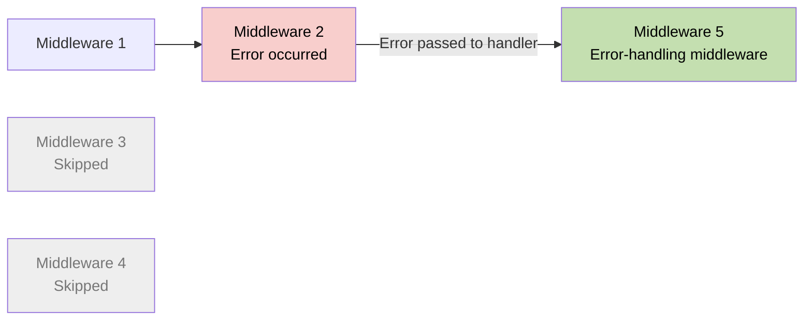

## What is Built-in Middleware? How to Serve Static Files from Express.js?

- **Built-in middleware** consists of functions built into the Express framework that provide common functionalities.
- **`express.static()`** middleware is used for serving static files.

```javascript
const express = require("express");
const app = express();

// Serve static files from the 'public' directory
app.use(express.static("public"));

// Other routes and middleware can be defined here

// Start the server
const PORT = 3000;
app.listen(PORT, () => {
  console.log(`Server is running on :${PORT}`);
});
```

### Browser Output

At `localhost:3000/1.jpg`, the browser displays the image served from `public/1.jpg`.

## What are the Advantages of Using Middleware in Express.js?

| Advantage | Description |
|---|---|
| **1. Modularity** | Middleware allows you to modularize your application's functionality into **smaller, self-contained units**. Each middleware function can handle a specific task or concern, such as logging, authentication, or error handling. |
| **2. Reusability** | Middleware can be reused at **multiple places**, making application code easier to maintain. |
| **3. Improved Request Handling** | Middleware functions have access to both the request (`req`) and response (`res`) objects, enabling you to perform **validations on requests** or modify the response before sending it back to the client. |
| **4. Flexible Control Flow** | Middleware functions can be applied globally to all routes or selectively to specific routes, allowing you to control the flow of request processing in your application. |
| **5. Third-Party Middleware** | Express.js offers a wide range of third-party middleware packages that provide additional functionality, such as `body-parser` and `cors`. |


## What are Route Handlers?

- A **route handler** is the second argument passed to `app.get()` or `app.post()`.
- A route handler function is used to **process the request and generate a response**.

```javascript
const express = require("express");
const app = express();

// Define a route for handling GET requests
app.get("/", (req, res) => {
  res.send("Interview Happy!");
});

// Define a route for handling POST requests
app.post("/login", (req, res) => {
  // Handle login logic
});

// Start the server
const PORT = 3000;
app.listen(PORT, () => {
  console.log(`Server is running on ${PORT}`);
});
```

## What are the Router Object & Router Methods, and How Do You Implement Them?

- The **Router object** is a mini version of an Express application used for **handling routes**.
- **Router methods** are functions provided by the Router object to define routes for different HTTP methods (`GET`, `POST`, `DELETE`, etc.).

### Implement Router Method

```javascript
// router.js
const express = require("express");

// Create a router object
const router = express.Router();

// Define a route for the root URL ('/')
router.get("/", (req, res) => {
  res.send("Interview Happy");
});

// Export the router object
module.exports = router;
```

### Use Router Method

```javascript
// app.js
const express = require("express");
const router = require("./router");
const app = express();

// Mount the router object on a path
app.use("/api", router);

// Start the server
app.listen(3000, () => {
  console.log("Server is running");
});
```

## What is the Difference Between `app.get()` and `router.get()`?

| `app.get()` | `router.get()` |
|---|---|
| Defines routes **directly on the application object**. | Defines routes on a **Router object**. |
| Routes are automatically mounted on the root path (`/`). | Routes are not automatically mounted; they must be explicitly mounted using `app.use()`. |
| Routes are not modular and cannot be reused in other applications. | Routes are modular and can be **reused in other applications** by exporting the Router object. |

### `app.get()` Example

```javascript
// app-get.js
const express = require("express");
const app = express();

app.get("/", (req, res) => {
  res.send("Interview Happy");
});

app.listen(3000, () => {
  console.log("Server is running");
});
```

### `router.get()` Example

```javascript
// router.js
const express = require("express");
const router = express.Router();

// Define a route for the root URL ('/')
router.get("/", (req, res) => {
  res.send("Interview Happy");
});

// Export the router object
module.exports = router;
```

## What are the Top 5 REST Guidelines and Their Advantages?

| Guideline | Description | Advantage |
|---|---|---|
| **1. Separation of Client & Server** | The implementation of the client and the server must be done independently. | Independence allows **easier maintenance, scalability, and evolution**. |
| **2. Stateless** | The server will not store anything about the latest HTTP request the client made. | Treats every request as a new request. It **simplifies server implementation** by avoiding the burden of state management. |
| **3. Uniform Interface** | Identify resources by URL, e.g., `www.abc.com/api/questions`. | Standardized URLs make it **easy to understand and use the API**. |
| **4. Cacheable** | The API response should be cacheable to improve performance. | Caching API responses **improves performance** by reducing repeated requests to the server. |
| **5. Layered System** | The system should follow a layered pattern. | A layered system, such as the Model-View-Controller (MVC) pattern, promotes **modular design** and separation of concerns. |


## Explain the Concept of Idempotence in RESTful APIs

**Idempotence** means performing an operation **multiple times** should have the same outcome as performing it once.

For example, sending multiple identical `GET` requests will always return the same response.

### Methods

| Idempotent Methods | Non-Idempotent Methods |
|---|---|
| `GET` | `POST` |
| `PUT` | |
| `DELETE` | |

## What are Serialization & Deserialization?

- **Serialization** is the process of **converting an object** into a format that can be stored, transmitted, or reconstructed later.
- **Deserialization** is the process of converting serialized data, such as binary, XML, or JSON data, back into an object.

### Diagram

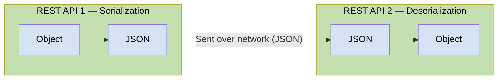

## What are the Types of Serialization?

1. **Binary Serialization**
2. **XML Serialization**
3. **JSON Serialization**

## How to Serialize & Deserialize in Node.js?

### Serialization

Serialize a JavaScript object into JSON format using **`JSON.stringify()`**.

```javascript
// Serialization (to JSON)
const obj = { name: "Happy", age: 39 };

const jsonStr = JSON.stringify(obj);

console.log("Serialized JSON:", jsonStr);
// Output: Serialized JSON: {"name":"Happy","age":39}
```

### Deserialization

Deserialize a JSON string into a JavaScript object using **`JSON.parse()`**.

```javascript
// Deserialization (from JSON)
const jsonStr2 = '{"name":"Happy","age":39}';

const obj2 = JSON.parse(jsonStr2);

console.log("Deserialized JSON:", obj2);
// Output: Deserialized JSON: { name: 'Happy', age: 39 }
```

## Explain the Concept of Versioning in RESTful APIs

Versioning in RESTful APIs refers to the practice of **maintaining multiple versions of an API** to support backward compatibility.

### Diagram

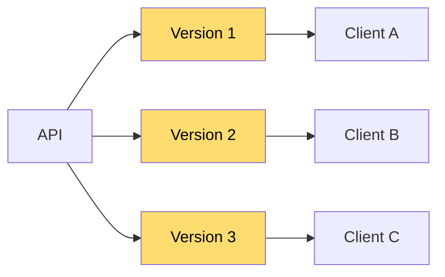

### Example URLs

```text
https://api.example.com/v1/resource
https://api.example.com/v2/resource
https://api.example.com/v3/resource
```


## What is the Typical Structure of a REST API Project in Node.js?

```text
ecommerce-project-root/
├── node_modules/
├── src/
│   ├── controllers/
│   │   ├── productController.js
│   │   └── userController.js
│   ├── models/
│   │   ├── productModel.js
│   │   └── userModel.js
│   ├── routes/
│   │   ├── productRoutes.js
│   │   └── userRoutes.js
│   ├── utils/
│   │   ├── errorHandlers.js
│   │   └── validators.js
│   └── app.js
├── .gitignore
└── package.json
```

| File / Directory | Purpose |
|---|---|
| **`node_modules/`** | Directory where npm packages are installed. |
| **`src/`** | Source code directory. |
| **`controllers/`** | Contains files responsible for handling business logic. |
| **`models/`** | Defines data models. |
| **`routes/`** | Defines API routes. |
| **`utils/`** | Contains reusable functions used across the project. |
| **`app.js`** | Initializes and configures the Express application. Connects routes, middleware, and other configurations. |
| **`.gitignore`** | Specifies files and directories to be ignored by version control, e.g., `node_modules` and `*.log`. |
| **`package.json`** | Contains metadata about the project and its dependencies. |


## What are Authentication and Authorization?

- **Authentication** is the process of **verifying the identity** of a user by validating their credentials, such as a username and password.
- **Authorization** is the process of allowing an authenticated user **access to resources**.
- Authentication always precedes authorization.

### Example

A student signs in to `www.school.com` using a username and password. After authentication, their permissions determine what they can access.

| Resource | Student Access |
|---|---|
| View Result | ✅ Allowed |
| Edit Result | ❌ Only teachers have rights |
| Fees | ✅ Allowed |
| Salary | ❌ Only teachers have rights |

### Diagram

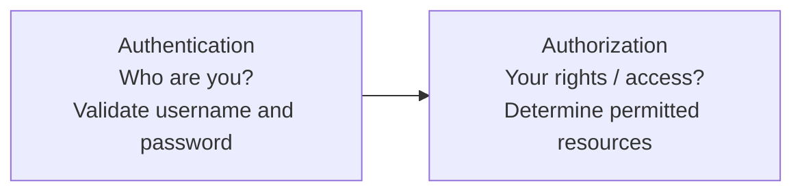


## What are the Types of Authentication in Node.js?

1. **Basic (Username and Password) Authentication**
2. **API Key Authentication**
3. **Token-based Authentication (JWT)**
4. **Multi-factor Authentication (MFA)**
5. **Certificate-based Authentication**

## What is Basic Authentication?

- In Basic Authentication, the user passes their credentials in a **POST request**. At the Node REST API end, credentials are verified, and a response is sent back.
- **Disadvantage:** Basic Authentication sends credentials in plain text over the network, so it is not considered a secure method of authentication.

## What is the Role of Hashing and Salt in Securing Passwords?

- **Hashing:** The process of converting a password into a fixed-size string of characters using a **mathematical algorithm**.
- **Salt:** A random string of data combined with a password before hashing.
  - Salting ensures security even if the hacker **knows the hashing algorithm**.
  - Even if two users **have the same password**, their hashed passwords will differ due to the unique salt.
  - Typically, each user has a unique salt.

### Diagram

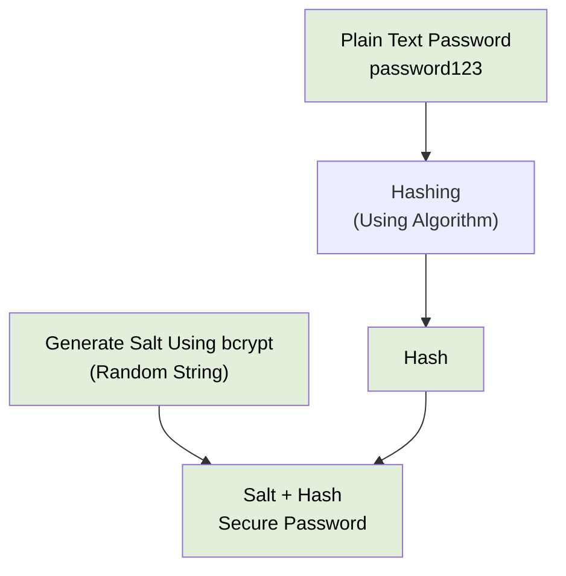

## How Can We Create Hashed Passwords in Node.js?

1. Generate a random salt.
2. Create a hash object using SHA-256.
3. Update the hash object with the salt and password.
4. Get the hashed data as a hexadecimal string.
5. Return the salt and hashed password as a string.

```javascript
const crypto = require("crypto");

// Define a function to hash and salt a password
function hashAndSaltPassword(password) {
  // 1. Generate a random salt
  const salt = crypto.randomBytes(16).toString("hex");

  // 2. Create a hash object using SHA-256
  const hash = crypto.createHash("sha256");

  // 3. Update the hash object with the salt and password
  hash.update(salt + password);

  // 4. Get the hashed data in a hexadecimal string
  const hexHash = hash.digest("hex");

  // 5. Return the salt and hashed password as a string
  return salt + ":" + hexHash;
}
```

## What is API Key Authentication?

- **API Key Authentication:** The API owner shares an API key with users. This key is used to authenticate users of that API.
- **Disadvantage:** API keys can be shared or stolen, so they may not be suitable for all scenarios.

### Example Request Header

```http
ApiKey: <your-api-key>
```

## Where Does the JWT Token Reside in the Request?

In the **request header**.

## What are the Parts of a JWT Token?

A JWT token has **3 parts**:

1. **Header**
2. **Payload**
3. **Signature**

## How to Handle Errors in Synchronous Operations Using `try-catch-finally`?

## What are Error-First Callbacks?

- **Error-first callbacks** are a convention in Node.js for handling asynchronous operations.
- They are called error-first callbacks because the **first argument of a callback function is reserved for an error object**.

```javascript
// Define the error-first callback function
const errorFirstCallback = (error, result) => {
  if (error) {
    console.error("Error:", error.message);
    return;
  }

  console.log("Result:", result);
};

// Call the asynchronous operation and pass the
// error-first callback function as an argument
asyncOperation(errorFirstCallback);

// Function simulating an asynchronous operation
function asyncOperation(callback) {
  // Simulate an asynchronous operation
  setTimeout(() => {
    const error = new Error("Async operation error");

    // Pass error as the first argument of the callback
    callback(error, null);
  }, 0);
}

// Output: Error: Async operation error
```

## What is NoSQL?

**NoSQL (Not Only SQL)** databases are designed to handle **structured, semi-structured, and unstructured data**.

### Diagram

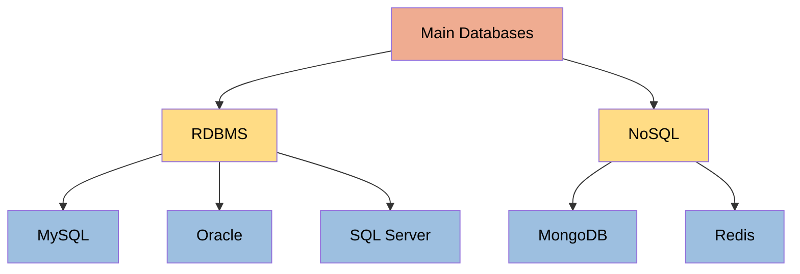


## What is the Difference Between NoSQL & RDBMS?

## When to Use RDBMS and When to Use a NoSQL Database in Your Applications?

## What is Mongoose? What are the Advantages of Using It?

- **Mongoose** is an **Object Data Modeling (ODM)** library for MongoDB and Node.js.
- Mongoose provides a **schema-based solution** to model application data.

### Advantages of Mongoose over Directly Using MongoDB

1. **Data validation**
2. **Middleware support**
3. **Defining relationships between collections**

### Diagram

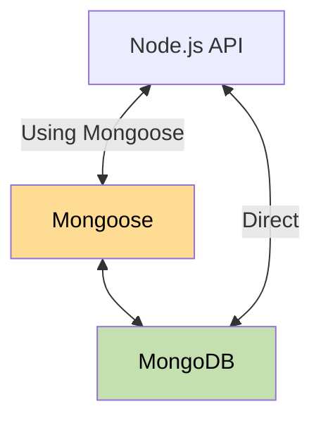


### Q. What is XSS (Cross-Site Scripting) attack?
**XSS (Cross-Site Scripting)** is a security vulnerability where an attacker injects malicious JavaScript into a trusted website. 

For example, consider a Node.js/Express endpoint:
```js
app.get('/search', (req, res) => {
  res.send(`<h1>Search results for: ${req.query.q}</h1>`);
});
```

If an attacker supplies this as `q`:

```html
<script>alert('XSS')</script>
```


**How I prevent it:**

- Use templates with automatic escaping and **context-aware output encoding**. HTML, JavaScript, and URL contexts need different handling.
- Use `textContent` instead of `innerHTML` when displaying plain text.
- If users can submit HTML, sanitize it with a maintained HTML sanitizer.
- Apply a restrictive **Content Security Policy (CSP)** as an additional defense.
- Use `HttpOnly` cookies to prevent JavaScript from reading session cookies. This limits cookie theft but does **not** prevent XSS or authenticated actions.

Input validation helps, but it does not replace safe output handling.

### Q. What is SQL Injection attack?

**SQL Injection (SQLi)** is a vulnerability where an attacker manipulates a database query by supplying malicious input. It happens when an application combines untrusted data with SQL code, allowing the database to interpret that input as part of the query.

An attacker may read sensitive data, bypass authentication, or modify and delete records, depending on the database permissions.

For example, this Node.js code is vulnerable:

```js
const query = `
  SELECT id, email
  FROM users
  WHERE email = '${req.body.email}'
`;

const result = await pool.query(query);
```

If the attacker submits this email:

```text
' OR 1=1 --
```

The query becomes:

```sql
SELECT id, email
FROM users
WHERE email = '' OR 1=1 --'
```

Because `1=1` is always true, the query returns all users instead of matching one email. `--` comments out the remaining quote.

**How to prevent it**

The primary defense is **parameterized queries**, which keep SQL instructions separate from input values.

Using PostgreSQL’s `pg` package:

```js
const result = await pool.query(
  'SELECT id, email FROM users WHERE email = $1',
  [req.body.email]
);
```

Here, the database treats the supplied email as a value, even if it contains SQL syntax.

Additional practices:

- Validate input types, lengths, and business rules.
- Allowlist dynamic table names, column names, and sort directions; ordinary value parameters cannot represent SQL identifiers.
- Give the application database account only the permissions it needs.
- Use ORM parameter binding correctly; concatenated raw SQL can still be vulnerable.
- Avoid exposing database errors to clients.

**The key principle is to parameterize values instead of building SQL through string concatenation.**

### Q. How can you improve the performance of a Node.js application?

**I improve Node.js performance by measuring the bottleneck first, applying a targeted fix, and validating it under realistic load.** I look at response latency—especially p95/p99—throughput, error rate, CPU, memory, and dependency timings.

My main areas of focus are:

1. **Profile the application**
   
   Use CPU profiles, heap snapshots, and request tracing to identify expensive code or slow dependencies. Node’s `perf_hooks` can measure event-loop delay and utilization. [Node.js performance APIs](https://nodejs.org/api/perf_hooks.html)

2. **Keep the event loop responsive**
   
   Avoid synchronous filesystem or crypto operations in request handlers, expensive loops, pathological regular expressions, and processing huge JSON payloads. Simply marking a function `async` does not move its computation off the main thread. [Node.js event-loop guidance](https://nodejs.org/en/learn/asynchronous-work/dont-block-the-event-loop)

3. **Offload CPU-intensive work**
   
   Use a reusable `worker_threads` pool for heavy JavaScript computation. Move long-running work, such as report generation, to background job workers when the API can return before completion. Worker threads usually offer little benefit for ordinary asynchronous I/O. [Worker threads documentation](https://nodejs.org/api/worker_threads.html)

4. **Optimize database access**
   
   Inspect slow queries and execution plans, add appropriate indexes, eliminate N+1 queries, fetch only required fields, and paginate results. Size connection pools against database capacity across **all application instances**.

5. **Handle I/O concurrency carefully**
   
   Run independent operations concurrently instead of awaiting each sequentially. Use bounded concurrency for large batches; an unlimited `Promise.all()` can exhaust connections or overwhelm downstream services. Configure timeouts and reuse connections.

6. **Cache repeated work**
   
   Cache frequently accessed data or expensive results where freshness requirements allow it. Define TTLs, invalidation rules, size limits, and protection against many requests rebuilding the same expired entry.

7. **Control memory and data transfer**
   
   Fix retained objects, unbounded caches, and listener leaks. Stream large files with backpressure instead of buffering everything in memory. Reduce response payloads and use compression where beneficial. [Node.js streams guidance](https://nodejs.org/learn/modules/backpressuring-in-streams)

8. **Scale with dependency limits in mind**
   
   Run multiple processes or container replicas behind a load balancer to use available cores and machines. Keep shared session state external, and ensure additional instances do not overload the database. [Express production guidance](https://expressjs.com/en/advanced/best-practice-performance/)

For example, if tracing shows an endpoint spends 90% of its time waiting for a database query, I would investigate that query and its indexes before changing JavaScript code or adding application instances.


### Q. How can you Deploy a Node.js application?

**A Node.js application can be deployed on a virtual machine, a managed application platform, containers, or serverless infrastructure.** The choice depends on traffic, operational requirements, and the team’s infrastructure.

For a production backend, I would follow this process:

1. **Prepare the application**
   
   Use a supported Node.js LTS release, define a production start command, and read configuration such as `PORT` and database URLs from the environment. Keep secrets outside the repository. [Node.js release guidance](https://nodejs.org/en/about/previous-releases)

   ```json
   {
     "scripts": {
       "start": "node server.js"
     }
   }
   ```

   In containers, the server should usually listen on `0.0.0.0` so it is reachable through the container’s network.

2. **Test and build in CI**
   
   A pipeline typically runs:

   ```bash
   npm ci
   npm run lint
   npm test
   npm run build
   ```

   These assume the project defines those scripts; plain JavaScript may need no build step. `npm ci` installs dependencies from the committed lockfile without updating it. Build dependencies must be available during compilation; the runtime artifact can contain only production dependencies. [npm documentation](https://docs.npmjs.com/cli/commands/npm-ci/)

3. **Package and release**
   
   Produce a versioned deployment artifact, often a Docker image, and deploy the same artifact through staging and production. Inject environment-specific configuration at runtime.

4. **Configure networking and process management**
   
   Place the application behind a reverse proxy or load balancer, configure DNS and HTTPS, and restrict direct access to internal services. On a VM, use a supervisor such as systemd or PM2. With containers, let the platform supervise and restart the application.

5. **Handle database changes**
   
   Run migrations as a controlled release step. Prefer backward-compatible changes so old and new application versions can coexist during deployment and application rollback remains possible.

6. **Deploy with health checks and graceful shutdown**
   
   Use readiness checks before routing traffic to a new instance. On `SIGTERM`, stop accepting requests, drain ongoing work, close database connections, and exit within a defined timeout. Use rolling, blue-green, or canary deployment when availability requires it. [Express deployment guidance](https://expressjs.com/en/advanced/healthcheck-graceful-shutdown/)

7. **Verify and monitor**
   
   Run smoke tests and monitor errors, latency, memory, CPU, and dependency health. Keep the previous artifact available for rollback.

A typical deployment path is:

```text
Git push → CI checks → Build artifact → Staging
         → Production rollout → Health checks → Monitoring
```

###  How to create unit tests using Jest framework?

**Jest is a JavaScript testing framework that provides a test runner, assertions, mocks, and code coverage.** For backend unit tests, I test a function or service in isolation and mock external dependencies such as databases and APIs.

Here is a practical example using **CommonJS**.

**1. Install and configure Jest**

```bash
npm install --save-dev jest
```

Add these scripts to `package.json`:

```json
{
  "scripts": {
    "test": "jest",
    "test:watch": "jest --watch",
    "test:coverage": "jest --coverage"
  }
}
```

Jest discovers files such as `userService.test.js` automatically. [Getting started](https://jestjs.io/docs/getting-started)

**2. Create the service**

```js
// userService.js
async function getUserName(userId, userRepository) {
  if (!Number.isInteger(userId) || userId <= 0) {
    throw new Error('Invalid user ID');
  }

  const user = await userRepository.findById(userId);

  if (!user) {
    throw new Error('User not found');
  }

  return user.name;
}

module.exports = { getUserName };
```

The repository is passed as a dependency, allowing tests to substitute it without connecting to a database.

**3. Write unit tests**

```js
// userService.test.js
const { getUserName } = require('./userService');

describe('getUserName', () => {
  let userRepository;

  beforeEach(() => {
    userRepository = {
      findById: jest.fn(),
    };
  });

  test('returns the name of an existing user', async () => {
    // Arrange
    userRepository.findById.mockResolvedValue({
      id: 1,
      name: 'Asha',
    });

    // Act
    const name = await getUserName(1, userRepository);

    // Assert
    expect(name).toBe('Asha');
    expect(userRepository.findById).toHaveBeenCalledWith(1);
  });

  test('rejects an invalid ID without querying the repository', async () => {
    await expect(
      getUserName(0, userRepository)
    ).rejects.toThrow('Invalid user ID');

    expect(userRepository.findById).not.toHaveBeenCalled();
  });

  test('throws when the user does not exist', async () => {
    userRepository.findById.mockResolvedValue(null);

    await expect(
      getUserName(1, userRepository)
    ).rejects.toThrow('User not found');
  });

  test('propagates repository errors', async () => {
    userRepository.findById.mockRejectedValue(
      new Error('Database unavailable')
    );

    await expect(
      getUserName(1, userRepository)
    ).rejects.toThrow('Database unavailable');
  });
});
```

`jest.fn()` creates a mock that records calls. `mockResolvedValue()` and `mockRejectedValue()` simulate asynchronous success and failure. [Mock documentation](https://jestjs.io/docs/30.0/mock-functions)

**4. Run the tests**

```bash
npm test
npm run test:coverage
```

The main concepts are:

- `describe()` groups related tests.
- `test()` or `it()` defines a test case.
- `expect()` asserts the expected behavior.
- `beforeEach()` prepares fresh state for every test.
- `toBe()` compares primitive values or object identity; `toEqual()` compares object structure.

**Always await or return asynchronous assertions**, otherwise the test may finish before the assertion runs. [Asynchronous testing](https://jestjs.io/docs/asynchronous)

In production projects, I cover success cases, boundary conditions, and failures. I use coverage to find gaps, while keeping assertions focused on observable behavior.

### Explain AAA?

**AAA stands for Arrange, Act, Assert.** It is a pattern for structuring unit tests so each test is easy to understand.

1. **Arrange:** Prepare the inputs, dependencies, mocks, and expected conditions.
2. **Act:** Execute the behavior being tested.
3. **Assert:** Verify the result or expected side effects.

For example, using Jest:

```js
test('returns the name of an existing user', async () => {
  // Arrange
  const userRepository = {
    findById: jest.fn().mockResolvedValue({
      id: 1,
      name: 'Asha',
    }),
  };

  // Act
  const name = await getUserName(1, userRepository);

  // Assert
  expect(name).toBe('Asha');
  expect(userRepository.findById).toHaveBeenCalledWith(1);
});
```

Here, we prepare a mocked repository, call the real service function, and verify both the returned name and the ID passed to the repository.

A good practice is to keep **one clear behavior per test**. Multiple assertions are fine when they verify that same behavior.

### Q. What are Query Operators in MongoDB?

**Query operators in MongoDB define conditions used to select matching documents.** They usually start with `$` and appear in filters for operations such as `find()`, `findOne()`, `updateOne()`, and `deleteMany()`.

For example:

```js
// Find users aged 18 or older.
db.users.find({ age: { $gte: 18 } });
```

The main groups are:

| Group | Common operators | Purpose |
|---|---|---|
| Comparison | `$eq`, `$ne`, `$gt`, `$gte`, `$lt`, `$lte`, `$in`, `$nin` | Compare field values |
| Logical | `$and`, `$or`, `$not`, `$nor` | Combine or negate conditions |
| Element / data type | `$exists`, `$type` | Check field presence or type |
| Array | `$all`, `$elemMatch`, `$size` | Match array contents or length |
| Evaluation / expressions | `$regex`, `$expr`, `$mod` | Match patterns or evaluate expressions |
| Geospatial | `$near`, `$geoWithin`, `$geoIntersects` | Query geographic data |

MongoDB also provides bitwise query operators. [Query operator reference](https://www.mongodb.com/docs/manual/reference/mql/query-predicates/)

**1. Comparison operators**

```js
// Age between 18 and 30, inclusive.
db.users.find({ age: { $gte: 18, $lte: 30 } });

// Role matches either value.
db.users.find({ role: { $in: ['admin', 'editor'] } });
```

`$gt` means greater than; `$gte` includes equality. `$in` matches any listed value, while `$nin` excludes listed values and can also match missing fields. [Comparison operators](https://www.mongodb.com/docs/manual/reference/mql/query-predicates/comparison/)

**2. Logical operators**

```js
// Active users who are either admins or editors.
db.users.find({
  active: true,
  $or: [
    { role: 'admin' },
    { role: 'editor' },
  ],
});
```

Conditions on different fields are implicitly combined with AND. `$not` negates a field condition; `$nor` matches documents satisfying none of its clauses.

**3. Field existence**

```js
db.users.find({ phone: { $exists: true } });
```

This includes documents where `phone` exists but is `null`. `$exists` checks presence, not whether the value is meaningful. [Existence operator](https://www.mongodb.com/docs/manual/reference/operator/query/exists/)

**4. Array operators**

```js
// Contains both skills.
db.users.find({
  skills: { $all: ['Node.js', 'MongoDB'] },
});

// Contains exactly three elements.
db.users.find({ skills: { $size: 3 } });

// One order must satisfy both conditions.
db.users.find({
  orders: {
    $elemMatch: {
      status: 'paid',
      total: { $gt: 1000 },
    },
  },
});
```

**`$elemMatch` ensures the same array element satisfies every condition.** Separate dotted-field conditions can be satisfied by different array elements. [Array matching documentation](https://www.mongodb.com/docs/manual/reference/operator/query/elemmatch/)

**5. Expressions**

```js
// Compare two fields in the same document.
db.products.find({
  $expr: { $gt: ['$salePrice', '$costPrice'] },
});
```

`$expr` allows aggregation expressions inside a query filter. [Expression documentation](https://www.mongodb.com/docs/manual/reference/operator/query/expr/)

In the Node.js driver, the same filter is passed to the collection:

```js
const users = await db.collection('users')
  .find({ active: true, age: { $gte: 18 } })
  .toArray();
```

Query operators determine **which documents match**. Update operators such as `$set` and `$inc` determine **how matching documents change**.

### Q. Compare Query Operators in SQL & MongoDB?

**SQL uses expressions in a `WHERE` clause; MongoDB uses a filter document with operators such as `$gt`, `$in`, and `$or`.** Most common conditions have similar counterparts, but their handling of nulls, missing fields, and arrays differs.

For scalar fields, the common mappings are:

| Condition | SQL `WHERE` expression | MongoDB filter |
|---|---|---|
| Equal | `age = 25` | `{ age: { $eq: 25 } }` or `{ age: 25 }` |
| Not equal | `age <> 25` | `{ age: { $ne: 25 } }` |
| Greater than | `age > 25` | `{ age: { $gt: 25 } }` |
| Greater than or equal | `age >= 25` | `{ age: { $gte: 25 } }` |
| Less than | `age < 25` | `{ age: { $lt: 25 } }` |
| Less than or equal | `age <= 25` | `{ age: { $lte: 25 } }` |
| In a list | `age IN (20, 25, 30)` | `{ age: { $in: [20, 25, 30] } }` |
| Not in a list | `age NOT IN (20, 25)` | `{ age: { $nin: [20, 25] } }` |
| Inclusive range | `age BETWEEN 18 AND 30` | `{ age: { $gte: 18, $lte: 30 } }` |
| AND | `age >= 18 AND active = TRUE` | `{ age: { $gte: 18 }, active: true }` |
| OR | `age < 18 OR active = FALSE` | `{ $or: [{ age: { $lt: 18 } }, { active: false }] }` |
| NOT | `NOT (age >= 18)` | `{ age: { $not: { $gte: 18 } } }` |
| Starts with | `name LIKE 'A%'` | `{ name: { $regex: '^A' } }` |

The pattern example assumes compatible case sensitivity; SQL `LIKE` and MongoDB regular expressions use different pattern syntax. [MongoDB SQL mapping](https://www.mongodb.com/docs/manual/reference/sql-comparison/), [comparison operators](https://www.mongodb.com/docs/manual/reference/mql/query-predicates/comparison/)

For example, these queries express the same condition when the fields have the expected scalar types:

```sql
SELECT *
FROM users
WHERE age >= 18
  AND role IN ('admin', 'editor');
```

```js
db.users.find({
  age: { $gte: 18 },
  role: { $in: ['admin', 'editor'] },
});
```

**The important differences are:**

- **NULL and missing fields:** SQL distinguishes null values using `IS NULL`. MongoDB distinguishes both null and absent fields:

  ```js
  { email: null }                  // Null OR missing
  { email: { $type: 'null' } }     // Explicit null, assuming a scalar field
  { email: { $exists: false } }    // Missing
  { email: { $ne: null } }         // Present and non-null
  ```

  [MongoDB null handling](https://www.mongodb.com/docs/manual/tutorial/query-for-null-fields/)

- **Negation behaves differently:** SQL comparisons involving NULL produce UNKNOWN, which `WHERE` excludes. MongoDB `$ne: 25`, `$nin: [20, 25]`, and `$not` can match documents with missing fields. These are therefore conceptual mappings rather than exact equivalents for every document. [SQL NULL semantics](https://www.postgresql.org/docs/current/functions-comparison.html)

- **Arrays have dedicated operators:** MongoDB provides `$all`, `$size`, and `$elemMatch`. In SQL, similar queries depend on whether the data uses related tables, arrays, or JSON. `$elemMatch` requires one array element to satisfy all specified conditions. [Array matching](https://www.mongodb.com/docs/manual/reference/operator/query/elemmatch/)

### Q. What is projection in MongoDB? How to implement it?

**Projection in MongoDB controls which fields are returned by a query.** The filter selects **which documents** match; the projection selects **which fields** appear in those documents. It does not modify the stored data.

It is similar to selecting specific columns in SQL:

```sql
SELECT name, email FROM users WHERE active = TRUE;
```

**1. Include specific fields**

In the MongoDB shell, pass the projection as the second argument to `find()`:

```js
db.users.find(
  { active: true },               // Filter
  { name: 1, email: 1, _id: 0 }   // Projection
);
```

Example result:

```js
[
  { name: 'Asha', email: 'asha@example.com' }
]
```

For basic field selection:

- `1` includes a field.
- `0` excludes a field.
- `_id` is included by default unless explicitly excluded.
- An inclusion projection excludes unspecified fields.
- An exclusion projection includes unspecified fields. [Projection documentation](https://www.mongodb.com/docs/v8.0/tutorial/project-fields-from-query-results/)

**2. Exclude specific fields**

```js
// Return every field except passwordHash and refreshToken.
db.users.find(
  {},
  { passwordHash: 0, refreshToken: 0 }
);
```

You cannot mix inclusion and exclusion for ordinary fields. Excluding `_id` from an inclusion projection is allowed:

```js
// Valid
{ name: 1, email: 1, _id: 0 }

// Invalid
{ name: 1, passwordHash: 0 }
```

**3. Implement it using the Node.js driver**

Assuming `db` is an established database connection:

```js
const users = await db.collection('users')
  .find(
    { active: true },
    { projection: { name: 1, email: 1, _id: 0 } }
  )
  .toArray();
```

Alternatively, chain `.project()`:

```js
const users = await db.collection('users')
  .find({ active: true })
  .project({ name: 1, email: 1, _id: 0 })
  .toArray();
```

**Notice the syntax difference:** the Node.js driver takes an options object containing `projection`; the shell accepts the projection document directly. [Node.js driver documentation](https://www.mongodb.com/docs/drivers/node/current/crud/query/project/)

**4. Project nested fields**

Use dot notation:

```js
db.users.find(
  {},
  { name: 1, 'address.city': 1, _id: 0 }
);
```

This preserves the nested structure:

```js
{ name: 'Asha', address: { city: 'Pune' } }
```

Projection reduces response size and unnecessary data transfer. For public API responses, I generally prefer explicitly including permitted fields so newly added internal fields are not returned accidentally.

### Q. How to remove _id field from result in MongoDB?

Set **`_id: 0` in the projection** to exclude it from query results.

**MongoDB shell:**

```js
// Return all fields except _id.
db.users.find({}, { _id: 0 });

// Return only name and email.
db.users.find({}, { name: 1, email: 1, _id: 0 });
```

**Node.js MongoDB driver:**

```js
const users = await db.collection('users')
  .find({}, {
    projection: { name: 1, email: 1, _id: 0 },
  })
  .toArray();
```

This removes `_id` **only from the returned results**; it remains in the stored documents. Excluding `_id` is allowed alongside included fields. [MongoDB documentation](https://www.mongodb.com/docs/drivers/node/current/crud/query/project/)

### Q. How do you perform sorting in ascending & descending order in MongoDB?

Use MongoDB’s **`.sort()`** method with:

- **`1`** for ascending order.
- **`-1`** for descending order.

**MongoDB shell:**

```js
// Sort by age: youngest first.
db.users.find().sort({ age: 1 });

// Sort by age: oldest first.
db.users.find().sort({ age: -1 });
```

**Sorting by multiple fields:**

```js
// Age ascending, then name descending for users with the same age.
db.users.find().sort({ age: 1, name: -1 });
```

Fields are prioritized in the order specified.

**Node.js MongoDB driver:**

```js
const users = await db.collection('users')
  .find({ active: true })
  .sort({ age: -1, _id: 1 })
  .limit(10)
  .toArray();
```

This returns the 10 oldest active users. Adding the unique `_id` field breaks ties when ages are equal, producing a consistent order.

Apply `.sort()` to the cursor **before** retrieving results with `.toArray()`. [MongoDB sorting examples](https://www.mongodb.com/docs/manual/reference/sql-comparison/)

### Q. What are Indexes in MongoDB? How indexing make data retrieval faster?

**An index in MongoDB is a separate data structure that stores selected field values in an ordered form, with references to the corresponding documents.** Standard MongoDB indexes use a **B-tree**, allowing efficient lookups, range searches, and supported sorts. Think of a book’s index: it helps locate relevant pages without reading the whole book. [MongoDB indexing documentation](https://www.mongodb.com/docs/manual/indexes/)

**How does it make retrieval faster?**

Suppose a `users` collection contains one million documents:

```js
db.users.find({ email: 'asha@example.com' });
```

Without a suitable index, MongoDB may perform a **collection scan**, checking every document to find matches.

Create an index:

```js
db.users.createIndex({ email: 1 });
```

MongoDB can now:

1. Traverse the index to locate the matching email.
2. Read the relevant index entries.
3. Fetch the matching documents.

This can greatly reduce the number of documents examined, especially when the condition matches only a small portion of the collection.

**Indexes can also support filtering and sorting together**

```js
db.orders.createIndex({ customerId: 1, createdAt: -1 });

db.orders.find({ customerId: 101 })
  .sort({ createdAt: -1 })
  .limit(10);
```

This compound index groups entries by customer, then orders each customer’s entries by creation time. MongoDB can use it to retrieve that customer’s latest orders without separately sorting all their orders.

**Field order matters:** `{ customerId: 1, createdAt: -1 }` and `{ createdAt: -1, customerId: 1 }` support different access patterns. [Index types](https://www.mongodb.com/docs/manual/core/indexes/index-types/)

**How do I verify the improvement?**

Use `explain()` before and after creating the index:

```js
db.users.find({ email: 'asha@example.com' })
  .explain('executionStats');
```

Check:

| Metric or stage | Meaning |
|---|---|
| `COLLSCAN` | Scans collection documents |
| `IXSCAN` | Scans index entries |
| `totalKeysExamined` | Number of index entries examined |
| `totalDocsExamined` | Number of documents examined |
| `nReturned` | Number of documents returned |

I compare the work performed with the number of results returned. **Seeing `IXSCAN` alone does not prove the query is efficient**—it could still scan many index entries. [Explain documentation](https://www.mongodb.com/docs/v8.0/reference/explain-results/)

There are trade-offs: indexes consume storage and memory, and inserts, deletes, and relevant updates must maintain them. Queries matching most documents may gain little benefit. A **covered query** can go further: if the index contains everything needed for filtering and output, MongoDB can answer without fetching documents. [Query optimization](https://www.mongodb.com/docs/manual/core/query-optimization/)

In production, I design indexes around actual query patterns and validate them with execution plans rather than indexing every field.

### Q. What are Indexes in MongoDB? How indexing make data retrieval faster?

**An index in MongoDB is a separate data structure that stores selected field values in an ordered form, with references to the corresponding documents.** Standard MongoDB indexes use a **B-tree**, allowing efficient lookups, range searches, and supported sorts. Think of a book’s index: it helps locate relevant pages without reading the whole book. [MongoDB indexing documentation](https://www.mongodb.com/docs/manual/indexes/)

**How does it make retrieval faster?**

Suppose a `users` collection contains one million documents:

```js
db.users.find({ email: 'asha@example.com' });
```

Without a suitable index, MongoDB may perform a **collection scan**, checking every document to find matches.

Create an index:

```js
db.users.createIndex({ email: 1 });
```

MongoDB can now:

1. Traverse the index to locate the matching email.
2. Read the relevant index entries.
3. Fetch the matching documents.

This can greatly reduce the number of documents examined, especially when the condition matches only a small portion of the collection.

**Indexes can also support filtering and sorting together**

```js
db.orders.createIndex({ customerId: 1, createdAt: -1 });

db.orders.find({ customerId: 101 })
  .sort({ createdAt: -1 })
  .limit(10);
```

This compound index groups entries by customer, then orders each customer’s entries by creation time. MongoDB can use it to retrieve that customer’s latest orders without separately sorting all their orders.

**Field order matters:** `{ customerId: 1, createdAt: -1 }` and `{ createdAt: -1, customerId: 1 }` support different access patterns. [Index types](https://www.mongodb.com/docs/manual/core/indexes/index-types/)

**How do I verify the improvement?**

Use `explain()` before and after creating the index:

```js
db.users.find({ email: 'asha@example.com' })
  .explain('executionStats');
```

Check:

| Metric or stage | Meaning |
|---|---|
| `COLLSCAN` | Scans collection documents |
| `IXSCAN` | Scans index entries |
| `totalKeysExamined` | Number of index entries examined |
| `totalDocsExamined` | Number of documents examined |
| `nReturned` | Number of documents returned |

I compare the work performed with the number of results returned. **Seeing `IXSCAN` alone does not prove the query is efficient**—it could still scan many index entries. [Explain documentation](https://www.mongodb.com/docs/v8.0/reference/explain-results/)

There are trade-offs: indexes consume storage and memory, and inserts, deletes, and relevant updates must maintain them. Queries matching most documents may gain little benefit. A **covered query** can go further: if the index contains everything needed for filtering and output, MongoDB can answer without fetching documents. [Query optimization](https://www.mongodb.com/docs/manual/core/query-optimization/)

In production, I design indexes around actual query patterns and validate them with execution plans rather than indexing every field.

### Q. On which filed you will create an index - projection field or filter field?

**I usually index the filter fields first. I add projection fields when a covered query provides a worthwhile performance benefit.** I also consider sorting when designing the index.

For example:

```js
db.users.find(
  { email: 'asha@example.com' },       // Filter
  { name: 1, email: 1, _id: 0 }       // Projection
);
```

**Indexing the filter field:**

```js
db.users.createIndex({ email: 1 });
```

MongoDB can locate matching index entries efficiently, then fetch the documents to retrieve `name`.

Creating an index only on `name`, the projection field, would generally not help locate the requested email.

**Indexing both filter and projection fields:**

```js
db.users.createIndex({ email: 1, name: 1 });
```

For this query, MongoDB can find the email and return both requested fields directly from the index. This is a **covered query**, which avoids fetching the documents.

We exclude `_id` because it is returned by default and is not part of this compound index. [MongoDB covered queries](https://www.mongodb.com/docs/manual/core/query-optimization/)

My decision process is:

- **Filter fields:** Support efficient document selection.
- **Sort fields:** Include them where needed to support the query’s ordering.
- **Projection fields:** Add them when covering a frequent query justifies a larger index and additional write overhead.

I verify the result using:

```js
db.users.find(
  { email: 'asha@example.com' },
  { name: 1, email: 1, _id: 0 }
).explain('executionStats');
```

For a covered query using this index, `totalDocsExamined` should be **0**. Index design follows the complete query pattern, rather than every field appearing in its output.

### Q. On which filed you will create an index - projection field or filter field?

**I usually index the filter fields first. I add projection fields when a covered query provides a worthwhile performance benefit.** I also consider sorting when designing the index.

For example:

```js
db.users.find(
  { email: 'asha@example.com' },       // Filter
  { name: 1, email: 1, _id: 0 }       // Projection
);
```

**Indexing the filter field:**

```js
db.users.createIndex({ email: 1 });
```

MongoDB can locate matching index entries efficiently, then fetch the documents to retrieve `name`.

Creating an index only on `name`, the projection field, would generally not help locate the requested email.

**Indexing both filter and projection fields:**

```js
db.users.createIndex({ email: 1, name: 1 });
```

For this query, MongoDB can find the email and return both requested fields directly from the index. This is a **covered query**, which avoids fetching the documents.

We exclude `_id` because it is returned by default and is not part of this compound index. [MongoDB covered queries](https://www.mongodb.com/docs/manual/core/query-optimization/)

My decision process is:

- **Filter fields:** Support efficient document selection.
- **Sort fields:** Include them where needed to support the query’s ordering.
- **Projection fields:** Add them when covering a frequent query justifies a larger index and additional write overhead.

I verify the result using:

```js
db.users.find(
  { email: 'asha@example.com' },
  { name: 1, email: 1, _id: 0 }
).explain('executionStats');
```

For a covered query using this index, `totalDocsExamined` should be **0**. Index design follows the complete query pattern, rather than every field appearing in its output.


### Q. What happens if I create an index on all fields of the collection?

**Indexing every field may speed up some reads, but it increases storage, memory pressure, and write overhead. It does not guarantee that every query becomes faster.**

If you create a separate index on every field:

```js
db.users.createIndex({ name: 1 });
db.users.createIndex({ email: 1 });
db.users.createIndex({ age: 1 });
db.users.createIndex({ city: 1 });
```

The main consequences are:

- **More expensive writes:** Inserts and deletes must maintain applicable indexes. Updates must maintain indexes whose keys change. An index may still help locate documents for an update or delete, but maintaining it adds work. [Write performance](https://www.mongodb.com/docs/manual/core/write-performance/)
- **More disk usage and cache pressure:** Indexes occupy storage. Frequently accessed index pages compete for memory, potentially increasing disk reads.
- **Unused indexes:** A field that is rarely queried may add maintenance cost without meaningful read benefits.
- **Queries may still be inefficient:** Separate indexes do not automatically provide the filtering and sorting benefits of a suitable compound index. Low-selectivity queries may gain little from indexing. [Query optimization](https://www.mongodb.com/docs/manual/core/query-optimization/)

For example:

```js
db.users.find({ city: 'Pune' }).sort({ age: 1 });
```

A targeted compound index can support both operations:

```js
db.users.createIndex({ city: 1, age: 1 });
```

**There are also different meanings of “index all fields”:**

| Approach | Important distinction |
|---|---|
| Separate index per field | Each index has its own maintenance cost |
| One compound index containing every field | Field order and prefixes determine which queries it supports efficiently |
| Wildcard index: `{ "$**": 1 }` | Supports queries on unknown or changing field names; it does not replace workload-based index design |

[Compound indexes](https://www.mongodb.com/docs/manual/core/indexes/index-types/), [wildcard indexing guidance](https://www.mongodb.com/docs/manual/core/indexes/index-types/index-wildcard/index-wildcard-compound/)

In production, I create the smallest useful set of indexes for actual filter, sort, and projection patterns, then verify their benefit with `explain('executionStats')` and workload measurements.

### Q. What is the difference between Single Field Indexes & Compound Indexes?

**A single field index indexes one field. A compound index indexes multiple fields in a defined order.**

| Feature | Single field index | Compound index |
|---|---|---|
| Fields indexed | One | Two or more |
| Example | `{ age: 1 }` | `{ city: 1, age: -1 }` |
| Ordering | By one field | By the first field, then subsequent fields |
| Typical use | Queries or sorts on one field | Queries combining filtering and sorting across fields |
| Field order | No field-order decision | Order affects which queries are efficient |

**Single field index:**

```js
db.users.createIndex({ age: 1 });

// Supports filtering by age.
db.users.find({ age: { $gte: 18 } });

// Supports sorting by age.
db.users.find().sort({ age: -1 });
```

MongoDB can traverse an ordinary single field index in either direction, so an ascending index can also support descending sorting.

**Compound index:**

```js
db.users.createIndex({ city: 1, age: -1 });

// Supports filtering by city and sorting by age.
db.users.find({ city: 'Pune' }).sort({ age: -1 });
```

The index first groups entries by `city`, then orders ages descending within each city. [MongoDB index types](https://www.mongodb.com/docs/manual/core/indexes/index-types/)

**The key interview concept is the index prefix.**

For this index:

```js
{ city: 1, age: -1 }
```

- Queries on **`city`** can efficiently use the leading field.
- Queries on **`city` and `age`** can use both fields.
- Queries on **`age` alone** generally cannot perform the same efficient lookup because `city` comes first.

A compound index is therefore **not equivalent to creating separate indexes on each field**. I choose its field order based on the application’s filter and sort patterns. [MongoDB indexing guidance](https://www.mongodb.com/docs/manual/core/query-optimization/)

### Q. What is Mongoose? What are the advantages of using it?

**Mongoose is an Object Data Modeling (ODM) library for MongoDB and Node.js.** It builds on the MongoDB driver and provides schemas, models, validation, type casting, and middleware to simplify working with application data. [Mongoose documentation](https://mongoosejs.com/)

Three core concepts are:

- **Schema:** Defines document fields, types, defaults, and validation rules.
- **Model:** A class compiled from a schema, used to query and modify a collection.
- **Document:** An instance of a model representing an individual record.

For example:

```js
const mongoose = require('mongoose');

const userSchema = new mongoose.Schema(
  {
    name: {
      type: String,
      required: true,
      trim: true,
    },
    email: {
      type: String,
      required: true,
      lowercase: true,
      trim: true,
    },
    age: {
      type: Number,
      min: 0,
    },
  },
  { timestamps: true }
);

const User = mongoose.model('User', userSchema);
```

After establishing a connection:

```js
await mongoose.connect(process.env.MONGODB_URI);

await User.create({
  name: 'Asha',
  email: 'asha@example.com',
  age: 28,
});

const users = await User.find({ age: { $gte: 18 } })
  .select('name email -_id')
  .sort({ name: 1 });
```

**Its main advantages are:**

1. **Consistent data modeling:** Centralizes field definitions, defaults, nested structures, and indexes.
2. **Validation and casting:** Supports required fields, ranges, enums, custom validators, and conversion to declared types.
3. **Convenient queries:** Provides methods such as `findById()`, `create()`, and chainable query helpers.
4. **Middleware:** Runs hooks around supported operations to centralize lifecycle behavior.
5. **Reusable model logic:** Supports document methods, model statics, virtual fields, and plugins. [Schema guide](https://mongoosejs.com/docs/guide.html)
6. **References through `populate()`:** Retrieves referenced documents from other collections, reducing manual application code. [Population guide](https://mongoosejs.com/docs/populate.html)

There are practical caveats:

- Mongoose validation runs in the application; it does not automatically enforce rules on writes from other database clients.
- `unique: true` declares a MongoDB unique index—it is **not a Mongoose validator**.
- Update validators generally require `{ runValidators: true }` and have operation-specific limitations. [Validation documentation](https://mongoosejs.com/docs/validation.html)
- Mongoose documents add memory and processing overhead. For reads that only need plain objects, `.lean()` skips document hydration, but also removes document features such as `.save()`. [Lean documentation](https://mongoosejs.com/docs/tutorials/lean.html)

I would choose Mongoose when shared schemas and model behavior improve maintainability; the native driver is also a valid choice when those abstractions are unnecessary.

**In Mongoose, relationships between collections are usually defined using document IDs and the `ref` option.** You retrieve the referenced documents using **`populate()`**.

The main relationship patterns are:

| Relationship | Example | Typical implementation |
|---|---|---|
| One-to-one | User → Profile | A reference with a unique index |
| One-to-many | User → Posts | Store the user reference in each post |
| Many-to-many | Students ↔ Courses | Arrays of references or a separate enrollment collection |

**1. Define a one-to-many relationship**

One user can write many posts:

```js
const mongoose = require('mongoose');
const { Schema } = mongoose;

const userSchema = new Schema({
  name: { type: String, required: true },
});

const postSchema = new Schema({
  title: { type: String, required: true },
  author: {
    type: Schema.Types.ObjectId,
    ref: 'User',
    required: true,
    index: true,
  },
});

const User = mongoose.model('User', userSchema);
const Post = mongoose.model('Post', postSchema);
```

`ref: 'User'` refers to the **registered model name**, not the collection name.

After connecting to MongoDB, save the referenced user’s ID:

```js
const user = await User.create({ name: 'Asha' });

await Post.create({
  title: 'Understanding Node.js',
  author: user._id,
});
```

Retrieve posts with author details:

```js
const posts = await Post.find({ author: user._id })
  .populate('author', 'name');
```

`populate()` replaces the returned `author` ID with the referenced user document. It generally performs additional queries; it does not rewrite the stored reference. [Mongoose population](https://mongoosejs.com/docs/populate.html)

**2. Define a one-to-one relationship**

Store a user reference in a profile, with a unique index:

```js
const profileSchema = new Schema({
  user: {
    type: Schema.Types.ObjectId,
    ref: 'User',
    required: true,
    unique: true,
  },
  bio: String,
});

const Profile = mongoose.model('Profile', profileSchema);
```

Once the unique index exists, a user can have **at most one profile**. This does not require every user to have a profile. `unique` declares an index rather than a Mongoose validator. [Validation documentation](https://mongoosejs.com/docs/validation.html)

**3. Define a many-to-many relationship**

For students and courses, a separate enrollment collection supports growing relationships and extra information:

```js
const enrollmentSchema = new Schema({
  student: { type: Schema.Types.ObjectId, ref: 'Student' },
  course: { type: Schema.Types.ObjectId, ref: 'Course' },
  enrolledAt: { type: Date, default: Date.now },
});

enrollmentSchema.index(
  { student: 1, course: 1 },
  { unique: true }
);
```

Register the `Student`, `Course`, and enrollment models before using population.

**When should you embed instead?**

Embed small, bounded data that belongs to its parent and is commonly read together, such as a user’s address. Embedded subdocuments live inside the parent document; references point to separate documents. [Mongoose subdocuments](https://mongoosejs.com/docs/subdocs.html)

**A crucial distinction:** `ref` does not enforce foreign-key integrity or cascade deletes. Your application must handle missing references, authorization, and deletion rules.

### Q. How to define relationships between collections using Mongoose?

**In Mongoose, relationships between collections are usually defined using document IDs and the `ref` option.** You retrieve the referenced documents using **`populate()`**.

The main relationship patterns are:

| Relationship | Example | Typical implementation |
|---|---|---|
| One-to-one | User → Profile | A reference with a unique index |
| One-to-many | User → Posts | Store the user reference in each post |
| Many-to-many | Students ↔ Courses | Arrays of references or a separate enrollment collection |

**1. Define a one-to-many relationship**

One user can write many posts:

```js
const mongoose = require('mongoose');
const { Schema } = mongoose;

const userSchema = new Schema({
  name: { type: String, required: true },
});

const postSchema = new Schema({
  title: { type: String, required: true },
  author: {
    type: Schema.Types.ObjectId,
    ref: 'User',
    required: true,
    index: true,
  },
});

const User = mongoose.model('User', userSchema);
const Post = mongoose.model('Post', postSchema);
```

`ref: 'User'` refers to the **registered model name**, not the collection name.

After connecting to MongoDB, save the referenced user’s ID:

```js
const user = await User.create({ name: 'Asha' });

await Post.create({
  title: 'Understanding Node.js',
  author: user._id,
});
```

Retrieve posts with author details:

```js
const posts = await Post.find({ author: user._id })
  .populate('author', 'name');
```

`populate()` replaces the returned `author` ID with the referenced user document. It generally performs additional queries; it does not rewrite the stored reference. [Mongoose population](https://mongoosejs.com/docs/populate.html)

**2. Define a one-to-one relationship**

Store a user reference in a profile, with a unique index:

```js
const profileSchema = new Schema({
  user: {
    type: Schema.Types.ObjectId,
    ref: 'User',
    required: true,
    unique: true,
  },
  bio: String,
});

const Profile = mongoose.model('Profile', profileSchema);
```

Once the unique index exists, a user can have **at most one profile**. This does not require every user to have a profile. `unique` declares an index rather than a Mongoose validator. [Validation documentation](https://mongoosejs.com/docs/validation.html)

**3. Define a many-to-many relationship**

For students and courses, a separate enrollment collection supports growing relationships and extra information:

```js
const enrollmentSchema = new Schema({
  student: { type: Schema.Types.ObjectId, ref: 'Student' },
  course: { type: Schema.Types.ObjectId, ref: 'Course' },
  enrolledAt: { type: Date, default: Date.now },
});

enrollmentSchema.index(
  { student: 1, course: 1 },
  { unique: true }
);
```

Register the `Student`, `Course`, and enrollment models before using population.

**When should you embed instead?**

Embed small, bounded data that belongs to its parent and is commonly read together, such as a user’s address. Embedded subdocuments live inside the parent document; references point to separate documents. [Mongoose subdocuments](https://mongoosejs.com/docs/subdocs.html)

**A crucial distinction:** `ref` does not enforce foreign-key integrity or cascade deletes. Your application must handle missing references, authorization, and deletion rules.

### Q. How Mongoose provide middleware support? What are Pre & Post Hooks?

**Mongoose provides middleware through schema-level functions called hooks.** They run before or after supported document, query, model, or aggregation operations.

| Hook | When it runs | Common uses |
|---|---|---|
| **Pre hook** | Before the operation | Transform data, perform checks, prepare values |
| **Post hook** | After successful completion | Logging, metrics, follow-up processing |

Register them using `schema.pre()` and `schema.post()`:

```js
const mongoose = require('mongoose');

const userSchema = new mongoose.Schema({
  name: String,
  lastSavedAt: Date,
});

// Document middleware: `this` is the document.
userSchema.pre('save', function () {
  this.lastSavedAt = new Date();
});

userSchema.post('save', function (doc) {
  console.log('User saved:', doc._id);
});

// Register hooks before compiling the model.
const User = mongoose.model('User', userSchema);

// After connecting to MongoDB:
await User.create({ name: 'Asha' });
```

The sequence is: **pre-save hook → database save → post-save hook**.

Mongoose supports four middleware types:

- **Document:** `this` is the document, such as in `save` hooks.
- **Query:** `this` is the query, such as in `findOneAndUpdate` hooks.
- **Model:** `this` is the model, such as in `insertMany` hooks.
- **Aggregate:** `this` is the aggregation object.

**Important details:**

- Use regular functions when accessing `this`.
- Hooks can be `async`; Mongoose awaits their promises.
- Throwing in a pre hook prevents the operation.
- `create()` triggers save hooks; `updateOne()` and `findOneAndUpdate()` do **not**.
- Validation normally runs before custom pre-save hooks.
- A post-hook failure does not automatically undo a completed database write.

[Mongoose middleware documentation](https://mongoosejs.com/docs/middleware.html)


video 135 for forgot password and reset password

keep in mind when we are using the middleware protect, there we are adding the useer to res then the user details is available on all the routes below that

security of cookie ----------- video 142 full dekhna -------------. res k cookies me humne apna jwt store kia and httponly mark kia h means no 3rd party can store it.

video 145 bhi theek h

** Special note: Many functions, checks, validators do not work on updationg one or many. So we should keep it in mind

video 102-107 phir se dekhna h

we need to form like "import-dev-data.js" of jonas to have the backup or default file to upload in database if anthing bad happen

Browser has document and window
Node has process and global

REST API
The api's which are made on REST architecture. The rest architecture is below
1. Separate API into logical resources
    -- What is resorce. It is an object or a representation of something which has some data associated to it. Any information can be named as resource. 
2. Expose structured resource-based URL's
3. Use HTTP methods
    -- Not to use end points like test.com/getTor => test.com/tour  (get method)
4. Send data as JSON
5. Be Stateless - like not storing the page on which user is

To read/write the file which is available in local folder we use the fs module ie fs.readFilesync and fs.writeFilesync. Path used be in form of __dirname /file/te.json

app.use(express.json({ limit : '10kb' })) It works as middleware and helps to get the data from the request body, also limits the data on body allowable

To get the dynamic params => api/v1/products/:id and use through req.params.id
req.query me hamesa object aata h
find, findbyid, findone etc ye sab "query promise" k form me return karte h. isi query pe hum sort, paginate etc lagate h then promise resolve karte h
for query - http://localhost:3000/api/v1/tours?duration[gte]=5&difficulty=easy

Please read about the process.argv in detail

Mongodb is schemaless while mysql is opposite. mongodb me hum kuch bhi ghused dete h

//--------------------Schema and Model-------------
We make schema(condition ) fist and then we make the model form it. Model is function used to connect to schema(blueprint) with a name. Layered form of schema is the model. schema => model => model instance
Generally the collection name is plural
First argument of the model of mongoose is the collection or table name
eg const data = mongoose.model('collection_name', dataSchema)

    image: {
        type: [String],   // Here how we define the type is important
        required: [true, "Please share the images"]
    },


In Schema, we have 
- unique
- default
- required
- min and max
- validate or validator
- trim (only for string)
- select - if it is false means it will not be visible in response api
- get
- set
- alias
- immutable
- transform

String
- lowercase
- uppercase
- trim
- match
- enum
- minLength
- maxLength
- populate

Number
- min
- max
- enum
- populate

Date
- min
- max
- expires

-----------------------------
console.log(__dirname)
console.log(__filename)
const path = require('path')
console.log(path.join(__dirname,"../../public"))

express.static defines the folder which serves directly means if it has the about.html filr, you can access directly like localhost:3000/about.html.  Jab ye folder define kar denge phir iske ander file dhyan se rakhni padegai

aur agr code me ye path use krna ho to src='/images/self.png'

app.use(express.static(path.join(__dirname,'public')));

-----------------------------
https://expressjs.com/en/4x/api.html#app
explore left section of above url


// ---------------- MVC Architecture---------------
Model Layer - It is concerned with everything about application data and business logic
Controller Layer - It's function is to handle the application's request, interect with models, and send back responses to the client
View Layer - used for the graphical interface, ssr website, template to generate the view. Basically presenation logic

FAT Model/THIN Controllers - Offload as much logic as possible into the models and keep the cotrollers as simple and lean as possible.


// ----------------------- Aggregation---------------
We basically define a pipeline that all documents from a certain collection go through where they are processed step by step in order to transform them into aggregated results.
eg we use aggregation pipeline in order to calculate averages, min, max values 
self note - basically data k uper calcution kr k kuch naya data dena.

aggreation is use to calculate the statics of the collection data in various steps or stages
eg we use aggregation pipeline in order to calculate averages, min, max values 
It occurs in stages, 
eg  Stage 1 - match
    Stage 2 - group it has _id means on which basis you want to group. if null is provided means no group or one single group. 
    Stage 3 - sort
    Stage 4 - match
https://www.mongodb.com/docs/manual/aggregation/   site for defination and example
self note - basically data k uper calcution kr k kuch naya data dena.

We have the virtual properties which do not save the data but return in response of api. These data can not be used for query


----------- https://mongoosejs.com/docs/middleware.html
We have the pre and post save middleware ie Document middleware which work before and after saving the document. "This" points towards the schema

We have the pre and post find middleware ie query middleware. "This" points towards the quey. Isme bas quey chalti h jo data filter karti h. We can use the regex in find to use various type of find query

We have the pre and post aggregation middleware. "This" points towards the aggregation.


------------ validation
enum


// ------------------------ Error Handling --------------------
video 112 concept is good, not the code
video 114 logic is must. 115 code and logic
video 116 kafi deep logical h, catchasync h
video 123 is also good

we always have 4, (err, req, res, next) => {}

We need to understand separately
- errorObject
- unhandled route
- catch and async or catchasync - iske error kaise flow kar rahe h

isOperational why it is added


----------------------- Auth ---------------
video 128 gives how JWT works
point to note that password hashing is one side, means we can encrypt it but can't decrypt it. It is for safety purpose that no one can use that password on another platform
Generally hume jwt me pas id pass karni chaiye coz, jwt debugger se data nikala ja sakta h. iska main use ye rehta h ki information koi bhi dekh le but koi ishe modify na kar paye

we can create a method on the instance of schema

video 132 part 2 is the good one


------------------- POSTMAN -----------------
video 133 for advanced postman setup

---------------------
we have the routes protected to certain user and login also like admin and subadmin


----------------------- MODELLING DATA -------------------
Relation
1:1
1: Many - further subdivide are few, many, ton
Many : Many

                                        data modelling
                                embedding           referencing
                                                child  parent  two-way

how to decide which type of data referencing we should use like embedding or referencing. see video 148,151,152 is must
ek hoto h child referencing and ek hoti h parent referencng
ek hota h virtual, ek hota h populate, phir ek hota h virtual populate

=> Ja child me parent ki id mark ki ho(parent referencing) and then child ko call kr k parent ki detail nikalni ho to populate use hoga. same case me agr parent ko call kr k child ki detail nikalni ho to virtual populate hoga
=> virtual me as ek additional node add krna api me jo kuch calculate kr k de, without storing/adding/using the database


video - 153 - child referencing
video - 154,156,157 - parent referencing and virtual populate - we mostly use it
159 kam samjh aaya

factory function banna padega pr wo project k last me banaunga

indexes - video 167 very much important - Indexes created the performance very much----------- we need to create at the end

populate or virtual populate me hum kabhi query nhi kr sakte like sum, avg. just we can show the data


methods vs static in mongoose, the differece is that one is called after making the instance and other one is called directly

video 168,169 aache content h

we can use the index for preventing the duplicate values like 2 reviews by single user

we have the set function in the schema.

video 200 for multer, imp
204 for multiple images imp h - multiple case me single and multiple dono cover ho jata h, we have the single and array

if needed, frontend pe 203 dekhna

we have the resize the photo function

we are using the sharp package to image resize

jab koi function kafi controller me use karna ho to bas uska ek factorycontroller bna lo design ek middleware(req,res,next) jaisa hone chaiye na ki koi function file bna k usko import karo controller file me

Jab calculation karni ho to aggregation agar data dikhana ho to populate
